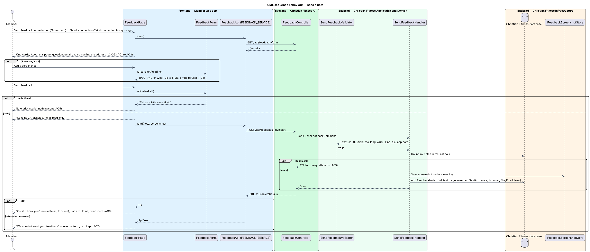

# Send feedback

## Overview

Christian Fitness is a Christian community for health in body and spirit in the Greater Toronto Area. The feedback subsystem lets members send the team ideas, problems, corrections and thanks from any page, and lets staff read, answer and resolve each one (`L1-020`).

This feature covers the member side: the Send feedback screen at `/feedback` (mock `docs/mocks/pages/feedback/`, states `default`, `broken`, `correction`, `invalid`, `submitting`, `success`, `error`). A member opens it from "Send feedback" in the footer of any member page, or from a story's "Send a correction". Staff read the notes in the [feedback inbox](../read-feedback-inbox/README.md).

- **note** — one piece of feedback a member sends: its kind, text, the page it is about, the member, the time, the device and browser family, the email choice and at most one screenshot
- **kind** — what a note is about: An idea, Something's off, A correction or Thanks
- **about this page** — the page the member came from, shown on the form and stored with the note; the member may remove it
- **device and browser family** — coarse description read from the request's `User-Agent`, such as "iPhone · Safari 18"
- **email choice** — whether the team may email the member about the note; ticked by default and naming the member's address

## Description

The feature is a vertical slice from the Send feedback screen to the database. No part of it exists in the code yet.

### Member web app

- **Route `/feedback`** — a child of the member shell behind `memberAuthGuard`, so a visitor who is not signed in (from the landing page's footer, for example) signs in first and returns (AC1, `L2-004` AC6). Title "Send feedback · Christian Fitness".
- **Entry points** — the member footer's "Send feedback" link (`L2-008` AC5, [navigate the member app](../../member-home/navigate-member-app/README.md)) passes the current path as `?from=<path>` and the page's title in the navigation state. A story's "Send a correction" (`L2-061` AC5) passes `?kind=correction&story=<slug>` (AC2). `from` is accepted only when `appPath` in `@cf/domain` (the rule return addresses use) says it is a path inside the member app.
- **`FeedbackPage`** — routed page in `projects/web/src/app/pages/feedback/`, with `FEEDBACK_SERVICE` bound on its `providers`. It composes library components only: the `choice-card` radio group "What's it about?" (four cards), the "About this page" chip with Remove, `textarea` with the question for the chosen kind, `file-field` for one screenshot (shown only for Something's off), `checkbox` "You can email me at <address>", `button` "Send feedback", `alert` for a failure, and beside the form the `feedback-row` design-system component's "You said, we did" list (AC3). On success the form is replaced by the done block "Got it. Thank you." (`role="status"`, focused) with "Back to Home" and "Send more" (AC6).
- **`FeedbackForm`** — pure helper in `domain/src/feedback/` with unit tests. It gives the question for each kind ("What would make this better?", "What happened?", "What should it say?", "What's been good?"), the starting kind ("An idea", or "A correction" when a story is given), and validates: a blank note gives "Tell us a little more first." with `aria-invalid="true"` and sends nothing (AC5); a note over 2,000 characters is named before sending; a screenshot that is not JPEG, PNG or WebP or is over 5 MB is refused with what is allowed and not uploaded (AC4). The Send button is never disabled for an empty note.
- **States** — while sending, the button reads "Sending…", is disabled and the fields are read-only (mock `submitting`). A refusal or no answer shows "We couldn't send your feedback" above the form and keeps everything written (AC7, mock `error`); `too_many_attempts` shows the same alert with its own sentence (`<TO SUPPLY>` copy).
- **`FeedbackApi` / `FEEDBACK_SERVICE`** — contract and token in `api/src/feedback/feedback.ts`: `form()` answers `FeedbackFormDto` (the member's address for the email choice); `send(note, screenshot?)` answers `void`. `HttpFeedbackService` sends `GET /api/feedback/form` and `POST /api/feedback` as `multipart/form-data`.

### Christian Fitness API

- **`FeedbackController`** — `GET /api/feedback/form` sends `GetFeedbackFormQuery`; `POST /api/feedback` sends one `SendFeedbackCommand` built from the form fields and the uploaded file. It requires a member session and checks nothing.
- **`SendFeedbackCommand`** — a class, not a record, so no generated `ToString` can print the text (as `EmailMessage` and the report command). It carries `Kind`, `Text`, `PagePath`, `PageTitle`, `StorySlug`, `MayEmail` and the screenshot's bytes.
- **`SendFeedbackValidator`** — refuses a blank text and an unknown kind with 400 `validation_failed`; a text over 2,000 characters with `fieldCodes.text` = `field_too_long` (AC8); a screenshot over 5 MB or whose content signature is not JPEG, PNG or WebP with `fieldCodes.screenshot` = `<TO SUPPLY>` code; a screenshot on a kind other than Something's off with `validation_failed`; a page path that is not an app path with `validation_failed`.
- **`SendFeedbackHandler`** — counts the caller's notes since `FeedbackNote.SendWindow.Since(now)`, an `AttemptWindow(10, 1 hour)`, and refuses the eleventh with 429 `too_many_attempts` (AC9). It reads the device and browser family through a new `IClientDevice` abstraction (beside `IClientAddress`), which keeps only the family and major version, never the raw `User-Agent`. It saves the screenshot under a new key in the private `IFeedbackScreenshotStore` and adds a `FeedbackNote` with status New, then saves once (AC6). Time comes from `TimeProvider`.
- **`FeedbackNote`** — new entity in `ChristianFitness.Domain/Feedback/`: `Id` (version 7), `MemberId`, `Kind` (`FeedbackKind`: `Idea`, `Problem`, `Correction`, `Thanks`), `Text` (at most 2,000), `PagePath?`, `PageTitle?`, `StorySlug?`, `MayEmail`, `Device`, `Browser`, `ScreenshotKey?`, `Status` (`FeedbackStatus`: `New`, `Replied`, `Resolved`), `SentAt`. `IAppDbContext.FeedbackNotes` and migration `AddFeedback` add it; an index on (`MemberId`, `SentAt`) serves the rate window and one on (`Status`, `SentAt`) the inbox.
- **`IFeedbackScreenshotStore`** — the shape of `IImageStore` (keys are new GUIDs plus the extension the content's signature gave, so no client text reaches a path), on its own private directory, served only by the staff endpoint of the inbox (AC10, `L2-074` AC8). Its directory is a setting documented in `docs/operations/settings.md` in the same change.
- **`GetFeedbackFormQuery`** — answers the caller's email so the checkbox can name it; the address is never logged.
- **Telemetry** — the route templates `api/feedback` and `api/feedback/form` only; no span, metric or log carries the note's text, the page's title, the screenshot or the member's address (AC10, `L2-033` AC2).
- **Reply delivery (AC11)** — designed in the [feedback inbox](../read-feedback-inbox/README.md): email when `MayEmail`, otherwise a direct message from Christian Fitness.

### Open questions

- **"You said, we did".** AC3 lists recent changes that began as feedback, but no requirement or console screen says who writes them or where they are stored. The design bundles them as static content in the member app until a requirement settles it.
- **Kind names.** The member form says An idea, Something's off, A correction and Thanks; the inbox mock says Idea, Something's broken, Content and Praise. One set of names should serve both, as `L2-074` AC1 shows "an icon and name for its kind".
- **About this page for a story.** The story is identified by its slug here; the inbox's "Open the story to correct it" needs the story's id or a slug that survives a changed link (`L2-061` AC8). The story design should settle which.
- **Suspended members.** `L2-062` AC11 refuses a suspended member's suggestion; `L2-063` says nothing about feedback. `<TO SUPPLY>`.
- **Screenshot refusal code.** `L2-063` AC4 names no code for a refused file; the validator needs one, and the event image upload's codes ([ADR 0025](../../../adr/0025-edit-an-event.md)) are the nearest precedent.
- **Device detail.** AC6 says "device and browser family"; the inbox mock shows a version ("Safari 18"). The design keeps the major version only.
- **Design-system blocks (resolved).** The mock's `context-chip` ("About this page") and the success `done` block are documented on the design-system page `steps`; the components are built from it.

## Requirements

The feature realizes the following level-2 (L2) requirements. Each L2 requirement refines a level-1 (L1) requirement, cited by identifier. The L2 specification states its requirements as acceptance criteria; the text below condenses those criteria faithfully.

| L2 ID | Refines (L1) | Requirement |
|-------|--------------|-------------|
| `L2-063` | `L1-020` | 1. "Send feedback" in the footer of any member page shall open `/feedback` with the page the member came from as "About this page", which they can remove; a visitor shall sign in first and return. 2. A story's "Send a correction" shall choose "A correction" with the story as the page. 3. The form shall ask what it is about as one radio group (An idea; Something's off; A correction; Thanks), with "An idea" chosen unless AC2 applies, a note whose question follows the choice, and whether the team may email the member (ticked by default, naming the address); beside it "You said, we did" lists recent changes that began as feedback. 4. With "Something's off", one JPEG, PNG or WebP screenshot of at most 5 MB may be added, named once chosen, with Remove; another type or size shall be refused with what is allowed and not uploaded. 5. An empty or blank note shall send nothing and mark the note `aria-invalid="true"` with "Tell us a little more first."; the button is never disabled for an empty note. 6. Sending shall show "Sending…" disabled, store the note with its kind, page, member, time, device and browser family and the email choice, and replace the form with "Got it. Thank you." (`role="status"`, focused) with "Back to Home" and "Send more". 7. A server failure shall say so above the form and keep what was written. 8. A note over 2,000 characters shall be refused 400 `validation_failed` with `fieldCodes.text` = `field_too_long`. 9. More than 10 notes from one member in an hour shall be refused `too_many_attempts` with HTTP 429. 10. Only staff shall read a note and its screenshot, and no span, metric or log shall carry the text, the page's title, the screenshot or the address. 11. A staff reply shall reach the member by email when they allowed it, else as a direct message from Christian Fitness. |
| `L2-032` | `L1-013` | 1. A body that fails validation shall be answered 400 ProblemDetails with a `code` and field errors, and the screen shall show a generic message. |
| `L2-033` | `L1-013` | 2. No log, metric or span shall contain an email, name, message text, token, query string or body. |

## Diagrams

### System context

A member sends feedback to Christian Fitness from any page; staff read it in the admin console. Telemetry leaves without the note, its page or the member's address.

### Containers

The Member web app posts the note and its screenshot to the API, which stores the note in the database and the screenshot on private storage.

### Components

`FeedbackController` sends `SendFeedbackCommand`; the validator checks text, kind and file, and the handler applies the hourly window, reads the device family, stores the screenshot and adds the `FeedbackNote`.

### Class structure

`FeedbackPage` depends on the `FeedbackApi` contract and on `FeedbackForm`; `SendFeedbackHandler` creates a `FeedbackNote` of a `FeedbackKind`.

### Behaviour — send a note

The form checks the note and the file before sending; the server validates, limits, stores and answers, and the form becomes the thank-you message or keeps the text with a failure message.

