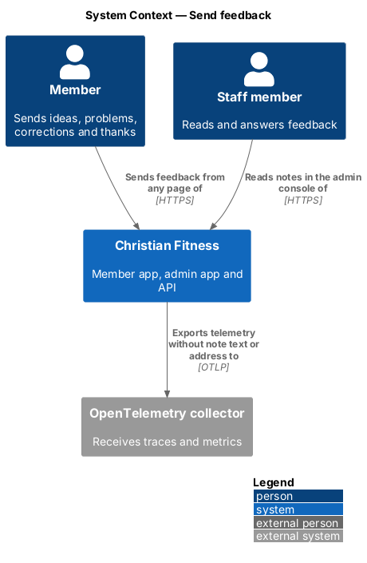
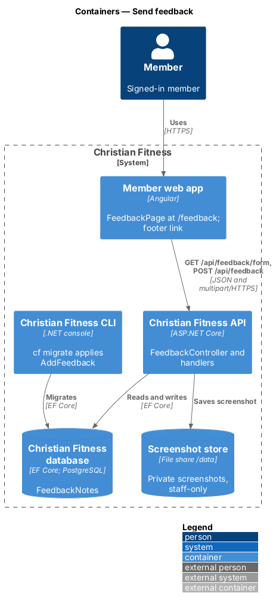
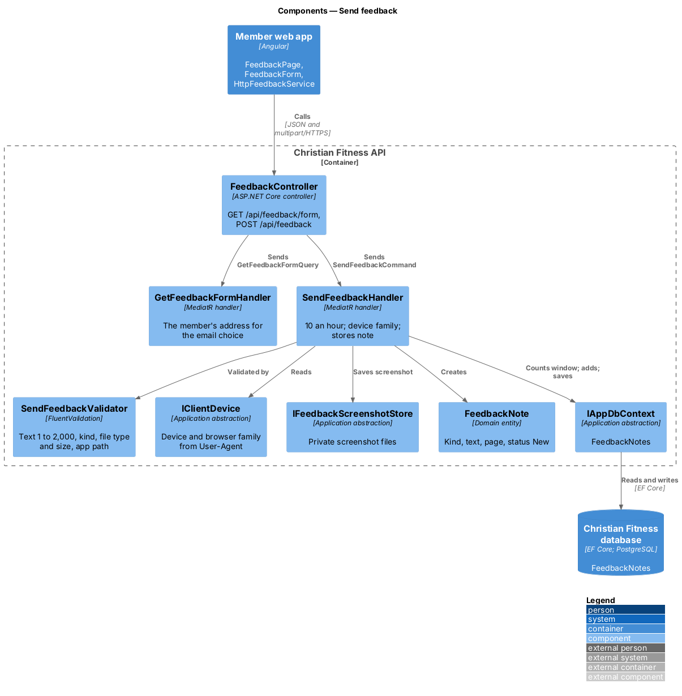
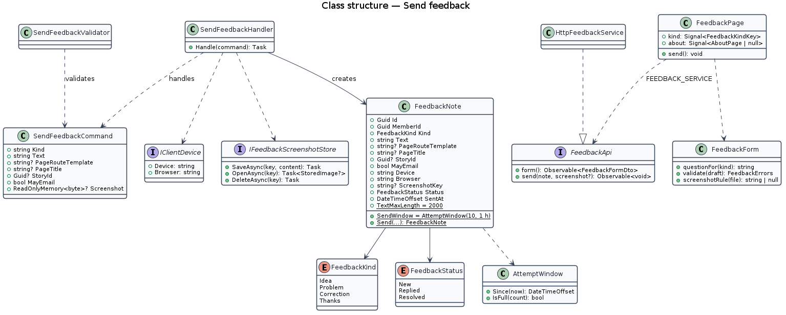

# Send feedback

## Overview

Christian Fitness is a Christian community for health in body and spirit in the Greater Toronto Area. The feedback subsystem lets members send the team ideas, problems, corrections and thanks from any page, and lets staff read, answer and resolve each one (`L1-020`).

This feature covers the member side: the Send feedback screen at `/feedback` (mock `docs/mocks/pages/feedback/`, states `default`, `broken`, `correction`, `invalid`, `submitting`, `success`, `error`). A member opens it from "Send feedback" in the footer of any member page, or from a story's "Send a correction". Staff read the notes in the [feedback inbox](../read-feedback-inbox/README.md).

- **note** — one piece of feedback a member sends: its kind, text, the page it is about, the member, the time, the OS family and browser family and major version, the email choice and at most one screenshot
- **kind** — what a note is about: Idea (`idea`), Something's off (`problem`), Correction (`correction`) or Thanks (`thanks`); the inbox uses the same names and codes
- **about this page** — the page the member came from, shown on the form and stored with the note; the member may remove it
- **device detail** — OS family and browser family and major version read from the request's `User-Agent`, such as "iOS · Safari 18"; nothing finer or the raw header is stored
- **email choice** — whether the team may email the member about the note; ticked by default and naming the member's address

## Description

The feature is a vertical slice from the Send feedback screen to the database. No part of it exists in the code yet.

### Member web app

- **Route `/feedback`** — a child of the member shell behind `memberAuthGuard`, so a visitor who is not signed in (from the landing page's footer, for example) signs in first and returns (AC1, `L2-004` AC6). Title "Send feedback · Christian Fitness".
- **Entry points** — the member footer's "Send feedback" link (`L2-008` AC5, [navigate the member app](../../member-home/navigate-member-app/README.md)) passes `?about=page:<route-template>` (on a story, `page:stories/:slug`). A story's "Send a correction" (`L2-061` AC5) passes `?about=story:<id>&kind=correction` (AC2). The query is preserved through sign-in and reload; the title is resolved separately, not carried only in navigation state ([ADR 0071](../../../adr/0071-addresses-and-slugs.md)). A page template gives a page-type label, not a specific event or series name. Only known app route templates and valid story ids are accepted.
- **`FeedbackPage`** — routed page in `projects/web/src/app/pages/feedback/`, with `FEEDBACK_SERVICE` bound on its `providers`. It composes library components only: the `choice-card` radio group "What's it about?" (four cards), the "About this page" chip with Remove, `textarea` with the question for the chosen kind, `file-field` for one screenshot (shown only for Something's off), `checkbox` "You can email me at <address>", `button` "Send feedback", `alert` for a failure, and beside the form the `feedback-row` design-system component's "You said, we did" list (AC3). On success the form is replaced by the done block "Got it. Thank you." (`role="status"`, focused) with "Back to Home" and "Send more" (AC6).
- **"You said, we did"** — Admins write the recent changes as static content bundled in the member app for now. This is a stand-in; the content later becomes a story section (AC3).
- **`FeedbackForm`** — pure helper in `domain/src/feedback/` with unit tests. It gives the question for each kind ("What would make this better?", "What happened?", "What should it say?", "What's been good?"), the starting kind ("Idea", or "Correction" when a story is given), and validates: a blank note gives "Tell us a little more first." with `aria-invalid="true"` and sends nothing (AC5); a note over 2,000 characters is named before sending; a screenshot that is not JPEG, PNG or WebP or is over 5 MB is refused with what is allowed and not uploaded (AC4). The Send button is never disabled for an empty note.
- **States** — while sending, the button reads "Sending…", is disabled and the fields are read-only (mock `submitting`). A refusal or no answer shows "We couldn't send your feedback" above the form and keeps everything written (AC7, mock `error`); `too_many_attempts` shows the same alert with its own sentence (`<TO SUPPLY>` copy).
- **`FeedbackApi` / `FEEDBACK_SERVICE`** — contract and token in `api/src/feedback/feedback.ts`: `form()` answers `FeedbackFormDto` (the member's address for the email choice); `send(note, screenshot?)` answers `void`. `HttpFeedbackService` sends `GET /api/feedback/form` and `POST /api/feedback` as `multipart/form-data`.

### Christian Fitness API

- **`FeedbackController`** — `GET /api/feedback/form` sends `GetFeedbackFormQuery`; `POST /api/feedback` sends one `SendFeedbackCommand` built from the form fields and the uploaded file. It requires a member session and checks nothing.
- **`SendFeedbackCommand`** — a class, not a record, so no generated `ToString` can print the text (as `EmailMessage` and the report command). It carries `Kind`, `Text`, `PageRouteTemplate`, `PageTitle`, `StoryId`, `MayEmail` and the screenshot's bytes.
- **`SendFeedbackValidator`** — refuses a blank text and an unknown kind with 400 `validation_failed`; a text over 2,000 characters with `fieldCodes.text` = `field_too_long` (AC8); a screenshot over 5 MB with `fieldCodes.screenshot` = `image_too_large` or whose content signature is not JPEG, PNG or WebP with `image_type_not_allowed` (400 `validation_failed`, AC4); a screenshot on a kind other than Something's off with `validation_failed`; an unknown app route template or invalid story id with `validation_failed`.
- **`SendFeedbackHandler`** — accepts feedback from suspended members under the same validation and rate rules, as a route to appeal (AC12). It counts the caller's notes since `FeedbackNote.SendWindow.Since(now)`, an `AttemptWindow(10, 1 hour)`, and refuses the eleventh with 429 `too_many_attempts` (AC9). It reads the OS family and browser family and major version through a new `IClientDevice` abstraction (beside `IClientAddress`), retaining nothing finer or the raw `User-Agent`. It saves the screenshot under a new key in the private `IFeedbackScreenshotStore` and adds a `FeedbackNote` with status New, then saves once (AC6). Time comes from `TimeProvider`.
- **`FeedbackNote`** — new entity in `ChristianFitness.Domain/Feedback/`: `Id` (version 7), `MemberId`, `Kind` (`FeedbackKind`: `Idea`, `Problem`, `Correction`, `Thanks`, serialized as `idea`, `problem`, `correction`, `thanks`), `Text` (at most 2,000), `PageRouteTemplate?`, `PageTitle?`, `StoryId?`, `MayEmail`, `Device` (OS family), `Browser` (family and major version), `ScreenshotKey?`, `Status` (`FeedbackStatus`: `New`, `Replied`, `Resolved`), `SentAt`. `IAppDbContext.FeedbackNotes` and migration `AddFeedback` add it; an index on (`MemberId`, `SentAt`) serves the rate window and one on (`Status`, `SentAt`) the inbox.
- **`IFeedbackScreenshotStore`** — the shape of `IImageStore` (keys are new GUIDs plus the extension the content's signature gave, so no client text reaches a path), on its own private directory, served only by the staff endpoint of the inbox (AC10, `L2-074` AC8). Its directory is a setting documented in `docs/operations/settings.md` in the same change.
- **`GetFeedbackFormQuery`** — answers the caller's email so the checkbox can name it; the address is never logged.
- **Telemetry** — the route templates `api/feedback` and `api/feedback/form` only; no span, metric or log carries the note's text, the page's title, the screenshot or the member's address (AC10, `L2-033` AC2).
- **Reply delivery (AC11)** — designed in the [feedback inbox](../read-feedback-inbox/README.md): email when `MayEmail`, otherwise a direct message from Christian Fitness.

### Open questions

- **Suspended-member access (decided in [ADR 0109](../../../adr/0109-send-feedback.md)).** AC12 permits feedback as an appeal, but `L2-004` AC4 and AC10 refuse suspended sign-in and `L2-029` AC2 ends sessions on suspension. The handler applies no suspension check, so a suspended member whose session is still alive can send; an appeal route that works without a session needs those requirements to change and is left to a later decision.
- **Decisions.** [ADR 0109](../../../adr/0109-send-feedback.md) records the address of what a note is about, the server-resolved label, the multipart contract, the field codes (`kind_invalid`, `text_required`, `field_too_long`, `about_invalid`, `image_too_large`, `image_type_not_allowed`, `screenshot_not_allowed`), the hourly limit, the device families and the private screenshot store.
- **Design-system blocks (resolved).** The mock's `context-chip` ("About this page") and the success `done` block are documented on the design-system page `steps`; the components are built from it.

## Requirements

The feature realizes the following level-2 (L2) requirements. Each L2 requirement refines a level-1 (L1) requirement, cited by identifier. The L2 specification states its requirements as acceptance criteria; the text below condenses those criteria faithfully.

| L2 ID | Refines (L1) | Requirement |
|-------|--------------|-------------|
| `L2-063` | `L1-020` | The member shall send feedback from any page, choosing Idea (`idea`), Something's off (`problem`), Correction (`correction`) or Thanks (`thanks`). Admins write the static "You said, we did" content for now, later a story section. Screenshot refusals shall use `image_too_large` or `image_type_not_allowed`; the note shall store OS family and browser family and major version, nothing finer. Suspended members shall be allowed to send feedback as an appeal. The [acceptance criteria](../../../specs/L2.md#l2-063-send-feedback) specify the form, validation, privacy, rate limit and reply delivery. |
| `L2-032` | `L1-013` | 1. A body that fails validation shall be answered 400 ProblemDetails with a `code` and field errors, and the screen shall show a generic message. |
| `L2-033` | `L1-013` | 2. No log, metric or span shall contain an email, name, message text, token, query string or body. |

## Diagrams

### System context

A member sends feedback to Christian Fitness from any page; staff read it in the admin console. Telemetry leaves without the note, its page or the member's address.

### Containers

The Member web app posts the note and its screenshot to the API, which stores the note in the database and the screenshot on private storage.

### Components

`FeedbackController` sends `SendFeedbackCommand`; the validator checks text, kind and file, and the handler applies the hourly window, reads the device family, stores the screenshot and adds the `FeedbackNote`.

### Class structure

`FeedbackPage` depends on the `FeedbackApi` contract and on `FeedbackForm`; `SendFeedbackHandler` creates a `FeedbackNote` of a `FeedbackKind`.

### Behaviour — send a note

The form checks the note and the file before sending; the server validates, limits, stores and answers, and the form becomes the thank-you message or keeps the text with a failure message.

