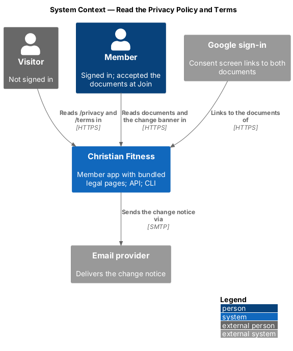
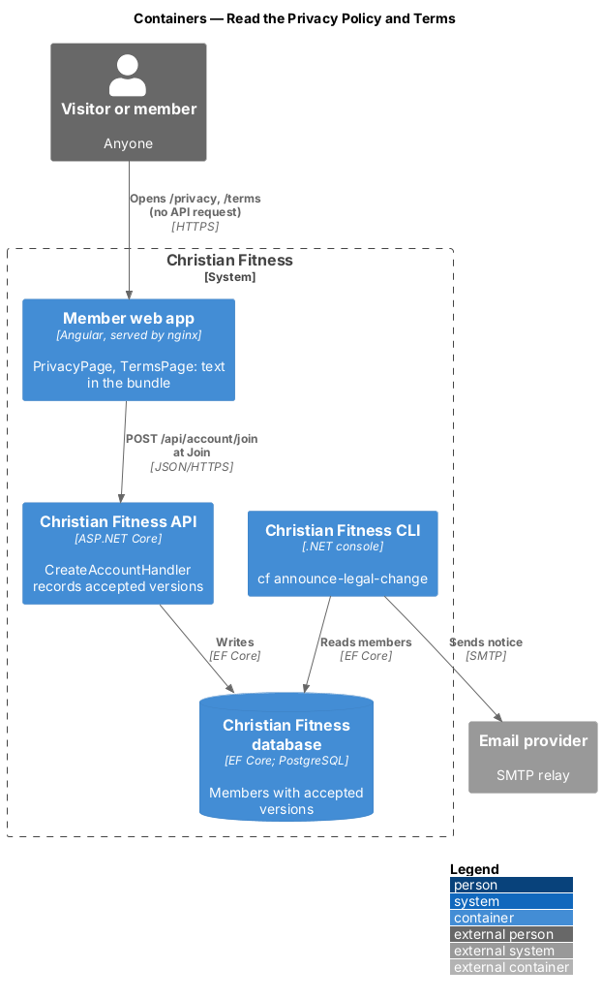
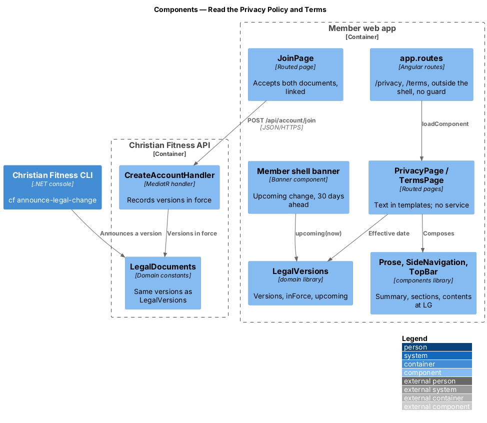
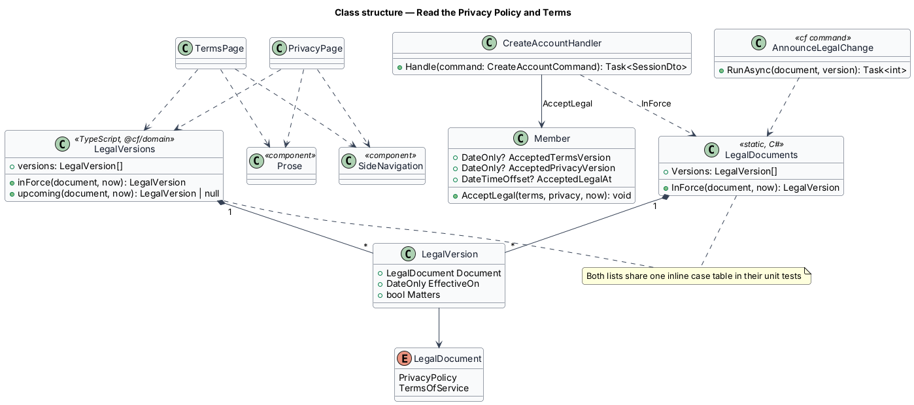
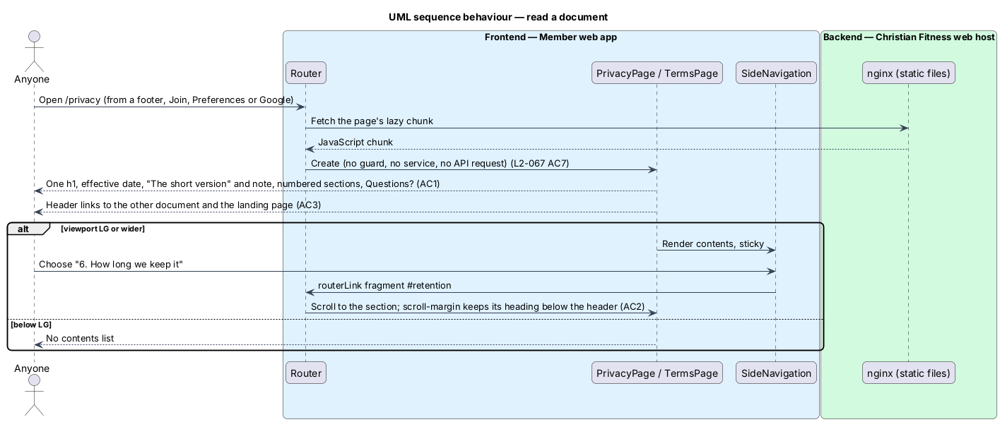
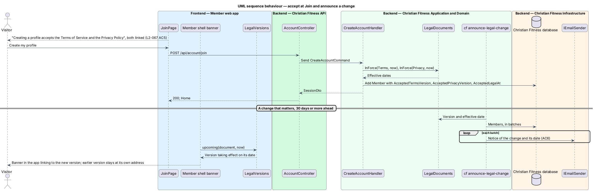

# Read the Privacy Policy and Terms of Service

## Overview

Christian Fitness is a Christian community for health in body and spirit in the Greater Toronto Area. The legal subsystem publishes the Privacy Policy and the Terms of Service where anyone can read them, each with a plain-language summary, and links them wherever a person joins or signs in (`L1-021`).

This feature covers the two documents' pages, `/privacy` and `/terms` (mocks `docs/mocks/pages/privacy/` and `docs/mocks/pages/terms/`), the links to them, the record of which versions a member accepted at Join, and the notice of a change that matters.

- **legal document** — the Privacy Policy or the Terms of Service
- **version** — one text of a legal document, identified by the date it takes effect (for example 1 April 2026)
- **version in force** — the latest version whose effective date has passed
- **short version** — the document's list of plain-language points under "The short version", with a note that the full text is what applies
- **change that matters** — new version that changes what a member agrees to or how their data is handled; it is announced at least 30 days before it takes effect

## Description

### Member web app

- **Routes `/privacy` and `/terms`** — top-level routes in `projects/web/src/app/app.routes.ts`, outside the member shell and with no guard, so anyone can open them signed in or not (AC1). Each uses `loadComponent` and a title ("Privacy Policy · Christian Fitness", "Terms of Service · Christian Fitness"). Earlier versions live at `/privacy/<yyyy-mm-dd>` and `/terms/<yyyy-mm-dd>` (AC6); they are static HTML files served beside the app, not part of its bundle ([ADR 0061](../../../adr/0061-legal-page-versioning.md)).
- **`PrivacyPage`, `TermsPage`** — routed pages in `projects/web/src/app/pages/privacy/` and `pages/terms/`. The document's text is written in the page's template, so the page loads with its own lazy chunk and makes no API request; it has no service, no loading state and no error state, and works when the app's data requests fail (AC7). Each page composes the public `top-bar` (lockup leading to the landing page and a link to the other document; AC3), a back link to the landing page, the title as the page's one `h1`, the effective date, the design-system `prose` component (the short version with its note, then the numbered sections), and "Questions?" with the team's email, postal address and a link to Send feedback (AC1).
- **Contents list** — the design-system `side-navigation` component, numbered, shown only at LG and wider and sticky there; below LG it is hidden (AC2). Each entry is a `routerLink` to the page's own route with a `fragment`, since a bare `href="#id"` resolves against the base URL; the router's `anchorScrolling` moves to the section. Each section heading carries `scroll-margin-top` from the layout token for the header's height, so it is not hidden under the header (AC2).
- **`LegalVersions`** — pure constants in the `domain` library (`domain/src/legal/legal-versions.ts`) with unit tests: each document's versions with their effective dates, `inForce(document, now)` and `upcoming(document, now)`. The pages, the banner and Join read them.
- **Links** — the landing page's `site-footer` (`L2-001` AC9) and the member app's footer (`L2-008` AC5) link to both documents; Preferences links to the Privacy Policy ([download and delete data](../../preferences/download-and-delete-data/README.md)); Join states that creating a profile accepts the Terms of Service and the Privacy Policy, with both linked ([create an account](../../member-access/create-account/README.md)) (AC4, AC5). Google's consent screen links to both through the OAuth client's settings in Google Cloud, which shall be documented with the deployment (`L2-041`, `L2-049`) (AC4).
- **Change banner** — the member shell shows the library's `banner` while `LegalVersions.upcoming` names a version taking effect within the next 30 days or more, with a link to it (AC6). The banner's text and its dismissal are `<TO SUPPLY>`: no mock draws it. Continued use after the effective date is acceptance: no blocking screen and no per-member acceptance record (ADR 0061).

### Christian Fitness API

- **Acceptance at Join** — `Member` gains `AcceptedTermsVersion`, `AcceptedPrivacyVersion` (`DateOnly`, the effective dates) and `AcceptedLegalAt`. `CreateAccountHandler`, and the Google "Finish your profile" handler of `L2-003` AC9, record the versions in force at that moment from the server's own `LegalDocuments` constants, never from a value the browser sends (AC5). Migration `AddLegalAcceptance` adds the columns; existing members keep none.
- **`LegalDocuments`** — constants in `ChristianFitness.Domain/Legal/` listing the same versions and dates as `LegalVersions` in `@cf/domain`. One inline case table of versions serves the unit tests of both stacks, so the two lists cannot drift (AGENTS.md, "a rule computed in both stacks").
- **Change notice email** — a CLI command `cf announce-legal-change <document> <version>` sends one `EmailMessage` to every member through `IEmailSender` in bounded batches, at least 30 days before the effective date (AC6). It logs only the count sent. It is a service notice (transactional under CASL), so it reaches every member whatever their email preferences say (`L2-064` AC3; [preferences](../../preferences/set-email-and-notification-preferences/README.md)).
- **Truth of the text** — before either page is published, each statement it makes about the system shall be checked against the deployed system (AC8). Each row below has its evidence or the change made to the text (decided 2026-11-24; mocks README open question 12, closed). The team's address is `privacy@christian.fitness` (the deployed domain, ADR 0047) and the postal address is the one in the mocks:

| Statement in the mocks | Evidence or change | Status |
|---|---|---|
| Data stored in Canada | `docs/operations/deployment.md`: resource group `rg-christian-fitness` in Canada Central. The text adds that the email delivery provider may process email addresses outside Canada | True |
| Encrypted in transit and at rest | HTTPS with HSTS (`L2-030` AC4); at rest by Azure's default encryption (SQL TDE, Storage SSE) | True |
| Staff access is logged | `AuditEntry` records staff changes, not staff reads | Text changed: the claim is removed; staff access is "limited to the team members who need it" |
| Deletion completed within 30 days | [Download and delete data](../../preferences/download-and-delete-data/README.md) erases after 30 days | True once built |
| Payment receipts kept seven years; refunds for cancelled paid events | No online payment (`L2-011` AC5) and no receipts | Text removed. Terms: any fee is paid to the host directly, under the host's own terms |
| Cancel up to 48 hours before a paid event | The event page says 24 hours | Text changed to 24 hours before an event starts, with no mention of payment |
| Minimum age 16 | Join and "Finish your profile" gain a required "I'm 16 or older" checkbox, no date of birth stored (`L2-003` AC12; [create a member account](../../member-access/create-account/README.md)) | True once built |
| Event hosts see the name and email of registrants | No host access exists (`L2-065` AC4); staff see registrations (`L2-024`) | Text changed: "The Christian Fitness team runs events and sees who has registered." Revisit when host access ships |
| Device type, browser and approximate location from the IP address | Feedback keeps device and browser family (`L2-063`); rate limits read the address and keep no location | Partly true: wording to be aligned when the slice is built |
| Church, faith details and health goals shown only to the people chosen in Preferences | Home church follows Edit profile's switch (`L2-006` AC4); goals are never public | Wording differs: the text now says they are not shared with other members unless put on the public profile |
| Newsletter tracking | The email carries no tracking image and no redirected link; links go straight to their target ([build and schedule the newsletter](../../publishing/build-and-schedule-newsletter/README.md)) | True |
| New versions are announced 30 days ahead; earlier versions stay readable | `cf announce-legal-change` and the banner; ADR 0061 | True once built |

### Open questions

- **Banner copy.** The change banner's wording and mock are `<TO SUPPLY>`.
- **Statements to build.** Rows marked "once built" are true when their slices ship (age confirmation, deletion, the notice command); the text shall not be published before them (AC8).
- **Who writes the text.** The documents live in the app's source, so a change ships as a release; no console screen edits them.

## Requirements

The feature realizes the following level-2 (L2) requirements. Each L2 requirement refines a level-1 (L1) requirement, cited by identifier. The L2 specification states its requirements as acceptance criteria; the text below condenses those criteria faithfully.

| L2 ID | Refines (L1) | Requirement |
|-------|--------------|-------------|
| `L2-067` | `L1-021` | 1. Anyone, signed in or not, opening `/privacy` or `/terms` shall see the document's title as its one `h1`, its effective date, "The short version" as plain-language points with a note that the full text applies, the numbered sections, and who to ask, with the team's email, postal address and a link to Send feedback. 2. At LG or wider a contents list shall stay in view and move to each section without hiding its heading under the header; below LG it shall not show. 3. Each page's header shall link to the other document and back to the landing page. 4. The landing page's footer, the member app's footer, Preferences and Google's consent screen shall link to the Privacy Policy, and all but Preferences to the Terms of Service. 5. Join shall say that creating a profile accepts both documents, with both linked, and the versions in force shall be recorded with the account. 6. A change that matters shall be emailed to members, as a service notice sent whatever their email preferences, and announced by a banner in the app at least 30 days before it takes effect; continued use accepts it; earlier versions shall stay readable as static files at dated addresses. 7. The documents shall be static pages bundled with the app, loading without an API request, working with data requests failing, and showing no loading or error state. 8. Each statement about the system shall be true of the deployed system before the page is published. |
| `L2-038` | `L1-015` | The pages shall meet WCAG 2.2 AA: one `h1`, headings in order, and a contents list that works by keyboard and touch. |

## Diagrams

### System context

Anyone reads the legal documents in Christian Fitness; Google's consent screen links to them; members receive the change notice by email.

### Containers

The documents travel in the Member web app's bundle and need no API. The API records accepted versions at Join; the CLI sends the change notice.

### Components

`PrivacyPage` and `TermsPage` compose `prose`, `side-navigation` and the public `top-bar`, reading `LegalVersions`; `CreateAccountHandler` records the versions of `LegalDocuments`.

### Class structure

`LegalVersions` and `LegalDocuments` hold the same versions in both stacks; `Member` keeps the versions accepted.

### Behaviour — read a document

The route loads the page's chunk and renders the text with no request; the contents list moves to each section.

### Behaviour — accept at Join and announce a change

Join records the versions in force from the server's own list; a later version is announced by email and banner at least 30 days ahead.

