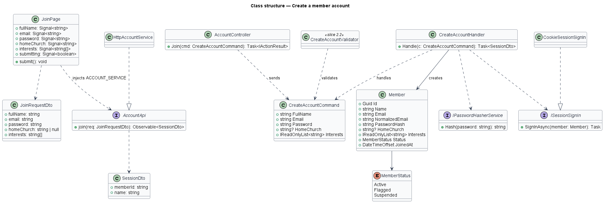

# Create a member account

## Overview

A *member account* is the record that lets a person sign in to the Member web app
and appear in the community. This feature covers the Join screen at `/join`, where a
visitor becomes a member. It belongs to the member-access subsystem.

- **member** — person with an account who has signed in
- **home church** — optional name of the congregation a member attends; sensitive
  personal data, never required and never logged
- **interest** — activity category a member follows, such as runs or basketball

The visitor gives full name, email, a password of at least 8 characters, an
optional home church and optional interests. A valid submission creates the
account, signs the visitor in and opens Home. A duplicate email (compared
case-insensitively) or invalid fields create nothing and are named on the form.

## Description

Slice 2.1 builds the happy path (L2-003 AC1, AC4, AC5); slice 2.2 adds the refusals (AC2, AC3,
AC6) and the failed state. Decisions are in [ADR 0007](../../../adr/0007-join-session-and-home-stand-in.md).

- **`JoinPage`** — lazy routed page at `/join` in `projects/web`, titled "Join · Christian
  Fitness". It holds one signal per field and renders the mock's blocks through presentation
  components: `AuthLayout` (`auth`, with the brand panel, the heading "Create your profile", the
  lead and "Already a member? Sign in"), `TextField` (`field`, `field__label`, `input`,
  `field__hint`) for Full name, Email, Password ("At least 8 characters") and Home church
  ("Optional — helps you find people nearby"), `InterestPicker` and `Button`. On submit it sends
  the `JoinRequestDto` and navigates to `/home` when the answer arrives (L2-003 AC1). While
  submitting, the button reads "Creating your profile…" with a spinner, is `disabled` and
  `aria-busy="true"`, the inputs are `readonly` and the interests `disabled`, as the mock's
  `submitting` state shows (L2-003 AC5). Client validation that names each invalid field with
  `aria-invalid="true"` (L2-003 AC3) is slice 2.2's, as a pure helper in `domain`.
- **`AuthLayout`** — presentation component (`cf-auth-layout`): the `auth` block with its brand
  panel, the page's one `main` and the `auth__form`; inputs `heading`, `lead`, `altText`,
  `altLink`, `altHref`; the fields and the submit button are projected through `[slot=fields]`
  and `[slot=submit]`; output `submitted` when the form is submitted. Sign-in (slice 3.1) reuses it.
- **`TextField`** — presentation component (`cf-text-field`): one `field` with its label, input
  and optional hint; inputs `fieldId`, `label`, `type`, `name`, `autocomplete`, `hint`, `value`,
  `readonly`; output `valueChange`.
- **`InterestPicker`** — presentation component (`cf-interest-picker`) rendering the fieldset,
  the legend "What are you into?" and one `interest` toggle per option with `aria-pressed`;
  inputs `legend`, `options`, `selected`, `disabled`; output `selectedChange`.
- **`Button`** — gains a `<button>` branch: without `href` it renders `<button>` with `type`,
  `disabled` and `busy` (`aria-busy`) and sizes `lg` and `block`; both branches show the same
  projected content through one `ng-template`.
- **`AccountApi` / `ACCOUNT_SERVICE`** — contract and token in `api`: `join(request:
  JoinRequestDto): Observable<SessionDto>`. `JoinRequestDto` is `fullName`, `email`, `password`,
  `homeChurch` (`null` when blank) and `interests` (keys). `INTERESTS` lists the eight interests
  as `{ key, label }`: `running` Running, `strength` Strength, `basketball` Basketball,
  `walking-groups` Walking groups, `mobility` Mobility, `nutrition` Nutrition, `cycling` Cycling,
  `retreats` Retreats. `HttpAccountService` in the member app posts to `/api/account/join` and is
  bound in `app.config.ts`.
- **`AccountController`** — `[AllowAnonymous]` `POST /api/account/join`. It sends one
  `CreateAccountCommand` and answers `201 Created` with the `SessionDto` (`memberId`, `name`) and
  the session cookie.
- **`CreateAccountValidator`** (slice 2.2) — FluentValidation: name required and at most 100
  characters, email well formed, password at least 8 characters, home church at most 120
  characters, interests among `Interests.All`. Over-length fields return code `field_too_long`
  (L2-003 AC6).
- **`CreateAccountHandler`** — hashes the password through `IPasswordHasherService` (ASP.NET Core
  Identity's PBKDF2 hasher), stores a `Member` with `Status = Active`, `HomeChurch` null when
  blank or white space (L2-003 AC4) and the distinct interest keys, saves once, signs the member
  in through `ISessionSignIn` and returns the `SessionDto`. Slice 2.2 adds the duplicate check:
  the email's lookup key (`NormalizedEmail`, trimmed and lower case) already stored returns code
  `email_taken` with HTTP 409 (L2-003 AC2).
- **`CookieSessionSignIn`** — infrastructure implementation of `ISessionSignIn`: it signs the
  member in with the cookie scheme, a principal holding only the member id, persistent for 14
  days and sliding (`__Host-cf-session`, `Secure`, `HttpOnly`, `SameSite=Lax`; see
  `security/secure-sessions`).
- **`Member`** — gains `HomeChurch` (nullable, at most 120 characters) and `Interests` (keys).
- **Home** — the member lands on `/home`, a stand-in until slice 13.1: the greeting "Welcome,
  {first name}" from `GET /api/session` (ADR 0007).
- **Error mapping** (slice 2.2) — `JoinPage` branches on `code`: `email_taken` shows "An account
  with this email already exists. Sign in instead?" on the email field; other codes show a
  generic `form-alert`. The code for a duplicate email is `email_taken`, answered with 409.
- **Telemetry** — no span or log carries the name, the email, the password, the home church or
  the request body; the request's span records the route template `account/join` (L2-033 AC2).

## Requirements

The feature realizes the following level-2 (L2) requirements. Each L2
requirement refines a level-1 (L1) requirement, cited by identifier.

| L2 ID | Refines (L1) | Requirement |
|-------|--------------|-------------|
| `L2-003` | `L1-002` | A visitor joins with full name, email, password, optional home church and optional interests. |
| `L2-030` | `L1-013` | 1. Given any account, when its password is stored, then it is hashed with ASP.NET Core Identity's PBKDF2 hasher and never logged or returned. 2. Given session cookies, when set, then they are `Secure`, `HttpOnly`, `SameSite=Lax` or stricter, and use the `__Host-` prefix. |
| `L2-033` | `L1-013` | 1. Given home church and faith details, when a member joins, then they are optional. 2. Given any log, metric or span, when emitted, then it contains no email, name, home church, message text, token, query string or body. |

## Diagrams

### System context

The visitor reaches Christian Fitness over HTTPS; the system exports telemetry to an OpenTelemetry collector.

### Containers

The Member web app calls the Christian Fitness API, which reads and writes the Christian Fitness database. The Christian Fitness CLI applies migrations and seed data; the API does not migrate on startup.

### Components

The components below are the parts this slice touches in the Member web app and the Christian Fitness API; each controller sends one MediatR request.

### Class structure

The class diagram shows the frontend contract and its HTTP implementation, the request and handler types and the domain entities they read or change.

### Behaviour — create an account

The validator refuses over-length fields with `field_too_long`; the handler refuses a case-insensitive duplicate email; a valid join creates the member, signs them in and opens Home (`L2-003`).

