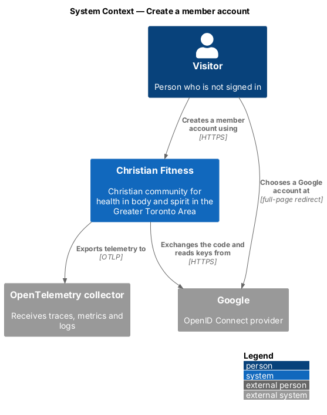
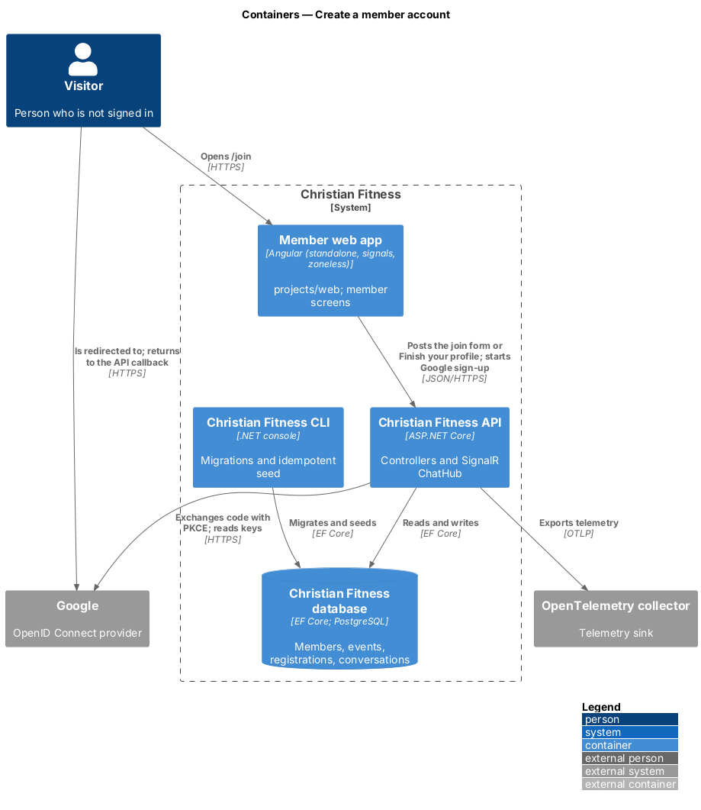
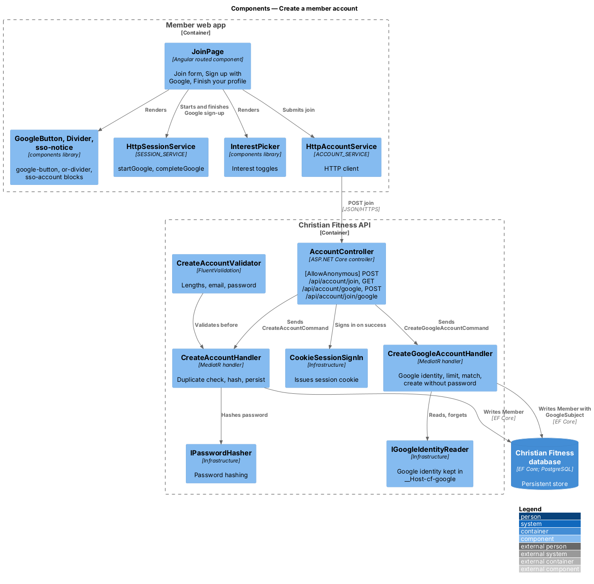
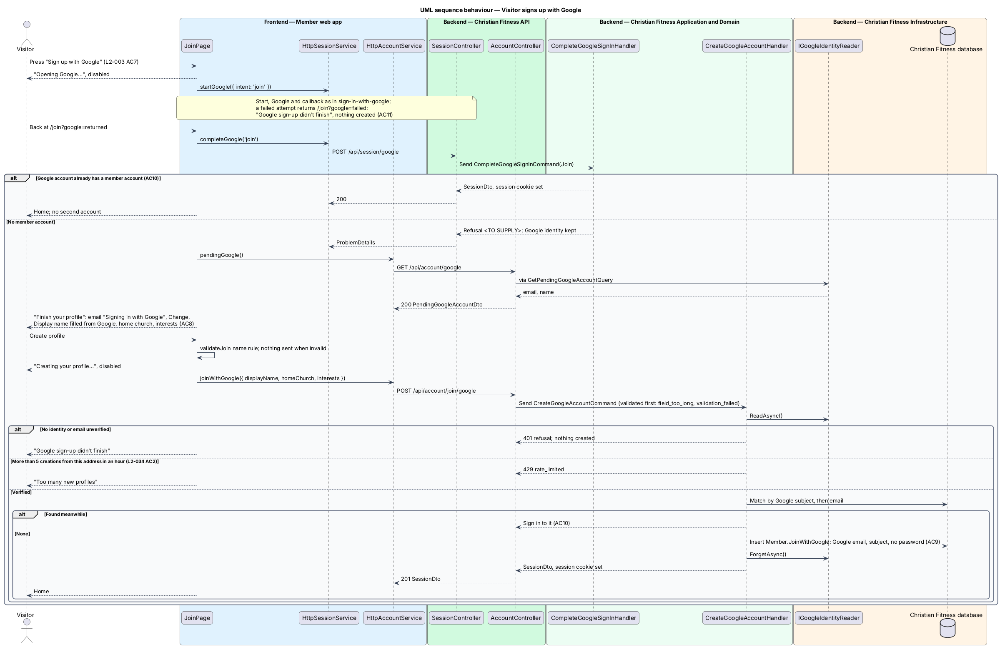

# Create a member account

## Overview

A *member account* is the record that lets a person sign in to the Member web app
and appear in the community. This feature covers the Join screen at `/join`, where a
visitor becomes a member. It belongs to the member-access subsystem.

- **member** — person with an account who has signed in
- **home church** — optional name of the congregation a member attends; sensitive
  personal data, never required and never logged
- **interest** — activity category a member follows, such as runs or basketball

The visitor gives name, email, a password of at least 8 characters, an
optional home church and optional interests. A valid submission creates the
account, signs the visitor in and opens Home. A duplicate email (compared
case-insensitively) or invalid fields create nothing and are named on the form.

A visitor may instead sign up with Google ([sign in with Google](../sign-in-with-google/README.md)).
A verified Google account with no member account opens "Finish your profile": the Google
account's email is shown, the name is filled from Google, and no email or password is
asked. The account is created with that email and no password. A Google account that already has
a member account is signed in to it instead, and no second account is created.

- **Finish your profile** — Join's Google form: the Google account, a name, optional home church and interests

## Description

Slice 2.1 builds the happy path (L2-003 AC1, AC4, AC5); slice 2.2 adds the refusals (AC2, AC3,
AC6) and the failed state. Signing up with Google (AC7 to AC11) is new; its parts are marked
"Google" below. The mock is `docs/mocks/pages/join/` (states `default`, `submitting`, `invalid`,
`invalid-fields`, `refused`, `limited`, `error`, `redirecting`, `google`, `google-invalid`, `google-submitting` and
`google-failed`). Decisions are in [ADR 0007](../../../adr/0007-join-session-and-home-stand-in.md)
and [ADR 0008](../../../adr/0008-join-refusals.md).

- **`JoinPage`** — lazy routed page at `/join` in `projects/web`, titled "Join · Christian
  Fitness". It holds one signal per field and renders the mock's blocks through presentation
  components: `AuthLayout` (`auth`, with the brand panel, the heading "Create your profile", the
  lead and "Already a member? Sign in"), `TextField` (`field`, `field__label`, `input`,
  `field__hint`) for Name, Email, Password ("At least 8 characters") and Home church
  ("Optional — helps you find people nearby"), `InterestPicker` and `Button`. On submit it sends
  `joinRequestOf(form)` and navigates to `/home` when the answer arrives (L2-003 AC1); a failed
  request gives the form back as it was, and a 5xx to this write never opens the server-error
  screen (`L2-043` AC5). While
  submitting, the button reads "Creating your profile…" with a spinner, is `disabled` and
  `aria-busy="true"`, the inputs are `readonly` and the interests `disabled`, as the mock's
  `submitting` state shows (L2-003 AC5). On submit it first runs `validateJoin`: when a field is
  invalid nothing is sent, the error summary (`FormAlert` "Check your details" with one link per
  field) appears above the fields and takes focus, and each invalid field shows its
  `field__error` with `aria-invalid="true"` (L2-003 AC3, mock `invalid-fields`). Editing a field
  clears its error. A refusal from the API is shown through `joinRefusalOf`: `email_taken` on the
  email field with "Sign in instead?" (AC2, mock `invalid`), a 429 as "Too many new profiles"
  (L2-034 AC2, mock `limited`, slice 3.2), any other 4xx as the generic
  "Check your details" alert (L2-032 AC1, mock `refused`), a 5xx or no answer as "We couldn't
  create your profile" (mock `error`); everything typed stays.
- **Sign up with Google** (Google; L2-003 AC7, AC11) — `JoinPage` shows `GoogleButton` ("Sign up
  with Google") first, above the `Divider` "or with email" and the email form. Pressing it calls
  `SESSION_SERVICE.startGoogle({ intent: 'join', returnUrl: null })`; the button reads "Opening
  Google…", is disabled and busy (mock `redirecting`) and the page leaves for Google. On return,
  `googleReturnOf` reads the marker once and the URL is replaced without it. `failed` shows the
  `form-alert` "Google sign-up didn't finish" with "Nothing was created. Try again, or create your
  profile with your email below.", and the email form still works (AC11, mock `google-failed`).
  `returned` calls `completeGoogle('join')`: a session means the Google account already had a
  member account, which is now signed in, and the page opens Home with no second account created
  (AC10); the no-account refusal opens "Finish your profile"; any other refusal shows the
  `google-failed` alert.
- **Finish your profile** (Google; L2-003 AC8, AC9) — `JoinPage` in its Google mode, also reached
  at `/join?google=finish` from Sign in's "Create my profile". It asks
  `ACCOUNT_SERVICE.pendingGoogle()` for the Google account kept on the server and renders the
  heading "Finish your profile", the lead "Google filled in the basics. Tell us a little more.",
  the `sso-account` line (the account's email, "Signing in with Google" and the link "Change", with
  "how you sign in" for assistive technology, back to the email form at `/join`), a "Name"
  `TextField` filled from Google with the hint "From your Google account — change it if you like",
  the home church, the interests and "Create profile"; there is no email or password field (mock
  `google`). No kept Google account (none, or expired) shows the `google-failed` alert over the
  email form. Submitting sends `joinWithGoogle(joinWithGoogleRequestOf(form))`; the button reads
  "Creating your profile…" and is disabled while it waits (mock `google-submitting`). The
  name is validated as on the email form, by `validateJoin`'s name rule; a blank name shows
  "Enter your name." in the focused summary and beside the field (mock `google-invalid`). The refusals of AC2 to AC6
  read through `joinRefusalOf` as on the email form (AC9).
- **Age confirmation** (L2-003 AC12) — both forms end the fields with a required checkbox "I'm 16 or
  older" (the library's `checkbox`, `check__box`, with its own `f-age` id), never pre-ticked. A
  `validateJoin` rule adds it to the error summary and marks it `aria-invalid="true"` with "Confirm
  you're 16 or older to create a profile" when unticked; nothing is sent (mocks `age-unconfirmed`
  and `age-unconfirmed-google`). The request carries `ageConfirmed`; `CreateAccountHandler` and the
  Google "Finish your profile" handler refuse a request without it with code `age_not_confirmed`
  and HTTP 400. No date of birth is asked for, and nothing about age is stored: the confirmation
  makes the Terms' and Privacy Policy's minimum age of 16 true (`L2-067` AC8).
- **Terms** — under the button both forms say "By creating a profile you agree to our Terms of
  Service and Privacy Policy.", each linked (`L2-067` AC5). Recording the versions in force with the
  account belongs to the legal pages' design.
- **`AuthLayout`** — presentation component (`cf-auth-layout`): the `auth` block with the page's
  one `main` and the `auth__form`; inputs `heading`, `lead`, `altText`, `altLink`, `altHref`; the
  fields and the submit button are projected through `[slot=fields]` and `[slot=submit]`;
  output `submitted` when the form is submitted, by the button or by Enter. An alert is projected
  through `[slot=alert]` into `auth__alert`, between the lead and the fields. Sign-in (slice 3.1)
  reuses it.
- **`FormAlert`** (slice 2.2) — presentation component (`cf-form-alert`): the `form-alert` block
  with `role="alert"` and `tabindex="-1"`, the alert icon, the `form-alert__title` and either a
  sentence (`text`) or the error summary's `form-alert__list` of links (`items`, each a message
  and the id of its field). It takes focus when it appears; a link moves focus to its field.
- **`AuthBrand`** — presentation component (`cf-auth-brand`) with no inputs: the `auth__brand`
  panel, its lockup back to `/` and, from 1024 px, the seal, the claim "Health in body and spirit,
  together." and the three points.
- **`TextField`** — presentation component (`cf-text-field`): one `field` with its label, input
  and optional hint; inputs `fieldId`, `label`, `type`, `name`, `autocomplete`, `hint`, `value`,
  `readonly`; output `valueChange`. Slice 2.2 adds `error`, `errorLink` and `errorHref`: with an
  error the input is `aria-invalid="true"` and described by the `field__error` (id
  `{fieldId}-error`) in place of the hint, and the link, when given, follows the sentence as an
  `link`.
- **`InterestPicker`** — presentation component (`cf-interest-picker`) rendering the fieldset,
  the legend "What are you into?" and one `interest` toggle per option with `aria-pressed`;
  inputs `legend`, `options`, `selected`, `disabled`; output `toggled` with the pressed key. On a
  coarse pointer each toggle's target extends to 44 × 44 px.
- **`joinRequestOf`, `toggleInterest`, `welcomeOf`** — pure helpers in `domain/src/account/join.ts`
  with a unit test per row: the request (a blank or white-space home church is `null`, the
  password as typed), the selection after one press (kept in the form's order) and the Home
  stand-in's greeting ("Welcome, " and the first name, or "Welcome").
- **`validateJoin`, `joinRefusalOf`, `apiErrorOf`** (slice 2.2) — pure helpers in `domain` with a
  unit test per row. `validateJoin(form)` gives each invalid field's message, in the form's order,
  from the rule table of ADR 0008 (the API's validator carries the same table).
  `joinRefusalOf(error)` turns an `ApiError` into what the screen shows: `email-taken`,
  `rate-limited` (any 429), `refused` or `failed`. `apiErrorOf(status, body)` reads `code` and `errors` from a
  ProblemDetails body, and gives code `network` for status 0.
- **`Button`** — gains a `<button>` branch: without `href` it renders `<button>` with `type`,
  `disabled` and `busy` (`aria-busy`), the size `lg` and the `block` modifier; both branches show
  the same projected content through one `ng-template` and `ngTemplateOutlet`.
- **`AccountApi` / `ACCOUNT_SERVICE`** — contract and token in `api`: `join(request:
  JoinRequestDto): Observable<SessionDto>`; for Google, `pendingGoogle():
  Observable<PendingGoogleAccountDto>` (`email`, `name`) and `joinWithGoogle(request:
  GoogleJoinRequestDto): Observable<SessionDto>` (`displayName`, `homeChurch`, `interests`). `JoinRequestDto` is `fullName`, `email`, `password`,
  `homeChurch` (`null` when blank) and `interests` (keys). `INTERESTS` lists the nine interests
  as `{ key, label }`: `running` Running, `strength` Strength, `basketball` Basketball,
  `walking-groups` Walking groups, `mobility` Mobility, `nutrition` Nutrition, `cycling` Cycling,
  `retreats` Retreats, `pickleball` Pickleball. `HttpAccountService` in the member app posts to `/api/account/join` and is
  bound in `app.config.ts`; a failed request errors with an `ApiError` (`status`, `code`,
  `errors`), made with `apiErrorOf`, so the page never handles an `HttpErrorResponse`.
- **`AccountController`** — `[AllowAnonymous]` `POST /api/account/join`. It sends one
  `CreateAccountCommand` and answers `201 Created` with the `SessionDto` (`memberId`, `name`) and
  the session cookie. For Google it adds `[AllowAnonymous]` `GET /api/account/google`
  (`GetPendingGoogleAccountQuery`) and `[AllowAnonymous]` `POST /api/account/join/google`
  (`CreateGoogleAccountCommand`), each sending one request.
- **`GetPendingGoogleAccountHandler`** (Google) — reads the Google identity through
  `IGoogleIdentityReader` and answers its email and name; none, or an unverified email, is refused
  with the code of [sign in with Google](../sign-in-with-google/README.md) and HTTP 401.
- **`CreateGoogleAccountValidator`** (Google) — the rules of `CreateAccountValidator` for the display
  name, home church and interests: name required and at most 100 characters, home church at most 120
  (`field_too_long`, AC6), else `validation_failed`.
- **`CreateGoogleAccountHandler`** (Google) — reads the Google identity (none or unverified: refused
  as above, nothing created); takes a lease of `AccountCreationLimiter`, the limit of 5 account
  creations per address per hour (`L2-034` AC2); asks `GoogleAccountMatch` again, and signs in to an
  account it finds instead of creating a second one (AC10); otherwise creates
  `Member.JoinWithGoogle(displayName, email, subject, now, homeChurch, interests)`, with the Google
  account's email, the Google subject and no password (AC9). An email taken at the same moment is
  refused `email_taken` by the unique index, as in `CreateAccountHandler`. It saves once, signs the
  member in through `ISessionSignIn`, forgets the Google identity and returns the `SessionDto`.
- **`CreateAccountValidator`** (slice 2.2) — FluentValidation, run by `ValidationBehavior` before
  the handler: name required and at most 100 characters trimmed, email required, matching
  `^[^\s@]+@[^\s@]+\.[^\s@]+$` and at most 254 characters, password at least 8 characters,
  home church at most 120 characters trimmed, interests among `Interests.All`. A failure answers
  400 `ValidationProblemDetails` with `errors` keyed by field (fixed sentences, never the value)
  and code `field_too_long` when any field is over its limit (L2-003 AC6), else
  `validation_failed` (L2-032 AC1).
- **`CreateAccountHandler`** — hashes the password through `IPasswordHasherService` (ASP.NET Core
  Identity's PBKDF2 hasher), stores a `Member` with `Status = Active`, `HomeChurch` null when
  blank or white space (L2-003 AC4) and the distinct interest keys, saves once, signs the member
  in through `ISessionSignIn` and returns the `SessionDto`. Slice 2.2 adds the duplicate check
  before anything is hashed: the email's lookup key (`NormalizedEmail`, trimmed and lower case)
  already stored throws `RefusalException` with code `email_taken`, answered 409 (L2-003 AC2). A
  second join with the same email at the same moment is refused by the unique index; the handler
  answers that `DbUpdateException` with `email_taken` too.
- **`CookieSessionSignIn`** — infrastructure implementation of `ISessionSignIn`: it signs the
  member in with the cookie scheme, a principal holding only the member id, persistent for 14
  days and sliding (`__Host-cf-session`, `Secure`, `HttpOnly`, `SameSite=Lax`; see
  `security/secure-sessions`).
- **`Member`** — gains `HomeChurch` (nullable, at most 120 characters) and `Interests` (keys).
- **Home** — the member lands on `/home`, a stand-in until slice 13.1: the greeting "Welcome,
  {first name}" from `GET /api/session` (ADR 0007).
- **Error mapping** (slice 2.2) — `ProblemDetailsExceptionHandler` answers
  `ValidationException` 400 and `RefusalException` with its kind's status (`Conflict` 409), each
  with its `code`; only a 500 is logged. `JoinPage` branches on `code` through `joinRefusalOf`:
  `email_taken` shows "An account with this email already exists. Sign in instead?" on the email
  field; a 429 `rate_limited`, the sixth account from one address in an hour, shows "Too many
  new profiles" ([limit request rates](../../security/limit-request-rates/README.md)); any
  other 4xx shows the generic `form-alert`; a 5xx or no answer shows the failed
  alert.
- **Telemetry** — no span or log carries the name, the email, the password, the home church, the
  Google subject or the request body; each request's span records the route template
  (`api/account/join`, `api/account/google`, `api/account/join/google`), the method and the status
  only (L2-033 AC2).

### Open questions

- **Existing code contradicts the amended requirement.** `JoinPage` has no "Sign up with Google",
  no `divider--label`, no Google mode and no terms line; `Member` has no `GoogleSubject` and requires a
  password hash. The next slices add each.
- **The Google photo.** The sign-in notice promises "we'll bring over your name and photo", and the
  `sso-account` line shows an avatar; `Member` has no photo, and `L2-049` AC9 forbids loading an
  image from Google. Settled by [ADR 0062](../../../adr/0062-first-google-sign-in-slice.md): the
  server copies the photo into `IImageStore` once, at join, if the member keeps it. The mock's avatar
  shows the account's initial.
- **"Change".** The link returns to the email form and deletes the kept Google identity
  (`__Host-cf-google`) at once; otherwise it lasts 10 minutes (ADR 0062).
- **The name field.** Both forms label it "Name" and store `Member.Name`. A blank name shows
  "Enter your name." in the error summary and beside the field.

## Requirements

The feature realizes the following level-2 (L2) requirements. Each L2
requirement refines a level-1 (L1) requirement, cited by identifier.

| L2 ID | Refines (L1) | Requirement |
|-------|--------------|-------------|
| `L2-003` | `L1-002` | A visitor joins with name, email, password, optional home church and optional interests. Valid details with a password of at least 8 characters shall create the account, sign the visitor in and open Home. An email already registered (case-insensitively) shall create nothing and mark the email field with "An account with this email already exists. Sign in instead?" and `aria-invalid="true"`. A short password, blank name or malformed email shall be named on the form and create nothing; a blank name shall show "Enter your name." in the summary and beside the field on either form. A blank home church shall be stored as none. While submitting, the button shall read "Creating your profile…" and be disabled. A name over 100 characters or a home church over 120 shall be refused `field_too_long`. "Sign up with Google" shall come first, above "or with email" and the email form; pressing it reads "Opening Google…", disables it and starts Google sign-in. A verified Google account with no member account shall show "Finish your profile" with the account's email as "Signing in with Google", a Change link back to the email form, a Name filled from Google that can be changed, optional home church and interests, and no email or password field. Submitting it with a name shall create the account with the Google account's email and no password, sign the visitor in and open Home, under AC4 to AC6. A Google account that already has a member account shall be signed in to it and open Home, with no second account. A Google sign-in that does not finish shall show "Google sign-up didn't finish" and that nothing was created, and the email form shall still work. Both forms shall have a required, unticked "I'm 16 or older" checkbox; unticked, nothing is sent and the checkbox is marked invalid in an error summary; the server refuses a join without it with `age_not_confirmed`; no date of birth is stored (AC12). |
| `L2-030` | `L1-013` | 1. Given any account, when its password is stored, then it is hashed with ASP.NET Core Identity's PBKDF2 hasher and never logged or returned. 2. Given session cookies, when set, then they are `Secure`, `HttpOnly`, `SameSite=Lax` or stricter, and use the `__Host-` prefix. |
| `L2-032` | `L1-013` | 1. Given any request body, when it fails validation, then the API returns 400 ProblemDetails with a `code` and field errors, and the screen shows a generic message. 3. Given user-supplied text, when rendered anywhere, then it is shown as text, never as HTML. |
| `L2-033` | `L1-013` | 1. Given home church and faith details, when a member joins, then they are optional. 2. Given any log, metric or span, when emitted, then it contains no email, name, home church, message text, token, query string or body. |
| `L2-034` | `L1-013` | 2. Given more than 5 account creations from one IP address in one hour, when the next is attempted, then it is refused with HTTP 429 and code `rate_limited`. |

## Diagrams

### System context

The visitor reaches Christian Fitness over HTTPS and may sign up with a Google account; the system exchanges the code with Google and exports telemetry to an OpenTelemetry collector.

### Containers

The Member web app calls the Christian Fitness API, which reads and writes the Christian Fitness database and calls Google to finish a Google sign-up. The Christian Fitness CLI applies migrations and seed data; the API does not migrate on startup.

### Components

The components below are the parts this slice touches in the Member web app and the Christian Fitness API; each controller sends one MediatR request.

### Class structure

The class diagram shows the frontend contract and its HTTP implementation, the request and handler types and the domain entities they read or change.

### Behaviour — create an account

The form names each invalid field and sends nothing; the validator refuses an invalid body with 400 and `field_too_long` or `validation_failed`; the handler refuses a case-insensitive duplicate email with 409 `email_taken`, also when the unique index catches a race; a valid join creates the member, signs them in and opens Home (`L2-003`, `L2-032`).

### Behaviour — sign up with Google

"Sign up with Google" starts an attempt; on return the page finishes it. A Google account that
already has a member account is signed in; otherwise "Finish your profile" reads the kept Google
account and creates the member with its email and no password (`L2-003` AC7–AC11, `L2-049`).

