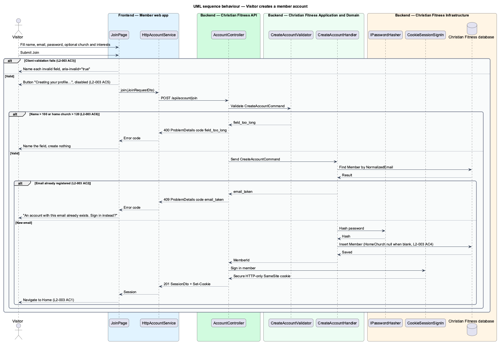

# Create a member account

## Overview

A *member account* is the record that lets a person sign in to the Member web app
and appear in the community. This feature covers the Join screen at `/join`, where a
visitor becomes a member. It belongs to the member-access subsystem.

- **member** — person with an account who has signed in
- **home church** — optional name of the congregation a member attends; sensitive
  personal data, never required and never logged
- **interest** — activity category a member follows, such as runs or basketball

The visitor gives full name, email, a password of at least 8 characters, an
optional home church and optional interests. A valid submission creates the
account, signs the visitor in and opens Home. A duplicate email (compared
case-insensitively) or invalid fields create nothing and are named on the form.

## Description

- **`JoinPage`** — routed page at `/join` in `projects/web`. It uses an Angular
  reactive form inside the mock's `auth` block with `field`, `input`,
  `interest-list` and `form-alert`. Client validation names each invalid field with
  `aria-invalid="true"` (L2-003 AC3). While submitting, the button reads "Creating
  your profile…" and is disabled (L2-003 AC5).
- **`InterestPicker`** — presentation component in `components` rendering the
  `interest` toggles with `aria-pressed`.
- **`AccountApi` / `ACCOUNT_SERVICE`** — contract and token in `api`;
  `HttpAccountService` posts `JoinRequestDto` (`fullName`, `email`, `password`,
  `homeChurch?`, `interests[]`).
- **`AccountController`** — `[AllowAnonymous]` `POST /api/account/join`. It sends one
  `CreateAccountCommand` and, on success, the infrastructure issues the session cookie.
- **`CreateAccountValidator`** — FluentValidation: name required and at most 100
  characters, email well formed, password at least 8 characters, home church at most
  120 characters. Over-length fields return code `field_too_long` (L2-003 AC6).
- **`CreateAccountHandler`** — normalizes the email to a lookup key, checks for an
  existing `Member` case-insensitively and returns code `email_taken` when one exists
  (L2-003 AC2). Otherwise it hashes the password through `IPasswordHasher`, stores a
  `Member` with `Status = Active`, leaves `HomeChurch` null when blank (L2-003 AC4)
  and saves once.
- **`CookieSessionSignIn`** — infrastructure service that signs the new member in
  with a secure, HTTP-only, SameSite cookie.
- **Error mapping** — `JoinPage` branches on `code`: `email_taken` shows "An account
  with this email already exists. Sign in instead?" on the email field; other codes
  show a generic `form-alert`. The exact `code` for a duplicate email is not named in
  the specification; `email_taken` is a proposal, `<TO SUPPLY>` for confirmation.
- **Telemetry** — no span or log carries the email, the password, the home church or
  the request body.

## Requirements

The feature realizes the following level-2 (L2) requirements. Each L2
requirement refines a level-1 (L1) requirement, cited by identifier.

| L2 ID | Refines (L1) | Requirement |
|-------|--------------|-------------|
| `L2-003` | `L1-002` | A visitor joins with full name, email, password, optional home church and optional interests. |

## Diagrams

### System context

The visitor reaches Christian Fitness over HTTPS; the system exports telemetry to an OpenTelemetry collector.

### Containers

The Member web app calls the Christian Fitness API, which reads and writes the Christian Fitness database. The Christian Fitness CLI applies migrations and seed data; the API does not migrate on startup.

### Components

The components below are the parts this slice touches in the Member web app and the Christian Fitness API; each controller sends one MediatR request.

### Class structure

The class diagram shows the frontend contract and its HTTP implementation, the request and handler types and the domain entities they read or change.

### Behaviour — create an account

The validator refuses over-length fields with `field_too_long`; the handler refuses a case-insensitive duplicate email; a valid join creates the member, signs them in and opens Home (`L2-003`).

