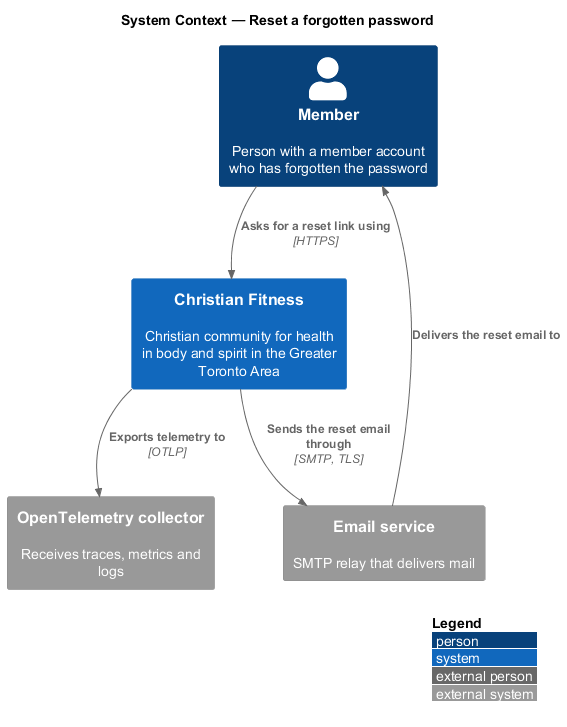
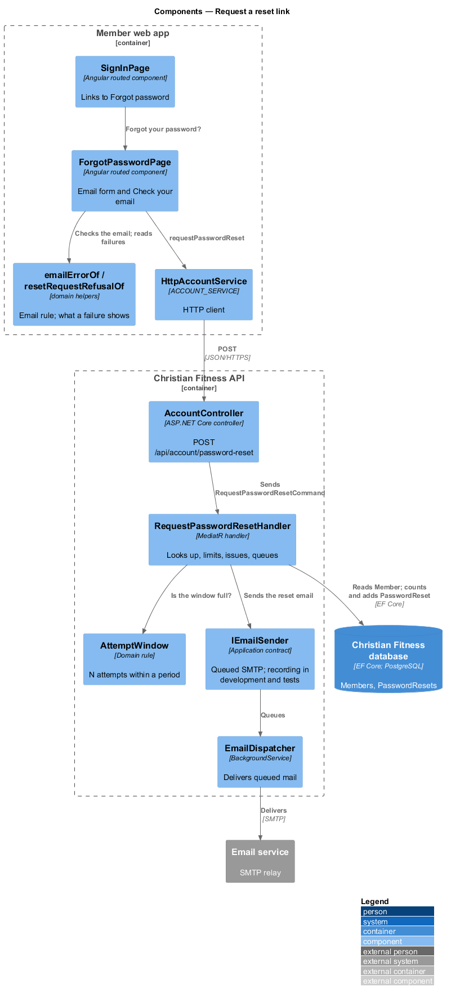
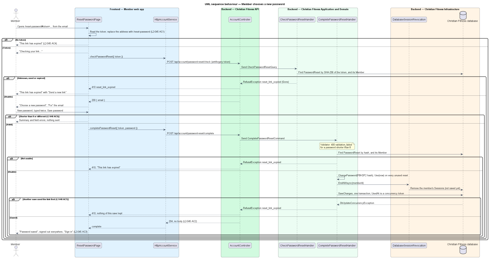

# Reset a forgotten password

## Overview

A member who has forgotten their password asks for a link by email and chooses a
new password through it. This feature covers the "Forgot your password?" link on
Sign in, the Forgot password screen at `/forgot-password`, the reset request the API
answers and the reset email. It belongs to the member-access subsystem.

- **reset request** — a visitor's request for a reset link to an email address
- **reset link** — single-use link to `/reset-password` holding a random token, valid
  for 30 minutes after the request
- **password reset** — the stored record of one issued link: the member, a hash of the
  token, when it was requested and when it expires
- **reset window** — one hour in which one account is sent at most 3 reset emails
- **usable link** — a reset link whose password reset is unused and was requested less
  than 30 minutes ago

The answer to a reset request never says whether an account has the email: a
registered email and an unknown one get the same 202 and the same "Check your email"
screen. Only a registered email, inside its reset window, is sent a link. A usable link
sets a new password once; doing so ends every session of the member, who then signs in
with the new password.

## Description

Slice 20.1 builds the request, the screen and the email
([ADR 0010](../../../adr/0010-password-reset-request-and-email.md)); slice 20.2 builds
the Reset password screen that the link opens and sets the new password
([ADR 0014](../../../adr/0014-choosing-a-new-password.md)).

#### Request a reset link (slice 20.1)

- **`SignInPage`** — gains the mock's "Forgot your password?" link under the password
  field, a `TextLink` to `/forgot-password` (L2-044 AC1). It loads the document, as the
  other auth links do.
- **`ForgotPasswordPage`** — routed, lazy page at `/forgot-password`, title "Forgot
  password · Christian Fitness", built from the mock's `auth`, `field`, `input` and
  `form-alert` blocks with one signal for the email. Submitting checks the email with
  `emailErrorOf` (`domain`, the Join rule of ADR 0008): a blank or malformed email sends
  nothing and shows the summary "Check your email address", which takes focus and links
  to the field, and marks the field `aria-invalid` with "Enter an email address like
  name@example.com" (L2-044 AC5, mock `invalid`). Editing the field clears its error.
  While the request is on its way the button reads "Sending…", is disabled and busy, and
  the field is read-only (L2-044 AC7, mock `submitting`). A 202 replaces the form with
  "Check your email", naming the email as typed (rendered as text), the 30-minute
  expiry, "Back to sign in" (`/sign-in`) and "send it again", which sends the same email
  again through the busy state (L2-044 AC4, mock `success`); the heading takes focus.
  `resetRequestRefusalOf` (`domain`) reads a failure: a 400 `validation_failed` marks the
  field as invalid, and anything else shows "We couldn't send the email" with the email
  kept (L2-044 AC7, mock `error`).
- **`AuthLayout`** (`components`) — gains a notice form: with `notice` it renders the
  `auth__form` as a `
` instead of a `<form>` and focuses its heading when it
  appears. `lead` may be completed by a `[slot=lead]` node (the bold email), `altText`
  is optional, `altEnd` closes the line, and without `altHref` the alternative is a
  `<button class="auth__alt-action">` that emits `altChosen`. The slots are declared once
  in one template both branches show.
- **`TextLink`** (`components`) — the design system's `text-link` block as a link, with
  its 44 × 44 px touch target on coarse pointers.
- **`AccountApi.requestPasswordReset` / `ACCOUNT_SERVICE`** — the contract in `api`
  takes a `PasswordResetRequestDto` (`email`) and completes on 202; a refusal errors with
  an `ApiError`. `HttpAccountService` implements it; no new token is bound.
- **`AccountController`** — `POST /api/account/password-reset`, `[AllowAnonymous]`, with
  the antiforgery token like every write; it sends one
  `RequestPasswordResetCommand` and answers 202 with no body.
- **`RequestPasswordResetValidator`** — the email is required, at most 254 characters
  and of the Join shape; otherwise 400 with code `validation_failed` (L2-044 AC5).
- **`RequestPasswordResetHandler`** — looks the member up by the email's lookup key
  (trimmed, lower case). With no member it returns at once. Otherwise it counts the
  member's `PasswordReset` rows requested since `AttemptWindow.Since(now)`; when 3 are
  inside the hour it returns without sending (L2-044 AC6). Else it issues a
  `PasswordReset`, saves it and sends the email through `IEmailSender`. The answer is the
  same 202 in every case (L2-044 AC2, AC3). Time comes from `TimeProvider`.
- **`PasswordReset`** (Domain) — `Issue(memberId, now)` makes 32 random bytes from
  `RandomNumberGenerator`, encoded base64url, and keeps only their SHA-256 hash in hex
  (`HashOf`), with `ExpiresAt = RequestedAt + 30 minutes`. The token itself exists
  only in the email (L2-044 AC2). Slice 20.2 adds its use (below).
- **`AttemptWindow`** (Domain) — the rule "at most `Limit` attempts within `Period`":
  `Since(now)` is the oldest instant still inside the window, and `IsFull(count)` says
  whether `count` attempts since then reach the limit. It holds no state, so any store
  can feed it; slice 3.2's failed sign-in window (5 in 15 minutes) can share it.
- **`IEmailSender`** (Application) — sends an `EmailMessage` (`To`, `Subject`,
  `Text`). With `Email:Smtp:Host` set, `QueuedEmailSender` writes it to a bounded
  in-process channel and `EmailDispatcher`, a hosted service, delivers it with
  `SmtpEmailTransport` (MailKit), so the API answers before the mail server does and the
  time to answer does not depend on whether a mail was sent. Without a host,
  `RecordingEmailSender` keeps the latest messages in memory, sending none: the
  development and test sender. Outside Development a missing host or member-app address
  stops the API at start-up ([settings](../../../operations/settings.md)).
- **The email** — plain text, to the account's address: subject "Reset your Christian
  Fitness password", the member's first name, the link
  `{MemberApp:BaseUrl}/reset-password#token=…`, the 30-minute expiry and a line saying
  to ignore it if they did not ask. The link's address comes from configuration, never
  from the request's `Host` header. The token is in the fragment, which no browser sends
  to a server or in a `Referer`.
- **Telemetry** — the route is recorded as its template; no span, metric or log carries
  the email, the token or the link (L2-044 AC8, L2-033 AC2). A delivery failure is logged
  by the exception's type only.

#### Choose a new password (slice 20.2)

- **`ResetPasswordPage`** — routed, lazy page at `/reset-password`, title "Reset
  password · Christian Fitness", built from the mock's `auth`, `field`, `input` and
  `form-alert` blocks. On arrival it reads the token once from the route's fragment with
  `resetTokenOf` (`domain`; `#token=…`), keeps it in a field and replaces the address with
  `/reset-password` through `Location`, so the token is not left in history (L2-045 AC1).
  With no token it shows the expired notice at once. Otherwise it shows "Checking your
  link…" (mock `loading`) and calls `checkPasswordReset`; the answer's email completes the
  lead "For …." as text, above "New password" (hint "At least 8 characters") and "Confirm
  new password", both `autocomplete="new-password"` (mock `default`). Submitting checks
  both fields with `newPasswordErrorsOf` (`domain`): a short password or a mismatch sends
  nothing and shows the summary, which takes focus and links to each field ("Your
  passwords don't match" when the mismatch is the only error, else "Check your new
  password"), and marks each field `aria-invalid` (L2-045 AC5, mock `invalid`); editing a
  field clears its error. While saving the button reads "Saving…", is disabled and busy,
  and the fields are read-only (L2-045 AC6, mock `submitting`). A 204 replaces the form
  with the notice "Password saved" and "Sign in" (`/sign-in`) (L2-045 AC3, mock
  `success`). `resetPasswordRefusalOf` (`domain`) reads a failure: 410
  `reset_link_expired` is the notice "This link has expired" with "Send a new link"
  (`/forgot-password`) and "Back to sign in" (L2-045 AC4, mock `error`); a 400
  `validation_failed` marks the new password; anything else, when saving, is "We couldn't
  save your password" with both fields kept (mock `failed`), and, when checking, the
  notice "We couldn't check your link" whose "Try again" checks the kept token again
  (L2-045 AC6, mock `unchecked`). Each notice's heading takes focus.
- **`AuthLayout`** (`components`) — the notices use its `notice` form; an empty
  `altLink` leaves out the last line, for a notice that has none.
- **`AccountApi.checkPasswordReset` / `completePasswordReset`** — the contract in `api`
  takes a `PasswordResetTokenDto` (`token`) and answers a `PasswordResetCheckDto`
  (`email`), and a `NewPasswordDto` (`token`, `password`) completing on 204. A refusal
  errors with an `ApiError`. `HttpAccountService` implements both.
- **`AccountController`** — `POST /api/account/password-reset/check` sends one
  `CheckPasswordResetQuery` and answers 200 with its `PasswordResetCheckDto`;
  `POST /api/account/password-reset/complete` sends one `CompletePasswordResetCommand` and
  answers 204. Both `[AllowAnonymous]` with the antiforgery token. The token is never in a
  URL.
- **`CompletePasswordResetValidator`** — the password is at least 8 characters, Join's
  rule and sentence ("Use at least 8 characters"); otherwise 400 `validation_failed`
  (L2-045 AC5).
- **`CheckPasswordResetHandler`** — finds the `PasswordReset` by `HashOf(token)` and its
  member; when either is missing or the reset is not `IsUsableAt(now)` it refuses with
  `RefusalKind.Gone` and code `reset_link_expired` (410). Else it answers the member's
  email (L2-045 AC1, AC4).
- **`CompletePasswordResetHandler`** — the same lookup and refusal; then
  `Member.ChangePassword(hash)` with the PBKDF2 hash of the new password, `Use(now)` on
  the reset and on every other unused reset of the member, and
  `ISessionRevocation.EndAllAsync(memberId)`, all saved by one `SaveChanges`. A
  `DbUpdateConcurrencyException` (another save used the link first) is refused
  `reset_link_expired`, and nothing of this save is kept (L2-045 AC2, AC3, AC7). Nobody is
  signed in.
- **`PasswordReset`** (Domain) — gains `UsedAt`, an EF Core concurrency token, so the
  database updates a reset only while it is still unused; `IsUsableAt(now)` is
  `UsedAt is null && now < ExpiresAt`, and `Use(now)` sets `UsedAt`.
- **`Member.ChangePassword`** (Domain) — replaces the password hash (L2-030 AC1).
- **`ISessionRevocation`** (Application) — `EndAllAsync(memberId)` ends every session of
  a member. `DatabaseSessionRevocation` (Infrastructure) removes the member's
  `Sessions` rows through the request's `AppDbContext`, so they go in the handler's
  `SaveChanges` with the new password (ADR 0009, ADR 0014).
- **Telemetry** — the routes are recorded as their templates; no span, metric or log
  carries the token, the password or the email (L2-045 AC8, L2-033 AC2).
- **Per-address limit** — at most 10 reset requests from one client address in an hour,
  whatever emails they name; the next is refused 429 `rate_limited` before any lookup and
  sends nothing, and the Forgot password screen shows "Too many requests" (L2-034 AC3, mock
  `forgot-password/limited`). It reuses slice 3.2's client address and sliding window
  (`PasswordResetRequestLimiter`, designed in
  [Limit request rates](../../security/limit-request-rates/README.md)). Link checks are
  not limited: a 256-bit token cannot be guessed.

### Open questions

- The queue is in process: a mail not yet delivered when the API stops is lost, and the
  member asks again. A durable outbox may replace it when other emails need one.

## Requirements

The feature realizes the following level-2 (L2) requirements. Each L2
requirement refines a level-1 (L1) requirement, cited by identifier.

| L2 ID | Refines (L1) | Requirement |
|-------|--------------|-------------|
| `L2-044` | `L1-002`, `L1-013` | A member who has forgotten their password shall ask for a reset link by email from the Sign in screen, and the answer shall never reveal whether an account has the email given (acceptance criteria 1–8). |
| `L2-045` | `L1-002`, `L1-013` | A member who opens a valid, unexpired reset link shall set a new password once, which signs them out everywhere (acceptance criteria 1–8). |
| `L2-034` | `L1-013` | 3. Given 10 password reset requests from one IP address in one hour, whatever emails they named, when the next is made, then it is refused with HTTP 429 and code `rate_limited`, no email is sent, and the Forgot password screen shows "Too many requests" and keeps the email typed. |

## Diagrams

### System context

The member reaches Christian Fitness over HTTPS; the system sends the reset email through an SMTP relay and exports telemetry to an OpenTelemetry collector.

### Containers

The Member web app posts the email, and later the link's token and the new password, to the API, which reads members, writes password resets and ends sessions in the database and hands the email to the mail relay.

### Components

The components below are the parts slices 20.1 and 20.2 touch; the controller sends one MediatR request per endpoint and the dispatcher delivers mail after the answer.

### Class structure

The class diagram shows both screens and their helpers, the contract, the requests and handlers, the domain types they use, the email senders and the session revocation.

### Behaviour — request a reset link

A malformed email never leaves the screen. Any other request is answered 202; only a registered email inside its reset window gets a new password reset and an email (`L2-044`).

### Behaviour — choose a new password

The screen checks the link before showing the form and never sends a password that is short or typed differently. Saving with a usable link changes the password, uses every link of the member and ends every session in one save; an unusable link is refused 410 `reset_link_expired` (`L2-045`).

