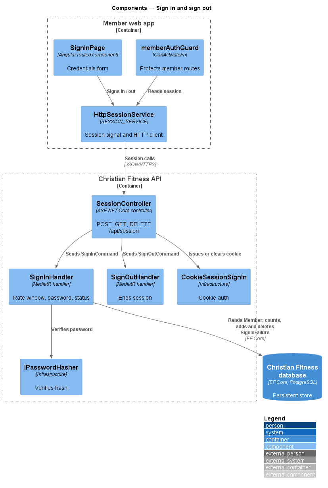
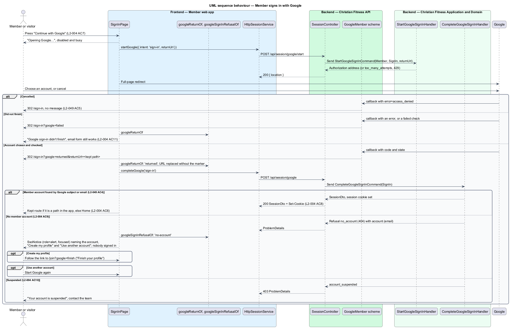

# Sign in and sign out

## Overview

Members reach every member route through a server session. This feature covers
the Sign in screen at `/sign-in`, the guard that protects member routes and the
Sign out action. It belongs to the member-access subsystem. A member signs in with
an email and password or with their Google account (`L1-002`); the Google flow both
apps share is designed in [sign in with Google](../sign-in-with-google/README.md).

- **session cookie** — secure, HTTP-only, SameSite cookie that identifies a signed-in member
- **failed sign-in window** — 15-minute interval in which 5 failed sign-ins for one
  email block further attempts
- **suspended member** — member whose `MemberStatus` is `Suspended`
- **Google-only account** — member account created with Google, which has no password

Correct credentials, or the Google account the member account uses, set the session
cookie and open Home, or the route the member first asked for. Wrong credentials show
one generic message that does not reveal which field was wrong, with a hint to use
Google that every email gets alike. A Google account with no member account is named
in a notice that offers to create a profile; nobody is signed in. Repeated failures and suspended accounts are refused with
error codes the screen branches on. Sign out ends the session on the server.

## Description

Slice 3.1 builds sign-in with the generic refusal, sign-out and the guard's
redirect ([ADR 0009](../../../adr/0009-sign-in-sign-out-and-request-protections.md));
slice 3.2 adds the failure window, the suspension refusal and the return to the
route first asked for ([ADR 0012](../../../adr/0012-sign-in-protections.md)).

- **`SignInPage`** — routed, lazy page at `/sign-in`. The mock
  (`docs/mocks/pages/sign-in/`) now draws it as the `signin` card ("Welcome back", "Sign in to
  see your events, groups and messages.") in place of the Join layout (`auth`) it used
  before; `field`, `input` and `form-alert` stay. "Continue with Google" (`GoogleButton`) comes
  first, above the `Divider` "or with email" and the email form, with "Forgot password?" beside
  the Password label (`L2-004` AC7), and one signal per field. While the
  request is on its way the button reads "Signing in…", is disabled and busy, and the
  fields are read-only. Success navigates to the `returnUrl` query parameter the guard
  set, read once from the route snapshot and checked by `signInReturnPathOf` (`domain`): a
  path inside the app (one leading `/`, no `//`, no `\`, no control character, not
  `/sign-in` itself) is followed, anything else, or none, opens `/home` (L2-004 AC1,
  AC6). `signInRefusalOf` (`domain`) turns the `ApiError` into what the screen shows,
  each as a `form-alert` that takes focus, with no field marked invalid:
  - 401 `invalid_credentials` — "Email or password is incorrect", "Check both and try again.
    If you joined with Google, use Continue with Google." The hint is the same for every email,
    so it reveals nothing about the account (L2-004 AC2, mock `invalid`);
  - 429 `too_many_attempts` — "Sign-in paused for 15 minutes", ending with the link "Reset your
    password" (L2-004 AC3, mock `error`);
  - 403 `account_suspended` — "Your account is suspended", with a sentence to contact the
    team (L2-004 AC4, mock `suspended`);
  - anything else — "We couldn't sign you in" (mock `failed`).

  The button stays enabled after every refusal: the pause belongs to one email on the
  server, which answers 429 again while it lasts. The "Forgot password?" link
  beside the Password label and the paused message's "Reset your password" both open
  `/forgot-password` (slice 20.1, [reset a forgotten password](../reset-password/README.md)).
- **Continue with Google** (`L2-004` AC7 to AC11) — pressing it calls
  `SESSION_SERVICE.startGoogle({ intent: 'sign-in', returnUrl })` with the `returnUrl` the guard
  set; the button reads "Opening Google…", is disabled and busy (mock `redirecting`) and the page
  leaves for Google. On return `googleReturnOf` reads the marker once and the URL is replaced
  without it:
  - `failed` — a `form-alert` "Google sign-in didn't finish" with "You're not signed in. Try
    again, or sign in with your email below."; the email form still works (AC11, mock
    `google-failed`);
  - `returned` — `completeGoogle('sign-in')`. A session navigates through `signInReturnPathOf`
    as the email sign-in does (AC8, `L2-049` AC6). `googleSignInRefusalOf` (`domain`) reads a
    refusal: the no-account code shows an `SsoNotice` (`role="alert"`, focused) naming the Google
    account from the refusal's `account` extension, "There's no Christian Fitness profile on this
    Google account yet. Create one now — we'll bring over your name and photo.", with "Create my
    profile" (a link to `/join?google=finish`, which opens "Finish your profile",
    [create a member account](../create-account/README.md)) and "Use another account", which
    starts Google again; nobody is signed in and nothing is created (AC9, mock
    `google-no-account`). `account_suspended` shows the suspended message of AC4 (AC10). Any other
    refusal shows the `google-failed` alert.
- **`memberAuthGuard`** — `CanActivateFn` in `domain` on `MemberShell`, the parent of
  every member route. It asks `SESSION_SERVICE.current()`: a session opens the route,
  a 401 redirects to `/sign-in?returnUrl=<the URL asked for>` (L2-004 AC6), and any
  other failure keeps the visitor where they are, since a 5xx already opens the
  server-error screen.
- **`MemberShell`** — routed layout in the member app; it renders `AppHeader` with
  the Sign out button ([navigate the member app](../../member-home/navigate-member-app/README.md)).
  Choosing it calls `signOut()` and, on a 204 or a 401 (already signed out), navigates
  to `/` (L2-004 AC5). Any other failure keeps the member where they are with the
  button enabled.
- **`SessionApi` / `SESSION_SERVICE`** — contract and token in `api`; `signIn` takes a
  `SignInRequestDto` (`email`, `password`) and answers the `SessionDto`; `signOut`
  completes once the session has ended, a 401 included; `current` answers the
  session; `startGoogle` and `completeGoogle` are added for the Google flow
  ([sign in with Google](../sign-in-with-google/README.md)). `HttpSessionService` implements it over HTTP, holds no state and is bound
  in `app.config.ts`.
- **`SessionController`** — `POST /api/session` (`[AllowAnonymous]`, 200 with the
  `SessionDto`), `DELETE /api/session` (204) and `GET /api/session`; for Google,
  `POST /api/session/google/start` and `POST /api/session/google` (both `[AllowAnonymous]`). Each sends one
  MediatR request. Both writes need the antiforgery token
  ([secure sessions](../../security/secure-sessions/README.md)).
- **`SignInHandler`** — in this order:
  1. unless a field is blank, it counts the email's `SignInFailure` rows of the last 15 minutes, read from
     `TimeProvider`; at 5 or more the attempt is refused with `too_many_attempts` and
     HTTP 429 before the password is checked, right or wrong, and is not recorded, so
     the pause ends when the oldest of the five is 15 minutes old (L2-004 AC3);
  2. `MemberCredentials`, the check staff sign-in shares (slice 9.1, ADR 0011), refuses a
     blank field, an unknown email or a wrong password with `invalid_credentials`, 401
     (L2-004 AC2); it verifies an unknown email against a fixed hash, so the answer takes
     as long as for a wrong password. A Google-only account has no password hash and is
     verified against the same fixed hash, so it answers exactly as a wrong password
     (L2-004 AC2). An unknown email or a wrong password records a
     `SignInFailure` (an unknown email too, so the pause never says whether an account
     exists); a blank field records nothing;
  3. a `Suspended` member with the right password is refused with `account_suspended`
     and HTTP 403 (L2-004 AC4); a wrong password for them is step 2's answer, so the
     suspension is told only to whoever knows the password;
  4. otherwise the email's failures are deleted and the member is signed in through
     `ISessionSignIn`.
- **`SignInFailure`** — `Domain` entity, one failed sign-in: `Id`, `EmailKey` (the
  SHA-256 of the email's lookup key, in hex, so an address typed by a stranger is not
  kept) and `FailedAt`. Table `SignInFailures`, indexed by `EmailKey` and `FailedAt`.
  Recording a failure first deletes every row older than the window, whatever its
  email, so the table holds at most the last 15 minutes' failures.
- **`CookieSessionSignIn`** — infrastructure implementation of `ISessionSignIn`: it
  issues the cookie on success and calls `SignOutAsync` on sign-out (L2-004 AC5), and
  sets the request's user to the new identity, so the response carries an antiforgery
  token for it.
- **`SignOutHandler`** — ends the session on the server: `DatabaseTicketStore` deletes its
  row and the cookie expires, so a replayed copy of the cookie is refused 401
  ([secure sessions](../../security/secure-sessions/README.md)).
- **Telemetry** — the sign-in route is recorded as its template; no span or log
  carries the email, its key, the password or the cookie, on success or refusal.

### Open questions

- **Existing code contradicts the amended mock.** `SignInPage` renders through `AuthLayout`, with
  "Forgot your password?" under the password field and no Google button; the mock now draws the
  `signin` card with "Forgot password?" beside the label. The `signin` block has no design-system
  page yet: it belongs beside `AuthLayout` and `StaffLayout` in `components/src/layout/` once the
  layout page draws it. The `invalid` message gains the Google hint. The next slices change each.
- **"Use another account".** It starts a new attempt; whether that attempt asks Google to show the
  chooser (`prompt=select_account`) is open in [sign in with Google](../sign-in-with-google/README.md).
- **Google start refusals and a deleting account.** Mock states `google-limited` (a 429 from the Google
  start, `L2-049` AC7), `google-unverified` ("Your Google account's email isn't verified. Verify it with
  Google, or join with email.", `L2-049` AC3) and `deleting` ("Your account is set to be deleted on
  {date}." with "Restore my account" and "Keep it deleted", `L2-066` AC8) show each one.

## Requirements

The feature realizes the following level-2 (L2) requirements. Each L2
requirement refines a level-1 (L1) requirement, cited by identifier.

| L2 ID | Refines (L1) | Requirement |
|-------|--------------|-------------|
| `L2-004` | `L1-002` | A registered member who signs in with the correct email and password shall get a secure, HTTP-only, SameSite session cookie and land on Home. A wrong password or unknown email shall show one generic message, "Email or password is incorrect", with "If you joined with Google, use Continue with Google." for every email alike; an account with no password shall answer exactly as a wrong password. 5 failed sign-ins for one email within 15 minutes shall refuse a sixth with `too_many_attempts` and HTTP 429 until the window passes. A suspended member with correct credentials shall be refused `account_suspended` with HTTP 403 and a message to contact the team. Sign out shall end the session on the server and return to the landing page. A visitor opening a member route shall be redirected to sign-in and returned there afterwards; a return address that is not a path inside the member app opens Home. Sign in shall show "Continue with Google" first, above "or with email" and the email form with "Forgot password?" beside the Password label; pressing it reads "Opening Google…", disables it and starts Google sign-in. A member back from Google with the account their member account uses shall get the session cookie and land on Home or the kept route. A verified Google account with no member account shall show a focused alert naming that account with "Create my profile" (opening "Finish your profile") and "Use another account" (opening Google again), with nobody signed in and nothing created. A suspended member choosing their Google account shall be refused as for a password. A Google sign-in that does not finish shall show "Google sign-in didn't finish" and that they are not signed in, and the email form shall still work. |

## Diagrams

### System context

The member reaches Christian Fitness over HTTPS and may sign in with a Google account; the system exchanges the code with Google and exports telemetry to an OpenTelemetry collector.

### Containers

The Member web app calls the Christian Fitness API, which reads and writes the Christian Fitness database and calls Google to finish a Google sign-in. The Christian Fitness CLI applies migrations and seed data; the API does not migrate on startup.

### Components

The components below are the parts this slice touches in the Member web app and the Christian Fitness API; each controller sends one MediatR request.

### Class structure

The class diagram shows the frontend contract and its HTTP implementation, the request and handler types and the domain entities they read or change.

### Behaviour — sign in

The guard sends a visitor to sign-in, and the interceptor fetches an antiforgery token first when there is none. The handler refuses a sixth attempt inside the 15-minute failure window before it checks the password, gives one generic refusal for an unknown email or a wrong password and records it, refuses a suspended member who gave the right password, and only then issues the cookie; the page returns the member to the route the guard recorded (`L2-004`).

### Behaviour — sign in with Google

"Continue with Google" starts an attempt and leaves for Google; on return the page finishes it.
The member account the Google account uses is signed in and the member lands on the kept route;
a Google account with no member account shows the notice that offers "Create my profile"; a
suspended member is refused; an attempt that did not finish shows the `google-failed` alert
(`L2-004` AC7–AC11, `L2-049`).

### Behaviour — sign out

Sign out, from the app header, ends the session on the server and returns the member to the landing page; a session that had already ended counts as signed out (`L2-004` AC5, `L2-008` AC4).

