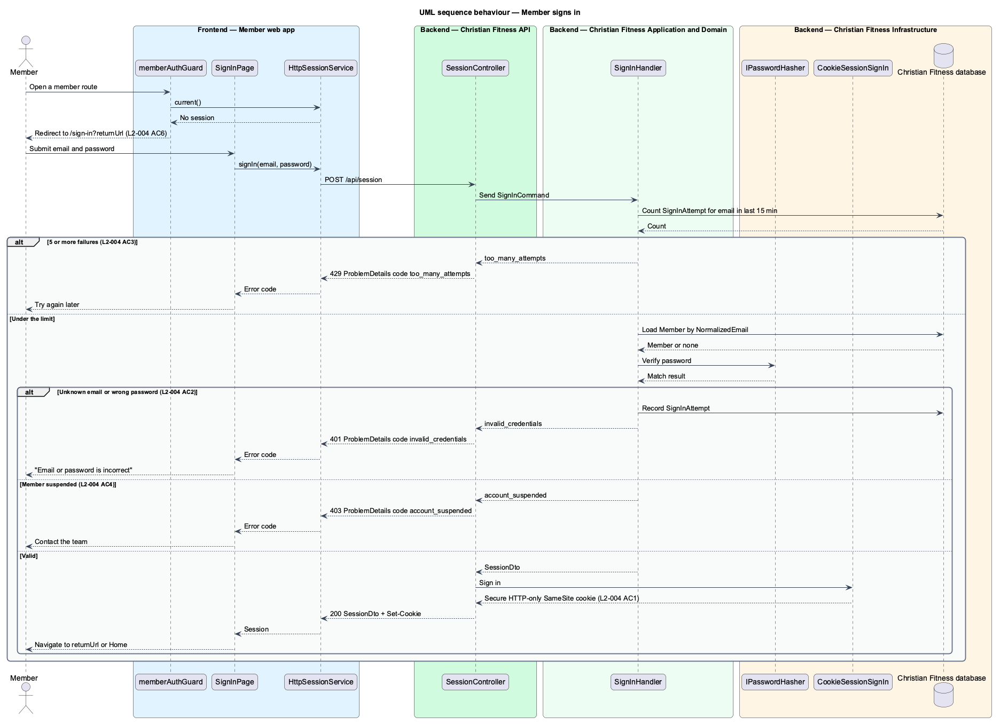

# Sign in and sign out

## Overview

Members reach every member route through a server session. This feature covers
the Sign in screen at `/sign-in`, the guard that protects member routes and the
Sign out action. It belongs to the member-access subsystem.

- **session cookie** — secure, HTTP-only, SameSite cookie that identifies a signed-in member
- **failed sign-in window** — 15-minute interval in which 5 failed sign-ins for one
  email block further attempts
- **suspended member** — member whose `MemberStatus` is `Suspended`

Correct credentials set the session cookie and open Home, or the route the member
first asked for. Wrong credentials show one generic message that does not reveal
which field was wrong. Repeated failures and suspended accounts are refused with
error codes the screen branches on. Sign out ends the session on the server.

## Description

- **`SignInPage`** — routed page at `/sign-in` using the mock's `auth`, `field`,
  `input` and `form-alert` blocks. It reads a `returnUrl` query parameter set by the
  guard and navigates there, or to `/home`, after success (L2-004 AC1, AC6). It
  shows "Email or password is incorrect" for code `invalid_credentials`, a
  wait message for `too_many_attempts` and a contact-the-team message for
  `account_suspended`.
- **`memberAuthGuard`** — `CanActivateFn` on the member route tree. It asks
  `SESSION_SERVICE` for the current session and redirects a visitor to
  `/sign-in?returnUrl=…` (L2-004 AC6).
- **`SessionApi` / `SESSION_SERVICE`** — contract and token in `api`;
  `HttpSessionService` implements `signIn`, `signOut` and `current`, and is bound in
  `app.config.ts`. The session state is a signal shared app-wide in `root`.
- **`SessionController`** — `POST /api/session` (`[AllowAnonymous]`),
  `DELETE /api/session` and `GET /api/session`. Each sends one MediatR request.
- **`SignInHandler`** — reads failed attempts for the normalized email inside the
  last 15 minutes from `TimeProvider`; at 5 it returns `too_many_attempts`, mapped to
  HTTP 429 (L2-004 AC3). It verifies the password through `IPasswordHasher`; a
  mismatch or unknown email records a failed attempt and returns
  `invalid_credentials` (L2-004 AC2). A `Suspended` status returns
  `account_suspended` (L2-004 AC4).
- **`SignInAttempt`** — record of one failed sign-in (`NormalizedEmail`,
  `AttemptedAt`). The specification names no storage for it; persisting it in the
  database versus an in-memory store is `<TO SUPPLY>`.
- **`CookieSessionSignIn`** — infrastructure service that issues the cookie on
  success and calls `SignOutAsync` on sign-out (L2-004 AC5).
- **`SignOutHandler`** — ends the server session; the page then navigates to `/`.
- **Telemetry** — the sign-in route is recorded as its template; no span carries the
  email, the password or the cookie.

## Requirements

The feature realizes the following level-2 (L2) requirements. Each L2
requirement refines a level-1 (L1) requirement, cited by identifier.

| L2 ID | Refines (L1) | Requirement |
|-------|--------------|-------------|
| `L2-004` | `L1-002` | Given a registered member, when they sign in with the correct email and password, then a secure, HTTP-only, SameSite session cookie is set and they land on Home; wrong credentials show one generic message; 5 failed sign-ins for one email within 15 minutes refuse a sixth with code `too_many_attempts` and HTTP 429; a suspended member is refused with code `account_suspended`; Sign out ends the session on the server; a visitor opening a member route is redirected to sign-in and returned afterwards (acceptance criteria 1–6). |

## Diagrams

### System context

The member reaches Christian Fitness over HTTPS; the system exports telemetry to an OpenTelemetry collector.

### Containers

The Member web app calls the Christian Fitness API, which reads and writes the Christian Fitness database. The Christian Fitness CLI applies migrations and seed data; the API does not migrate on startup.

### Components

The components below are the parts this slice touches in the Member web app and the Christian Fitness API; each controller sends one MediatR request.

### Class structure

The class diagram shows the frontend contract and its HTTP implementation, the request and handler types and the domain entities they read or change.

### Behaviour — sign in

The guard sends a visitor to sign-in with a return URL. The handler applies the 15-minute failure window, the generic credential refusal and the suspension refusal before the cookie is issued (`L2-004`).

### Behaviour — sign out

Sign out ends the session on the server, clears the session signal and returns the member to the landing page (`L2-004` AC5).

