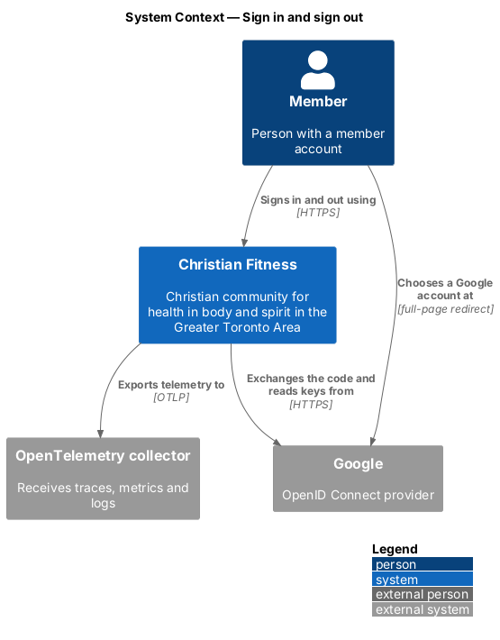
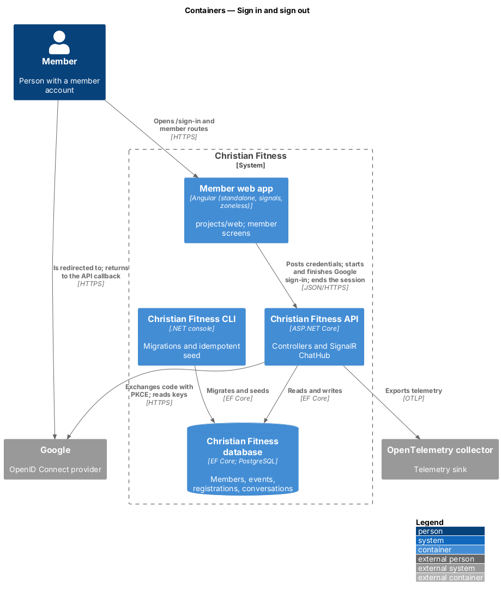
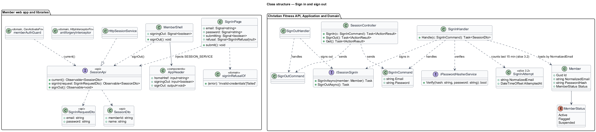
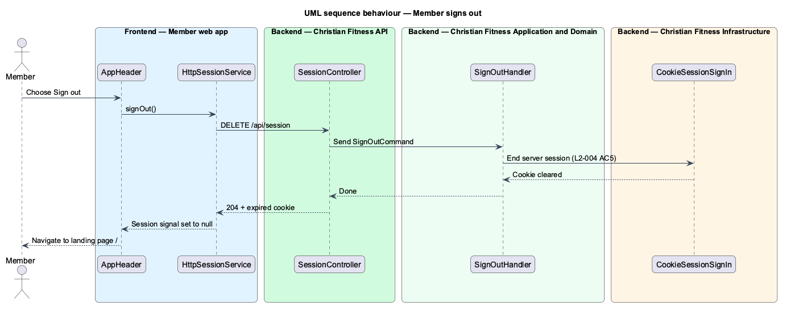

# Sign in and sign out

## Overview

Members reach every member route through a server session. This feature covers
the Sign in screen at `/sign-in`, the guard that protects member routes and the
Sign out action. It belongs to the member-access subsystem.

- **session cookie** — secure, HTTP-only, SameSite cookie that identifies a signed-in member
- **failed sign-in window** — 15-minute interval in which 5 failed sign-ins for one
  email block further attempts
- **suspended member** — member whose `MemberStatus` is `Suspended`

Correct credentials set the session cookie and open Home, or the route the member
first asked for. Wrong credentials show one generic message that does not reveal
which field was wrong. Repeated failures and suspended accounts are refused with
error codes the screen branches on. Sign out ends the session on the server.

## Description

Slice 3.1 builds sign-in with the generic refusal, sign-out and the guard's
redirect ([ADR 0009](../../../adr/0009-sign-in-sign-out-and-request-protections.md));
slice 3.2 adds the failure window, the suspension refusal and the return to the
route first asked for.

- **`SignInPage`** — routed, lazy page at `/sign-in` using the mock's `auth`,
  `field`, `input` and `form-alert` blocks, with one signal per field. While the
  request is on its way the button reads "Signing in…", is disabled and busy, and the
  fields are read-only. Success navigates to `/home` (L2-004 AC1); slice 3.2 reads a
  `returnUrl` set by the guard and navigates there instead (L2-004 AC6).
  `signInRefusalOf` (`domain`) turns the `ApiError` into what the screen shows: the
  `form-alert` "Email or password is incorrect" for code `invalid_credentials`, with
  no field marked invalid (L2-004 AC2, mock `invalid`), and "We couldn't sign you in"
  for anything else (mock `failed`). Slice 3.2 adds a wait message for
  `too_many_attempts` and a contact-the-team message for `account_suspended`. The
  mock's "Forgot your password?" link under the password field opens `/forgot-password`
  (slice 20.1, [reset a forgotten password](../reset-password/README.md)).
- **`memberAuthGuard`** — `CanActivateFn` in `domain` on `MemberShell`, the parent of
  every member route. It asks `SESSION_SERVICE.current()`: a session opens the route,
  a 401 redirects to `/sign-in` (slice 3.2 adds `?returnUrl=…`), and any other failure
  keeps the visitor where they are, since a 5xx already opens the server-error screen.
- **`MemberShell`** — routed layout in the member app; it renders `AppHeader` with
  the Sign out button ([navigate the member app](../../member-home/navigate-member-app/README.md)).
  Choosing it calls `signOut()` and, on a 204 or a 401 (already signed out), navigates
  to `/` (L2-004 AC5). Any other failure keeps the member where they are with the
  button enabled.
- **`SessionApi` / `SESSION_SERVICE`** — contract and token in `api`; `signIn` takes a
  `SignInRequestDto` (`email`, `password`) and answers the `SessionDto`; `signOut`
  completes once the session has ended, a 401 included; `current` answers the
  session. `HttpSessionService` implements it over HTTP, holds no state and is bound
  in `app.config.ts`.
- **`SessionController`** — `POST /api/session` (`[AllowAnonymous]`, 200 with the
  `SessionDto`), `DELETE /api/session` (204) and `GET /api/session`. Each sends one
  MediatR request. Both writes need the antiforgery token
  ([secure sessions](../../security/secure-sessions/README.md)).
- **`SignInHandler`** — looks the member up by the email's lookup key and verifies the
  password through `IPasswordHasherService`. An unknown email is verified against a
  fixed hash, so the answer takes as long as for a wrong password. Either failure or a
  blank field throws `RefusalException` with code
  `invalid_credentials`, answered 401 (L2-004 AC2). Success signs the member in
  through `ISessionSignIn`. Slice 3.2 first reads failed attempts for the email inside
  the last 15 minutes from `TimeProvider` and refuses the sixth with
  `too_many_attempts` and HTTP 429 (L2-004 AC3), and refuses a `Suspended` member
  with `account_suspended` (L2-004 AC4).
- **`SignInAttempt`** (slice 3.2) — record of one failed sign-in (`NormalizedEmail`,
  `AttemptedAt`). Where it is stored is slice 3.2's decision.
- **`CookieSessionSignIn`** — infrastructure implementation of `ISessionSignIn`: it
  issues the cookie on success and calls `SignOutAsync` on sign-out (L2-004 AC5), and
  sets the request's user to the new identity, so the response carries an antiforgery
  token for it.
- **`SignOutHandler`** — ends the session on the server: `DatabaseTicketStore` deletes its
  row and the cookie expires, so a replayed copy of the cookie is refused 401
  ([secure sessions](../../security/secure-sessions/README.md)).
- **Telemetry** — the sign-in route is recorded as its template; no span or log
  carries the email, the password or the cookie, on success or refusal.

## Requirements

The feature realizes the following level-2 (L2) requirements. Each L2
requirement refines a level-1 (L1) requirement, cited by identifier.

| L2 ID | Refines (L1) | Requirement |
|-------|--------------|-------------|
| `L2-004` | `L1-002` | Given a registered member, when they sign in with the correct email and password, then a secure, HTTP-only, SameSite session cookie is set and they land on Home; wrong credentials show one generic message; 5 failed sign-ins for one email within 15 minutes refuse a sixth with code `too_many_attempts` and HTTP 429; a suspended member is refused with code `account_suspended`; Sign out ends the session on the server; a visitor opening a member route is redirected to sign-in and returned afterwards (acceptance criteria 1–6). |

## Diagrams

### System context

The member reaches Christian Fitness over HTTPS; the system exports telemetry to an OpenTelemetry collector.

### Containers

The Member web app calls the Christian Fitness API, which reads and writes the Christian Fitness database. The Christian Fitness CLI applies migrations and seed data; the API does not migrate on startup.

### Components

The components below are the parts this slice touches in the Member web app and the Christian Fitness API; each controller sends one MediatR request.

### Class structure

The class diagram shows the frontend contract and its HTTP implementation, the request and handler types and the domain entities they read or change.

### Behaviour — sign in

The guard sends a visitor to sign-in, and the interceptor fetches an antiforgery token first when there is none. The handler gives one generic refusal for an unknown email or a wrong password before the cookie is issued; slice 3.2 adds the 15-minute failure window, the suspension refusal and the return URL (`L2-004`).

### Behaviour — sign out

Sign out, from the app header, ends the session on the server and returns the member to the landing page; a session that had already ended counts as signed out (`L2-004` AC5, `L2-008` AC4).

