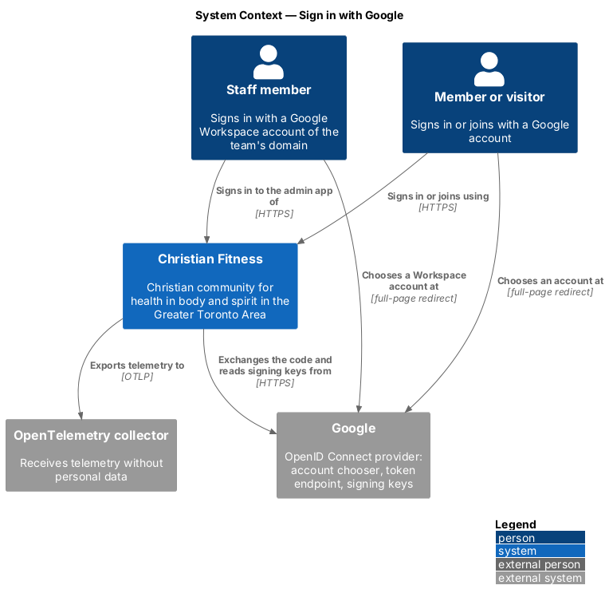
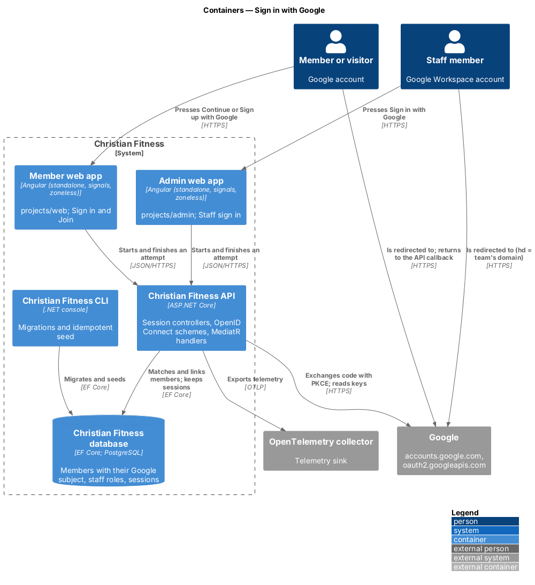
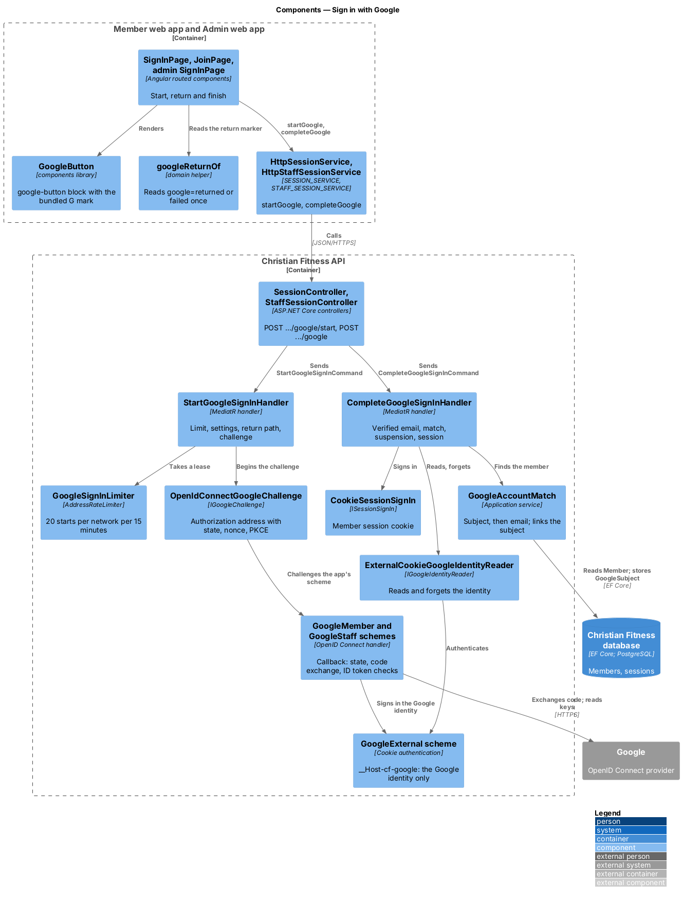
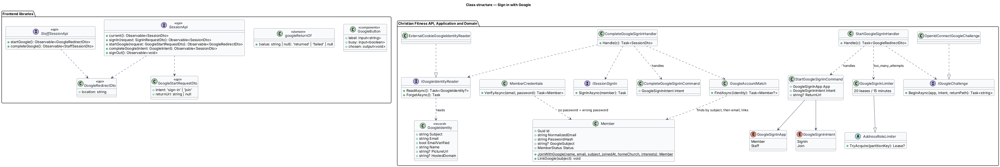
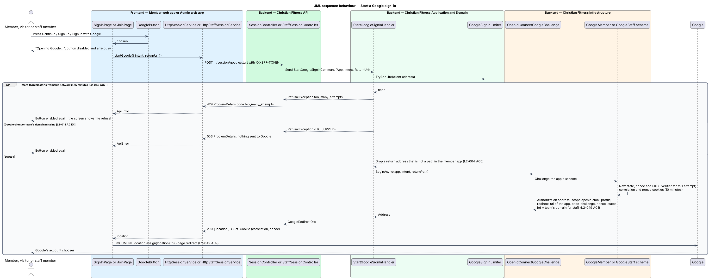
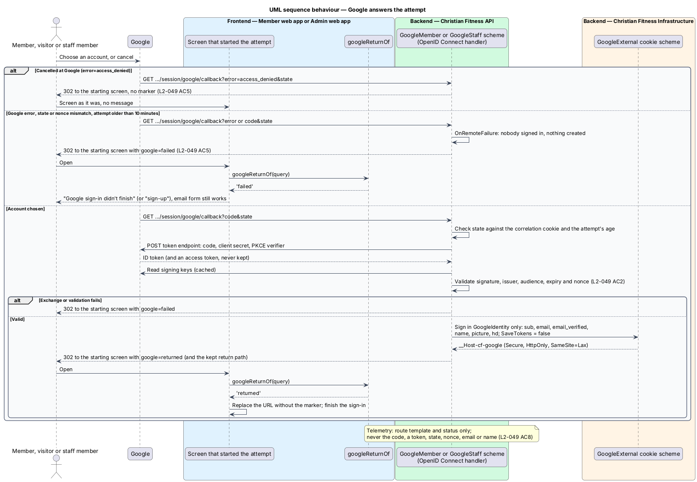
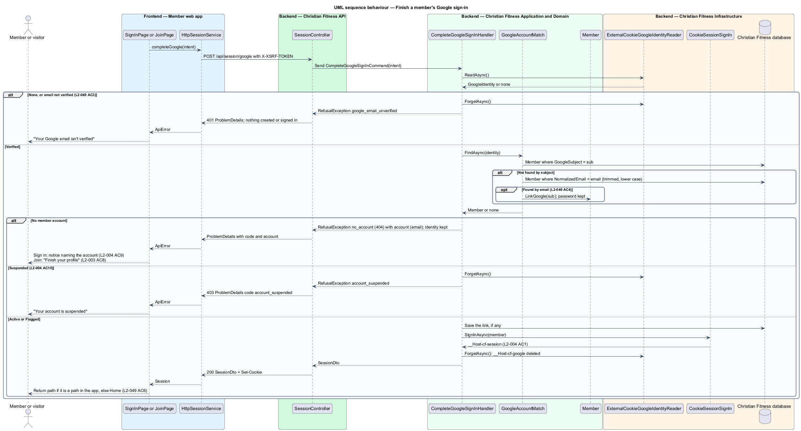

# Sign in with Google

## Overview

Christian Fitness is a Christian community for health in body and spirit in the Greater Toronto
Area. It runs two web apps: the _Member web app_ for members and the _Admin web app_ for the team.
A member may sign in with an email and password or with their Google account (`L1-002`); staff sign
in to the Admin web app only with the team's Google Workspace accounts (`L1-008`). This feature is
the Google sign-in both apps share: how an attempt starts, how Google's answer is checked on the
server, and how a checked Google account is matched to a Christian Fitness account. It belongs to the
member-access subsystem; the screens that start it are designed in
[sign in and sign out](../sign-in-and-out/README.md), [create a member account](../create-account/README.md)
and [admin sign-in](../../admin-access/admin-sign-in/README.md).

- **Google sign-in** — OpenID Connect authorization code flow with Google, completed on the server
- **attempt** — one Google sign-in from the press of a Google button to the return from Google, valid for at most 10 minutes
- **`state`** — random value an attempt sends to Google and expects back, which ties the answer to the attempt
- **nonce** — random value an attempt asks Google to put in the ID token, which ties the token to the attempt
- **PKCE challenge** — hash of a secret verifier the server keeps for the attempt and shows only when it exchanges the code (RFC 7636)
- **ID token** — JSON Web Token signed by Google that states who the person is
- **Google subject** — stable identifier of a Google account (the ID token's `sub` claim)
- **hosted domain** — Google Workspace domain of an account (the ID token's `hd` claim), absent for a personal Google account
- **Google identity** — subject, email, `email_verified`, name, picture and hosted domain read from one checked ID token
- **linked account** — member account that has stored a Google subject
- **team's domain** — Google Workspace domain whose accounts may open the Admin web app (`christian.fitness`)

The person presses "Continue with Google" or "Sign up with Google" (member app) or "Sign in with
Google" (admin app). The button reads "Opening Google…", and the browser leaves for Google in a
full-page redirect. Google shows its account chooser (mock `docs/mocks/pages/google-account-chooser/`,
drawn only so the flows click through: Google renders it, the product never does). Google sends the
browser back to the API, which exchanges the code, checks the ID token and keeps only the Google
identity, then returns the browser to the screen that started the attempt. That screen asks the API
to finish: the API matches the Google identity to an account and signs it in, or refuses with a
`code` the screen branches on. No Google script, font or image loads in either app, and no Google
token reaches the browser or outlives the sign-in.

## Description

The slice runs from the Google button on each screen, through Google, to the member store. It
extends the session code of [sign in and sign out](../sign-in-and-out/README.md) (`SessionController`,
`ISessionSignIn`, `MemberCredentials`) and of [admin sign-in](../../admin-access/admin-sign-in/README.md)
(`StaffSessionController`, `IStaffSessionSignIn`). It needs an ADR when the first slice lands; the
choices below marked `<TO SUPPLY>` are its open points.

### Frontend (both apps)

- **`GoogleButton`** — presentation component in the components library under its design-system
  name (`components/src/google-button/`, block `google-button`, design-system page
  `docs/design-system/components/google-button.html`). It renders one `<button type="button">` with
  the full-colour G mark, bundled as inline SVG in the library (`google-g`), and the label the screen
  passes: "Continue with Google", "Sign up with Google", "Sign in with Google" or "Try another Google
  account". Inputs `label` and `busy` (`booleanAttribute`); while busy it reads "Opening Google…",
  shows the spinner icon, and is `disabled` and `aria-busy="true"` (mock states `redirecting`). It
  follows Google's sign-in branding: Google's wording, a neutral border and fill, at least 44 px tall
  (`L2-049` AC10). Output `chosen`.
- **`Divider`** — the existing components-library divider in its labelled form (block `or-divider`),
  reading "or with email" between the Google button and the email form.
- **Start** — each screen calls its session contract's `startGoogle(...)`: `SessionApi.startGoogle({
  intent, returnUrl })` in the member app, `StaffSessionApi.startGoogle()` in the admin app (see the
  screen designs). The answer is a `GoogleRedirectDto` (`location`, Google's authorization address);
  the screen leaves for it with `DOCUMENT.location.assign(location)`, a full-page redirect
  (`L2-049` AC9). The button stays busy until the page unloads. A refusal brings the button back
  with the refusal shown.
- **Return** — Google's answer comes back to the screen that started the attempt with the query
  `google=returned` (finish it) or `google=failed` (`L2-049` AC5), or with neither when the person
  cancelled at Google. `googleReturnOf` (`domain`) reads that parameter once; the screen then
  replaces the URL without it, so a reload neither repeats the finish nor shows the message again.
- **Finish** — on `returned` the screen calls `completeGoogle()` on its contract, which answers the
  session or a refusal (`ApiError` with `code`). What each screen shows for each code is in its own
  design.

### Backend: starting an attempt

- **`SessionController.StartGoogle`** — `[AllowAnonymous]` `POST /api/session/google/start` (member
  app) with `StartGoogleSignInRequest` (`intent`: `sign-in` or `join`; `returnUrl`). It sends one
  `StartGoogleSignInCommand` with `App = Member` and answers 200 with the `GoogleRedirectDto`.
- **`StaffSessionController.StartGoogle`** — `[AllowAnonymous]` `POST /api/admin/session/google/start`
  (admin app). It sends one `StartGoogleSignInCommand` with `App = Staff` and `Intent = SignIn`. Both
  starts are writes, so they carry the antiforgery token
  ([secure sessions](../../security/secure-sessions/README.md)).
- **`StartGoogleSignInValidator`** — FluentValidation: the intent is `sign-in` or `join`; a staff
  attempt has no return address. A failure answers 400 `validation_failed` (`L2-032` AC1).
- **`StartGoogleSignInHandler`** — in this order:
  1. `GoogleSignInLimiter` (an `AddressRateLimiter` of 20 leases per 15 minutes, partitioned by
     `IClientAddress`, counting both apps alike) refuses the 21st start from one network within 15
     minutes with `too_many_attempts` and HTTP 429 (`L2-049` AC7);
  2. a missing Google client (`Google:ClientId`, `Google:ClientSecret`) or, for a staff attempt, a
     missing team's domain (`Google:StaffDomain`) refuses the start with code `<TO SUPPLY>` and HTTP
     503, and nothing leaves for Google (`L2-018` AC10);
  3. a return address that is not a path inside the member app is dropped, by the server copy of the
     rule `signInReturnPathOf` applies (`L2-049` AC6, `L2-004` AC6); both suites share one inline
     case table;
  4. `IGoogleChallenge.BeginAsync(app, intent, returnPath)` answers the authorization address.
- **`OpenIdConnectGoogleChallenge`** — Infrastructure implementation of `IGoogleChallenge`. It runs
  the OpenID Connect challenge of the app's scheme and answers the address the challenge redirects
  to, in place of the 302, so the screen can branch on a refusal before it leaves. The intent and the
  return path travel in the challenge's `AuthenticationProperties.Items`, protected inside `state`.
- **OpenID Connect schemes** — ASP.NET Core's OpenID Connect handler, registered twice in
  `AuthenticationSetup`: `GoogleMember` with callback path `/api/session/google/callback` and
  `GoogleStaff` with `/api/admin/session/google/callback`, each a redirect address registered for
  its app's origin with the one Google client (`L2-049` AC1). Both use Google's discovery document
  (`https://accounts.google.com/.well-known/openid-configuration`), `ResponseType = code` with PKCE,
  a nonce, the scopes `openid`, `email` and `profile` only, `SaveTokens = false`,
  `GetClaimsFromUserInfoEndpoint = false` and `RemoteAuthenticationTimeout` of 10 minutes.
  `GoogleStaff` also sends `hd` with the team's domain, so Google offers only the team's accounts
  (`L2-049` AC1). Google answers by `GET` (response mode `query`), so the correlation and nonce
  cookies work with `SameSite=Lax`.

### Backend: Google's answer

- **Callback** — the OpenID Connect handler of the scheme answers its callback path; no controller
  takes part. It checks the `state` against its correlation cookie and the attempt's age, exchanges
  the code at Google's token endpoint with the PKCE verifier from the server, and validates the ID
  token's signature against Google's published keys, its issuer, audience, expiry and nonce
  (`L2-049` AC2). On success it signs in to the `GoogleExternal` cookie scheme with the Google
  identity alone and redirects to the screen that started the attempt with `google=returned` (and the
  kept return path, for a member sign-in). The access and ID tokens are dropped with the response.
- **`OnRemoteFailure`** — Google reports an error, the `state` or nonce does not match, the attempt is
  older than 10 minutes or the exchange fails: nobody is signed in, nothing is created, and the
  browser returns to the starting screen with `google=failed` (`L2-049` AC5). A `state` that cannot be
  read names no screen; the browser then returns to the app's sign-in screen.
- **`OnAccessDenied`** — the person cancelled at Google (`error=access_denied`): the browser returns
  to the starting screen with no marker and no message (`L2-049` AC5).
- **`GoogleExternal` cookie scheme** — `__Host-cf-google`: `Secure`, `HttpOnly`, `SameSite=Lax`,
  path `/`, protected by the Data Protection keys the session cookies use. It holds the Google
  identity and nothing else: never a code, token, `state` or nonce. Its lifetime is `<TO SUPPLY>`;
  each finish that signs someone in or refuses them for good deletes it.
- **`GoogleIdentity`** — Application record: `Subject`, `Email`, `EmailVerified`, `Name`,
  `PictureUrl` and `HostedDomain`, the only claims sign-in uses (`L2-049` AC2).
- **`IGoogleIdentityReader`** — Application abstraction with `ReadAsync()` (the identity, or none)
  and `ForgetAsync()` (deletes the external cookie); `ExternalCookieGoogleIdentityReader`
  implements it in Infrastructure.

### Backend: finishing for a member

- **`SessionController.CompleteGoogle`** — `[AllowAnonymous]` `POST /api/session/google` with the
  intent. It sends one `CompleteGoogleSignInCommand` and answers 200 with the `SessionDto` and the
  member session cookie, as the email sign-in does.
- **`CompleteGoogleSignInHandler`** — in this order:
  1. no Google identity (none came back, or it expired) refuses with code `<TO SUPPLY>` and HTTP 401;
  2. an identity whose `EmailVerified` is false is forgotten and refused the same way: nothing is
     created or signed in (`L2-049` AC3);
  3. `GoogleAccountMatch.FindAsync(identity)` finds the member account (`L2-049` AC4);
  4. none found: the refusal `<TO SUPPLY>` (code and status) with an `account` extension holding the
     Google account's email, and the identity is kept for "Finish your profile"
     ([create a member account](../create-account/README.md));
  5. a `Suspended` member is refused `account_suspended` and HTTP 403, and the identity is forgotten
     (`L2-004` AC10);
  6. otherwise the identity is forgotten, the member is signed in through `ISessionSignIn`, and the
     `SessionDto` is answered. A member with a password keeps it (`L2-049` AC4).
- **`GoogleAccountMatch`** — Application service both finishes use. It looks for the `Member` whose
  `GoogleSubject` equals the identity's subject; failing that, for the `Member` whose
  `NormalizedEmail` equals the identity's email (trimmed, lower case). A member found by email is
  linked: `Member.LinkGoogle(subject)` stores the subject, saved with the sign-in (`L2-049` AC4).
- **`Member`** — gains `GoogleSubject` (nullable, unique index) and `LinkGoogle(subject)`, and the
  factory `Member.JoinWithGoogle(name, email, subject, joinedAt, homeChurch, interests)`, which
  stores no password hash. `MemberCredentials` answers a password sign-in to such an account exactly
  as a wrong password: verified against the fixed hash, `invalid_credentials`, a failure recorded
  (`L2-004` AC2).

Creating the account from "Finish your profile" also needs the required "I'm 16 or older"
confirmation: the request carries `ageConfirmed` and is refused with code `age_not_confirmed` and
HTTP 400 without it (`L2-003` AC12; [create a member account](../create-account/README.md)).

### Backend: finishing for staff

`StaffSessionController.CompleteGoogle` (`POST /api/admin/session/google`) sends
`CompleteStaffGoogleSignInCommand`; its handler checks the hosted domain, matches the account through
`GoogleAccountMatch` and requires a staff role. It is designed in
[admin sign-in](../../admin-access/admin-sign-in/README.md).

### Settings and telemetry

- **Settings** — `Google__ClientId`, `Google__ClientSecret` (from the secret store) and
  `Google__StaffDomain`, documented in `docs/operations/settings.md` in the slice that adds them
  (`L2-041` AC3, `L2-018` AC10). The Google client registers the two callback addresses, one per
  origin (ADR 0047: `www` and `admin`), and a local address for each app in Development.
- **Telemetry** — each endpoint and callback is recorded as its route template, method and status
  only (`L2-040` AC1). No span, metric or log carries the code, a token, the `state`, the nonce, the
  email, the name or the picture address (`L2-049` AC8); the outgoing calls to Google's token and key
  endpoints record their host and status, never a body. `Microsoft.AspNetCore` logs stay at
  `Warning`, as `docs/operations/settings.md` sets them, since they carry query strings.

### Open questions

- **Error codes and the external identity's lifetime.** Settled by
  [ADR 0062](../../../adr/0062-first-google-sign-in-slice.md) (`L2-049` AC11 and AC12):
  `google_email_unverified`, `no_account`, `account_suspended`, `account_deleting` and
  `google_unavailable`; `__Host-cf-google` lasts 10 minutes.
- **Unverified email on screen.** `L2-049` AC3 refuses an unverified Google email, but no mock state
  shows it. The screens show the "didn't finish" message (`L2-004` AC11, `L2-003` AC11, `L2-018` AC8)
  until a mock says otherwise.
- **Too many attempts on screen.** No mock state shows a 429 from a Google start in any of the three
  screens. A mock state, or a stand-in recorded in an ADR, is needed before that slice.
- **Not configured on screen.** `L2-018` AC10 says the admin app refuses to start sign-in while a
  setting is missing; no mock state shows what Staff sign in then says, and the spec is silent on the
  member app.
- **The Google picture.** Settled by ADR 0062 (`L2-049` AC14): the server copies it into
  `IImageStore` once at join if the member keeps it; the browser never loads it from Google.
- **Account chooser.** Settled by ADR 0062 (`L2-049` AC13): `prompt=select_account` only for "Use
  another account" and "Try another Google account". The mocks that show the chooser on every attempt
  are stand-ins for Google's own screen.

## Requirements

The feature realizes the following level-2 (L2) requirement. It refines three level-1 (L1)
requirements, cited by identifier. The L2 specification states its requirements as acceptance
criteria; the text below condenses those criteria faithfully.

| L2 ID    | Refines (L1)                 | Requirement                                                                                                                                                                                                                                                                                                                                                                                                                                                                                                                                                                                                                                                                                                                                                                                                                                                                                                                                                                                                                                                                                                                                                                                                                                                                                                                                                                                                                                         |
| -------- | ---------------------------- | ---------------------------------------------------------------------------------------------------------------------------------------------------------------------------------------------------------------------------------------------------------------------------------------------------------------------------------------------------------------------------------------------------------------------------------------------------------------------------------------------------------------------------------------------------------------------------------------------------------------------------------------------------------------------------------------------------------------------------------------------------------------------------------------------------------------------------------------------------------------------------------------------------------------------------------------------------------------------------------------------------------------------------------------------------------------------------------------------------------------------------------------------------------------------------------------------------------------------------------------------------------------------------------------------------------------------------------------------------------------------------------------------------------------------------------------------------- |
| `L2-049` | `L1-002`, `L1-008`, `L1-013` | Sign-in with Google shall use OpenID Connect's authorization code flow, completed on the server, in both apps, and shall trust only Google's signed answer. Each attempt shall carry its own `state`, nonce and PKCE challenge, ask only for `openid`, `email` and `profile`, and name a redirect address registered for its app; the admin app shall also limit the choice to the team's domain. The server shall exchange the code itself, check the ID token's signature, issuer, audience, expiry and nonce and the `state`, and use only subject, email, `email_verified`, name, picture and hosted domain; no Google token shall reach the browser or be kept. An unverified email shall be refused and nothing created or signed in. A verified account shall match first on its stored Google subject, then on its email case-insensitively; an account matched by email shall be linked and signed in, keeping any password. A Google error, a mismatched `state` or nonce, an attempt older than 10 minutes or a failed exchange shall sign nobody in, create nothing, and make the starting screen say sign-in didn't finish; cancelling at Google shall return to that screen with no message. A kept return address shall be honoured under `L2-004` AC6. More than 20 Google sign-ins started from one network in 15 minutes shall refuse the next with `too_many_attempts` and HTTP 429. No span, metric or log shall carry the code, a token, the `state`, the nonce, the email or the name. Neither app shall load a script, font or image from Google: sign-in is a full-page redirect and the bundled Google mark is used. The Google buttons shall follow Google's sign-in branding (Google's wording, the full-colour G, a neutral border and fill, at least 44 px tall). |

## Diagrams

### System context

A member or a staff member signs in to Christian Fitness with a Google account. Google is an
external system the browser visits for the account chooser and the API calls for the code exchange
and the signing keys; the system exports telemetry without personal data.

### Containers

Both web apps start an attempt through the Christian Fitness API and leave for Google in a
full-page redirect. Google returns the browser to the API's callback, which calls Google's token
endpoint and reads its keys; the API keeps no Google token and stores only the linked Google
subject in the Christian Fitness database.

### Components

Inside the API, the two session controllers send the start and finish requests. The OpenID Connect
handler checks Google's answer and writes the `GoogleExternal` cookie; the finish handlers read it
through `IGoogleIdentityReader` and match the account through `GoogleAccountMatch`.

### Class structure

`StartGoogleSignInHandler` depends on the limiter and `IGoogleChallenge`; `CompleteGoogleSignInHandler`
reads a `GoogleIdentity`, matches a `Member` through `GoogleAccountMatch` and signs in through
`ISessionSignIn`. `Member` gains `GoogleSubject`; the frontend contracts gain `startGoogle` and
`completeGoogle`.

### Behaviour — start an attempt

The screen asks the API to start; the API applies the per-network limit and the settings check,
then answers Google's authorization address carrying a `state`, a nonce and a PKCE challenge, and
the browser leaves for Google (`L2-049` AC1, AC7, AC9; `L2-018` AC10).

### Behaviour — Google answers

Google returns the browser to the API's callback. The handler checks the `state`, exchanges the
code, validates the ID token and keeps only the Google identity; an error, a mismatch or an expired
attempt returns the browser with `google=failed`, and a cancel returns it with no marker
(`L2-049` AC2, AC5, AC8).

### Behaviour — finish and match the account

The screen asks the API to finish. An unverified email is refused; the account is matched by Google
subject, then by email, which links it; a suspended member is refused; otherwise the member is
signed in and the identity forgotten (`L2-049` AC3, AC4, AC6; `L2-004` AC8, AC10).

