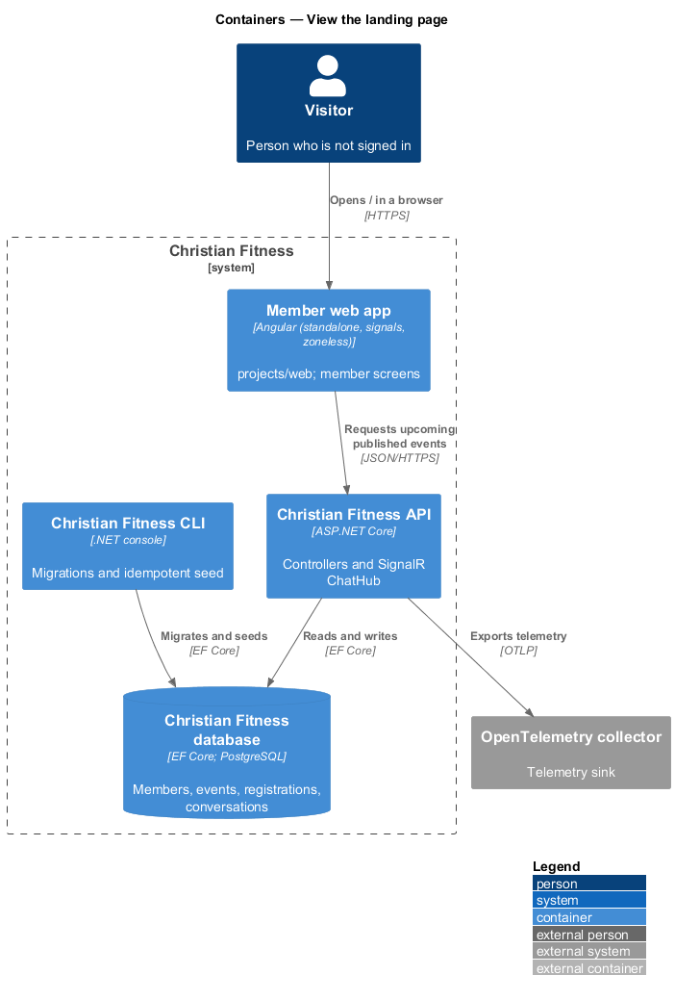

# View the landing page

## Overview

Christian Fitness is a Christian community for health in body and spirit in the Greater Toronto
Area. The _landing page_ is the public screen at `/`, the first screen a visitor sees. It is a news
front page: the community's latest stories by section, its upcoming events and its newsletter, with
invitations to join or sign in (`L1-001`, `L1-018`). It belongs to the member-access subsystem,
which covers everything a person does before and while signing in.

- **visitor** — person who opens the Member web app without a session
- **story** — article staff publish in one section, read at `/stories/<slug>` ([read a story](../../news/read-story/README.md))
- **section** — one of Events, Training, Nutrition, Faith & Body, Community and Pros; "Latest" is every section together
- **lead story** — newest published story, shown first with its image and summary
- **headlines** — the next four published stories after the lead
- **river** — the remaining stories under "The latest", newest first
- **rail** — side column with the call to join, the upcoming events, the newsletter box and "Most read"
- **most read** — the five stories read most in the last 7 days, numbered 1 to 5
- **upcoming event** — published event whose start time is later than the current time

A visitor sees the masthead with "Sign in", "Join free" and the sections, Latest current. Latest
shows the lead story, the four headlines and the river; another section shows only its own stories
under its name. The rail holds "Life to the full.", "Join the community", the next four upcoming
events, the newsletter box and "Most read", above the John 10:10 verse and the footer. The stories
and the events load and fail independently. A signed-in member who opens `/` is sent to Home. The landing page is for visitors and orders by date only; the area, follow and interest ordering is Home's (`L2-065` AC7; ADR 0076). At
viewport XS everything stacks in one column; at LG and wider the lead sits beside the headlines and
the river beside a rail that stays in view (`L2-002`).

## Description

The slice runs from the landing route to the stories and events tables. The mock is
`docs/mocks/pages/landing/` (states `default`, `section`, `section-empty`, `loading`, `empty`,
`error`, `events-error`, `most-read-empty`, `most-read-failed`, `more-stories`,
`more-stories-loading`, `more-stories-failed` and `river-capped`). Journey 25 built it; the
decisions the design left open are in [ADR 0107](../../../adr/0107-news-front-page.md). The story page, the newsletter and the feeds are designed in
[read a story](../../news/read-story/README.md),
[subscribe to the newsletter](../../news/subscribe-to-newsletter/README.md) and
[publish RSS feeds](../../news/publish-rss-feeds/README.md); this page only leads to them.

### Member web app

- **`LandingPage`** — routed page in `projects/web`, loaded with `loadComponent` at `/`, behind
  `redirectSignedInGuard`. Its `providers` bind `STORIES_SERVICE` and `PUBLIC_EVENTS_SERVICE`, so
  the clients and their requests live only while the page does. It reads the `section` query
  parameter through `newsSectionOf` and holds three independent states as signals: the stories
  (loading, loaded, empty, failed, with More stories idle, loading or failed), the events
  (loading, loaded, empty, failed) and most read (hidden until it has stories). It
  renders, in order: `Masthead`; for Latest the `top-stories` (`StoryLead` beside the
  `headline-list` of four `Headline`s) and the river under the ruled title "The latest"; for a
  section the river alone under the section's name as the page heading (`L2-001` AC2, AC3); the
  `rail`; the `verse`; `Footer`. Choosing a section navigates to `/?section=<section-slug>`; the page
  reacts to the query parameter and asks for that section's stories again (`L2-001` AC3).
- **States** — loading shows `Skeleton` rows for the top stories, the river and the events (mock
  `loading`). No stories at all reads "No stories yet. Check back soon." under "The latest"
  (mock `empty`); a section with none reads "No stories in <section> yet this week." (mock
  `section-empty`) (`L2-001` AC4). The river grows 12 stories at a time with "More stories", keeps
  the stories shown when a page fails ("More stories didn't load. The ones above are still here."),
  and stops at 60 with "That's the latest 60 stories. Choose a section above to see older ones."
  (`riverEndOf`; ADR 0107). Stories that fail show the `InlineMessage` (`inline-error`)
  "Stories didn't load." with "Check your connection, then try again." and Try again, leaving the
  rail as it is (mock `error`); events that fail show "Upcoming events didn't load." with Try again
  in the rail's list, leaving the stories as they are (mock `events-error`) (`L2-001` AC7). Fewer
  than four events show only those, with no empty rows; none reads "No events posted yet. Check
  back soon." (`L2-001` AC6). "Most read" is hidden while it loads, when it is empty and when it
  fails (mocks `most-read-empty`, `most-read-failed`). Try again repeats only the request that
  failed.
- **`redirectSignedInGuard`** — `CanActivateFn` on `/`, unchanged. It reads `SESSION_SERVICE` and
  redirects a signed-in member to `/home`; any failure shows the page (`L2-001` AC8; ADR 0037).
- **`Masthead`** — presentation component in the components library under its design-system name
  (`components/src/masthead/`, block `masthead`, with `section-nav`): the lockup, "Sign in" (to
  `/sign-in`) and "Join free" (to `/join`), and one link per section in the order Latest, Events,
  Training, Nutrition, Faith & Body, Community, Pros. The current one carries
  `aria-current="page"` (`L2-001` AC1). Inputs only: the sections with their links and the current
  section. It stays at the top while the page scrolls at every viewport; at XS the section links
  scroll sideways inside it without the page scrolling sideways, and "Join free" stays in it
  (`L2-002` AC1, AC3). A plain click on a section emits `navigate`, which the page follows through
  the router. The story page keeps the top bar's `site` form for now (ADR 0105, ADR 0107).
- **Story blocks** — presentation components in the components library under the design-system
  page `story` (`components/src/story/`): `StoryLead` (`cf-story-lead`, block `story-lead`: image,
  section, title, summary, author and age), `HeadlineList` (`cf-headline-list`, blocks
  `headline-list` and `headline`: section, title, author, age and image), `River` (`cf-river`,
  blocks `river` and `story-row`: the ruled title, then section, age, title, author, image and the
  summary where there is one, with what ends the river projected after it) and `RankedList`
  (`cf-ranked-list`, block `ranked`, for "Most read": numbered 1 to 5, title only). Each takes a
  `NewsStoryView` and draws skeletons with `loading`.
  Each title is a link to `/stories/<slug>` (`L2-001` AC2). Titles, summaries and authors are
  rendered as text, never as HTML (`L2-001` AC10). How the page's blocks map to components follows
  the `story` design-system page; [read a story](../../news/read-story/README.md) adds `StoryCard`
  in the same folder.
- **`storyAge`** — pure helper in the `domain` library (`news/story-list.ts`), defined by
  [read a story](../../news/read-story/README.md): a publication instant and now to "2 hours ago",
  "Yesterday" or a date, in `America/Toronto`. The page passes it the clock it reads once per load.
- **`newsSectionOf`** — pure helper in the `domain` library with a unit test per row: a `section`
  query value to one of the six sections, and anything else, or none, to Latest (`L2-001` AC3).
  The values are ADR 0071's feed slugs (`events`, `training`, `nutrition`, `faith-body`,
  `community`, `pros`), each mapped to the API's section name (`faith-and-body`); `NEWS_SECTIONS`
  lists the masthead's links in order (`news/front-page.ts`).
- **Rail** — the `rail` block (`aria-label="Join, events and newsletter"`), in the page template:
  - `JoinCard` (`cf-join-card`, in `components/src/newsletter-box/`), the design-system page
    `newsletter-box`'s block `join-card`: "Life to the
    full.", "A Christian community for health in body and spirit. Find events, train with
    friends, and meet professionals who share your faith." and "Join the community" leading to
    `/join` (`L2-001` AC5);
  - "Upcoming events" under a ruled title (`section-heading`), a `List` (`list-divided`) of up to
    four `EventRow`s (existing component, block `event-row`): month and day, title, and weekday,
    time and area, each leading to `/join`, since the events screen needs a session (ADR 0037).
    `eventCardViewOf` words the start in Toronto, and the row reads "Sat 6:45 AM · Waterfront";
  - `NewsletterBox` (design-system page `newsletter-box`): "The Abundant Weekly", "The week's
    stories and events in one email. Every Saturday, 7 AM.", the Email address field and
    "Subscribe free", and "Or follow by RSS". "Subscribe free" navigates to `/subscribe` with the
    typed email in navigation state; "Or follow by RSS" navigates to `/subscribe#rss`; the page
    sends nothing itself (`L2-057` AC1,
    [subscribe to the newsletter](../../news/subscribe-to-newsletter/README.md)). Journey 27
    builds it; until then the rail has no newsletter box;
  - "Most read", the `ranked` list of five stories (`L2-001` AC5).
- **`Footer`** — existing component (block `site-footer`), gaining links to the newsletter's latest
  issue (`/newsletter`), the feeds (`/subscribe#rss`), Send feedback, the Privacy Policy
  (`/privacy`) and the Terms of Service (`/terms`) (`L2-001` AC9). The route of Send feedback is
  set by the feedback design (`L2-063`). Journey 25 keeps the Privacy Policy and Terms of Service
  links; the Newsletter, RSS and Send feedback links come with journeys 26, 27 and 30.
- **Feed discovery** — the document head names the feeds with
  `<link rel="alternate" type="application/rss+xml">` (`L2-060` AC3), as
  [publish RSS feeds](../../news/publish-rss-feeds/README.md) defines them. The links sit in the
  member app's `index.html`, which nginx serves for `/`, so a feed reader that runs no script
  finds them.
- **Responsive layout** — the page stylesheet uses the design-system breakpoints. At XS the lead,
  the headlines, the river and the rail stack in that order with no horizontal overflow; at LG and
  wider the lead sits beside the four headlines and the river beside the rail, which is sticky
  while the stories scroll (`L2-002` AC1, AC2).
- **`StoriesApi` / `STORIES_SERVICE`** — the contract of [read a story](../../news/read-story/README.md)
  in the `api` library, extended with `frontPage(section, skip)`, answering `FrontPageDto`, and
  `mostRead()`, answering `StorySummaryDto[]`. `HttpStoriesService` implements both.
  `StorySummaryDto` carries `id`, `slug`, `section`, `headline`, `summary` (or `null`), `author`,
  `publishedAt` (UTC) and `image` (key and crop); `FrontPageDto` carries `lead` (or `null`),
  `headlines` (at most four), `latest` (at most 12) and `more`. A section's page answers no lead
  and no headlines.
- **`PublicEventsApi` / `PUBLIC_EVENTS_SERVICE`** — existing contract; `upcoming(take)` now asks
  for 4, and `LandingEventDto` gains `area`.
- **Removed** — `LandingProfessionals`, `LandingProfessionalsOnView`,
  `PUBLIC_PROFESSIONALS_SERVICE` and `HttpPublicProfessionalsService`, which served the old page's
  professionals section (ADR 0057, superseded by ADR 0107).

### Christian Fitness API

- **`PublicStoriesController`** — the `[AllowAnonymous]` controller of
  [read a story](../../news/read-story/README.md) under `api/public/stories`, gaining
  `GET /api/public/stories?section=&skip=` (`ListFrontPageStoriesQuery`) and
  `GET /api/public/most-read-stories` (`ListMostReadStoriesQuery`), an address outside
  `api/public/stories/…` so that no story's link can hide it. Each action sends one request and
  is held to `public-reads`.
- **`ListFrontPageStoriesQuery` / `ListFrontPageStoriesHandler`** — reads the stories readers see
  now (`PublishedStories.At`: Published ones and Scheduled ones whose time has come, at that time),
  newest first, then `Id`. Without a section the lead is the story placed as the Lead, else the
  newest; the headlines are the stories placed in Top headlines, filled with the newest others up
  to four, newest first (`L2-069` AC6 with `L2-001` AC2; ADR 0107); the river is the rest. With a
  section it answers only that section's stories as the river. The river comes 12 at a time from
  `skip` (0 to 48), so it is bounded at 60, and `more` says whether older ones follow. An unknown
  section or skip is refused by `ListFrontPageStoriesValidator` with 400 `validation_failed`
  (`section_invalid`, `skip_invalid`); the page never sends one, since `newsSectionOf` maps it to
  Latest. Drafts, stories in review, scheduled ones not yet due and unpublished stories never
  appear.
- **`ListMostReadStoriesQuery` / `ListMostReadStoriesHandler`** — sums each Published story's
  `StoryReadTally` rows for the last 7 Toronto days (`TimeProvider`) and answers the five highest,
  ties broken by the newer story, then the higher id (`L2-001` AC5; ADR 0107). The 7 days are the
  Toronto day six days ago to today; a story with no reads in them is not ranked.
- **`PublicReadLimiter`** — the limit of anonymous news reads named in
  [read a story](../../news/read-story/README.md); both story reads take a lease from it.
- **Removed** — `PublicServicesController`'s `GET /api/public/services/featured` and
  `ListLandingProfessionalsQuery` (ADR 0057, superseded by ADR 0107).
- **`PublicEventsController`** — existing `[AllowAnonymous]` `GET /api/public/events/upcoming?take=`.
  `GetUpcomingEventsQuery.MaxTake` becomes 4 and `LandingEventDto` gains `Area`; the handler still
  reads Published events that start after `TimeProvider.GetUtcNow()`, soonest first (`L2-001` AC5,
  AC6). The answer carries no going count, capacity or member detail.
- **Telemetry and privacy** — each request is recorded as its route template, method and status;
  the `section` query value is never recorded. Nothing on the page identifies or reaches a member:
  bylines are the story's author line, and the answers carry no member id or contact detail
  (`L2-001` AC10).

### Open questions

None. Journey 25 settled the earlier ones in [ADR 0107](../../../adr/0107-news-front-page.md): the
old layout and the professionals parts are replaced and removed; the section's address value is
ADR 0071's feed slug; the member count stays out until a requirement states it; "Most read" is its
own request, hidden when it is empty or fails; the river grows 12 at a time to 60; and every title
leads to its story.

## Requirements

The feature realizes the following level-2 (L2) requirements. Each L2 requirement refines a level-1
(L1) requirement, cited by identifier. The L2 specification states its requirements as acceptance
criteria; the text below condenses those criteria faithfully.

| L2 ID | Refines (L1) | Requirement |
|-------|--------------|-------------|
| `L2-001` | `L1-001`, `L1-018` | The landing page shall be a news front page: a masthead with the sections, the top stories, the latest stories, and a rail with the call to join, the next four events, the newsletter sign-up and the most-read stories, above the John 10:10 verse. A visitor opening `/` shall see "Sign in", "Join free" and the sections Latest, Events, Training, Nutrition, Faith & Body, Community and Pros, with Latest current (`aria-current="page"`). Latest shall lead with the newest story (image, section, title, summary, author, age), then four headlines (section, title, author, age, image), then the rest under "The latest", newest first (section, age, title, author, image, and summary where it has one); every title leads to its story page. Choosing another section shall set `/?section=<name>` and show only that section's stories, newest first, under its name as the heading, without the top stories; an unknown section shows Latest. A section with no stories shall read "No stories in <section> yet this week."; no stories at all shall read "No stories yet. Check back soon." The rail shall hold "Life to the full.", "Join the community" leading to Join, "Upcoming events" with the next four published events in date order (date, title, weekday, time and area, each leading to Join), the newsletter box and "Most read", the five most-read stories of the last 7 days numbered 1 to 5. Fewer than four events shall show only those; none shall read "No events posted yet. Check back soon." Stories that fail shall show "Stories didn't load." with Try again, leaving the rail unaffected; events that fail shall show "Upcoming events didn't load." with Try again, leaving the stories unaffected. A signed-in member shall be redirected to Home. The footer shall link to the newsletter's latest issue, the RSS feeds, Send feedback, the Privacy Policy and the Terms of Service. Titles, summaries and authors shall be rendered as text, never HTML, and nothing on the page shall identify or reach a member. |
| `L2-002` | `L1-001` | At viewport XS the lead story, the headlines, the latest stories and the rail shall stack in one column in that order, the sections shall scroll sideways inside the masthead without the page scrolling sideways, "Join free" shall stay in the masthead, and no content shall overflow horizontally. At LG or wider the lead story shall sit beside the four headlines, and the latest stories beside the rail, which stays in view while the stories scroll. At any viewport the masthead with the sections shall stay at the top while the visitor scrolls. |

## Diagrams

### System context

A visitor reads the news front page of Christian Fitness over HTTPS without an account; staff
publish the stories and events it shows. The system exports telemetry to an OpenTelemetry
collector without personal data.

### Containers

The Member web app calls the Christian Fitness API for the front-page stories, the most-read
stories and the upcoming events; the API reads them from the Christian Fitness database. The
Christian Fitness CLI applies migrations and seed data; the API does not migrate on startup.

### Components

`LandingPage` composes the masthead, story, rail and footer components and reads two contracts;
in the API, `PublicStoriesController` and `PublicEventsController` each send one MediatR request
per action.

### Class structure

`LandingPage` depends on `StoriesApi` and `PublicEventsApi` and on the `newsSectionOf` and
`storyAge` helpers; the handlers project `Story`, `StoryReadTally` and `Event` rows into
`FrontPageDto`, `StorySummaryDto` and `LandingEventDto`.

### Behaviour — open the landing page

The guard redirects a signed-in member to Home. Otherwise the page reads the section, then asks
for the front page, the most-read stories and at most four upcoming events in parallel; each part
shows its rows, its empty message or its own failure with Try again, without affecting the others
(`L2-001` AC1–AC8).

### Behaviour — choose a section

Choosing a section changes the address to `/?section=<value>`; the page asks for that section's
stories alone and shows them under its name, or the section's empty message; an unknown value shows
Latest (`L2-001` AC3, AC4).

