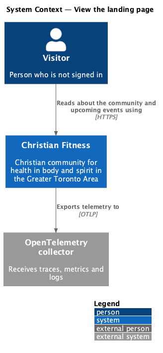
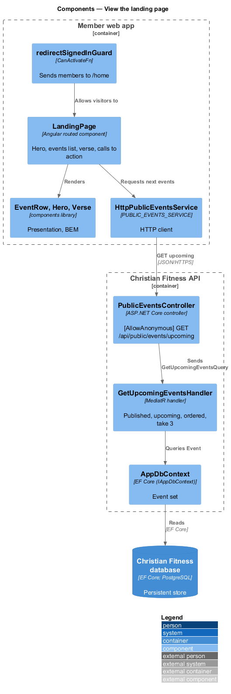
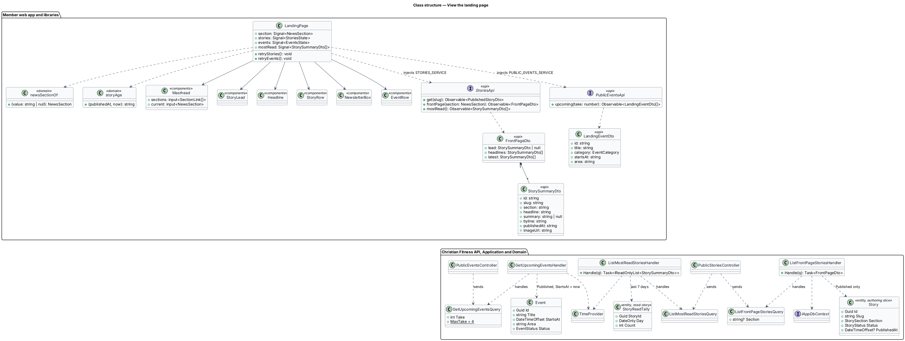
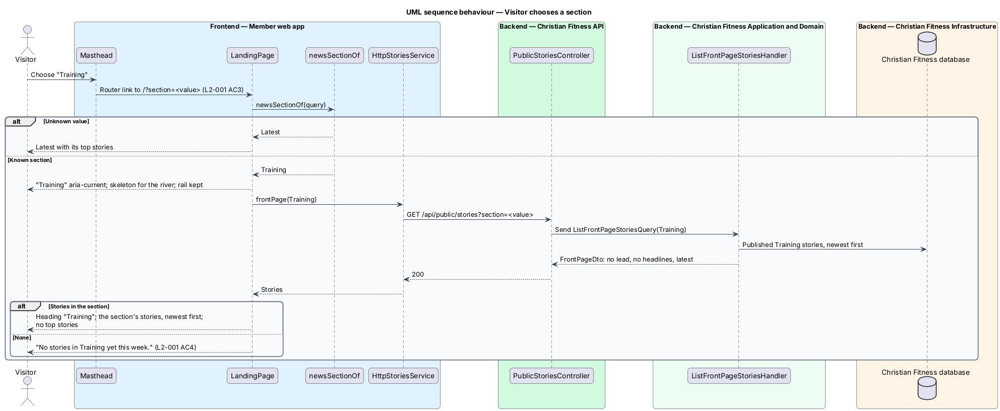

# View the landing page

## Overview

Christian Fitness is a Christian community for health in body and spirit in the Greater Toronto
Area. The _landing page_ is the public screen at `/`, the first screen a visitor sees. It is a news
front page: the community's latest stories by section, its upcoming events and its newsletter, with
invitations to join or sign in (`L1-001`, `L1-018`). It belongs to the member-access subsystem,
which covers everything a person does before and while signing in.

- **visitor** — person who opens the Member web app without a session
- **story** — article staff publish in one section, read at `/stories/<slug>` ([read a story](../../news/read-story/README.md))
- **section** — one of Events, Training, Nutrition, Faith & Body, Community and Pros; "Latest" is every section together
- **lead story** — newest published story, shown first with its image and summary
- **headlines** — the next four published stories after the lead
- **river** — the remaining stories under "The latest", newest first
- **rail** — side column with the call to join, the upcoming events, the newsletter box and "Most read"
- **most read** — the five stories read most in the last 7 days, numbered 1 to 5
- **upcoming event** — published event whose start time is later than the current time

A visitor sees the masthead with "Sign in", "Join free" and the sections, Latest current. Latest
shows the lead story, the four headlines and the river; another section shows only its own stories
under its name. The rail holds "Life to the full.", "Join the community", the next four upcoming
events, the newsletter box and "Most read", above the John 10:10 verse and the footer. The stories
and the events load and fail independently. A signed-in member who opens `/` is sent to Home. At
viewport XS everything stacks in one column; at LG and wider the lead sits beside the headlines and
the river beside a rail that stays in view (`L2-002`).

## Description

The slice runs from the landing route to the stories and events tables. The mock is
`docs/mocks/pages/landing/` (states `default`, `section`, `section-empty`, `loading`, `empty`,
`error` and `events-error`). The story page, the newsletter and the feeds are designed in
[read a story](../../news/read-story/README.md),
[subscribe to the newsletter](../../news/subscribe-to-newsletter/README.md) and
[publish RSS feeds](../../news/publish-rss-feeds/README.md); this page only leads to them.

### Member web app

- **`LandingPage`** — routed page in `projects/web`, loaded with `loadComponent` at `/`, behind
  `redirectSignedInGuard`. Its `providers` bind `STORIES_SERVICE` and `PUBLIC_EVENTS_SERVICE`, so
  the clients and their requests live only while the page does. It reads the `section` query
  parameter through `newsSectionOf` and holds three independent states as signals: the stories
  (loading, loaded, empty, failed), the events (loading, loaded, empty, failed) and most read. It
  renders, in order: `Masthead`; for Latest the `top-stories` (`StoryLead` beside the
  `headline-list` of four `Headline`s) and the river under the ruled title "The latest"; for a
  section the river alone under the section's name as the page heading (`L2-001` AC2, AC3); the
  `rail`; the `verse`; `Footer`. Choosing a section navigates to `/?section=<value>`; the page
  reacts to the query parameter and asks for that section's stories again (`L2-001` AC3).
- **States** — loading shows `Skeleton` rows for the top stories, the river and the events (mock
  `loading`). No stories at all reads "No stories yet. Check back soon." under "The latest"
  (mock `empty`); a section with none reads "No stories in <section> yet this week." (mock
  `section-empty`) (`L2-001` AC4). Stories that fail show the `InlineMessage` (`inline-error`)
  "Stories didn't load." with "Check your connection, then try again." and Try again, leaving the
  rail as it is (mock `error`); events that fail show "Upcoming events didn't load." with Try again
  in the rail's list, leaving the stories as they are (mock `events-error`) (`L2-001` AC7). Fewer
  than four events show only those, with no empty rows; none reads "No events posted yet. Check
  back soon." (`L2-001` AC6). Try again repeats only the request that failed.
- **`redirectSignedInGuard`** — `CanActivateFn` on `/`, unchanged. It reads `SESSION_SERVICE` and
  redirects a signed-in member to `/home`; any failure shows the page (`L2-001` AC8; ADR 0037).
- **`Masthead`** — presentation component in the components library under its design-system name
  (`components/src/masthead/`, block `masthead`, with `section-nav`): the lockup, "Sign in" (to
  `/sign-in`) and "Join free" (to `/join`), and one link per section in the order Latest, Events,
  Training, Nutrition, Faith & Body, Community, Pros. The current one carries
  `aria-current="page"` (`L2-001` AC1). Inputs only: the sections with their links and the current
  section. It stays at the top while the page scrolls at every viewport; at XS the section links
  scroll sideways inside it without the page scrolling sideways, and "Join free" stays in it
  (`L2-002` AC1, AC3). The story page reuses it.
- **Story blocks** — presentation components in the components library under the design-system
  page `story` (`components/src/story/`): `StoryLead` (`story-lead`: image, section, title, summary,
  author and age), `Headline` (`headline`, in a `headline-list`: section, title, author, age and
  image), `StoryRow` (`story-row`, in the `river`: section, age, title, author, image and the
  summary where there is one) and the `ranked` list for "Most read" (numbered 1 to 5, title only).
  Each title is a link to `/stories/<slug>` (`L2-001` AC2). Titles, summaries and authors are
  rendered as text, never as HTML (`L2-001` AC10). How the page's blocks map to components follows
  the `story` design-system page; [read a story](../../news/read-story/README.md) adds `StoryCard`
  in the same folder.
- **`storyAge`** — pure helper in the `domain` library, defined by
  [read a story](../../news/read-story/README.md): a publication instant and now to "2 hours ago",
  "Yesterday" or a date, in `America/Toronto`. The page passes it the clock it reads once per load.
- **`newsSectionOf`** — pure helper in the `domain` library with a unit test per row: a `section`
  query value to one of the six sections, and anything else, or none, to Latest (`L2-001` AC3).
  The query value of each section is `<TO SUPPLY>` (see Open questions).
- **Rail** — the `rail` block (`aria-label="Join, events and newsletter"`), in the page template:
  - the join card from the design-system page `newsletter-box` (block `join-card`): "Life to the
    full.", "A Christian community for health in body and spirit. Find events, train with
    friends, and meet professionals who share your faith." and "Join the community" leading to
    `/join` (`L2-001` AC5);
  - "Upcoming events" under a ruled title (`section-heading`), a `List` (`list-divided`) of up to
    four `EventRow`s (existing component, block `event-row`): month and day, title, and weekday,
    time and area, each leading to `/join`, since the events screen needs a session (ADR 0037).
    `eventCardViewOf` words the start in Toronto;
  - `NewsletterBox` (design-system page `newsletter-box`): "The Abundant Weekly", "The week's
    stories and events in one email. Every Saturday, 7 AM.", the Email address field and
    "Subscribe free", and "Or follow by RSS". "Subscribe free" navigates to `/subscribe` with the
    typed email in navigation state; "Or follow by RSS" navigates to `/subscribe#rss`; the page
    sends nothing itself (`L2-057` AC1,
    [subscribe to the newsletter](../../news/subscribe-to-newsletter/README.md));
  - "Most read", the `ranked` list of five stories (`L2-001` AC5).
- **`Footer`** — existing component (block `site-footer`), gaining links to the newsletter's latest
  issue (`/newsletter`), the feeds (`/subscribe#rss`), Send feedback, the Privacy Policy
  (`/privacy`) and the Terms of Service (`/terms`) (`L2-001` AC9). The route of Send feedback is
  set by the feedback design (`L2-063`).
- **Feed discovery** — the document head names the feeds with
  `<link rel="alternate" type="application/rss+xml">` (`L2-060` AC3), as
  [publish RSS feeds](../../news/publish-rss-feeds/README.md) defines them. The links sit in the
  member app's `index.html`, which nginx serves for `/`, so a feed reader that runs no script
  finds them.
- **Responsive layout** — the page stylesheet uses the design-system breakpoints. At XS the lead,
  the headlines, the river and the rail stack in that order with no horizontal overflow; at LG and
  wider the lead sits beside the four headlines and the river beside the rail, which is sticky
  while the stories scroll (`L2-002` AC1, AC2).
- **`StoriesApi` / `STORIES_SERVICE`** — the contract of [read a story](../../news/read-story/README.md)
  in the `api` library, extended with `frontPage(section)`, answering `FrontPageDto`, and
  `mostRead()`, answering `StorySummaryDto[]`. `HttpStoriesService` implements both.
  `StorySummaryDto` carries `id`, `slug`, `section`, `headline`, `summary` (or `null`), `byline`,
  `publishedAt` (UTC) and `imageUrl`; `FrontPageDto` carries `lead` (or `null`), `headlines` (at
  most four) and `latest`, all `StorySummaryDto`. A section's page answers no lead and no headlines.
- **`PublicEventsApi` / `PUBLIC_EVENTS_SERVICE`** — existing contract; `upcoming(take)` now asks
  for 4, and `LandingEventDto` gains `area`.

### Christian Fitness API

- **`PublicStoriesController`** — the `[AllowAnonymous]` controller of
  [read a story](../../news/read-story/README.md) under `api/public/stories`, gaining
  `GET /api/public/stories?section=` (`ListFrontPageStoriesQuery`) and
  `GET /api/public/stories/most-read` (`ListMostReadStoriesQuery`). Each action sends one request.
- **`ListFrontPageStoriesQuery` / `ListFrontPageStoriesHandler`** — reads Published stories only,
  newest `PublishedAt` first, then `Id`. Without a section it answers the newest as the lead, the
  next four as headlines and the following ones as the river; with a section it answers only that
  section's stories as the river. The river is bounded at 60 stories, 12 at a time (`L2-037`). An
  unknown section is refused by `ListFrontPageStoriesValidator` with 400 `validation_failed`; the
  page never sends one, since `newsSectionOf` maps it to Latest. Drafts, stories in review,
  scheduled and unpublished stories never appear.
- **`ListMostReadStoriesQuery` / `ListMostReadStoriesHandler`** — sums each Published story's
  `StoryReadTally` rows for the last 7 Toronto days (`TimeProvider`) and answers the five highest,
  ties broken by the newer story (`L2-001` AC5). The tie rule is `<TO SUPPLY>` until an ADR settles
  it.
- **`PublicReadLimiter`** — the limit of anonymous news reads named in
  [read a story](../../news/read-story/README.md); both story reads take a lease from it.
- **`PublicEventsController`** — existing `[AllowAnonymous]` `GET /api/public/events/upcoming?take=`.
  `GetUpcomingEventsQuery.MaxTake` becomes 4 and `LandingEventDto` gains `Area`; the handler still
  reads Published events that start after `TimeProvider.GetUtcNow()`, soonest first (`L2-001` AC5,
  AC6). The answer carries no going count, capacity or member detail.
- **Telemetry and privacy** — each request is recorded as its route template, method and status;
  the `section` query value is never recorded. Nothing on the page identifies or reaches a member:
  bylines are the story's author line, and the answers carry no member id or contact detail
  (`L2-001` AC10).

### Open questions

- **Existing code contradicts the amended requirement.** `LandingPage` still renders the old
  layout (`TopBar`, the hero, three "Coming up" events with `place` in place of the area, and
  "Meet our professionals"). `LandingProfessionals`, `LandingProfessionalsOnView`,
  `PUBLIC_PROFESSIONALS_SERVICE` and `HttpPublicProfessionalsService` in the member app, and
  `PublicServicesController` with `ListLandingProfessionalsQuery` in the API, serve a section the
  page no longer has (ADR 0057). `GetUpcomingEventsQuery.MaxTake` is 3. The next slices replace the
  layout, remove the professionals parts and supersede ADR 0057 and the layout parts of ADR 0037.
- **Section in the address.** `L2-001` AC3 gives `/?section=<name>` but not the form of a name
  with a space or `&` ("Faith & Body"). The feed paths of `L2-060` AC1 use `faith-body`; the same
  lower-case slugs would keep the two aligned. This needs an ADR.
- **Member count.** The join card shows "2,400+ members across the GTA". ADR 0037 left a member
  count out because no data backs it; `L2-001` AC5 does not name it. It stays out until a
  requirement states it.
- **Most read states.** The mock shows "Most read" filled in every state, `loading` and `error`
  included; `L2-001` states no loading, empty or failed state for it, and the mocks now draw
  `loading` (skeleton), `most-read-empty` and `most-read-failed` (the section is hidden, nothing
  else breaks). It loads with the stories request, not separately.
- **River length.** `L2-001` AC2 says "the rest follow"; no count or paging is stated. The mocks show 12 stories, then
  "More stories" loads 12 at a time, capped at 60 (`L2-037`): `more-stories`,
  `more-stories-loading`, `more-stories-failed` and `river-capped`.
- **Story links in the mock.** The mocks README records that stories do not open from the
  landing mock; `L2-001` AC2 makes every title lead to its page (`L2-061`), which this design
  follows.

## Requirements

The feature realizes the following level-2 (L2) requirements. Each L2 requirement refines a level-1
(L1) requirement, cited by identifier. The L2 specification states its requirements as acceptance
criteria; the text below condenses those criteria faithfully.

| L2 ID | Refines (L1) | Requirement |
|-------|--------------|-------------|
| `L2-001` | `L1-001`, `L1-018` | The landing page shall be a news front page: a masthead with the sections, the top stories, the latest stories, and a rail with the call to join, the next four events, the newsletter sign-up and the most-read stories, above the John 10:10 verse. A visitor opening `/` shall see "Sign in", "Join free" and the sections Latest, Events, Training, Nutrition, Faith & Body, Community and Pros, with Latest current (`aria-current="page"`). Latest shall lead with the newest story (image, section, title, summary, author, age), then four headlines (section, title, author, age, image), then the rest under "The latest", newest first (section, age, title, author, image, and summary where it has one); every title leads to its story page. Choosing another section shall set `/?section=<name>` and show only that section's stories, newest first, under its name as the heading, without the top stories; an unknown section shows Latest. A section with no stories shall read "No stories in <section> yet this week."; no stories at all shall read "No stories yet. Check back soon." The rail shall hold "Life to the full.", "Join the community" leading to Join, "Upcoming events" with the next four published events in date order (date, title, weekday, time and area, each leading to Join), the newsletter box and "Most read", the five most-read stories of the last 7 days numbered 1 to 5. Fewer than four events shall show only those; none shall read "No events posted yet. Check back soon." Stories that fail shall show "Stories didn't load." with Try again, leaving the rail unaffected; events that fail shall show "Upcoming events didn't load." with Try again, leaving the stories unaffected. A signed-in member shall be redirected to Home. The footer shall link to the newsletter's latest issue, the RSS feeds, Send feedback, the Privacy Policy and the Terms of Service. Titles, summaries and authors shall be rendered as text, never HTML, and nothing on the page shall identify or reach a member. |
| `L2-002` | `L1-001` | At viewport XS the lead story, the headlines, the latest stories and the rail shall stack in one column in that order, the sections shall scroll sideways inside the masthead without the page scrolling sideways, "Join free" shall stay in the masthead, and no content shall overflow horizontally. At LG or wider the lead story shall sit beside the four headlines, and the latest stories beside the rail, which stays in view while the stories scroll. At any viewport the masthead with the sections shall stay at the top while the visitor scrolls. |

## Diagrams

### System context

A visitor reads the news front page of Christian Fitness over HTTPS without an account; staff
publish the stories and events it shows. The system exports telemetry to an OpenTelemetry
collector without personal data.

### Containers

The Member web app calls the Christian Fitness API for the front-page stories, the most-read
stories and the upcoming events; the API reads them from the Christian Fitness database. The
Christian Fitness CLI applies migrations and seed data; the API does not migrate on startup.

### Components

`LandingPage` composes the masthead, story, rail and footer components and reads two contracts;
in the API, `PublicStoriesController` and `PublicEventsController` each send one MediatR request
per action.

### Class structure

`LandingPage` depends on `StoriesApi` and `PublicEventsApi` and on the `newsSectionOf` and
`storyAge` helpers; the handlers project `Story`, `StoryReadTally` and `Event` rows into
`FrontPageDto`, `StorySummaryDto` and `LandingEventDto`.

### Behaviour — open the landing page

The guard redirects a signed-in member to Home. Otherwise the page reads the section, then asks
for the front page, the most-read stories and at most four upcoming events in parallel; each part
shows its rows, its empty message or its own failure with Try again, without affecting the others
(`L2-001` AC1–AC8).

### Behaviour — choose a section

Choosing a section changes the address to `/?section=<value>`; the page asks for that section's
stories alone and shows them under its name, or the section's empty message; an unknown value shows
Latest (`L2-001` AC3, AC4).

