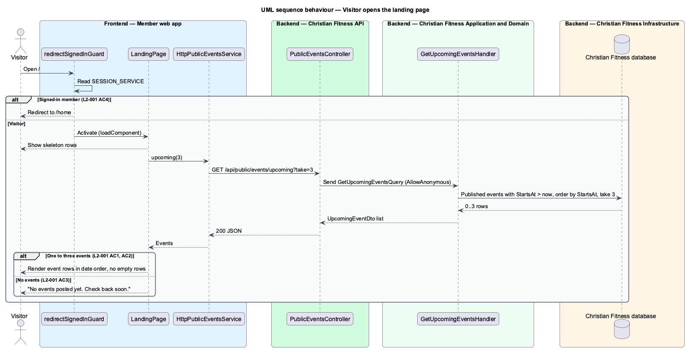

# View the landing page

## Overview

Christian Fitness is a Christian community for health in body and spirit in the
Greater Toronto Area. The *landing page* is the public screen at `/`, the first
screen a visitor sees. It belongs to the member-access subsystem, which covers
everything a person does before and while signing in.

- **visitor** — person who opens the Member web app without a session
- **published event** — event that staff have made visible to members and visitors
- **upcoming event** — published event whose start time is later than the current time

The page states the headline, lists the next three published events in date order,
describes the community and the vetted professionals, quotes John 10:10 and invites
the visitor to "Join free" or "Sign in". A signed-in member who opens `/` is sent to
Home instead. The layout stacks into one column at viewport XS and places hero text
and image side by side at viewport LG or wider (L2-002).

## Description

The slice runs from the landing route to the events table.

- **`LandingPage`** — routed page in `projects/web`, loaded with `loadComponent` at
  `/`. It reads the next events from `PUBLIC_EVENTS_SERVICE` and renders the mock's
  `hero`, `band`, `list-ruled` of `event-row`, `verse` and `site-footer` blocks. It
  holds one signal per state: loading (`skeleton`), loaded, empty (`empty-inline`
  with "No events posted yet. Check back soon.") and error (`inline-error`).
- **`redirectSignedInGuard`** — `CanActivateFn` on `/`. It reads `SESSION_SERVICE`
  and redirects a signed-in member to `/home` (L2-001 AC4).
- **`SiteHeader`, `Hero`, `EventRow`, `DateTile`, `Verse`, `SiteFooter`** —
  presentation components in the `components` library. Each takes inputs only and
  keeps the mocks' BEM class names.
- **`PublicEventsApi` / `PUBLIC_EVENTS_SERVICE`** — contract and token in the `api`
  library; `HttpPublicEventsService` implements it and is bound in `app.config.ts`.
  `UpcomingEventDto` carries `id`, `title`, `startsAt`, `place` and `category`.
- **`PublicEventsController`** — `[AllowAnonymous]` endpoint
  `GET /api/public/events/upcoming?take=3`. It sends one `GetUpcomingEventsQuery`.
- **`GetUpcomingEventsHandler`** — reads `Event` rows that are published and start
  after `TimeProvider.GetUtcNow()`, orders them by `StartsAt` ascending and takes at
  most 3. Fewer rows return a shorter list; none return an empty list (L2-001 AC2, AC3).
- **Responsive layout** — the page stylesheet uses the design-system breakpoints
  XS and LG; the header keeps "Sign in" reachable without horizontal scroll (L2-002).
  Exact breakpoint widths come from `docs/design-system/tokens`.

## Requirements

The feature realizes the following level-2 (L2) requirements. Each L2
requirement refines a level-1 (L1) requirement, cited by identifier.

| L2 ID | Refines (L1) | Requirement |
|-------|--------------|-------------|
| `L2-001` | `L1-001` | The landing page shall show the headline, the next three published events, the community and professionals sections, the John 10:10 verse and calls to join and sign in. |
| `L2-002` | `L1-001` | Given viewport XS, the hero text and image shall stack in one column, "Sign in" shall be reached from the header without horizontal scrolling, and no content shall overflow horizontally; given viewport LG or wider, the hero shall show text and image side by side and the events list shall sit beside the community and professionals sections (acceptance criteria 1–2). |

## Diagrams

### System context

The visitor reaches Christian Fitness over HTTPS; the system exports telemetry to an OpenTelemetry collector.

### Containers

The Member web app calls the Christian Fitness API, which reads and writes the Christian Fitness database. The Christian Fitness CLI applies migrations and seed data; the API does not migrate on startup.

### Components

The components below are the parts this slice touches in the Member web app and the Christian Fitness API; each controller sends one MediatR request.

### Class structure

The class diagram shows the frontend contract and its HTTP implementation, the request and handler types and the domain entities they read or change.

### Behaviour — open the landing page

The guard redirects a signed-in member to Home; otherwise the page asks for at most 3 upcoming published events and renders either the rows or the empty message (`L2-001`).

