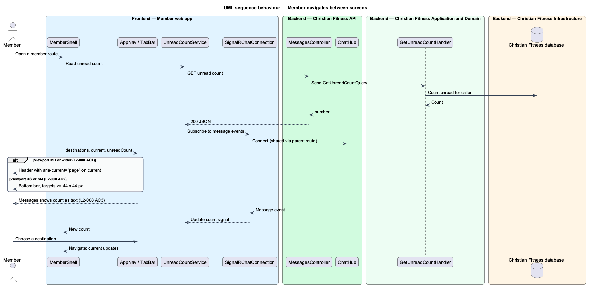

# Navigate the member app

## Overview

Every signed-in member screen shares one navigation shell. It offers five
destinations: Home, Events, Services, Messages and Profile. This feature belongs to
the member-home subsystem.

- **app header** — top bar shown at viewport MD or wider, with the destinations as links
- **bottom bar** — fixed bar shown at viewport XS or SM, with the same destinations
- **current destination** — destination whose route is active, marked with
  `aria-current="page"`

The navigation marks the current destination and shows the unread message count on
Messages as text, so colour is never the only carrier of that state. Bottom bar
targets measure at least 44 × 44 px.

## Description

- **`MemberShell`** — routed layout component that parents every member route
  (behind `memberAuthGuard`). It hosts `<router-outlet>` and both navigation bars, and
  provides the unread count to them. It is the parent through which sibling routes
  share one chat connection.
- **`AppNav`** — presentation component in `components` that renders the mock's
  `app-header` and `app-nav` blocks with `routerLink`-free anchors: it takes
  `destinations`, `current` and `unreadCount` inputs and keeps `aria-current="page"`
  on the active item (L2-008 AC1). The shell supplies the `href` values.
- **`TabBar`** — presentation component rendering the mock's `tab-bar` with
  `tab-bar__item` targets of at least 44 × 44 px (L2-008 AC2).
- **`CountBadge`** — renders the unread count as text (`count-badge`) with an
  accessible label such as "4 unread" (L2-008 AC3). The mock's mobile `tab-bar__dot`
  is `aria-hidden`; the bottom bar shall expose the count as text as well.
- **`UnreadCountService` / `UNREAD_COUNT_SERVICE`** — contract and token in `api`. The
  implementation reads the initial count from the home summary or `GET
  /api/messages/unread-count` and updates it from `CHAT_CONNECTION` events; no
  component opens its own connection. The endpoint name is `<TO SUPPLY>` pending the
  messages designs.
- **Breakpoints** — XS, SM and MD come from `docs/design-system/tokens`; CSS media
  queries switch between header and bottom bar.

## Requirements

The feature realizes the following level-2 (L2) requirements. Each L2
requirement refines a level-1 (L1) requirement, cited by identifier.

| L2 ID | Refines (L1) | Requirement |
|-------|--------------|-------------|
| `L2-008` | `L1-004` | Given viewport MD or wider, a header shows Home, Events, Services, Messages and Profile with `aria-current="page"` on the current one; given viewport XS or SM, the same destinations appear in a bottom bar with targets of at least 44 × 44 px; given unread messages, Messages shows the unread count as text, not colour alone (acceptance criteria 1–3). |

## Diagrams

### System context

The member reaches Christian Fitness over HTTPS; the system exports telemetry to an OpenTelemetry collector.

### Containers

The Member web app calls the Christian Fitness API, which reads and writes the Christian Fitness database. The Christian Fitness CLI applies migrations and seed data; the API does not migrate on startup.

### Components

The components below are the parts this slice touches in the Member web app and the Christian Fitness API; each controller sends one MediatR request.

### Class structure

The class diagram shows the frontend contract and its HTTP implementation, the request and handler types and the domain entities they read or change.

### Behaviour — navigate the member app

The shell reads the unread count once and keeps it current through the shared chat connection; the navigation marks the current destination and shows the count as text at every viewport (`L2-008`).

