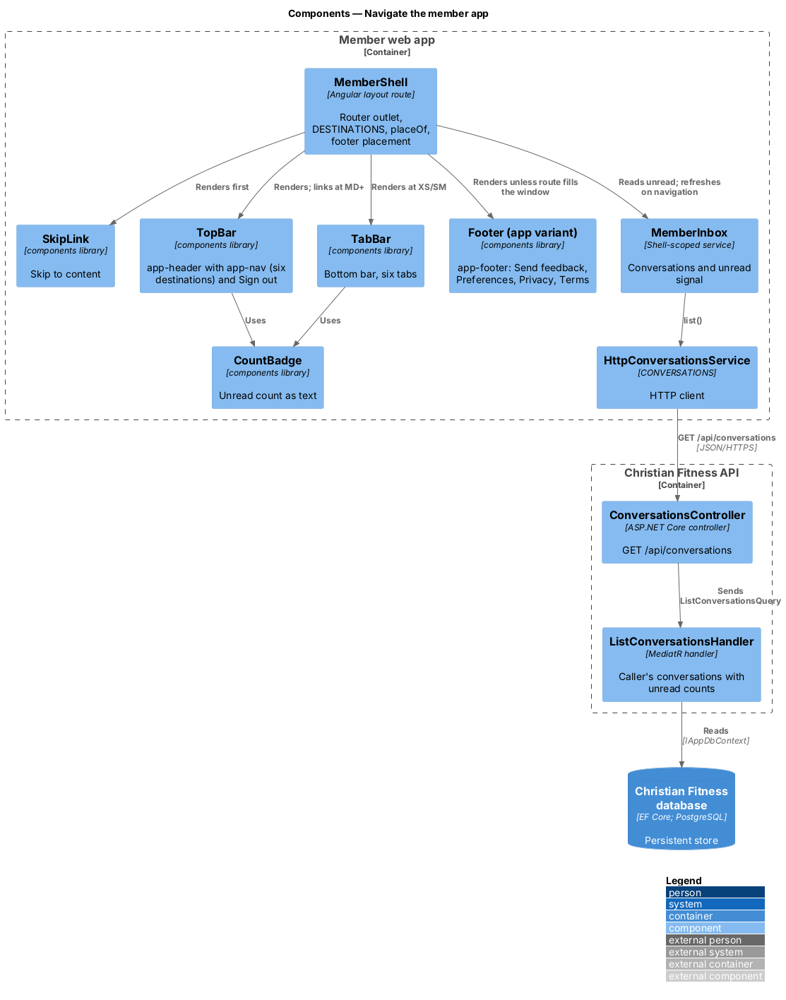
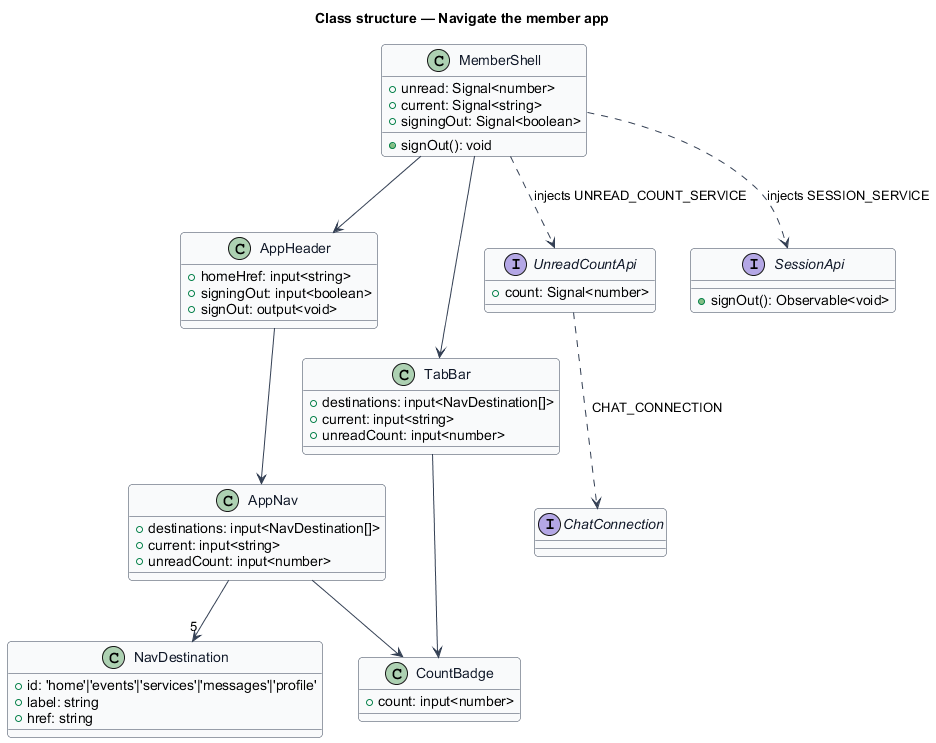
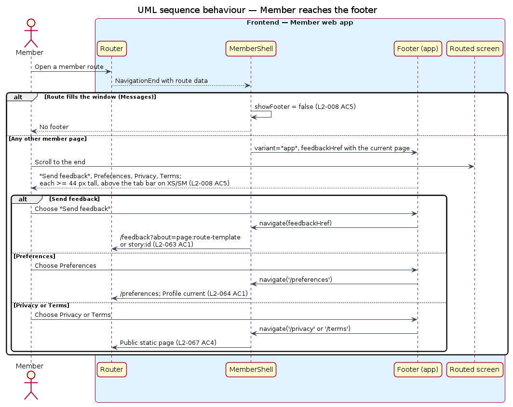

# Navigate the member app

## Overview

Every signed-in member screen shares one navigation shell. It offers six destinations: Home,
Events, Directory, Services, Messages and Profile. This feature belongs to the member-home
subsystem.

- **app header** — top bar shown at viewport MD or wider, with the destinations as links
- **bottom bar** — fixed bar shown at viewport XS or SM, with the same destinations
- **current destination** — destination whose route is active, marked with
  `aria-current="page"`
- **member footer** — strip at the end of a scrolling member page with "Send feedback",
  Preferences, Privacy and Terms

The navigation marks the current destination and shows the unread message count on Messages as
text, so colour is never the only carrier of that state. A screen under a destination keeps that
destination current: an event and a series are under Events, and a listing's profile is under
Directory (`L2-008` AC1). Bottom bar targets measure at least 44 × 44 px, and no label is cut off
at 360 px wide with six tabs (mocks `docs/mocks/README.md`, "Phone tab bar").

The member footer gives every member page a way to send the team feedback
([send feedback](../../feedback/send-feedback/README.md)), to open the member's preferences
([set email and notification preferences](../../preferences/set-email-and-notification-preferences/README.md))
and to read the Privacy Policy and Terms of Service (`L2-067` AC4). Messages fills the window and
has no footer (`L2-008` AC5).

## Description

- **`MemberShell`** — routed layout component (`projects/web/src/app/shell/member-shell.ts`) that
  parents every member route behind `memberAuthGuard`. It hosts `<router-outlet>`, the top bar,
  the tab bar and the member footer. Its `providers` hold `MemberInbox` and bind `CONVERSATIONS`
  to `HttpConversationsService`, so sibling routes share one conversation list. It also signs the
  member out ([sign in and sign out](../../member-access/sign-in-and-out/README.md)).
- **`DESTINATIONS`** — the shell's constant list of `MemberDestination` values. The design adds
  `{ key: 'directory', label: 'Directory', href: '/directory' }` between Events and Services, the
  order the mocks draw (`docs/mocks/pages/*/default.html`, blocks `app-nav` and `tab-bar`).
- **`placeOf(url)`** — the shell's function that maps an address to its current destination. The
  design extends it as follows:
  - `/directory` and `/directory/<id>` map to `directory` ([browse the directory](../../directory/browse-directory/README.md), [view a listing profile](../../directory/view-listing-profile/README.md));
  - `/events/series/<id>` stays under `events`, which the existing `/events/` prefix rule covers ([view an event series](../../events/view-event-series/README.md));
  - `/preferences` maps to `profile`, as the mock `docs/mocks/pages/preferences/` marks the profile button and the Profile tab current;
  - `/feedback` maps to no destination, as the mock `docs/mocks/pages/feedback/` shows.

  The rules form a case table and should move to a pure helper in the `domain` library with one
  unit test per row, since the function grows with each destination.
- **`MemberDestination` / `MemberDestinationKey`** — the type both bars take
  (`components/src/top-bar/member-destination.ts`). `MemberDestinationKey` gains `'directory'`,
  and the tab bar gains the Directory icon the mocks draw.
- **`SkipLink`** — the design system's skip link, first in the shell: the first Tab shows "Skip to
  content", and Enter moves focus to the screen's `main#main` (`L2-038` AC8;
  [ADR 0019](../../../adr/0019-design-system-layout-navigation-and-migration.md)).
- **`TopBar`** (`variant="app"`) — the design system's top bar in `components/top-bar/`: the
  mock's `app-header` block with the lockup linking to `homeHref`, the `app-nav` links labelled
  "Primary" from MD up (every destination but Profile, `aria-current="page"` on the current one,
  `L2-008` AC1), the `profile-button` with the member's initials and a ghost **Sign out** button,
  44 px tall, at every viewport (`L2-008` AC4). Inputs: `destinations`, `current`, `unread`,
  `profileHref`, `profileInitials`, `signingOut`; outputs `navigate` (a plain click only) and
  `signOut`. The `site` variant is the public `site-header`.
- **`TabBar`** — the design system's tab bar in `components/tab-bar/`: the `tab-bar` with six
  `tab-bar__item` targets of at least 44 × 44 px whose labels fit at 360 px wide (`L2-008` AC2),
  taking the same `destinations`, `current` and `unread` as the top bar, so their labels match
  word for word.
- **`CountBadge`** — renders the unread count as text (`count-badge`) with an accessible label such
  as "4 unread" (`L2-008` AC3), capped at "99+". On the tab bar the count is in words for
  assistive technology (", 4 unread"), never only the dot.
- **`MemberInbox`** — screen-scoped service on `MemberShell`
  (`projects/web/src/app/services/member-inbox.ts`). It asks `CONVERSATIONS.list()` on entry and
  on each change of address, and exposes `unread` as the `totalUnreadOf` sum from the `domain`
  library. The top bar, the tab bar, Home's Messages aside and Messages read this one list.
- **`HttpConversationsService` / `CONVERSATIONS`** — the contract's HTTP implementation. It calls
  `GET /api/conversations`; `ConversationsController` sends one `ListConversationsQuery`, and
  `ListConversationsHandler` reads only the caller's conversations through `IAppDbContext`.
- **`Footer`** (`variant="app"`) — the design system's footer in `components/footer/`, which today
  renders only the public `site-footer`. The design adds an `app` variant that renders the mock's
  `app-footer` block: the line "© <year> Christian Fitness · Toronto" and `app-footer__links` with
  four links, each a target of at least 44 px tall (`L2-008` AC5):
  - **Send feedback** — `/feedback`, carrying the page it was chosen on as "About this page"
    (`L2-063` AC1);
  - **Preferences** — `/preferences` (`L2-064` AC1);
  - **Privacy** — `/privacy` (`L2-067` AC4);
  - **Terms** — `/terms` (`L2-067` AC4).

  Inputs: `variant`, `year` and `feedbackHref`; output `navigate` on a plain click, as the top bar
  does, so the component holds no router. The footer is a `<footer>` outside
  `main`, the page's one `contentinfo` landmark. On XS and SM it sits above the fixed tab bar, which
  pads the body so the footer is never covered.
- **Footer placement** — `MemberShell` renders the footer after `<router-outlet>` unless the active
  route's `data` says the screen fills the window. The Messages routes (`messages` and
  `messages/:id`) carry that flag, so Messages has no footer (`L2-008` AC5). The flag's name is
  `<TO SUPPLY>`.
- **Error screens** — the not-found and server-error screens
  ([show error screens](../../errors/show-error-screens/README.md)) render inside `MemberShell`,
  with no destination current, as the mocks `pages/not-found/` and `pages/server-error/` show.
- **Breakpoints** — XS, SM and MD come from `docs/design-system/tokens`; CSS media queries switch
  between header and bottom bar.

### Open questions

- **Footer in the design system (resolved).** `docs/design-system/components/footer.html` documents the member footer (`.app-footer`: anatomy, the links, the tab-bar offset) beside `site-footer`, so the library keeps one `Footer` with an `app` variant.
- **"About this page".** The mock's footer link is a plain `/feedback`; how the page it was
  chosen on reaches Send feedback (a query parameter or navigation state) is `<TO SUPPLY>` and
  belongs to [send feedback](../../feedback/send-feedback/README.md). Navigation state does not
  survive a reload or the sign-in round trip of `L2-063` AC1; a query parameter does.
- **Event chat.** `messages/:id` and `events/:id/chat` show the same chat screen. `L2-008` AC5
  names only Messages; whether the event chat reached from an event also omits the footer is
  `<TO SUPPLY>`. The design treats every chat route as filling the window.
- **Code behind the requirement.** The shell today has five destinations, no Directory key, no
  `/preferences` rule and no footer; the `Footer` component has only the site variant. Each is
  work for the next slices.

## Requirements

The feature realizes the following level-2 (L2) requirements. Each L2 requirement refines a
level-1 (L1) requirement, cited by identifier. The L2 specification states its requirements as
acceptance criteria; the text below condenses those criteria faithfully.

| L2 ID | Refines (L1) | Requirement |
|-------|--------------|-------------|
| `L2-008` | `L1-004` | Given viewport MD or wider, a header shall show Home, Events, Directory, Services, Messages and Profile with `aria-current="page"` on the current one, an event or a series counting as Events and a listing's profile as Directory. Given viewport XS or SM, the same six destinations shall appear in a bottom bar with targets of at least 44 × 44 px and no label cut off at 360 px wide. Given unread messages, Messages shall show the unread count as text, not colour alone. Given a signed-in member at any viewport, the app header shall offer a Sign out button with a target of at least 44 × 44 px. Given a member page that scrolls, its end shall show a footer with "Send feedback", Preferences, Privacy and Terms, each at least 44 px tall, above the bottom bar on XS and SM; Messages shall have no footer (acceptance criteria 1–5). |
| `L2-038` | `L1-015` | Given either app's shell, when the first Tab is pressed, then "Skip to content" shall show and move focus to the screen's `main`; given a component in `docs/design-system/components/`, when a screen needs it, then it shall come from the components library under its design-system name (acceptance criteria 7–8). |
| `L2-063` | `L1-020` | Given a signed-in member, when they choose "Send feedback" in the footer of any member page, then `/feedback` shall open with the page they came from shown as "About this page" (acceptance criterion 1). |
| `L2-064` | `L1-019` | Given a signed-in member, when they choose Preferences on their own profile or in the footer of any member page, then `/preferences` shall open (acceptance criterion 1). |
| `L2-067` | `L1-021` | Given the member app's footer, when it shows, then it shall link to the Privacy Policy and the Terms of Service (acceptance criterion 4). |

## Diagrams

### System context

The member reaches Christian Fitness over HTTPS; the system exports telemetry to an OpenTelemetry
collector.

### Containers

The Member web app calls the Christian Fitness API for the member's conversations, which carry the
unread counts. The API reads the Christian Fitness database; the CLI applies migrations and seed
data, and the API does not migrate on startup.

### Components

`MemberShell` renders the skip link, the top bar, the tab bar and the member footer, and reads the
unread count from `MemberInbox`. In the API, `ConversationsController` sends one
`ListConversationsQuery`.

### Class structure

`MemberShell` passes six `MemberDestination` values to `TopBar` and `TabBar`, the unread count
from `MemberInbox`, and the footer's links to `Footer` in its `app` variant.

### Behaviour — navigate the member app

The shell reads the member's conversations on entry and on each change of address. The navigation
marks the current destination, Directory included, and shows the count as text at every viewport
(`L2-008` AC1–AC3).

### Behaviour — reach the member footer

At the end of a scrolling member page the footer offers Send feedback, Preferences, Privacy and
Terms. Messages carries the route flag that leaves the footer out (`L2-008` AC5).

