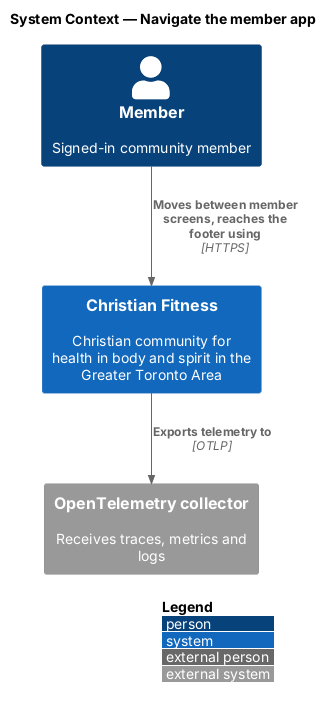
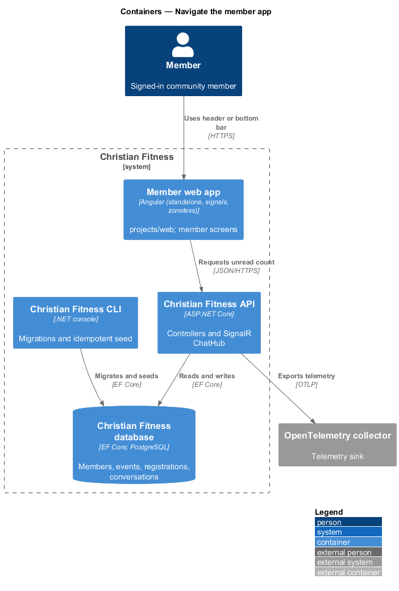

# Navigate the member app

## Overview

Every signed-in member screen shares one navigation shell. It offers five
destinations: Home, Events, Services, Messages and Profile. This feature belongs to
the member-home subsystem.

- **app header** — top bar shown at viewport MD or wider, with the destinations as links
- **bottom bar** — fixed bar shown at viewport XS or SM, with the same destinations
- **current destination** — destination whose route is active, marked with
  `aria-current="page"`

The navigation marks the current destination and shows the unread message count on
Messages as text, so colour is never the only carrier of that state. Bottom bar
targets measure at least 44 × 44 px.

## Description

- **`MemberShell`** — routed layout component that parents every member route
  (behind `memberAuthGuard`). It hosts `<router-outlet>` and both navigation bars, and
  provides the unread count to them. It is the parent through which sibling routes
  share one chat connection.
- **`SkipLink`** — the design system's skip link, first in the shell: the first Tab shows
  "Skip to content", and Enter moves focus to the screen's `main#main` (`L2-038` AC8;
  [ADR 0019](../../../adr/0019-design-system-layout-navigation-and-migration.md)).
- **`TopBar`** (`variant="app"`) — the design system's top bar in `components/top-bar/`,
  replacing slice 3.1's `AppHeader` and the planned `AppNav`: the mock's `app-header` block with
  the lockup linking to `homeHref`, the `app-nav` links labelled "Primary" from MD up (every
  destination but Profile, `aria-current="page"` on the current one, L2-008 AC1), the
  `profile-button` with the member's initials and, at its end, a ghost **Sign out** button,
  44 px tall, at every viewport (L2-008 AC4). Inputs: `destinations`, `current`, `unread`,
  `profileHref`, `profileInitials`, `signingOut`; outputs `navigate` (a plain click only) and
  `signOut`. `MemberShell` signs the member out
  ([sign in and sign out](../../member-access/sign-in-and-out/README.md)). Until the screens
  they open exist, the shell passes no destinations, so neither the `nav` nor the bottom bar
  shows; each journey that builds a destination adds it ([ADR 0009](../../../adr/0009-sign-in-sign-out-and-request-protections.md), ADR 0019).
  The same component's `site` variant is the public `site-header`.
- **`TabBar`** — the design system's tab bar in `components/tab-bar/`: the `tab-bar` with
  `tab-bar__item` targets of at least 44 × 44 px (L2-008 AC2), taking the same `destinations`,
  `current` and `unread` as the top bar so their labels match word for word.
- **`MemberDestination`** — the destination type both bars take: `key` (home, events, services,
  messages, profile), `label` and `href`.
- **`CountBadge`** — renders the unread count as text (`count-badge`) with an accessible label
  such as "4 unread" (L2-008 AC3), capped at "99+" as the badge page says (the top-bar page's
  "9+" yields to it, ADR 0019). On the tab bar the count is text as well, never only the dot.
- **`UnreadCountService` / `UNREAD_COUNT_SERVICE`** — contract and token in `api`. The
  implementation reads the initial count from the home summary or `GET
  /api/messages/unread-count` and updates it from `CHAT_CONNECTION` events; no
  component opens its own connection. The endpoint name is `<TO SUPPLY>` pending the
  messages designs.
- **Error screens** — the not-found and server-error screens ([show error screens](../../errors/show-error-screens/README.md)) render inside `MemberShell`, with no destination current, as the mocks `pages/not-found/` and `pages/server-error/` show. Until the shell exists they render on their own in the app's outlet.
- **Breakpoints** — XS, SM and MD come from `docs/design-system/tokens`; CSS media
  queries switch between header and bottom bar.

## Requirements

The feature realizes the following level-2 (L2) requirements. Each L2
requirement refines a level-1 (L1) requirement, cited by identifier.

| L2 ID | Refines (L1) | Requirement |
|-------|--------------|-------------|
| `L2-008` | `L1-004` | Given viewport MD or wider, a header shows Home, Events, Services, Messages and Profile with `aria-current="page"` on the current one; given viewport XS or SM, the same destinations appear in a bottom bar with targets of at least 44 × 44 px; given unread messages, Messages shows the unread count as text, not colour alone; given a signed-in member at any viewport, the app header offers a Sign out button with a target of at least 44 × 44 px (acceptance criteria 1–4). |
| `L2-038` | `L1-015` | Given either app's shell, when the first Tab is pressed, then "Skip to content" shows and moves focus to the screen's `main`; given a component in `docs/design-system/components/`, when a screen needs it, then it comes from the components library under its design-system name (acceptance criteria 7–8). |

## Diagrams

### System context

The member reaches Christian Fitness over HTTPS; the system exports telemetry to an OpenTelemetry collector.

### Containers

The Member web app calls the Christian Fitness API, which reads and writes the Christian Fitness database. The Christian Fitness CLI applies migrations and seed data; the API does not migrate on startup.

### Components

The components below are the parts this slice touches in the Member web app and the Christian Fitness API; each controller sends one MediatR request.

### Class structure

The class diagram shows the frontend contract and its HTTP implementation, the request and handler types and the domain entities they read or change.

### Behaviour — navigate the member app

The shell reads the unread count once and keeps it current through the shared chat connection; the navigation marks the current destination and shows the count as text at every viewport (`L2-008`).

