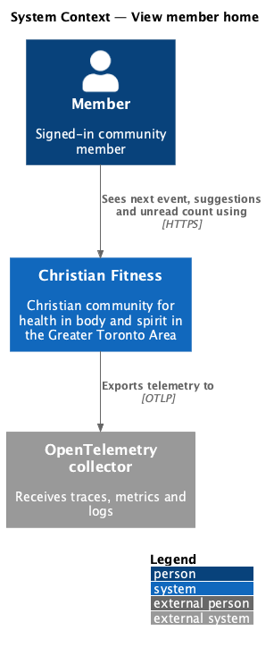
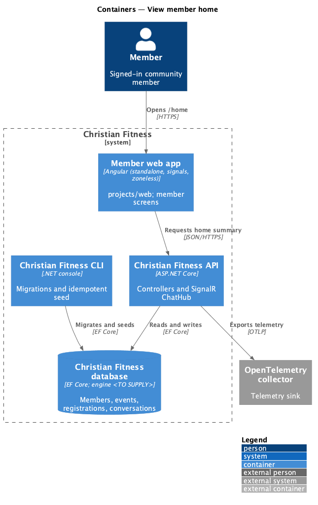
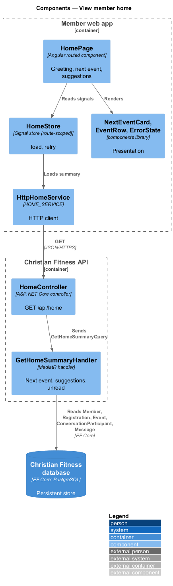
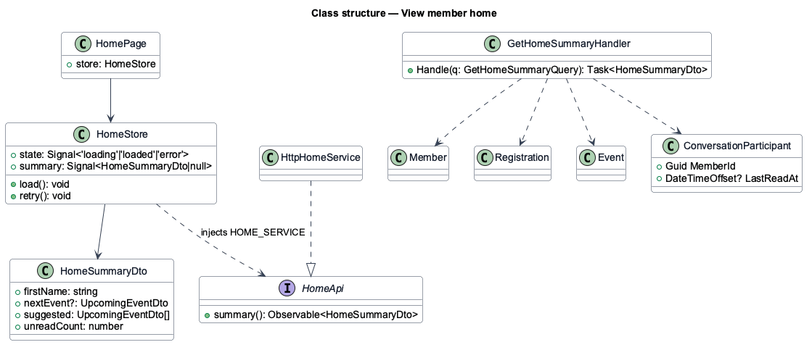
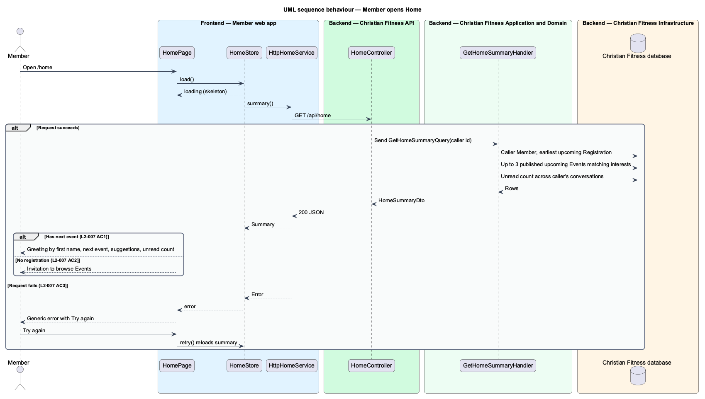

# View member home

## Overview

_Home_ is the first screen a member sees after signing in, at `/home`. It gathers
what matters now: the next event the member is registered for, up to three suggested
events and the unread message count. It belongs to the member-home subsystem.

- **next registered event** — earliest upcoming event the member is registered for
- **suggested event** — upcoming published event whose category matches one of the
  member's interests and for which the member is not registered
- **unread message count** — number of messages in the member's conversations they
  have not read

Home greets the member by first name. With no registration, the next-event area
invites the member to browse Events. When the home data request fails, a generic
error with Try again is shown.

## Description

- **`HomePage`** — routed page at `/home`. It renders the mock's `next-event`,
  `section-head`, `list-ruled` of `event-row`, `mini-list`, `empty-card` (no
  registration, L2-007 AC2), `skeleton` and `error-state` with a Try again button
  (L2-007 AC3). Its `HomeStore` is provided on the routed component.
- **`HomeStore`** — signal store with `load()` and `retry()`; holds
  `loading | loaded | error`.
- **`NextEventCard`, `EventRow`, `EmptyCard`, `ErrorState`** — presentation
  components in `components`.
- **`firstNameOf`** — pure helper in `domain` that takes the first name from a full
  name, with unit tests.
- **`HomeApi` / `HOME_SERVICE`** — contract and token; `HttpHomeService` calls
  `GET /api/home`.
- **`HomeController`** — sends one `GetHomeSummaryQuery`.
- **`GetHomeSummaryHandler`** — reads the caller's `Member`, their earliest upcoming
  `Registration`, up to 3 published upcoming `Event` rows whose category matches an
  interest and is not already registered, and the unread count across the
  `ConversationParticipant` rows of the caller. It returns `HomeSummaryDto` with the
  count as a number. Slice 13.1 built the events part as `GetHomeQuery` and `GetHomeHandler`
  (`HomeDto`: `nextEvent`, `suggested`); suggestions are soonest first, and the interest to
  category table is `InterestCategories` (ADR 0044). The page uses `NextEvent` (library) and the
  session's greeting in place of `HomeStore` and `firstNameOf`; unread is slice 13.2.
- **Unread count source** — the mock also offers a `partial` state; the rule that
  decides which parts may fail independently is `<TO SUPPLY>`.

## Requirements

The feature realizes the following level-2 (L2) requirements. Each L2
requirement refines a level-1 (L1) requirement, cited by identifier.

| L2 ID    | Refines (L1) | Requirement                                                                                                                                                                                                                                                                                                                                                                                                             |
| -------- | ------------ | ----------------------------------------------------------------------------------------------------------------------------------------------------------------------------------------------------------------------------------------------------------------------------------------------------------------------------------------------------------------------------------------------------------------------- |
| `L2-007` | `L1-004`     | Given a signed-in member, when they open Home, then it greets them by first name and shows their next registered event, up to three suggested events matching their interests and their unread message count; with no registered events the next-event area invites them to browse Events; when the home data request fails a generic error with Try again is shown and Try again reloads it (acceptance criteria 1–3). |

## Diagrams

### System context

The member reaches Christian Fitness over HTTPS; the system exports telemetry to an OpenTelemetry collector.

### Containers

The Member web app calls the Christian Fitness API, which reads and writes the Christian Fitness database. The Christian Fitness CLI applies migrations and seed data; the API does not migrate on startup.

### Components

The components below are the parts this slice touches in the Member web app and the Christian Fitness API; each controller sends one MediatR request.

### Class structure

The class diagram shows the frontend contract and its HTTP implementation, the request and handler types and the domain entities they read or change.

### Behaviour — open Home

The store loads one summary; the page renders the greeting, next event or invitation, suggestions and unread count, or a generic error whose Try again reloads it (`L2-007`).

