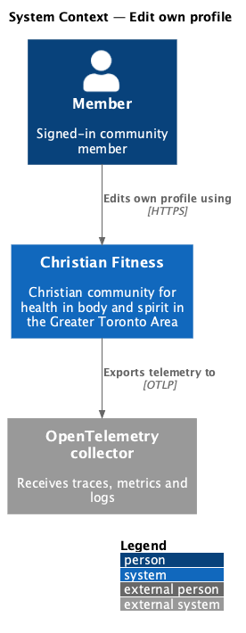
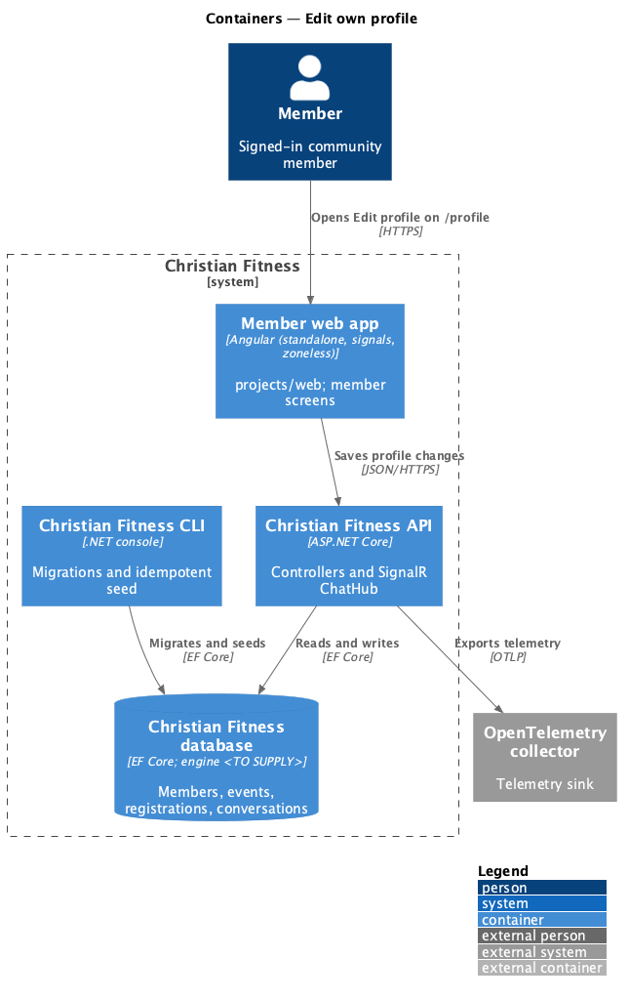
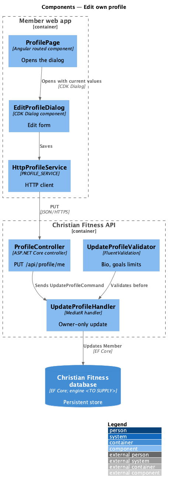
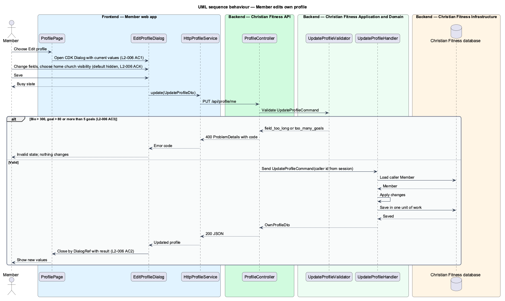
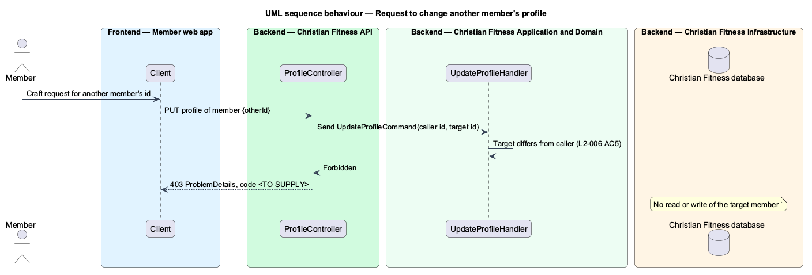

# Edit own profile

## Overview

A member keeps their profile current through the Edit profile dialog on the Profile
screen. Editing opens a CDK Dialog; there are no inline forms. This feature belongs
to the member-profile subsystem.

- **goal** — short statement of what a member is working toward; at most 5 goals of
  at most 80 characters each
- **home church visibility** — member's choice whether other members see their home
  church; hidden by default

The dialog opens with the current values. A valid save updates the profile and
closes the dialog. Over-length or over-count values are refused by the server and
change nothing. A request to change another member's profile is refused with HTTP 403.

## Description

- **`ProfilePage`** — owns the Edit profile button. It opens `EditProfileDialog`
  through CDK `Dialog`, passing the current `OwnProfileDto`, and refreshes its signal
  from the dialog's result.
- **`EditProfileDialog`** — dialog component in `projects/web` that renders the
  mock's `dialog`, `field-grid`, `field`, `input`, `textarea`, `goals` and
  `interest-list` blocks. It shows the busy state while saving, the invalid state with
  `aria-invalid` on refused fields, and the failed state as a `form-alert`. It closes
  by its `DialogRef` on success (L2-006 AC2).
- **Home church visibility control** — a checkbox that defaults to hidden
  (L2-006 AC4). The current mock `dialogs/edit-profile` has no such control and its
  hint reads "Only shown on your profile"; the mock needs a visibility state before
  implementation, `<TO SUPPLY>`.
- **`ProfileApi.update`** — `HttpProfileService` sends `PUT /api/profile/me` with
  `UpdateProfileDto`.
- **`ProfileController.Update`** — sends one `UpdateProfileCommand`; the member id
  comes from the session, never from the body.
- **`UpdateProfileValidator`** — bio at most 300 characters and goals at most 80
  characters return `field_too_long`; more than 5 goals return `too_many_goals`
  (L2-006 AC3).
- **`UpdateProfileHandler`** — loads the caller's `Member`, applies the changes and
  saves once. A route or command that targets another member's id is refused with
  HTTP 403 and changes nothing (L2-006 AC5); the exact error `code` for that refusal is
  `<TO SUPPLY>`.
- **Telemetry** — no span or log carries the bio, goals or home church.

## Requirements

The feature realizes the following level-2 (L2) requirements. Each L2
requirement refines a level-1 (L1) requirement, cited by identifier.

| L2 ID | Refines (L1) | Requirement |
|-------|--------------|-------------|
| `L2-006` | `L1-003` | Editing opens a dialog or a screen; there are no inline forms. |

## Diagrams

### System context

The member reaches Christian Fitness over HTTPS; the system exports telemetry to an OpenTelemetry collector.

### Containers

The Member web app calls the Christian Fitness API, which reads and writes the Christian Fitness database. The Christian Fitness CLI applies migrations and seed data; the API does not migrate on startup.

### Components

The components below are the parts this slice touches in the Member web app and the Christian Fitness API; each controller sends one MediatR request.

### Class structure

The class diagram shows the frontend contract and its HTTP implementation, the request and handler types and the domain entities they read or change.

### Behaviour — edit own profile

The dialog opens with current values; the validator refuses over-length and over-count values; the handler updates only the caller's record and the dialog closes on success (`L2-006`).

### Behaviour — refuse a change to another member's profile

The handler compares the target with the session's member and refuses with HTTP 403 before any write (`L2-006` AC5).

