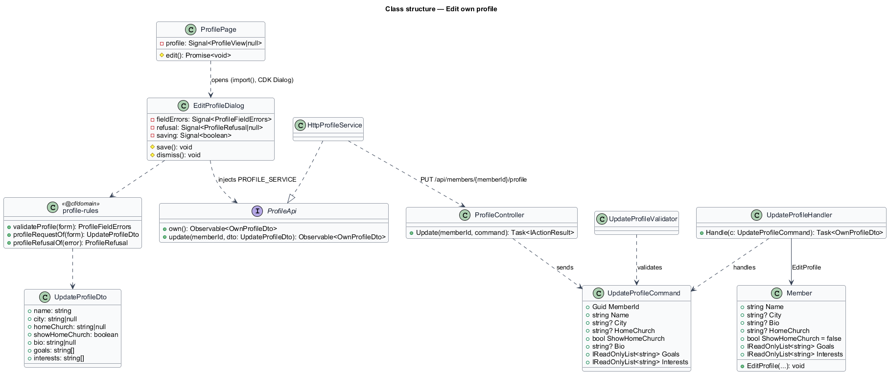

# Edit own profile

## Overview

A member keeps their profile current through the Edit profile dialog on the Profile
screen. Editing opens a modal dialog; there are no inline forms. This feature belongs
to the member-profile subsystem.

- **goal** — short statement of what a member is working toward; at most 5 goals of
  at most 80 characters each
- **home church visibility** — member's choice whether other members see their home
  church; hidden by default

The dialog opens with the current values. A valid save updates the profile and
closes the dialog. Over-length or over-count values are refused by the server and
change nothing. A request to change another member's profile is refused with HTTP 403.

## Description

Slice 18.2 builds this feature ([ADR 0024](../../../adr/0024-edit-my-profile.md)) on the
Profile screen of slice 18.1 ([view profile](../view-profile/README.md)).

- **`ProfilePage`** — owns the Edit profile button, projected into the `profile-hero`'s
  action slot, and the empty About section's "Add a bio" (a `cf-button` with the `link`
  variant). Either one imports `edit-profile-dialog.ts` with `import()` on first use, so
  neither the dialog nor `@angular/cdk` is in the initial bundle or the screen's chunk, and
  calls `openEditProfileDialog` with the screen's injector (so the dialog uses the screen's
  `PROFILE_SERVICE`) and the current `OwnProfileDto`. The profile the dialog closes with,
  as saved, replaces the profile on screen (L2-006 AC2); closing without saving changes
  nothing. The screen closes the dialog by its ref when it is destroyed.
- **`EditProfileDialog`** — dialog component in `projects/web/src/app/dialogs/edit-profile/`,
  a CDK Dialog composed only from `@cf/components`: the `cf-dialog` shell (scrim, panel,
  title, Close, footer), `cf-form-layout` (Home church and City in a `field-grid`),
  `cf-text-field`, `cf-checkbox`, `cf-textarea`, `cf-interest-list` with `cf-interest`,
  `cf-alert` and `cf-button`, inside one `<form>`. The CDK container is the
  `role="dialog"`, `aria-modal` element named by the title; it hides the page from
  assistive technology, traps focus, starts it in Full name and returns it to the opener.
  It opens with the current values (AC1). Before sending, `validateProfile` names each field to fix in
  an error summary and inline (mock `invalid`, `invalid-limits`; AC6). While saving the
  button reads "Saving…" with `aria-busy`, the fields are read-only, Cancel is disabled and
  Close, Escape and the scrim do nothing (mock `busy`). A refusal shows "Check your profile" with "Some of
  your changes weren't accepted" (mock `refused`); no answer or a 5xx shows "We couldn't
  save your changes" (mock `failed`); both keep every value (AC7). On success it closes
  with the saved profile.
- **Home church visibility** — the checkbox "Show my home church to other members",
  unchecked for every member until they check it (AC4); the church field's hint reads
  "Hidden from other members unless you show it". The public profile (slice 19.1) reads it.
- **`validateProfile`, `profileRequestOf`, `profileRefusalOf`** — pure helpers in
  `@cf/domain` with unit tests. Goals are one per line; blank lines are dropped and each
  goal trimmed before counting. The rule table is the API validator's, row for row.
- **`ProfileApi.update`** — `HttpProfileService` sends `PUT /api/members/{memberId}/profile`
  with `UpdateProfileDto` (`name`, `city`, `homeChurch`, `showHomeChurch`, `bio`, `goals`,
  `interests`) and answers the saved `OwnProfileDto`, which now carries `memberId` and
  `showHomeChurch`. A failure errors with an `ApiError`.
- **`ProfileController.Update`** — sends one `UpdateProfileCommand` with the route's
  member id.
- **`UpdateProfileValidator`** — name required and at most 100 characters, city at most
  100, home church at most 120, bio at most 300, each goal at most 80, all counted after
  trimming: `field_too_long`. More than 5 goals: `too_many_goals`. Interests outside the
  list, a blank name or a blank goal: `validation_failed`. With several, `field_too_long`
  wins, then `too_many_goals` (AC3).
- **`UpdateProfileHandler`** — refuses any member id that is not the session's with HTTP
  403 and code `forbidden`, before any read or write, whether or not the id names a member
  (AC5, L2-031 AC3). Otherwise it loads the caller's `Member`, calls `EditProfile` and
  saves once, then answers the saved profile.
- **`Member.EditProfile`** — trims each value, stores a blank city, home church or bio as
  none, drops blank goals and repeated interests, and sets `ShowHomeChurch` (migration
  `AddHomeChurchVisibility`, false for every member).
- **Telemetry** — no span or log carries the name, bio, goals or home church; the span
  records the route template `api/members/{memberId}/profile`, never the id.

## Requirements

The feature realizes the following level-2 (L2) requirements. Each L2
requirement refines a level-1 (L1) requirement, cited by identifier.

| L2 ID | Refines (L1) | Requirement |
|-------|--------------|-------------|
| `L2-006` | `L1-003` | Editing opens a dialog or a screen; there are no inline forms. 1. The dialog opens with the current values. 2. A valid save shows the new values and closes the dialog. 3. A bio over 300 characters, more than 5 goals or a goal over 80 characters is refused with `field_too_long` or `too_many_goals` and nothing changes. 4. Home church visibility defaults to hidden. 5. A change to another member's profile is refused with HTTP 403. 6. A cleared name, an over-long bio or too many goals is named in the dialog and nothing is sent. 7. A refused or unanswered save keeps the dialog open with a generic message and every value. |
| `L2-031` | `L1-013` | 2, 3. Another member's data is refused and guessing ids reveals nothing. |
| `L2-033` | `L1-013` | 2. No log, metric or span carries a name, home church or body. |

## Diagrams

### System context

The member reaches Christian Fitness over HTTPS; the system exports telemetry to an OpenTelemetry collector.

### Containers

The Member web app calls the Christian Fitness API, which reads and writes the Christian Fitness database. The Christian Fitness CLI applies migrations and seed data; the API does not migrate on startup.

### Components

The components below are the parts this slice touches in the Member web app and the Christian Fitness API; each controller sends one MediatR request.

### Class structure

The class diagram shows the frontend contract and its HTTP implementation, the request and handler types and the domain entities they read or change.

### Behaviour — edit own profile

The dialog opens with current values; the validator refuses over-length and over-count values; the handler updates only the caller's record and the dialog closes on success (`L2-006`).

### Behaviour — refuse a change to another member's profile

The handler compares the target with the session's member and refuses with HTTP 403 before any write (`L2-006` AC5).

