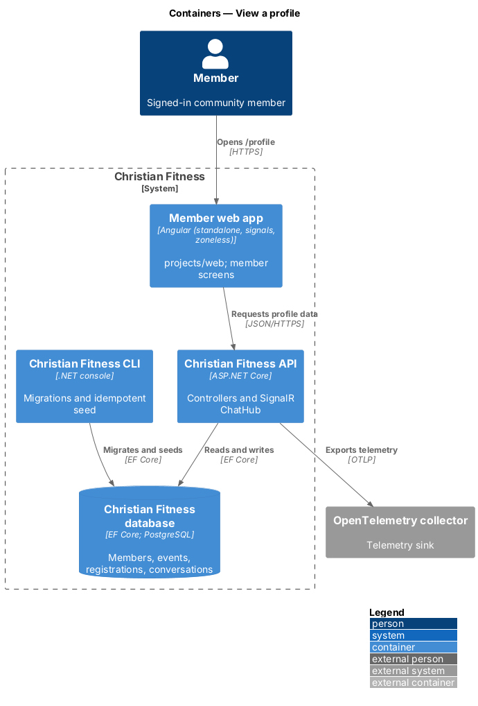
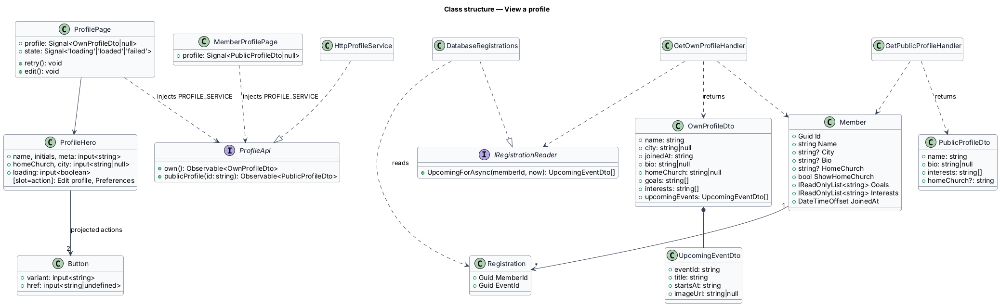
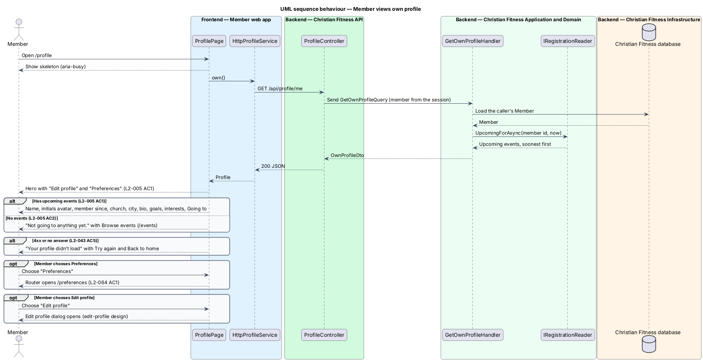
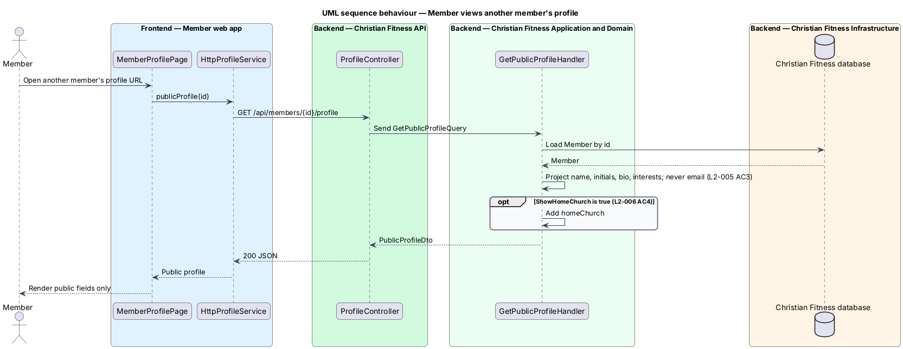

# View a profile

## Overview

A *profile* is the page that describes one member to the community. This feature
covers the Profile screen at `/profile`, which shows a member their own profile, and
the view of another member's profile. It belongs to the member-profile subsystem.

- **own profile** — profile of the signed-in member, with every field
- **public profile** — subset of another member's profile: name, initials, bio and
  interests, plus home church only when that member chose to show it
- **initials avatar** — avatar that shows a member's initials in place of a photo

The own profile shows name, initials avatar, city, join date, bio, home church,
goals, interests and upcoming registered events, with two actions: "Edit profile",
which opens the edit dialog, and "Preferences", which opens the member's preferences
at `/preferences` ([set email and notification preferences](../../preferences/set-email-and-notification-preferences/README.md);
`L2-064`). With no registered events it shows an empty state that links to Events. The public profile never shows email, and shows
home church only when its owner made it visible (L2-006).

## Description

Slice 18.1 built the own profile (L2-005 AC1, AC2;
[ADR 0015](../../../adr/0015-view-my-profile.md)); slice 19.1 built the public
profile (AC3). Slice 18.2 added the Edit profile button and the "Add a bio" action
that open the edit dialog ([edit own profile](../edit-profile/README.md)). The
amended `L2-005` AC1 adds the Preferences action beside Edit profile; it is the next
slice of this feature and lands with the Preferences screen. The mock's Groups
section comes with group membership (slice 12.3).

- **`ProfilePage`** — routed, lazy page at `/profile` in `projects/web`, a child of
  `MemberShell`, titled "Profile · Christian Fitness". It binds `PROFILE_SERVICE` to
  `HttpProfileService` on its own `providers`, so the client lives only while the
  screen does. Its `state` signal is `loading`, `loaded` or `failed`:
  - `loading` — the mock's skeletons inside `aria-busy="true"`, with a visually
    hidden "Loading profile" heading;
  - `loaded` — `ProfileHero` (initials avatar from `initialsOf`, name as the `h1`,
    "Member since …", then home church and city when present) with two nodes in its
    `[slot=action]`: the secondary `Button` "Edit profile", which opens the edit
    dialog, and the secondary `Button` "Preferences" with `href="/preferences"`, which
    renders as a link (`L2-005` AC1; mock `profile-hero__action`). The About, "Goals this
    year" and Into sections, and the "Going to" section as a `GoingList`. Each empty
    section shows the mock's `empty-inline` sentence; an empty "Going to" adds
    "Browse events", a link to `/events` (L2-005 AC2);
  - `failed` — a 4xx answer or no answer: the mock's `error-state` with "Your profile
    didn't load", **Try again**, which asks again in place, and **Back to home**
    (`/home`). A 5xx shows the server-error screen instead (L2-043 AC4, AC5).
- **`ProfileHero`, `GoingList`, `TagList`, `EmptyInline`, `ProfileSkeleton`** —
  presentation components in `components` (inputs only), each one encapsulated BEM
  stylesheet named as in the design system. Every name, bio, goal, church, city and
  event title is rendered as text.
- **`TopBar`** — the shell's top bar carries the mock's `profile-button`: the
  signed-in member's initials, labelled "Your profile", linking to `/profile`, with
  `aria-current="page"` while Profile or Preferences shows
  ([navigate the member app](../../member-home/navigate-member-app/README.md)). A
  plain click emits `navigate`, so `MemberShell` moves the router without a reload;
  the shell reads the name once from `SESSION_SERVICE`.
- **`initialsOf`, `memberSinceOf`, `goingDateOf`, `interestLabelsOf`** — pure helpers
  in `domain` with unit tests: the avatar's initials; "today" when the member joined
  on today's date in Toronto, otherwise the month and year ("January 2026"); an
  event's day as "Sat, Apr 18" in Toronto time; interest keys as their labels, in the
  order given, unknown keys left out.
- **`ProfileApi` / `PROFILE_SERVICE`** — contract and token in `api`; `own()` answers
  `OwnProfileDto`. `HttpProfileService` calls `GET /api/profile/me` and holds no
  state.
- **`ProfileController`** — `GET /api/profile/me` sends one `GetOwnProfileQuery`. It
  takes no member id: the member is the session's (`ICurrentMember`), so nobody can
  ask for another member's own profile. A visitor is refused 401 by the fallback
  policy.
- **`GetOwnProfileHandler`** — reads the caller's `Member` and asks
  `IRegistrationReader.UpcomingForAsync(memberId, now)` for the events they are going
  to, soonest first, with `now` from `TimeProvider`. The reader is
  `DatabaseRegistrations` in Infrastructure, which queries the `Registration` rows of
  upcoming, published events. It logs nothing: home church and bio are never in a
  log or span (L2-033 AC2).
- **`Member`** — holds `City` (at most 100 characters), `Bio` (at most 300) and
  `Goals` (at most 5 of at most 80) (migration `AddMemberProfile`), edited through
  [edit own profile](../edit-profile/README.md).

The answer of `GET /api/profile/me` is

| Field            | Type                    | Notes                                                    |
|------------------|-------------------------|----------------------------------------------------------|
| `name`           | string                  | Full name                                                |
| `city`           | string or null          | Null until the member gives one                          |
| `joinedAt`       | string (ISO 8601)       | When the account was created                             |
| `bio`            | string or null          | Null until the member writes one                         |
| `homeChurch`     | string or null          | Optional, sensitive; shown only to its owner here        |
| `goals`          | string[]                | Up to 5                                                  |
| `interests`      | string[]                | Interest keys (`running`, `strength`, …)                 |
| `upcomingEvents` | `{ eventId, title, startsAt, imageUrl }[]` | Soonest first; `imageUrl` may be null |

The public profile (slice 19.1):

- **`MemberProfilePage`** — routed page for another member, matching the mock
  `pages/profile/member.html`. The route is `/members/:id`
  ([ADR 0038](../../../adr/0038-view-a-members-profile.md)): hero (name, initials, home church
  only when shown), About and Into. The mock's Message button, goals, events and Groups wait for
  slices 14.1, 12.3 and later.
- **`GetPublicProfileHandler`** — `GET /api/members/{id}/profile` returns `PublicProfileDto` with name, bio
  and interests (the screen derives the initials); 404 `not_found` for an unknown or malformed id. It adds `homeChurch` only when `Member.ShowHomeChurch` is true, and
  never includes email (L2-005 AC3). The DTO has no email field by construction.

### Open questions

- **Who may see the public profile.** Preferences sets who sees the whole profile,
  and a profile set to Anyone can be opened by a visitor who is not signed in,
  showing only the public fields of `L2-005` AC3
  ([set email and notification preferences](../../preferences/set-email-and-notification-preferences/README.md)).
  `/members/:id` today sits behind `memberAuthGuard` and its endpoint behind the
  fallback policy. Opening both to visitors, and refusing a profile its owner limits,
  belongs to that design and changes `GetPublicProfileHandler`; the route and policy
  change is work for its slices.
- **Home church switch.** `docs/mocks/README.md` (open question 4) asks whether home
  church gets its own switch in Preferences. `Member.ShowHomeChurch` already exists;
  where a member sets it is `<TO SUPPLY>`.
- **Code behind the requirement.** `ProfilePage` renders only Edit profile in the
  hero; the Preferences link is work for the next slice, and its route `/preferences`
  does not exist yet.

## Requirements

The feature realizes the following level-2 (L2) requirements. Each L2
requirement refines a level-1 (L1) requirement, cited by identifier.

| L2 ID | Refines (L1) | Requirement |
|-------|--------------|-------------|
| `L2-005` | `L1-003` | Given a signed-in member, when they open Profile, then it shall show their name, initials avatar, city, join date, bio, home church, goals, interests and their upcoming registered events, with "Edit profile" and "Preferences" (`L2-064`); with no registered events the events area shall show an empty state with a link to Events; another member's profile URL shall show only that member's public fields (name, initials, bio, interests) and never their email or home church unless that member chose to show it (acceptance criteria 1–3). |
| `L2-064` | `L1-019` | Given a signed-in member, when they choose Preferences on their own profile, then `/preferences` shall open (acceptance criterion 1). |

## Diagrams

### System context

The member reaches Christian Fitness over HTTPS; the system exports telemetry to an OpenTelemetry collector.

### Containers

The Member web app calls the Christian Fitness API, which reads and writes the Christian Fitness database. The Christian Fitness CLI applies migrations and seed data; the API does not migrate on startup.

### Components

The components below are the parts this slice touches in the Member web app and the Christian Fitness API; each controller sends one MediatR request.

### Class structure

The class diagram shows the frontend contract and its HTTP implementation, the request and handler types and the domain entities they read or change.

### Behaviour — view own profile

The handler reads only the caller's member record and registrations. The page shows every own field with Edit profile and Preferences, and an empty state with a link to Events when nothing is registered (`L2-005` AC1, AC2).

### Behaviour — view another member's profile

The public projection omits email by construction and adds home church only when its owner chose to show it (`L2-005` AC3).

