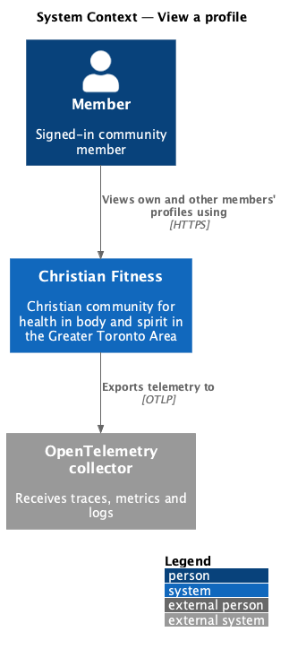
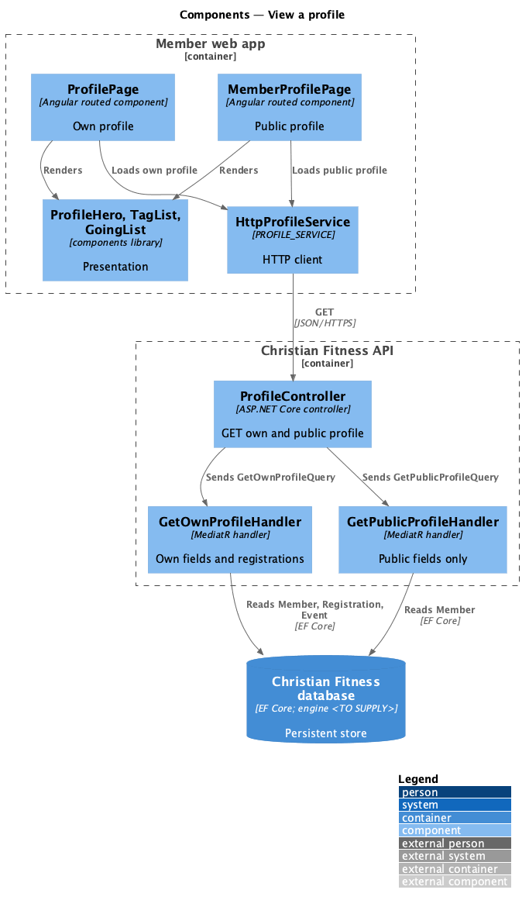

# View a profile

## Overview

A *profile* is the page that describes one member to the community. This feature
covers the Profile screen at `/profile`, which shows a member their own profile, and
the view of another member's profile. It belongs to the member-profile subsystem.

- **own profile** — profile of the signed-in member, with every field
- **public profile** — subset of another member's profile: name, initials, bio and
  interests, plus home church only when that member chose to show it
- **initials avatar** — avatar that shows a member's initials in place of a photo

The own profile shows name, initials avatar, city, join date, bio, home church,
goals, interests and upcoming registered events. With no registered events it shows
an empty state that links to Events. The public profile never shows email, and shows
home church only when its owner made it visible (L2-006).

## Description

- **`ProfilePage`** — routed page at `/profile` in `projects/web`. It renders the
  mock's `profile-hero`, `avatar`, `prose`, `goals`, `tag-list` and `going-list`
  blocks, with `skeleton` while loading, `error-state` on failure and
  `empty-inline` linking to Events when `upcomingEvents` is empty (L2-005 AC2).
- **`MemberProfilePage`** — routed page for another member, matching the mock
  `pages/profile/member.html`. The route path is not listed in the mock manifest;
  `/members/:id` is proposed, `<TO SUPPLY>` for confirmation.
- **`ProfileHero`, `Avatar`, `TagList`, `GoingList`** — presentation components in
  `components`.
- **`initialsOf`** — pure helper in `domain` that derives the initials from a full
  name, with unit tests.
- **`ProfileApi` / `PROFILE_SERVICE`** — contract and token; `HttpProfileService`
  calls `GET /api/profile/me` and `GET /api/members/{id}/profile`. Services are
  provided on the routed component.
- **`ProfileController`** — sends `GetOwnProfileQuery` or `GetPublicProfileQuery`.
- **`GetOwnProfileHandler`** — reads the caller's `Member` and their `Registration`
  rows for upcoming events, returning `OwnProfileDto`.
- **`GetPublicProfileHandler`** — returns `PublicProfileDto` with name, initials, bio
  and interests. It adds `homeChurch` only when `Member.ShowHomeChurch` is true, and
  never includes email (L2-005 AC3). The DTO has no email field by construction.

## Requirements

The feature realizes the following level-2 (L2) requirements. Each L2
requirement refines a level-1 (L1) requirement, cited by identifier.

| L2 ID | Refines (L1) | Requirement |
|-------|--------------|-------------|
| `L2-005` | `L1-003` | Given a signed-in member, when they open Profile, then it shows their name, initials avatar, city, join date, bio, home church, goals, interests and their upcoming registered events; with no registered events the events area shows an empty state with a link to Events; another member's profile URL shows only that member's public fields (name, initials, bio, interests) and never their email or home church unless that member chose to show it (acceptance criteria 1–3). |

## Diagrams

### System context

The member reaches Christian Fitness over HTTPS; the system exports telemetry to an OpenTelemetry collector.

### Containers

The Member web app calls the Christian Fitness API, which reads and writes the Christian Fitness database. The Christian Fitness CLI applies migrations and seed data; the API does not migrate on startup.

### Components

The components below are the parts this slice touches in the Member web app and the Christian Fitness API; each controller sends one MediatR request.

### Class structure

The class diagram shows the frontend contract and its HTTP implementation, the request and handler types and the domain entities they read or change.

### Behaviour — view own profile

The handler reads only the caller's member record and registrations; the page shows every own field and an empty state with a link to Events when nothing is registered (`L2-005`).

### Behaviour — view another member's profile

The public projection omits email by construction and adds home church only when its owner chose to show it (`L2-005` AC3).

