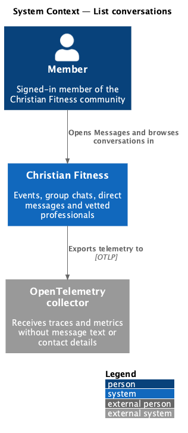
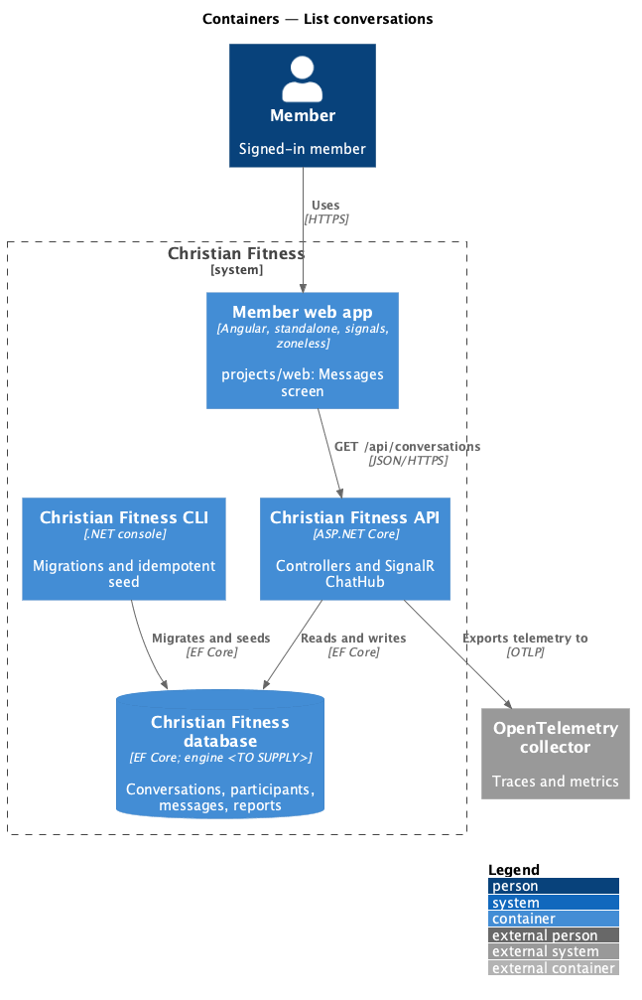
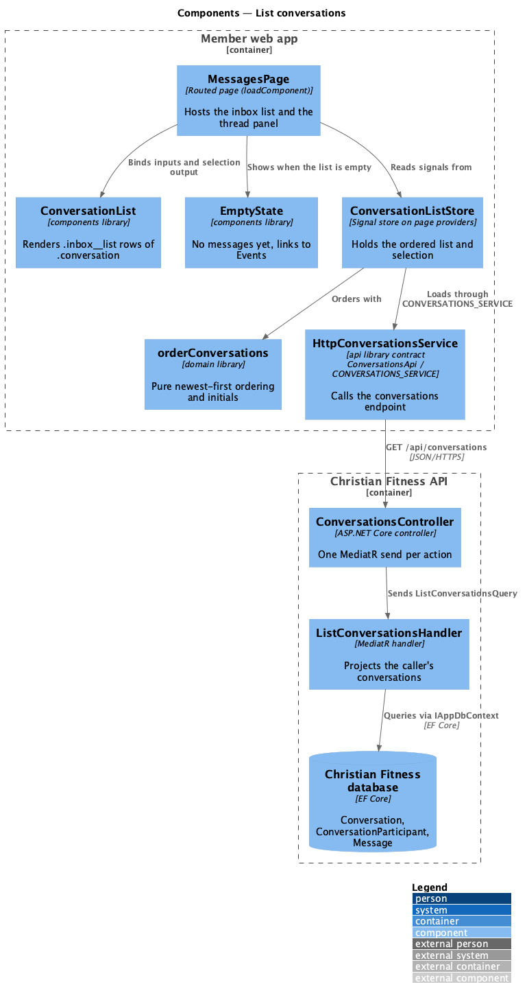
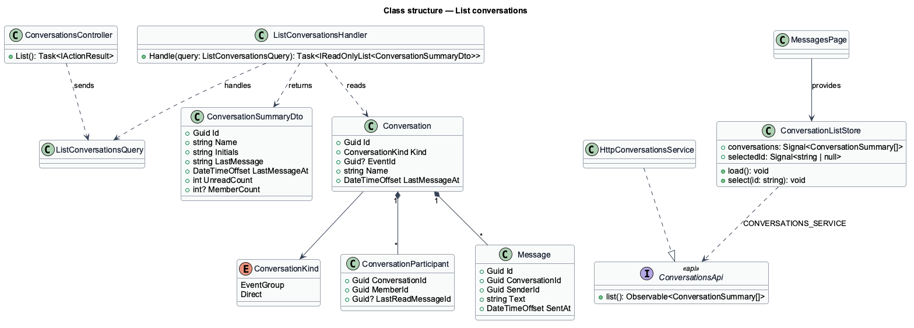
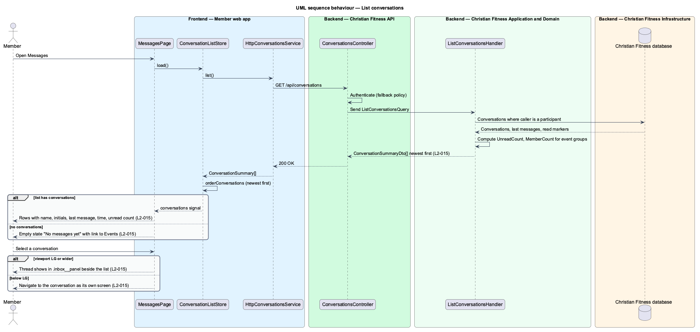

# List conversations

## Overview

Christian Fitness is a Christian community for health in body and spirit in the Greater Toronto
Area. Members meet at events and keep going together through messages (L1-007). This feature
covers the entry point to messaging: the Messages screen and its list of conversations.

- **conversation** — ordered exchange of messages among a fixed set of participants
- **event group chat** — conversation whose participants are the members registered for one event
- **direct conversation** — conversation between two members
- **participant** — member who belongs to a conversation and may read and send in it
- **unread count** — number of messages in a conversation newer than the participant's last read message

A member opens Messages and sees every conversation they belong to, newest first. Each row
shows the conversation name, initials, the last message, its time and the unread count. Event
group chats also show their member count. A member with no conversations sees an empty state
that links to Events, because registering for an event is how a member joins a group chat. On a
wide viewport the selected conversation opens beside the list; on a narrow one it opens as its
own screen. Sending and reading messages belong to the send-and-receive-messages feature.

## Description

The slice runs from the Messages screen of the Member web app to the database.

- **`MessagesPage`** — routed page in `projects/web`, loaded with `loadComponent`. It renders
  the `inbox` block from the mocks (`inbox__list`, `inbox__panel`, `inbox__notice`) and decides
  between the side-by-side layout (LG and wider) and navigation to the conversation route
  (below LG). The LG breakpoint value comes from the design-system layout tokens.
- **`ConversationList`** — presentation component in the `components` library. It receives
  `ConversationSummary[]` and the selected id as inputs, renders each row as the
  `conversation` block (`avatar`, `mini-row__name`, `mini-row__text`, `mini-row__time`), and
  emits the chosen id. The selected row carries `aria-current`.
- **`EmptyState`** — presentation component (`empty-state` block) showing "No messages yet"
  with a link to Events, as in `docs/mocks/pages/messages/empty.html`.
- **`ConversationListStore`** — signal store provided on `MessagesPage` `providers`, so it is
  released when the member leaves the screen. It holds the ordered list and the selection.
  The list is bounded by a window of `<TO SUPPLY>` rows per AGENTS.md "Bound what grows".
- **`orderConversations`** and **`initialsOf`** — pure helpers in the `domain` library, with
  unit tests, for newest-first ordering and initials.
- **`ConversationsApi`** / **`CONVERSATIONS_SERVICE`** — contract and token in the `api`
  library; **`HttpConversationsService`** is the HTTP implementation bound in `app.config.ts`.
- **`ConversationsController`** — `GET /api/conversations`; authenticated by the fallback
  policy, and it sends one `ListConversationsQuery`.
- **`ListConversationsHandler`** — MediatR handler. It reads, through `IAppDbContext`, only the
  conversations where the caller is a `ConversationParticipant`. It projects each to a
  `ConversationSummaryDto` with `UnreadCount` from the participant's `LastReadMessageId` and
  `MemberCount` for `EventGroup` conversations.
- **`Conversation`**, **`ConversationParticipant`**, **`Message`** — domain entities;
  `ConversationKind` distinguishes `EventGroup` from `Direct`.

Paging of the conversation list on the server is `<TO SUPPLY>`. Telemetry records the route
template only; it carries no message text.

## Requirements

| L2 ID | Refines (L1) | Requirement |
|-------|--------------|-------------|
| `L2-015` | `L1-007` | Given a member, when they open Messages, then their conversations are listed newest first with name, initials, last message, time and unread count; group chats show member count. Given no conversations, when Messages loads, then an empty state links to Events. Given viewport LG or wider, when a conversation is selected, then it shows beside the list; below LG, it opens as its own screen. |

## Diagrams

### System context

The member uses Christian Fitness to browse conversations. The system exports telemetry to an
OpenTelemetry collector without message text.

### Containers

The Member web app calls `GET /api/conversations` on the Christian Fitness API. The API reads
the Christian Fitness database; the CLI owns migrations and seed data.

### Components

`MessagesPage` reads `ConversationListStore`, which loads through `CONVERSATIONS_SERVICE`. On
the server, `ConversationsController` sends `ListConversationsQuery` to its handler.

### Class structure

`ListConversationsHandler` reads `Conversation` with its participants and messages and returns
`ConversationSummaryDto`. On the client, `HttpConversationsService` realizes `ConversationsApi`.

### Behaviour — list conversations

The handler returns only the caller's conversations, newest first. The page shows the rows or
the empty state, then places the selected thread by viewport width (L2-015).

