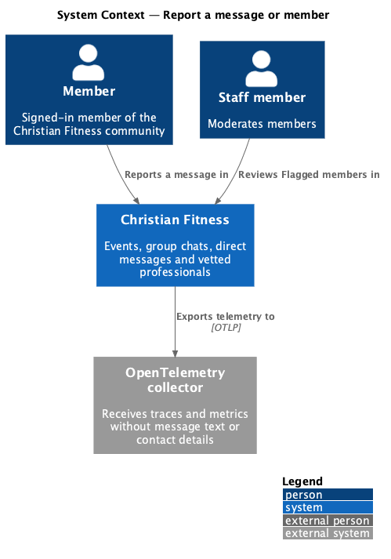
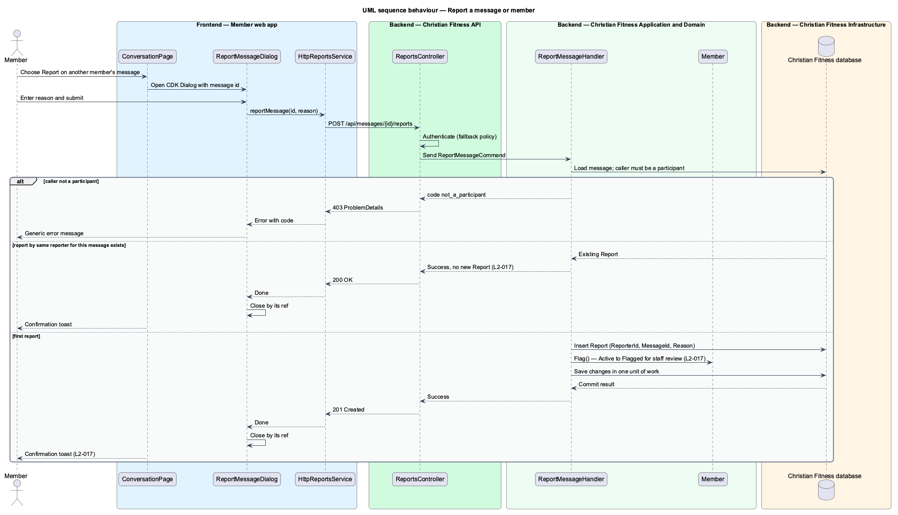

# Report a message or member

## Overview

Christian Fitness lets members exchange messages in event group chats and direct
conversations (L1-007). This feature gives a member a way to report a message from another
member when it breaks the community's standards, so staff can review the sender.

- **report** — record that a member raised a concern about one message, with a reason
- **reporter** — member who submits a report
- **Flagged** — member status meaning staff review is pending; one of `Active`, `Flagged`,
  `Suspended`

A member chooses Report on another member's message and may give a reason. The system records
the report, moves an Active sender to Flagged for staff review, and shows the reporter a
confirmation. A second report of the same message by the same member is refused
(`already_reported`) and creates no duplicate. ADR 0000 settles what this design left open.
Staff review of Flagged members belongs to the admin moderation subsystem.

The title of `L2-017` names a member as well as a message, but its acceptance criteria only
describe reporting a message. Reporting a member directly, without a message, is
out of scope (ADR 0058); this design covers the message path.

## Description

The slice runs from the conversation screen to the database. The mock is
`docs/mocks/dialogs/report-message/` (default, busy, failed, duplicate, success) over the
Messages thread, whose received messages carry a Report button. The confirmation is the
dialog's own success state, not a toast (ADR 0058).

- **`ConversationPage`** — page from the send-and-receive-messages feature. It offers Report on
  messages whose sender is not the current member.
- **`ReportMessageDialog`** — CDK Dialog in `projects/web` that collects the reason. It closes
  by its ref on success and shows a generic message on any refusal.
- **`ReportsApi`** / **`REPORTS_SERVICE`** — contract and token in the `api` library;
  **`HttpReportsService`** is bound in `app.config.ts`.
- **`ReportsController`** — `POST /api/messages/{id}/reports` (a group or a direct message id);
  sends one `ReportMessageCommand`.
- **`ReportMessageHandler`** with **`ReportMessageValidator`** — allows an optional reason of at
  most 500 characters (`field_too_long`) and requires the caller to be a participant of the
  message's conversation (`message_not_found` 404). It refuses the caller's own message
  (`cannot_report_own_message` 403), creates a `MessageReport` once per reporter and message,
  calls `Member.TryFlag` on the sender, and saves in one unit of work. A repeat report is refused
  `already_reported` 409 with no new row.
- **`MessageReport`** — domain entity with a unique index on (`ReporterId`, `MessageId`), which also
  guards against concurrent duplicates.
- **`Member`** — domain entity; `TryFlag` moves `Active` to `Flagged`; a member already `Flagged` or `Suspended` keeps
  their status (L2-017 AC4).

The reason text and the reporter's identity are not logged or placed in telemetry. The error codes are in ADR 0058.

## Requirements

| L2 ID | Refines (L1) | Requirement |
|-------|--------------|-------------|
| `L2-017` | `L1-007` | Given a message from another member, when a member reports it with a reason, then the sender is Flagged for staff review and the reporter sees confirmation. Given a member reports the same message twice, when the second report is sent, then no duplicate report is created. |

## Diagrams

### System context

The member reports a message through Christian Fitness; a staff member later reviews the
Flagged sender in the same system.

### Containers

The Member web app posts the report to the Christian Fitness API, which writes the database.
The Admin web app reads Flagged members through `StaffOnly` endpoints.

### Components

`ReportMessageDialog` submits through `REPORTS_SERVICE`. `ReportsController` sends
`ReportMessageCommand`, and the handler flags the sender through the `Member` entity.

### Class structure

A `Report` links its reporter, the `Message` and the reported `Member`. The handler creates
the report once and calls `Member.Flag()`.

### Behaviour — report a message

A first report creates the `Report` and flags the sender in one unit of work. A repeat report
returns success with no new row; both paths show confirmation (L2-017).

