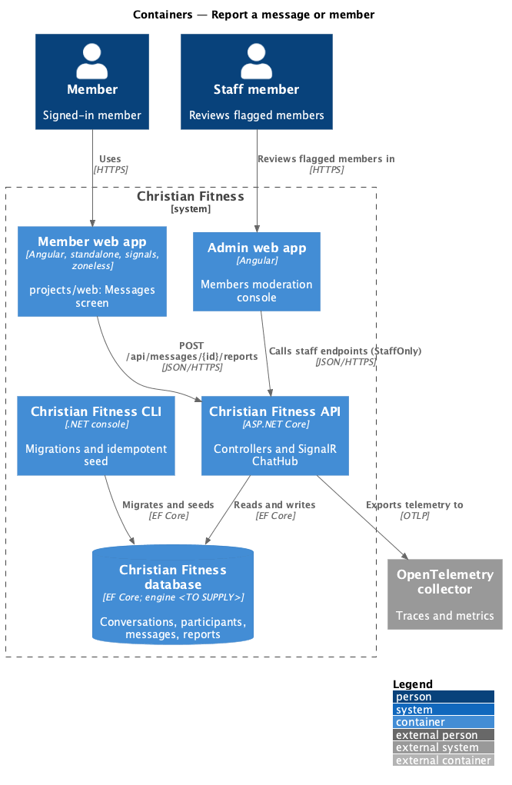
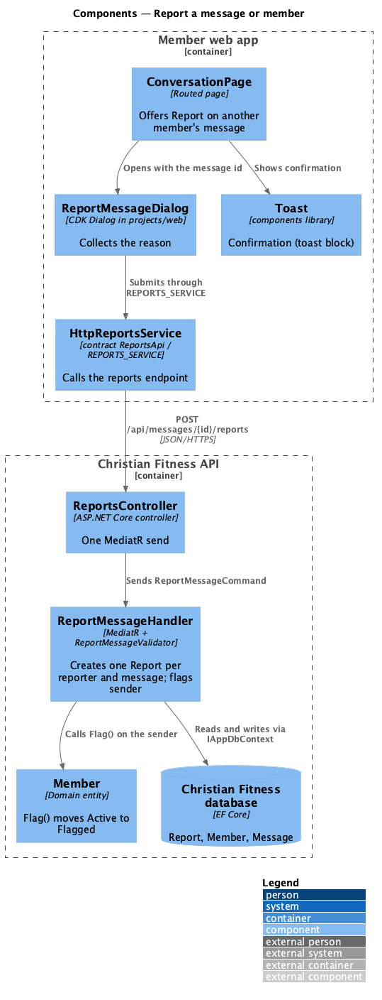
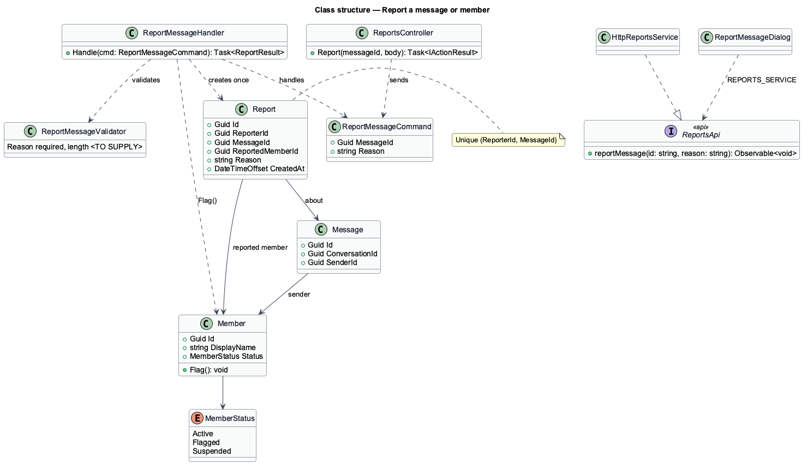

# Report a message or member

## Overview

Christian Fitness lets members exchange messages in event group chats and direct
conversations (L1-007). This feature gives a member a way to report a message from another
member when it breaks the community's standards, so staff can review the sender.

- **report** — record that a member raised a concern about one message, with a reason
- **reporter** — member who submits a report
- **Flagged** — member status meaning staff review is pending; one of `Active`, `Flagged`,
  `Suspended`

A member chooses Report on another member's message and gives a reason. The system records
the report, moves the sender to Flagged for staff review, and shows the reporter a
confirmation. A second report of the same message by the same member creates no duplicate.
Staff review of Flagged members belongs to the admin moderation subsystem.

The title of `L2-017` names a member as well as a message, but its acceptance criteria only
describe reporting a message. Reporting a member directly, without a message, is
`<TO SUPPLY>`; this design covers the message path.

## Description

The slice runs from the conversation screen to the database. No mock exists yet for the
report action or its dialog; the dialog's layout is `<TO SUPPLY>` until a mock is added under
`docs/mocks/dialogs/`. The confirmation uses the `toast` notification
(`docs/mocks/notifications/toast/success.html`).

- **`ConversationPage`** — page from the send-and-receive-messages feature. It offers Report on
  messages whose sender is not the current member.
- **`ReportMessageDialog`** — CDK Dialog in `projects/web` that collects the reason. It closes
  by its ref on success and shows a generic message on any refusal.
- **`Toast`** — presentation component in the `components` library for the confirmation.
- **`ReportsApi`** / **`REPORTS_SERVICE`** — contract and token in the `api` library;
  **`HttpReportsService`** is bound in `app.config.ts`.
- **`ReportsController`** — `POST /api/messages/{id}/reports`; sends one
  `ReportMessageCommand`.
- **`ReportMessageHandler`** with **`ReportMessageValidator`** — requires a reason (maximum
  length `<TO SUPPLY>`) and requires the caller to be a participant of the message's
  conversation. It creates a `Report` once per reporter and message, calls `Member.Flag()` on
  the sender, and saves in one unit of work. A repeat report returns success without a new row.
- **`Report`** — domain entity with a unique index on (`ReporterId`, `MessageId`), which also
  guards against concurrent duplicates.
- **`Member`** — domain entity; `Flag()` moves `Active` to `Flagged`. The effect on a member
  already `Flagged` or `Suspended` is to leave the status unchanged; confirmation of this rule
  is `<TO SUPPLY>`.

The reason text and the reporter's identity are not logged or placed in telemetry. Error codes
for a missing reason and for reporting one's own message are `<TO SUPPLY>`; the spec defines
none.

## Requirements

| L2 ID | Refines (L1) | Requirement |
|-------|--------------|-------------|
| `L2-017` | `L1-007` | Given a message from another member, when a member reports it with a reason, then the sender is Flagged for staff review and the reporter sees confirmation. Given a member reports the same message twice, when the second report is sent, then no duplicate report is created. |

## Diagrams

### System context

The member reports a message through Christian Fitness; a staff member later reviews the
Flagged sender in the same system.

### Containers

The Member web app posts the report to the Christian Fitness API, which writes the database.
The Admin web app reads Flagged members through `StaffOnly` endpoints.

### Components

`ReportMessageDialog` submits through `REPORTS_SERVICE`. `ReportsController` sends
`ReportMessageCommand`, and the handler flags the sender through the `Member` entity.

### Class structure

A `Report` links its reporter, the `Message` and the reported `Member`. The handler creates
the report once and calls `Member.Flag()`.

### Behaviour — report a message

A first report creates the `Report` and flags the sender in one unit of work. A repeat report
returns success with no new row; both paths show confirmation (L2-017).

