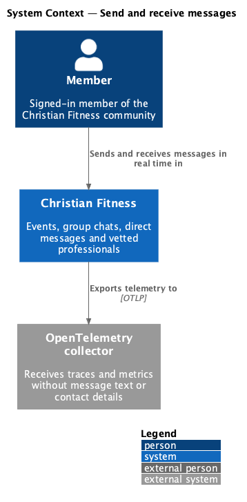
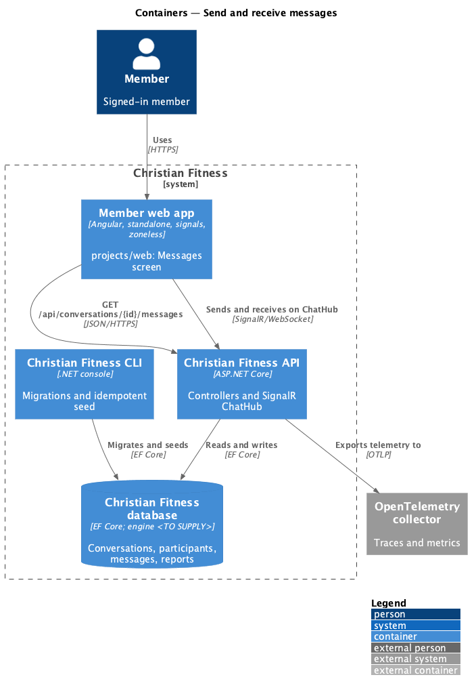
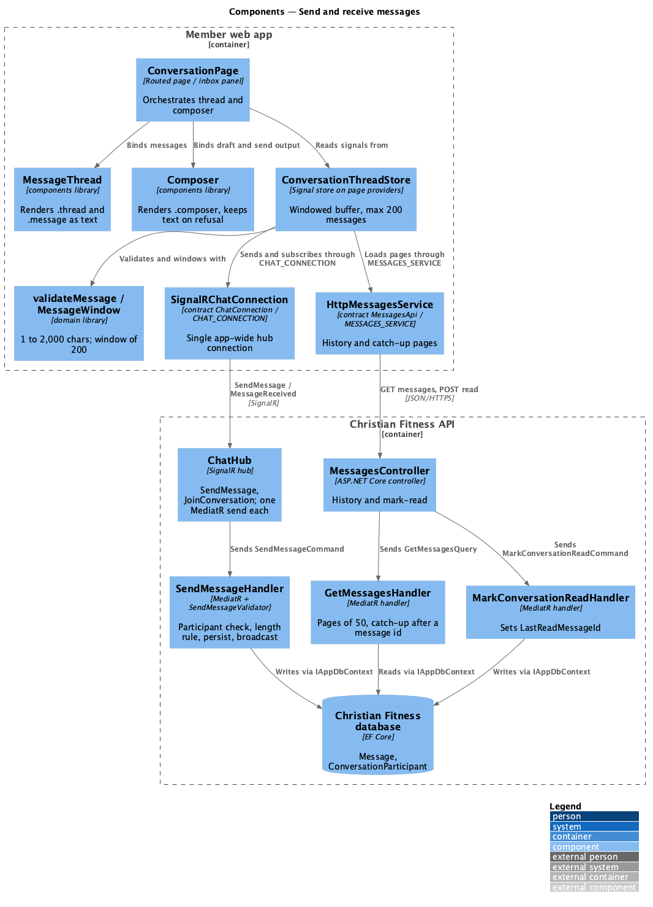
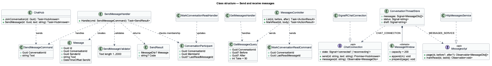
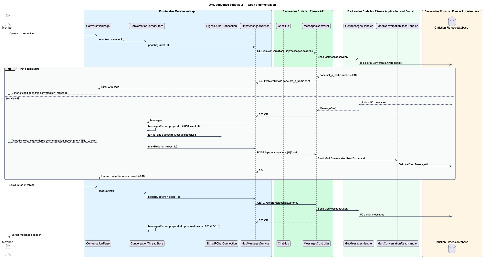
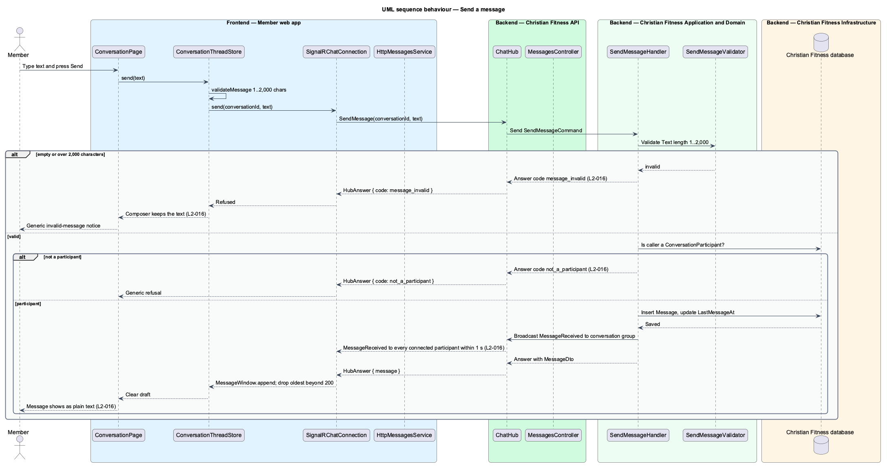
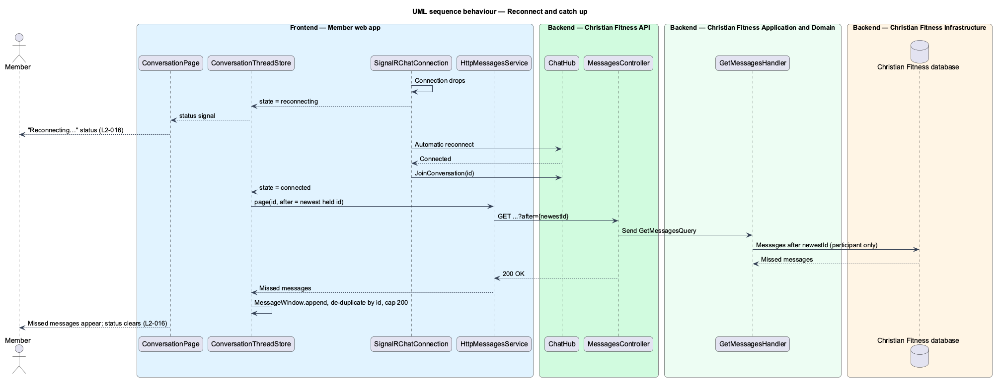

# Send and receive messages

## Overview

Christian Fitness lets members exchange messages in real time in event group chats and in
direct conversations (L1-007). This feature covers what happens inside one conversation:
loading its history, sending a message, receiving other participants' messages without a
reload, and recovering after the connection drops.

- **conversation** — ordered exchange of messages among a fixed set of participants
- **participant** — member who belongs to a conversation and may read and send in it
- **thread** — on-screen list of a conversation's messages (`thread` block in the mocks)
- **composer** — text field and send button below the thread (`composer` block)
- **message window** — client-side buffer that holds at most 200 messages of one conversation
- **catch-up** — fetch of the messages sent while the real-time connection was down

A message holds 1 to 2,000 characters. Only participants read or send in a conversation. Each
message reaches every participant within 1 second and always renders as plain text. Opening a
conversation sets its unread count to zero. Listing conversations belongs to the
list-conversations feature; reporting a message belongs to report-message-or-member.

## Description

The slice runs from the conversation screen through the `ChatHub` and REST endpoints to the
database. Screens follow `docs/mocks/pages/messages/` (`default`, `direct`, `draft`,
`loading`, `error`, `send-failed`).

- **`ConversationPage`** — orchestrating page in `projects/web`. Above LG it renders in the
  `inbox__panel`; below LG it is its own lazy route. It binds the store to the components.
- **`MessageThread`** — presentation component (`thread`, `thread__messages`, `message`,
  `message__bubble`, `message__author`, `message__time`, `message__error`). It renders text by
  interpolation only, never `innerHTML`, so HTML or script shows as plain text.
- **`Composer`** — presentation component (`composer`, `composer__input`, `composer__send`).
  It emits the draft on send and keeps the text after a refusal.
- **`ConversationThreadStore`** — signal store on the page's `providers`. It owns the message
  window, the draft, the connection status and the unread reset. It releases its hub
  subscription with `takeUntilDestroyed` when the page is destroyed.
- **`validateMessage`** and **`MessageWindow`** — pure `domain` helpers with unit tests: the
  1 to 2,000 character rule, and a buffer of capacity 200 that prepends earlier pages and
  appends new messages, de-duplicating by id.
- **`ChatConnection`** / **`CHAT_CONNECTION`** — contract in the `api` library with
  **`SignalRChatConnection`** bound in `app.config.ts`. It is the only connection to `ChatHub`;
  no component opens its own. It exposes a `state` signal (`connected`, `reconnecting`).
- **`MessagesApi`** / **`MESSAGES_SERVICE`** — contract with **`HttpMessagesService`** for
  `GET /api/conversations/{id}/messages` (`take=50`, `before`, `after`) and
  `POST /api/conversations/{id}/read`.
- **`ChatHub`** — SignalR hub. `JoinConversation` and `SendMessage` each send one MediatR
  request and return a `HubAnswer` with an optional `code`; the hub never throws a refusal.
- **`MessagesController`** — sends `GetMessagesQuery` or `MarkConversationReadCommand`.
- **`SendMessageHandler`** with **`SendMessageValidator`** — refuses text outside 1 to 2,000
  characters with `message_invalid` and a non-participant with `not_a_participant`. It saves
  the `Message`, updates `Conversation.LastMessageAt`, and broadcasts `MessageReceived` to the
  conversation's hub group.
- **`GetMessagesHandler`** — returns pages of 50 for participants only, else
  `not_a_participant` (HTTP 403 ProblemDetails with `code`).
- **`MarkConversationReadHandler`** — sets the caller's `LastReadMessageId`.

Telemetry carries no message text, query string or body; the hub method and route template
are recorded instead. Hub scale-out across instances (backplane) is `<TO SUPPLY>`.

## Requirements

| L2 ID | Refines (L1) | Requirement |
|-------|--------------|-------------|
| `L2-016` | `L1-007` | Given a member in a conversation, when they send a message of 1 to 2,000 characters, then it appears for every participant within 1 second without reloading. Given an empty message or one over 2,000 characters, when sent, then it is refused with code `message_invalid` and the composer keeps the text. Given a member who is not a participant, when they try to read or send in that conversation, then it is refused with code `not_a_participant`. Given message text containing HTML or script, when displayed, then it is rendered as plain text. Given the real-time connection drops, when it returns, then missed messages are fetched and the member sees a "Reconnecting…" status meanwhile. Given a conversation with more than 50 messages, when opened, then the latest 50 load and earlier ones load on scrolling up; the client holds at most 200 in memory. Given a member opens a conversation, when its messages show, then its unread count becomes zero. |

## Diagrams

### System context

The member sends and receives messages through Christian Fitness. Telemetry goes to the
OpenTelemetry collector without message text.

### Containers

The Member web app loads history over HTTPS and exchanges live messages with `ChatHub` over
SignalR. Both paths reach the Christian Fitness database through the API.

### Components

`ConversationThreadStore` sends through `CHAT_CONNECTION` and pages history through
`MESSAGES_SERVICE`. On the server, `ChatHub` and `MessagesController` each send one MediatR
request per call.

### Class structure

`SendMessageHandler` validates with `SendMessageValidator`, checks `ConversationParticipant`,
and creates `Message`. The client store composes a `MessageWindow` of capacity 200.

### Behaviour — open a conversation

The handler refuses a non-participant with `not_a_participant`. A participant receives the
latest 50 messages, the unread count resets, and scrolling up loads earlier pages within the
200-message window (L2-016).

### Behaviour — send a message

The handler refuses invalid text with `message_invalid` and the composer keeps it. A valid
message is saved and broadcast to every participant within 1 second (L2-016).

### Behaviour — reconnect and catch up

While the connection is down the page shows "Reconnecting…". On return the store fetches
messages after the newest one it holds and merges them by id (L2-016).

