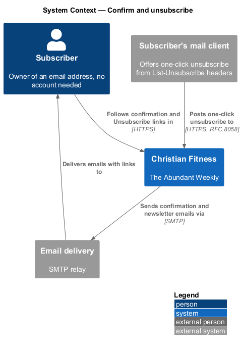
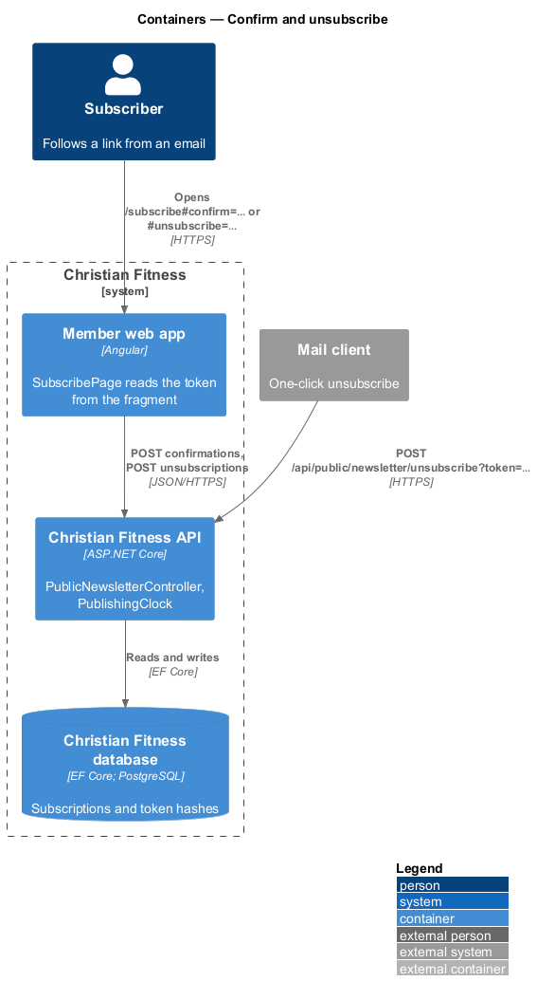
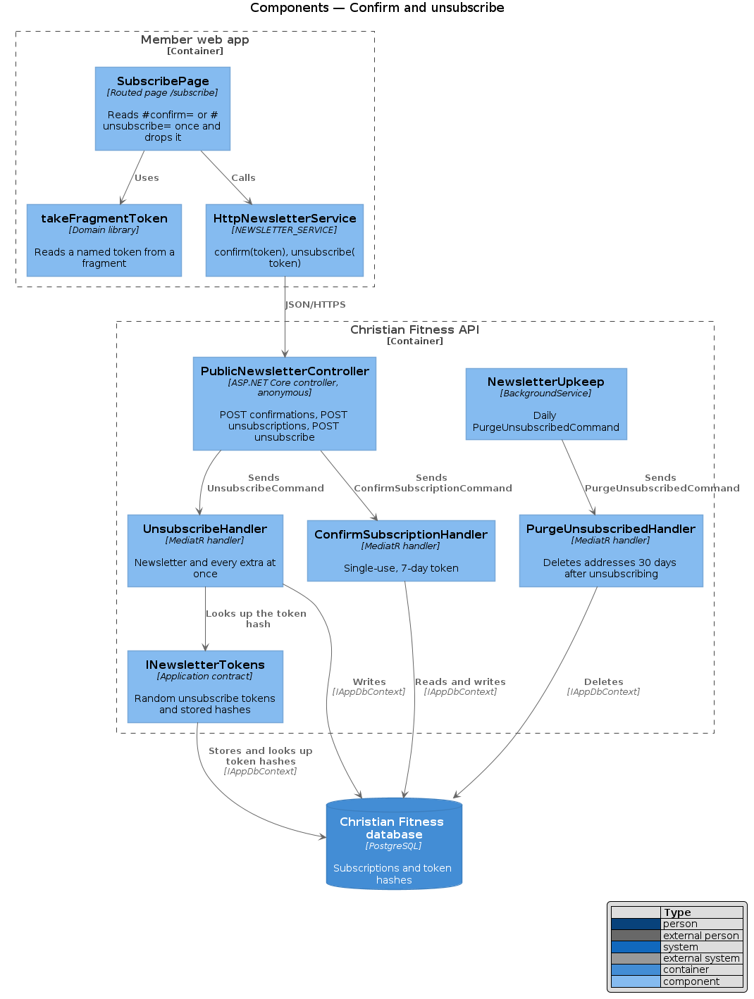
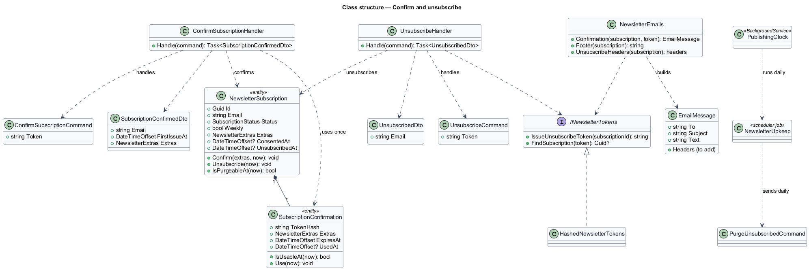
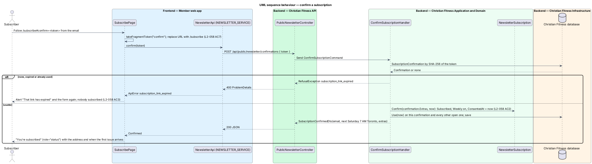
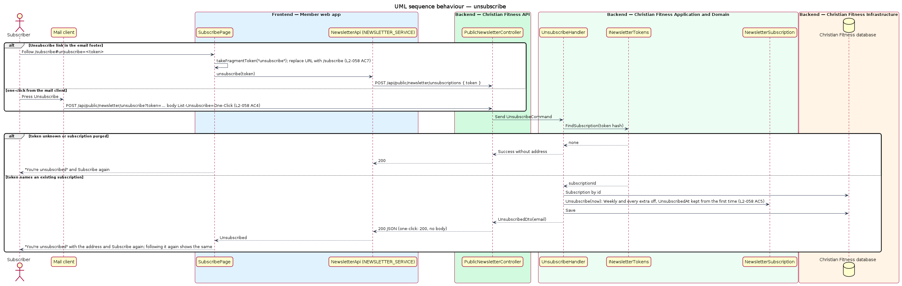
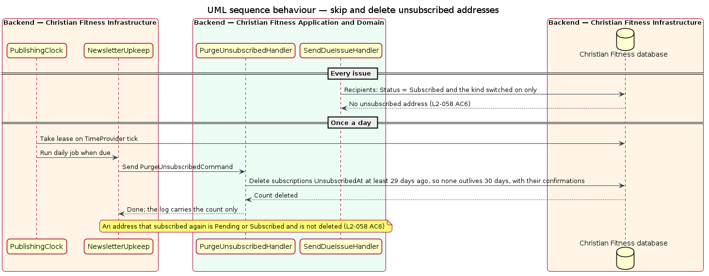

# Confirm and unsubscribe

## Overview

A subscription to The Abundant Weekly starts Pending (`subscribe-to-newsletter`). The address's
owner turns it on by following the one link in a confirmation email, and turns it off by an
Unsubscribe link carried by every email the newsletter sends (`L1-018`). Both steps work without
an account, without signing in and without typing anything. Canada's anti-spam law asks for this
recorded consent and one-step unsubscribe (`docs/mocks/README.md`, "Newsletter confirmation and
unsubscribe").

- **confirmation token** — 32 random bytes in base64url, single-use and valid for 7 days, of which the system stores only a SHA-256 hash
- **consent time** — instant the owner followed a valid confirmation link, kept on the subscription
- **unsubscribe token** — opaque token that names one subscription, signed with the API's Data Protection keys and placed in every newsletter email
- **one-click unsubscribe** — unsubscribe a mail client performs from the `List-Unsubscribe` and `List-Unsubscribe-Post` headers (RFC 8058)
- **purge** — deletion of an unsubscribed address no later than 30 days after it unsubscribed

The states after each link are states of the Subscribe screen (mock `docs/mocks/pages/subscribe/`):
`confirmed` ("You're subscribed"), `link-expired` ("That link has expired" above the form) and
`unsubscribed` ("You're unsubscribed" with Subscribe again).

## Description

### Member web app

- **`SubscribePage`** — the page of `subscribe-to-newsletter`. On open it reads at most one token
  from the route's fragment, `#confirm=<token>` or `#unsubscribe=<token>`, with
  **`takeFragmentToken`** (pure helper in the `domain` library) and at once replaces the URL with
  `/subscribe` (`Location.replaceState`), so the token leaves the address bar and is never sent to
  a server in a URL or a `Referer` (`L2-058` AC7; the pattern of ADR 0014). It then calls
  `confirm(token)` or `unsubscribe(token)` on `NEWSLETTER_SERVICE` and shows:
  - `confirmed` — a `role="status"` region that takes focus: "You're subscribed", the address as
    text, when the first issue arrives and the extras chosen ("with event alerts as they post"),
    and "Read last week's issue" (`L2-058` AC2);
  - `link-expired` — the library's `Alert` "That link has expired. Confirmation links last 7 days.
    Enter your email again and we'll send a new one." above the form (`L2-058` AC3);
  - `unsubscribed` — "You're unsubscribed", the address, and Subscribe again, which shows the form
    (`L2-058` AC5).

  While the request runs the page shows its loading state (`<TO SUPPLY>`: no mock state is drawn
  for it). A 5xx or no answer shows the `error` alert.
- **Email footer links** — Manage preferences and Follow by RSS lead to Subscribe and its feeds;
  only the Unsubscribe link carries a token (`L2-059` AC3).

### Christian Fitness API

- **`PublicNewsletterController`** — `[AllowAnonymous]` under `api/public/newsletter`; each action
  sends one MediatR request:
  - `POST confirmations` (`{ token }`) sends `ConfirmSubscriptionCommand`;
  - `POST unsubscriptions` (`{ token }`) sends `UnsubscribeCommand` and answers the address;
  - `POST unsubscribe?token=…` is the one-click address named in `List-Unsubscribe`. It reads the
    form body `List-Unsubscribe=One-Click`, sends the same `UnsubscribeCommand` and answers 200
    with no body. A mail provider posts it from no page of the app, so it is exempt from the
    antiforgery filter (`AntiforgerySetup`); the token is its only credential.
- **`ConfirmSubscriptionCommand`** / **`ConfirmSubscriptionHandler`** — hashes the token and finds
  the `SubscriptionConfirmation`. None, expired (`ExpiresAt` from `TimeProvider`) or already used
  is refused with 400 and the new code `subscription_link_expired`, changing nothing (`L2-058`
  AC3). A usable one calls `NewsletterSubscription.Confirm(extras, now)`: Status Subscribed, the
  Weekly on, the extras chosen with that request, `ConsentedAt` = now (`L2-058` AC2). It marks
  this and every other open confirmation of the subscription used, and answers
  `SubscriptionConfirmedDto` (`email`, `firstIssueAt` — the next send time of the Weekly in
  `America/Toronto` — and `extras`).
- **`UnsubscribeCommand`** / **`UnsubscribeHandler`** — reads the subscription id from the token
  through **`INewsletterTokens`**; a token it cannot read is refused with
  `subscription_link_expired`. `NewsletterSubscription.Unsubscribe(now)` turns the Weekly and all
  three extras off at once and sets `UnsubscribedAt` the first time only, so a second visit
  answers the same and does not delay the purge (`L2-058` AC5). A subscription already purged
  answers as an unknown token does.
- **`INewsletterTokens`** / **`DataProtectionNewsletterTokens`** — Application contract and its
  Infrastructure implementation over ASP.NET Core Data Protection (`IDataProtector` with the
  purpose `newsletter.unsubscribe`, keys at `DataProtection:KeysPath`, ADR 0047). The token holds
  the subscription id only; nothing is stored for it, so every email can carry one without a row
  per message.
- **`NewsletterEmails`** — Application service (introduced in `subscribe-to-newsletter`) that also
  writes the part every newsletter email shares (`L2-058` AC4): a footer that names Christian
  Fitness and its postal address (setting `Newsletter:PostalAddress`), the Unsubscribe link
  `<MemberApp:BaseUrl>/subscribe#unsubscribe=<token>`, and two headers:
  `List-Unsubscribe: <https://…/api/public/newsletter/unsubscribe?token=…>` and
  `List-Unsubscribe-Post: List-Unsubscribe=One-Click`. The existing `EmailMessage` has no headers;
  this slice adds them (see Open questions).
- **Recipients** — every sender of an issue or an extra selects only Subscribed addresses with that
  kind switched on, so nothing reaches an unsubscribed address (`L2-058` AC6;
  `publishing/build-and-schedule-newsletter`).
- **`NewsletterUpkeep`** — daily job of the shared, leased `PublishingClock` scheduler
  ([ADR 0069](../../../adr/0069-scheduled-work.md)), not a separate hosted service. It sends
  **`PurgeUnsubscribedCommand`**,
  whose handler deletes every subscription whose `UnsubscribedAt` is at least 29 days old, with its
  confirmations, allowing a day for the daily run before 30 days (`L2-058` AC6). After an outage
  the next available tick picks up overdue work. Tests advance `FakeTimeProvider` and run the
  command directly.
- **Telemetry** — the one-click route is recorded as its template
  (`api/public/newsletter/unsubscribe`) without its query string; no log or span carries a token or
  an address (`L2-058` AC7, `L2-033` AC2). The purge logs a count only.

### Open questions

- **Email headers and HTML.** `EmailMessage` carries `To`, `Subject` and `Text` only and
  `SmtpEmailTransport` sends plain text. One-click unsubscribe needs custom headers, and the issue
  "as the email reads" (`L2-059` AC1) suggests an HTML body. Both change the shared email contract
  and need an ADR next to ADR 0010.
- **Access logs.** The one-click URL carries the token in its query string, as RFC 8058 requires.
  nginx and the Container Apps ingress may log request lines; whether their logs drop query strings
  is `<TO SUPPLY>` and belongs to the deployment settings.
- **Unsubscribe token lifetime.** The design gives unsubscribe tokens no expiry, so a link in an
  old email still works; rotating the Data Protection keys out of the ring would end old links.
  The key retention period is `<TO SUPPLY>`.
- **Postal address.** The mocks' footer reads "Christian Fitness · Toronto, ON", which is not a
  postal address. The address itself is `<TO SUPPLY>`.
- **Link scanners.** Mail security scanners that fetch links do not run the page's script, so
  they neither confirm nor unsubscribe. A scanner that runs scripts would confirm a subscription;
  no defence beyond the page's POST is specified.
- **Members' preferences.** A member's email switches (`L2-064` AC8–AC9) read and write the
  subscription of the account's address; that screen is designed with Preferences.

## Requirements

The feature realizes the following level-2 (L2) requirements. Each L2 requirement refines a
level-1 (L1) requirement, cited by identifier. The specification states its requirements as
acceptance criteria; the text below condenses those criteria faithfully.

| L2 ID    | Refines (L1)       | Requirement |
| -------- | ------------------ | ----------- |
| `L2-058` | `L1-018`, `L1-013` | A confirmation email shall hold one link with a single-use token lasting 7 days and say who sent it, why, and that ignoring it subscribes nobody. A valid confirmation link shall subscribe the address with the extras chosen, record the time of consent, and show "You're subscribed" with the address and when the first issue arrives. A link that is expired, already used or unknown shall subscribe nobody, and Subscribe shall say the link has expired and show the form again. Every email the newsletter sends shall name Christian Fitness and its postal address and carry an Unsubscribe link and the `List-Unsubscribe` and `List-Unsubscribe-Post` headers for one-click unsubscribe. An Unsubscribe link shall unsubscribe the address from the newsletter and every extra at once, without signing in or typing, and show "You're unsubscribed" with a way to subscribe again; following it again shall show the same. Nothing shall be sent to an unsubscribed address, which shall be deleted within 30 days unless it subscribes again. No span, metric or log shall carry a confirmation or unsubscribe token, and the page that reads one shall remove it from the address bar. |
| `L2-033` | `L1-013`           | No log, metric or span shall contain an email, name, home church, message text, token, query string or body (AC2). |

## Diagrams

### System context

Christian Fitness sends emails whose links reach the subscriber; the subscriber, or their mail
client, follows them back to Christian Fitness.

### Containers

The Member web app posts tokens it read from the fragment; a mail client posts the one-click
unsubscribe to the API directly. The API signs unsubscribe tokens with its Data Protection keys.

### Components

`PublicNewsletterController` sends `ConfirmSubscriptionCommand` and `UnsubscribeCommand`;
`NewsletterUpkeep` sends `PurgeUnsubscribedCommand` once a day.

### Class structure

A `NewsletterSubscription` is confirmed through one `SubscriptionConfirmation` and unsubscribed
through a token `INewsletterTokens` reads; `NewsletterEmails` builds the shared footer and headers.

### Behaviour — confirm a subscription

The page drops the token from the address bar and posts it; a usable token subscribes the address
and records consent, anything else shows the expired-link state (`L2-058` AC2, AC3, AC7).

### Behaviour — unsubscribe

The footer link and the mail client's one-click both send `UnsubscribeCommand`, which turns
everything off at once and answers the same on a second visit (`L2-058` AC4, AC5, AC7).

### Behaviour — skip and delete unsubscribed addresses

Senders select only subscribed addresses; a daily purge deletes addresses unsubscribed for 29
days or more (`L2-058` AC6).

