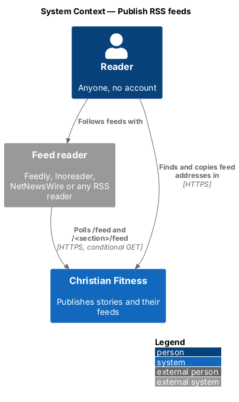
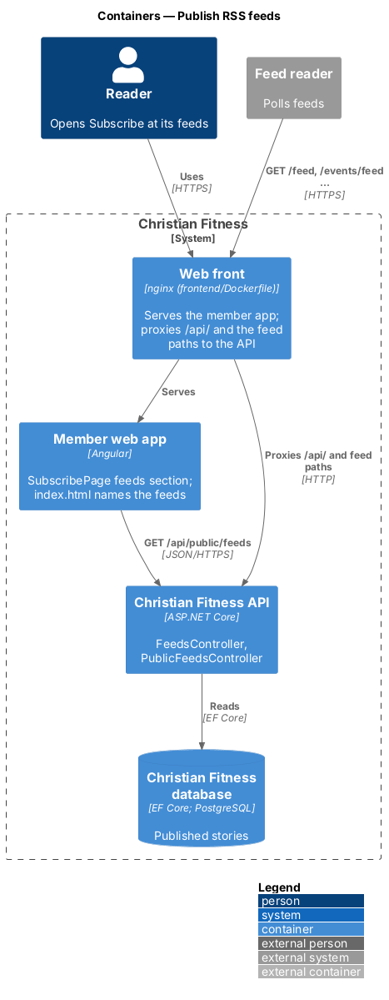
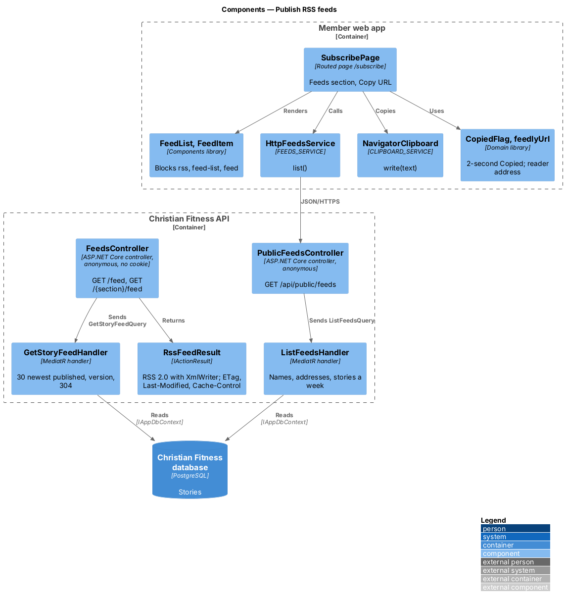
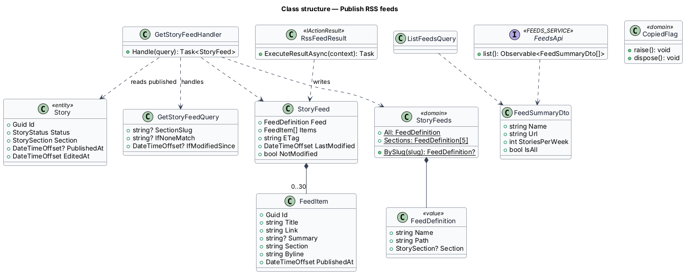
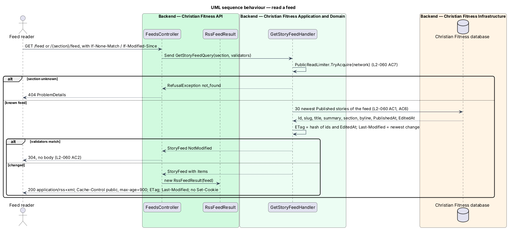
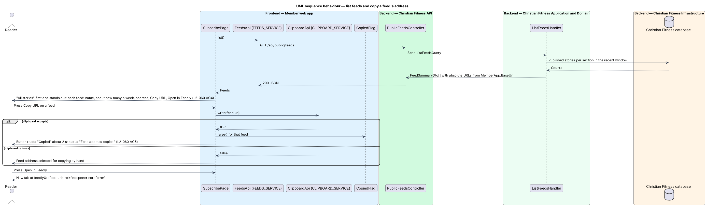

# Publish RSS feeds

## Overview

Readers who prefer a feed reader to email follow the community's stories by RSS, with no email
and no account (`L1-018`). Christian Fitness publishes one feed of all stories and one per
section, and the Subscribe screen lists them with each address to copy or open in Feedly (mock
`docs/mocks/pages/subscribe/`, the `rss` section of `default` and the state `copied`).

- **feed** — RSS 2.0 document of the 30 newest published stories, of every section or of one
- **All stories feed** — the feed at `/feed`
- **section feed** — the feed of one section at `/events/feed`, `/training/feed`, `/nutrition/feed`, `/faith-body/feed` or `/community/feed`
- **conditional request** — a request that repeats the `ETag` or `Last-Modified` a feed gave, answered 304 with no body while nothing changed
- **stories a week** — about how many stories a feed carries in a week, shown beside each feed

Feeds are public reads: they need no account, set no cookie, and are rate limited per network
(`L2-060` AC7). A feed carries nothing that identifies or reaches a member, and never a draft or a
removed story (`L2-060` AC6). The landing page and Subscribe name the feeds in the document head
so a reader finds them from the site's address (`L2-060` AC3).

## Description

### Christian Fitness API

- **`StoryFeeds`** — static catalogue in `ChristianFitness.Domain/News`: the All stories feed
  and the five section feeds as `FeedDefinition` (`Name`, `Path`, `Section`). `BySlug` answers the
  section of `events`, `training`, `nutrition`, `faith-body` or `community`, else none.
- **`FeedsController`** — `[AllowAnonymous]` controller mapped at the site's root, not under
  `api/`: `GET feed` and `GET {section}/feed`. Each sends one **`GetStoryFeedQuery`** with the
  section slug and the request's `If-None-Match` and `If-Modified-Since` values, and returns an
  **`RssFeedResult`**. It is excluded from `UseAntiforgeryTokens`, which today adds antiforgery
  cookies to every API response, so a feed sets no cookie (`L2-060` AC7).
- **`GetStoryFeedHandler`** — takes a `PublicReadLimiter` lease (`news/read-story`); with none
  left it refuses with 429 `rate_limited`. An unknown section is 404 `not_found`. It reads the 30
  newest effectively Published stories (of the section, or all), including Scheduled stories
  whose `PublishAt` has passed ([ADR 0069](../../../adr/0069-scheduled-work.md)), newest effective
  publication time first
  (`L2-060` AC1, AC6). Its `ETag` is a strong hash of the items' ids and `EditedAt` values, so an
  edit, a new story or an unpublished one changes it; `Last-Modified` is the newest of those
  instants, including the scheduled publication time for a story that became visible on read.
  When the request's validators match it answers `NotModified` and the result writes 304
  with no body (`L2-060` AC2).
- **`RssFeedResult`** — `IActionResult` in the Api layer that writes RSS 2.0 with
  `System.Xml.XmlWriter` (which escapes every value) as `application/rss+xml; charset=utf-8`, with
  `Cache-Control: public, max-age=900`, `ETag` and `Last-Modified` (`L2-060` AC2). The channel
  names the feed, its address and the site. Each item has `title`, `link`
  (`<MemberApp:BaseUrl>/stories/<slug>`), `description` (the summary, as text), `category` (the
  section), `dc:creator` (the byline; RSS `author` would need an email address), `pubDate`
  (RFC 1123) and `guid isPermaLink="false"` set to `urn:uuid:<story id>`, which stays the same when
  the slug changes (`L2-060` AC1). Addresses come from `MemberAppAddress`, never from the request's
  `Host`.
- **`PublicFeedsController`** — `[AllowAnonymous]` under `api/public/feeds`; `GET` sends
  **`ListFeedsQuery`**, whose handler answers six `FeedSummaryDto` (`name`, absolute `url`,
  `storiesPerWeek`, `isAll`), All stories first. `storiesPerWeek` is the number of stories
  published in the feed over a recent window divided by its weeks, rounded; the window is
  `<TO SUPPLY>` (the mock shows "~20 a week").
- **Telemetry** — routes are recorded as their templates (`feed`, `{section}/feed`); no
  validator, query string or address is recorded.

### Member web app

- **Document head** — `projects/web/src/index.html` carries one
  `<link rel="alternate" type="application/rss+xml" title="Christian Fitness: All stories"
  href="/feed">` and one per section feed. Every page of the member app, the landing page and
  Subscribe included, is served from that file, so the head names the feeds whichever address a
  reader starts from (`L2-060` AC3).
- **Feeds section of `SubscribePage`** — the page (`subscribe-to-newsletter`) also binds
  `FEEDS_SERVICE` to `HttpFeedsService` and `CLIPBOARD_SERVICE` to `NavigatorClipboard` on its
  `providers` and asks `list()`. The section (block `rss`, heading "Prefer RSS?", with the
  `id="rss"` the landing page's link targets) renders **`FeedList`** and **`FeedItem`**
  (components library, blocks `feed-list` and `feed`, `feed--all` for All stories, which comes
  first and stands out) with name, "~N a week", the address as text (`feed__url`), Copy URL and
  Open in Feedly (`L2-060` AC4). At XS each feed's actions sit under its address (`L2-057` AC9).
- **Copy URL** — writes the feed's address through `CLIPBOARD_SERVICE`. On success that feed's
  **`CopiedFlag`** (`news/read-story`) makes its button read "Copied" for 2,000 ms and a
  `p role="status"` says "Feed address copied"; when the clipboard refuses, the page selects the
  address text so it can be copied by hand (`L2-060` AC5). The page keeps one flag per feed and
  disposes them on destroy.
- **Open in Feedly** — a link built by **`feedlyUrl(feedUrl)`** (pure helper in the `domain`
  library: `https://feedly.com/i/subscription/feed/` followed by the encoded address), with
  `target="_blank"` and `rel="noopener noreferrer"`, and visually hidden text naming the feed and
  "(opens in a new tab)" (`L2-060` AC4).
- **`FeedsApi` / `FEEDS_SERVICE`** — contract and token in the `api` library; `HttpFeedsService`
  implements `list()`.

### Open questions

- **Routing the feed paths.** The member app and the API share an origin behind nginx, which
  proxies only `/api/` today (ADR 0047). The paths `/feed` and `/<section>/feed` need their own
  proxy rules, or `/events/feed` reaches the SPA's `events/:id` route. The change to
  `frontend/Dockerfile`'s nginx configuration, and its documentation, belong to the feed slice.
- **Public read limit.** The limit and window are `<TO SUPPLY>` (see `news/read-story`). A feed
  reader behind a shared network address polling every 15 minutes needs the limit to leave room
  for it.
- **Response caching.** `L2-060` AC2 settles the headers. Whether the API also keeps the rendered
  feed for 15 minutes (ASP.NET Core output caching) is open; the design renders on each request
  that is not a 304, from one query of at most 30 rows.
- **Pros has no feed.** Pros is a section on the landing page and in the editor (`L2-001` AC1), but
  `L2-060` AC1 names five section feeds; the mock lists the same five. A story in Pros is in the
  All stories feed only.
- **Feed addresses.** The mock shows `https://christianfitness.ca/feed`; ADR 0047 serves the member
  app at `www.christian.fitness`. The addresses follow `MemberApp:BaseUrl`, whichever it is.

## Requirements

The feature realizes the following level-2 (L2) requirement. Each L2 requirement refines a level-1
(L1) requirement, cited by identifier. The specification states its requirements as acceptance
criteria; the text below condenses those criteria faithfully.

| L2 ID    | Refines (L1) | Requirement |
| -------- | ------------ | ----------- |
| `L2-060` | `L1-018`     | `/feed` shall answer a valid RSS 2.0 document (`application/rss+xml`) of the 30 newest published stories with title, link, summary, section, author, publication date and a permanent id; `/events/feed`, `/training/feed`, `/nutrition/feed`, `/faith-body/feed` and `/community/feed` shall answer the same for one section. A repeated request with the feed's `ETag` or `Last-Modified` shall be answered 304 with no body while nothing changed, and feeds shall be cacheable for 15 minutes. The landing page and Subscribe shall name the feeds in the document head (`<link rel="alternate" type="application/rss+xml">`). Subscribe's feeds shall show "All stories" first and standing out, and each feed's name, about how many stories a week, its address as text, "Copy URL" and "Open in Feedly", which opens the reader in a new tab with the feed's address. "Copy URL" shall put the address on the clipboard, read "Copied" for about 2 seconds with a `status` message, and select the address when the clipboard refuses. A draft or removed story shall not be in a feed, and a feed shall carry nothing that identifies or reaches a member. A feed shall need no account, set no cookie and be rate limited per network like other public reads. |

## Diagrams

### System context

Readers find and copy feed addresses in Christian Fitness; their feed readers poll the feeds.

### Containers

nginx serves the member app and proxies `/api/` and the feed paths to the API, which reads
published stories from the database.

### Components

`FeedsController` sends `GetStoryFeedQuery` and writes an `RssFeedResult`; the Subscribe page lists
feeds through `FEEDS_SERVICE` and copies addresses through `CLIPBOARD_SERVICE`.

### Class structure

`StoryFeeds` defines the six feeds; `GetStoryFeedHandler` answers a `StoryFeed` of at most 30
`FeedItem`, which `RssFeedResult` writes.

### Behaviour — read a feed

A feed request is limited per network, answered 304 when its validators still match, and otherwise
written as RSS 2.0 with caching headers and no cookie (`L2-060` AC1, AC2, AC6, AC7).

### Behaviour — list feeds and copy an address

Subscribe lists the feeds with All stories first; Copy URL reads "Copied" for about 2 seconds or
selects the address when the clipboard refuses (`L2-060` AC4, AC5).

