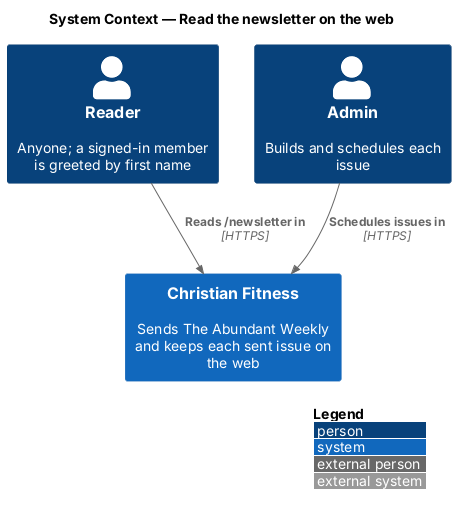
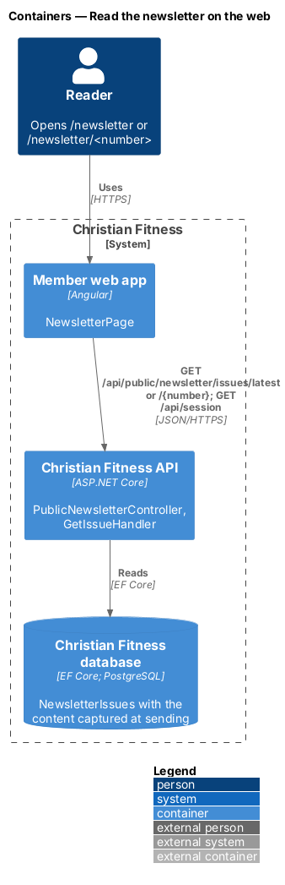
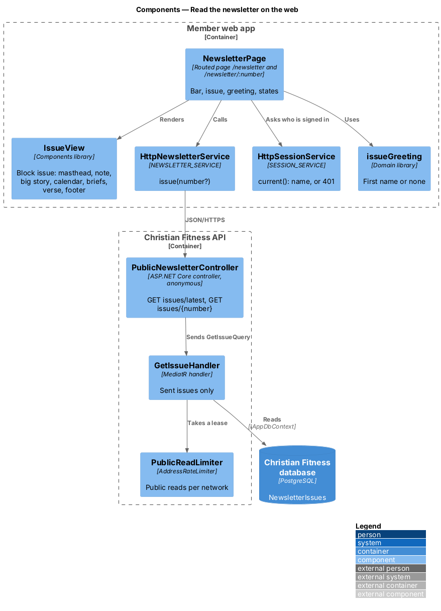
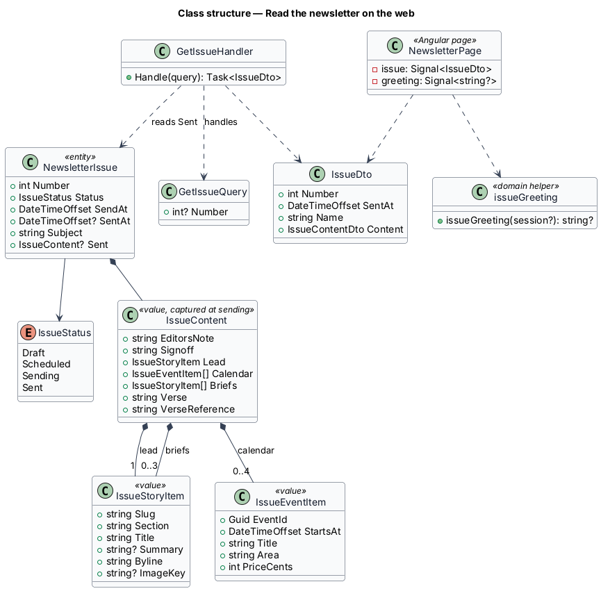
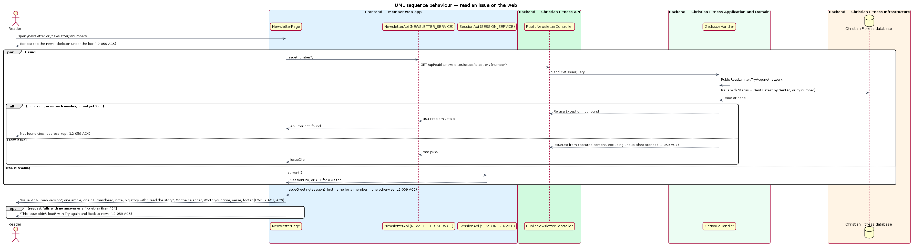

# Read the newsletter on the web

## Overview

Each issue of The Abundant Weekly is emailed to its subscribers and also kept on the web, so
anyone can read the latest issue without subscribing (`L1-018`). The landing page footer, the
Subscribe screen's "Read the full issue" and "Read last week's issue" lead here. This feature is
the Newsletter page of the Member web app at `/newsletter` and `/newsletter/<number>` (mock
`docs/mocks/pages/newsletter/`, states `default`, `unpublished`, `loading` and `error`).

- **issue** — one numbered edition of the newsletter, built and scheduled by an Admin (`publishing/build-and-schedule-newsletter`)
- **sent issue** — issue whose sending has finished; only sent issues are on the web
- **web version** — the sent issue shown in the browser as the email reads, under a bar that leads back to the news
- **captured content** — the stories, events and words of an issue as they stood at the moment of sending, kept with the issue

The page shows one `article`: the masthead with the newsletter's name, issue number and date; the
editor's note; the big story with image, title, summary and "Read the story"; "On the calendar"
with the next four published events at the time of sending regardless of featured toggles; "Worth your time" with three more
stories; a verse with its reference; and the footer. A signed-in member is greeted by first name;
anyone else is not greeted.

## Description

### Member web app

- **`NewsletterPage`** — routed page at `newsletter` and `newsletter/:number` in `projects/web`,
  loaded with `loadComponent`, outside the member shell. Its `providers` bind `NEWSLETTER_SERVICE`
  to `HttpNewsletterService`. It shows the bar (block `issue-page`, element `issue-page__bar`:
  the brand linking to the news and "Issue <number> · web version", `L2-059` AC2), then a
  skeleton (`SkeletonRegion`, mock `loading`), the issue, the app's not-found view for a 404
  `not_found` (`L2-059` AC4), or the error state "This issue didn't load" with Try again and Back
  to news for no answer or another 4xx (`L2-059` AC5). A 5xx opens the server-error screen as
  every read does (`L2-043` AC4). The issue column is at most 42 rem wide and nothing overflows at
  XS (`L2-059` AC6).
- **Greeting** — the page asks `SESSION_SERVICE.current()` beside the issue. **`issueGreeting`**
  (pure helper in the `domain` library) answers "Morning, <first name>." for a session and none for
  a 401, so the issue endpoint stays the same for every reader and carries no personal data
  (`L2-059` AC2). The first name is the first word of `SessionDto.name` (`<TO SUPPLY>`: the
  session has no separate first name).
- **`IssueView`** — presentation component in the components library (block `issue`, elements
  `issue__masthead`, `issue__date`, `issue__greeting`, `issue__text`, `issue__signoff`,
  `issue__section`, `issue__image`, `issue__lead-title`, `issue__action`, `issue__verse`,
  `issue__quote`, `issue__cite`, `issue__footer`, `issue__links`), inputs only. Its one `h1` is the
  newsletter's name; each section's heading is an `h2` and each brief an `h3` (`L2-059` AC6). The
  calendar rows reuse the mock's `event-row` block and the briefs its `headline-list` block. Every
  value is rendered as text. The same component renders the Admin's preview
  (`publishing/build-and-schedule-newsletter`).
- **Links** — "Read the story" and each brief lead to `/stories/<slug>` (`L2-061`); the calendar's
  "See every event" leads to the landing page as drawn. In the footer, "Manage preferences" leads to
  `/subscribe`, "Follow by RSS" to `/subscribe#rss`, and "Unsubscribe" to `/subscribe` with no
  token, so following it on the web unsubscribes nobody (`L2-059` AC3; `L2-058` AC5).

### Christian Fitness API

- **`PublicNewsletterController`** — `[AllowAnonymous]`; `GET issues/latest` and
  `GET issues/{number:int}` each send one **`GetIssueQuery`** (`Number` null for the latest).
- **`GetIssueHandler`** — takes a `PublicReadLimiter` lease (`news/read-story`), then reads the
  `NewsletterIssue` with `Status = Sent`, the latest by `SentAt` or the one with that number. None
  sent, an unknown number, or an issue not yet sent is refused with 404 `not_found` (`L2-059` AC4).
  It answers `IssueDto`: `number`, `sentAt`, the newsletter's name and the captured content,
  excluding every story that is no longer published, including the lead if applicable. Already
  sent emails cannot change (`L2-059` AC7).
- **Captured content** — `NewsletterIssue.Sent` (`IssueContent`) is written by the sending
  handler at the moment sending starts (`publishing/build-and-schedule-newsletter`): the editor's
  note and sign-off, the big story and the briefs as `IssueStoryItem` (slug, section, title,
  summary, byline, image key) and the next four published events as `IssueEventItem` (start, title,
  area, price), so the web version reads as the email did and later edits do not change it
  (`L2-059` AC1), except that the web response hides stories since unpublished. Dates and weekdays
  are shown in `America/Toronto`.

### As built

[ADR 0112](../../../adr/0112-newsletter-desk-sending-and-web-version.md): the page binds
`ISSUES_SERVICE` (`HttpIssuesService`), the captured content is JSON on the issue
(`NewsletterIssue.Captured`), and the mock's sign-off line is left out.

### Open questions

- **Email body.** The web version and the email share `IssueContent`; whether the email itself is
  HTML is open in `confirm-and-unsubscribe`.
- **Mock "loading" bar.** The mock's loading bar already names "Issue 48"; for `/newsletter` the
  number is not known until the issue loads, so the bar shows the number once it is known.

## Requirements

The feature realizes the following level-2 (L2) requirement. Each L2 requirement refines a level-1
(L1) requirement, cited by identifier. The specification states its requirements as acceptance
criteria; the text below condenses those criteria faithfully.

| L2 ID    | Refines (L1) | Requirement |
| -------- | ------------ | ----------- |
| `L2-059` | `L1-018`     | `/newsletter` shall show the latest sent issue and `/newsletter/<number>` that issue, including the next four published events at sending regardless of featured toggles. A story unpublished after sending shall be hidden on the web; sent emails cannot change. A bar shall identify the web version, and only a signed-in member is greeted by name. Footer links shall lead to Subscribe and its feeds; only a subscriber's own email link unsubscribes. Unknown issues shall show not-found, loading shall show a skeleton and failure shall offer Try again and a way back. The issue shall be one `article` with one `h1`, headings in order, at most 42rem wide and without horizontal overflow at XS. |

## Diagrams

### System context

Admins schedule issues in Christian Fitness, which keeps every sent issue for readers on the web.

### Containers

The Member web app asks the API for a sent issue and, separately, who is signed in.

### Components

`NewsletterPage` renders `IssueView` from `NEWSLETTER_SERVICE` and greets through
`issueGreeting`; `GetIssueHandler` reads sent issues only.

### Class structure

A `NewsletterIssue` keeps the `IssueContent` captured at sending: one lead story, up to three
briefs and up to four calendar events.

### Behaviour — read an issue

The page loads the issue and the session together; a missing issue shows the not-found view and a
failure the error state (`L2-059` AC1–AC6).

