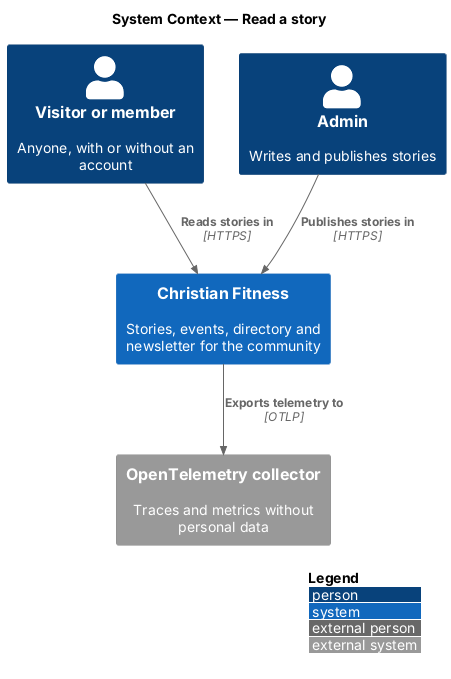
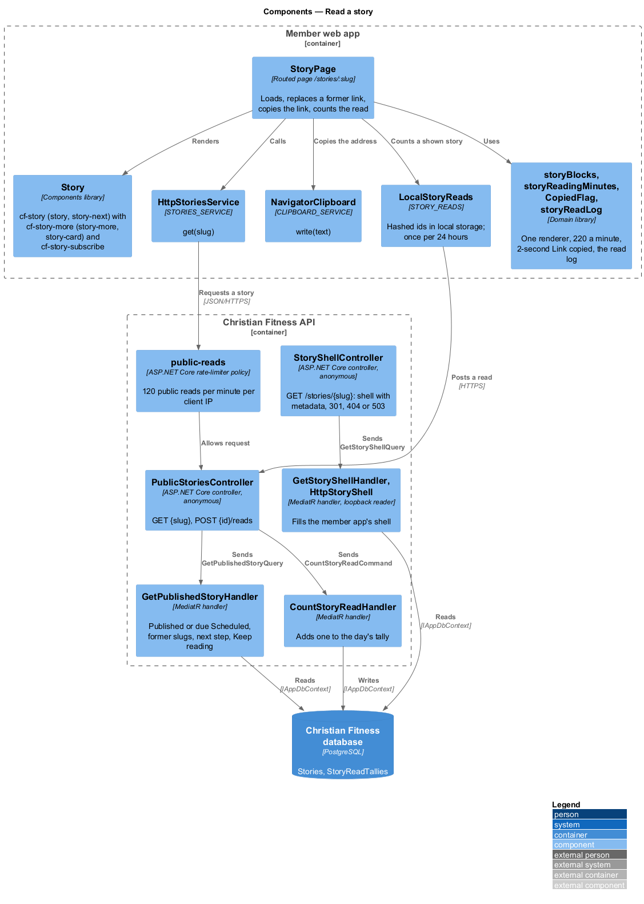
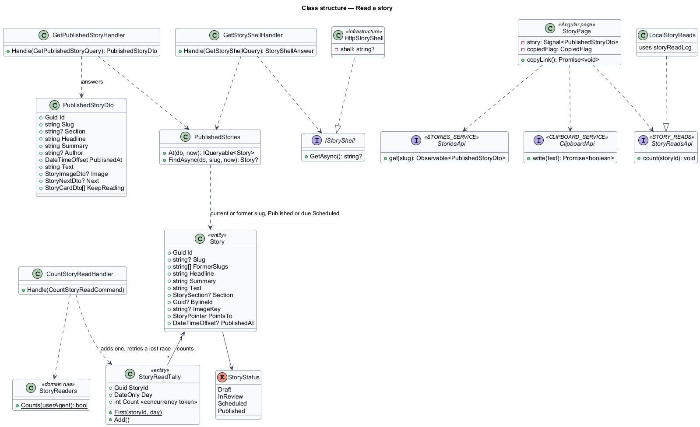

# Read a story

## Overview

Christian Fitness publishes the community's news as _stories_, grouped by section, on pages anyone
can read without an account (`L1-018`). The landing page lists them (`L2-001`, designed in
`member-access/view-landing-page`); the RSS feeds carry them (`publish-rss-feeds`); the weekly
newsletter links to them (`read-newsletter-on-web`). This feature is the page each of those leads
to: `/stories/<slug>` in the Member web app (mock `docs/mocks/pages/story/`).

The fixed address `/news/how-we-vet-every-listing` also opens the seeded vetting story. Like
the ordinary story route, it returns the not-found view when that story is missing or unpublished;
the Suggest a listing link is hidden in those cases.

- **story** — article staff write and publish in the Admin web app (`publishing/write-review-publish-story`)
- **published story** — story whose status is Published; Draft, In review and Scheduled stories are not public
- **section** — one of Events, Training, Nutrition, Faith & Body, Community and Pros
- **slug** — the story's link under `/stories/`: lowercase letters, digits and hyphens, unique among stories
- **former slug** — slug a published story had before an Admin changed it, kept so its earlier address still works
- **pull quote** — paragraph the writer began with `>`, shown as a quotation
- **reading time** — word count of the text at 220 words a minute, rounded up, at least 1 minute
- **next step** — the one event or directory listing a story points readers to, shown as a card after the text
- **read** — one showing of the story page to a reader, counted per day without recording who read it

The page shows the section, the headline as the one `h1`, the summary where the story has one,
the byline, the story's age and reading time, Copy link, the lead image, the text with its pull
quotes, the next step card, "Spotted a mistake? Send a correction", "Keep reading" with three more
stories and the newsletter box. Everything a writer typed is rendered as text, never as HTML.

## Description

The slice runs from the public Story page to the database. The `Story` entity and its statuses
belong to the authoring slice (`publishing/write-review-publish-story`); this slice only reads
published stories.

### Member web app

- **`StoryPage`** — routed page at `stories/:slug` in `projects/web`, loaded with `loadComponent`
  and outside the member shell, so it opens with or without a session (`L2-061` AC1). Its
  `providers` bind `STORIES_SERVICE` to `HttpStoriesService` and `CLIPBOARD_SERVICE` to
  `NavigatorClipboard`. It holds the story as a signal and shows the mock's states: `loading`
  (skeletons for headline, image and text), `default`, `plain` (no summary, no next step),
  `link-copied` and `error` ("This story didn't load" with Try again and All stories, `L2-061`
  AC9). A 404 `not_found` shows the app's not-found view in place, keeping the address (`L2-043`
  AC1); a 5xx opens the server-error screen as every read does (`L2-043` AC4). When the answer's
  `slug` differs from the one opened, the page replaces the URL with the current address
  (`L2-061` AC8). It sets the document title to the headline (`<headline> · Christian Fitness`)
  and the `description` meta to the summary through Angular's `Title` and `Meta` services
  (`L2-061` AC11; see Open questions on link previews). After the story shows it calls
  `countRead(id)` once.
- **`StoryArticle`** — presentation component in the components library (block `story`, elements
  `story__head`, `story__section`, `story__title`, `story__dek`, `story__byline`, `story__meta`,
  `story__figure`, `story__body`, `story__quote`, `story__correct`), inputs only. It renders each
  paragraph with text interpolation, never `innerHTML`, and a paragraph with `isQuote` as a
  `blockquote` (`L2-061` AC1, AC10). The text column is at most 42 rem wide. Copy link is the
  library's `Button`; its live text comes from the `copied` input and a `p role="status"` carries
  "Link copied" (`L2-061` AC3). Its outputs are `copyRequested` and `correctionRequested`.
- **`StoryNext`** — presentation component (block `story-next`): "From this story" for an event or
  "In the directory" for a listing, the editor's words and an arrow, as one link (`L2-061` AC4).
  The event route `/events/:id` and the listing route sit behind the member guard, which takes a
  visitor to sign in and back (`L2-004` AC6).
- **`StoryCard`** — presentation component (block `story-card`) for each "Keep reading" item:
  image, section, title, byline and age, as one link (`L2-061` AC6). The surrounding blocks
  `story-more` and `story-subscribe` ("The Abundant Weekly", "Every Saturday, 7 AM.",
  Subscribe free to `/subscribe`) sit in the page template, built from the library's `Link` and
  `Button`. The header is the design system's `masthead` component.
- **`StoriesApi` / `STORIES_SERVICE`** — contract and token in the `api` library: `get(slug)`
  answers a `PublishedStoryDto`; `countRead(id)` answers nothing. **`HttpStoriesService`**
  implements it and errors with an `ApiError` carrying the `code`.
- **`ClipboardApi` / `CLIPBOARD_SERVICE`** — contract and token in the `api` library:
  `write(text)` resolves `true` when the clipboard took the text and `false` when it refused.
  **`NavigatorClipboard`** implements it with `navigator.clipboard.writeText`. The same contract
  serves Copy URL on Subscribe (`publish-rss-feeds`).
- **`CopiedFlag`** — helper in the `domain` library: `raise()` sets `copied` for 2,000 ms and
  restarts the timer on a second press; `dispose()` clears the timer. The page disposes it on
  destroy (`L2-037` AC2). Unit tests advance a fake clock.
- **`storyAge`** — pure helper in the `domain` library: a publication instant and now to "2 hours
  ago", "Yesterday" or a date, in `America/Toronto`. The exact wording table is `<TO SUPPLY>`
  beyond the mock's examples; the landing page uses the same helper.
- **Send a correction** — a link to Send feedback with "A correction" chosen and this story as the
  page it is about (`L2-063` AC2). The query parameters are set by the feedback design
  (`<TO SUPPLY>` until that design exists).

### Christian Fitness API

- **`PublicStoriesController`** — `[AllowAnonymous]` under `api/public/stories`; each action sends
  one MediatR request. `GET {slug}` answers `PublishedStoryDto`; `POST {id:guid}/reads` answers 204;
  `GET images/{key}` serves a lead image from `IImageStore` (`GetStoryImageQuery`, the same store
  and key rules as event images, ADR 0025).
- **`GetPublishedStoryQuery`** / **`GetPublishedStoryHandler`** — finds the story by slug, else by
  a `StorySlugRedirect` whose `FormerSlug` matches. A slug that matches nothing, or a story that is
  not Published, is refused with 404 `not_found` and nothing of the story (`L2-061` AC7; uniform
  404 as `L2-031` AC3). For a published story it answers `PublishedStoryDto`: `id`, current
  `slug`, `section`, `headline`, `summary`, `byline`, `publishedAt` (UTC), `readingMinutes`,
  `imageUrl`, `paragraphs` (`text`, `isQuote`), `next` (`kind`, `targetId`, `words`) when the
  pointed event or listing is still published, and `keepReading` (three `StoryCardDto` of other
  published stories, the same section first, then newest first). The `public-reads` policy applies
  before the handler and counts opening the story as one read.
- **`CountStoryReadCommand`** / handler — adds one to the `StoryReadTally` of the story and the
  current Toronto day (`TimeProvider`), only for a Published story; anything else is a silent
  no-op, so the answer reveals nothing. No member, address or cookie is recorded. The tallies feed
  the Reads column of Stories (`L2-068` AC1) and "Most read" on the landing page (`L2-001` AC5).
- **`StoryText`** — domain service in `ChristianFitness.Domain/News`. `Paragraphs(text)` splits
  the stored text on blank lines and marks a paragraph that begins with `>` as a pull quote, with
  the marker removed (`L2-069` AC10). `ReadingMinutes(text)` counts words separated by white space
  and answers `max(1, ceil(words / 220))` (`L2-061` AC2). The server computes both once, so the
  rule lives in one stack only; a unit test covers each row of the reading-time table (0, 1, 220,
  221 and 1,320 words).
- **`StorySlugRedirect`** — entity written by the authoring slice when a published story's slug
  changes; `FormerSlug` is unique.
- **`StoryReadTally`** — entity (`StoryId`, `Day`, `Count`), one row per story per Toronto day.
- **`public-reads`** — named ASP.NET Core rate-limiter policy for anonymous story, section,
  directory and feed reads. It counts by client IP in a sliding window of 120 requests per minute
  with six segments. A refusal is 429 ProblemDetails with code `too_many_requests` and
  `Retry-After` (`L2-034` AC4–5, ADR 0072).

Telemetry records the route template (`api/public/stories/{slug}`), never the slug value, the
query string or the body (`TelemetryRedactionProcessor`; `L2-033` AC2).

### Open questions

- **Link previews (`L2-061` AC11).** The member app is a client-rendered SPA served as static files
  by nginx (ADR 0047). Crawlers that build link previews mostly do not run JavaScript, so the
  title and description set by `StoryPage` do not reach them. Options: server-side rendering or
  prerendering for `/stories/*`, or an API endpoint that serves the shell with the story's
  `<title>` and `<meta>` filled in. Either needs an ADR. The same limit applies to the redirect of
  a former slug (`L2-061` AC8): the design replaces the URL in the browser; a 301 from the server
  needs the same server-side step.
- **Body format.** `L2-069` AC10 settles `>` for a pull quote and text-only storage. That
  paragraphs are separated by a blank line follows the editor mock; headings, lists, links and
  emphasis inside the text are not specified and are not supported by this design.
- **Next step wording.** The card shows "the editor's words" (`L2-061` AC4), such as "Find church
  sports ministries near you", but the story editor mock has only "Points readers to" with no
  field for those words. The source of the words is `<TO SUPPLY>`.
- **Directory listings.** A story may point to a listing (`L2-055`); no directory listing entity
  exists in the code yet. The pointer stores a kind and an id; the listing's lookup arrives with
  the directory slices.
- **Signed-in members.** The page sits outside the member shell, so a signed-in member sees the
  public masthead with Sign in and Join free. Whether a member sees the member navigation instead
  is not drawn.
- **Reads.** A read is counted when the page shows the story, so a reader who reloads counts
  twice and a crawler that runs no JavaScript counts none. Whether that is the intended meaning of
  "how many times it was read" (`L2-068` AC1) is `<TO SUPPLY>`.

## Requirements

The feature realizes the following level-2 (L2) requirement. Each L2 requirement refines a level-1
(L1) requirement, cited by identifier. The specification states its requirements as acceptance
criteria; the text below condenses those criteria faithfully.

| L2 ID    | Refines (L1) | Requirement |
| -------- | ------------ | ----------- |
| `L2-061` | `L1-018`     | A published story at `/stories/<slug>` shall show, with or without an account, its section, the headline as the one `h1`, the summary where it has one, the author, its age and reading time, its lead image and its text, with a paragraph marked as a pull quote shown as a quotation. Reading time shall be the word count at 220 words a minute, rounded up, never less than "1 min read". "Copy link" shall put the address on the clipboard, read "Link copied" for about 2 seconds with a `status` message, and show the address selected when the clipboard refuses. A story pointing to a published event or listing shall end with one card, "From this story" or "In the directory", with the editor's words, taking a visitor who is not signed in to sign in and back; a story pointing to nothing, or to an event or listing no longer published, shall show no card. "Spotted a mistake? Send a correction" shall open Send feedback as a correction about the story. "Keep reading" shall hold three other published stories, the same section first, newest first, each with image, section, title, author and age, followed by the newsletter's name and cadence leading to Subscribe. A slug matching no published story, or a story that is a draft, in review, scheduled or unpublished, shall show the not-found view and send nothing of the story. An earlier address of a story whose link changed after publication shall redirect to the current one. Loading shall show skeletons for headline, image and text; a failure shall offer Try again and a way back to all stories. Headline, summary, author and text shall be rendered as text, never HTML, in a column no wider than 42rem with no horizontal overflow at XS. The document's title and description shall be the story's headline and summary. |

## Diagrams

### System context

Anyone reads stories in Christian Fitness; Admins publish them. Telemetry leaves the system
without personal data.

### Containers

The Member web app asks the Christian Fitness API for one published story with no session; the
API reads the database and the image store.

### Components

`StoryPage` calls `STORIES_SERVICE` and `CLIPBOARD_SERVICE`; `PublicStoriesController` sends
`GetPublishedStoryQuery` and `CountStoryReadCommand`. The `public-reads` policy limits story
requests before the handler uses `StoryText`.

### Class structure

`GetPublishedStoryHandler` reads a published `Story`, resolves a `StorySlugRedirect` and answers a
`PublishedStoryDto`; `StoryReadTally` counts reads per day.

### Behaviour — open a story

The page shows skeletons, asks for the story and shows either the story, with its former slug
replaced, or the not-found view; a shown story then counts one read (`L2-061` AC1, AC2, AC4,
AC6–AC11).

### Behaviour — copy the link

Copy link writes the address to the clipboard and reads "Link copied" for about 2 seconds; a
refused clipboard shows the address selected (`L2-061` AC3).

