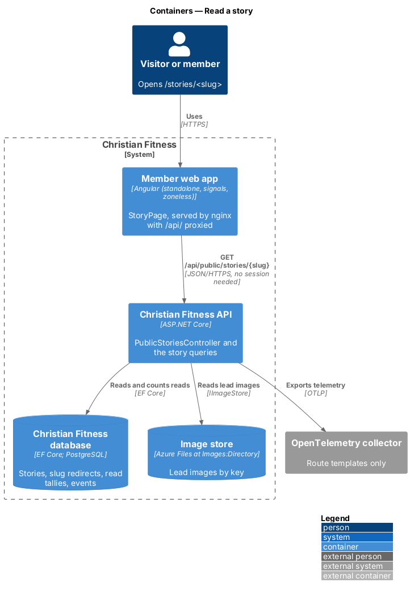
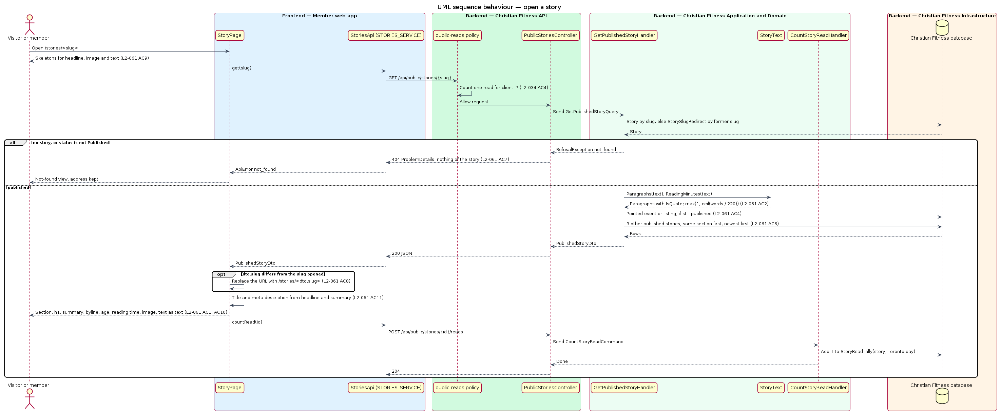
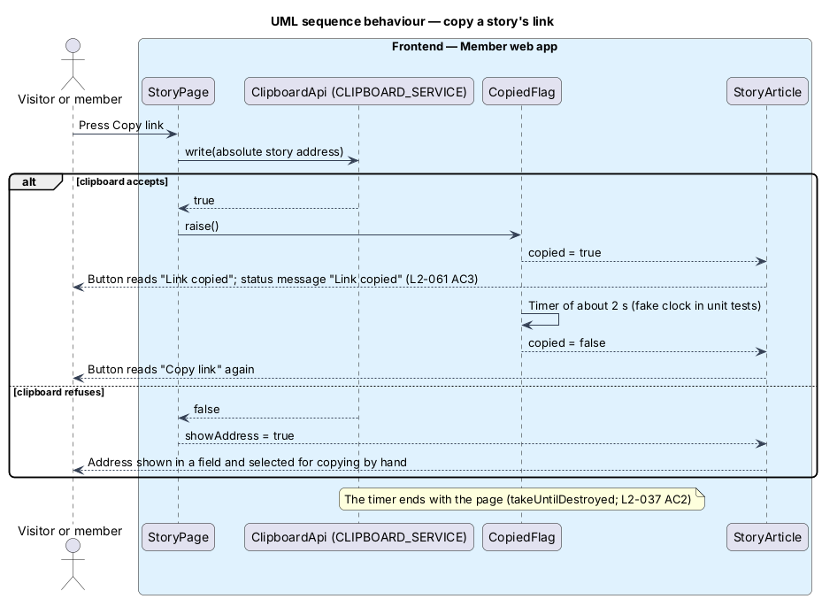

# Read a story

## Overview

Christian Fitness publishes the community's news as _stories_, grouped by section, on pages anyone
can read without an account (`L1-018`). The landing page lists them (`L2-001`, designed in
`member-access/view-landing-page`); the RSS feeds carry them (`publish-rss-feeds`); the weekly
newsletter links to them (`read-newsletter-on-web`). This feature is the page each of those leads
to: `/stories/<slug>` in the Member web app (mock `docs/mocks/pages/story/`).

The mock's `vetting` state (`/news/how-we-vet-every-listing`) is in no acceptance criterion and
is not built (ADR 0105).

- **story** — article staff write and publish in the Admin web app (`publishing/write-review-publish-story`)
- **published story** — story whose status is Published; Draft, In review and Scheduled stories are not public
- **section** — one of Events, Training, Nutrition, Faith & Body, Community and Pros
- **slug** — the story's link under `/stories/`: lowercase letters, digits and hyphens, unique among stories
- **former slug** — slug a published story had before an Admin changed it, kept so its earlier address still works
- **pull quote** — paragraph the writer began with `>`, shown as a quotation
- **reading time** — word count of the text at 220 words a minute, rounded up, at least 1 minute
- **next step** — the one event or directory listing a story points readers to, shown as a card after the text
- **read** — one showing of the story page to a reader, counted per day without recording who read it

The page shows the section, the headline as the one `h1`, the summary where the story has one,
the byline, the story's age and reading time, Copy link, the lead image, the text with its pull
quotes, the next step card, "Spotted a mistake? Send a correction" (journey 30), "Keep reading" with three more
stories and the newsletter box. Everything a writer typed is rendered as text, never as HTML.

## Description

The slice runs from the public Story page to the database. The `Story` entity and its statuses
belong to the authoring slice (`publishing/write-review-publish-story`); this slice only reads
published stories. [ADR 0105](../../../adr/0105-read-a-story.md) records how it builds on what
journey 22 left.

### Member web app

- **`StoryPage`** — routed page at `stories/:slug` in `projects/web`, loaded with `loadComponent`.
  It is routed twice, as the claim link is: first for a visitor (`signedOutGuard`), headed by the
  top bar's `site` form, which draws the masthead's Story variant (Sign in, Join free); then as a
  child of the member shell, under the member navigation (`L2-061` AC13). Its `providers` bind
  `STORIES_SERVICE` to `HttpStoriesService`, `CLIPBOARD_SERVICE` to `NavigatorClipboard` and
  `STORY_READS` to `LocalStoryReads`. It holds the story as a signal and shows the mock's states:
  `loading` (skeletons for headline, image and text), `default`, `plain` (no summary, no next
  step), `link-copied` and `error` ("This story didn't load" with Try again and All stories,
  `L2-061` AC9). A 404 shows the app's not-found view in place, keeping the address (`L2-043` AC1);
  a 5xx opens the server-error screen as every read does (`L2-043` AC4). When the answer's `slug`
  differs from the one opened, the page replaces the URL with the current address (`L2-061` AC8).
  It sets the document title to the headline and the `description` meta to the summary through
  Angular's `Title` and `Meta` services (`L2-061` AC11). After the story shows it counts one read
  through `STORY_READS`.
- **`Story`** — the components library's `cf-story` (block `story`, built for the preview in
  journey 22): the back link "All stories", section, headline as the `h1`, dek, byline with
  author, "age · reading time" and Copy link, the figure, the body drawn from `storyBlocks` as
  text runs (never `innerHTML`), pull quotes as `blockquote`, and the `story-next` card (`L2-061`
  AC1, AC4, AC10). The text column is at most 42 rem wide. Copy link is the library's `Button`;
  its words come from the `copied` input and a `p role="status"` carries "Link copied" (`L2-061`
  AC3); with `address` set (the clipboard refused) a read-only field shows the address, focused
  and selected. Outputs: `copy` and `navigate` (a plain click on an internal next step).
- **`StoryCard`** — presentation component (block `story-card`) for each "Keep reading" item:
  image, section, title, author and age, as one link (`L2-061` AC6). The surrounding blocks
  `story-more` and `story-subscribe` ("The Abundant Weekly", "Every Saturday, 7 AM.", Subscribe
  free to `/subscribe`, journey 27) sit in the page template, built from the library's `Button`.
- **`StoriesApi` / `STORIES_SERVICE`** — contract and token in the `api` library: `get(slug)`
  answers a `PublishedStoryDto`; `countRead(id)` answers nothing. **`HttpStoriesService`**
  implements it.
- **`ClipboardApi` / `CLIPBOARD_SERVICE`** — contract and token in the `api` library:
  `write(text)` resolves `true` when the clipboard took the text and `false` when it refused.
  **`NavigatorClipboard`** implements it with `navigator.clipboard.writeText`. The same contract
  serves Copy URL on Subscribe (`publish-rss-feeds`).
- **`StoryReadsApi` / `STORY_READS`** — contract and token in the `api` library: `count(id)`.
  **`LocalStoryReads`** in the domain library keeps, under `cf-story-reads` in local storage, the
  SHA-256 of each story id counted with when it was counted; a story counted in the last 24 hours
  is not sent again, and older entries are dropped on each write (`L2-061` AC12). No cookie.
- **`CopiedFlag`** — helper in the `domain` library: `raise()` sets `copied` for 2,000 ms and
  restarts the timer on a second press; `dispose()` clears the timer. The page disposes it on
  destroy (`L2-037` AC2). Unit tests advance a fake clock.
- **`storyReadingMinutes`** and **`storyReaderWhen`** — pure helpers in the `domain` library: the
  words of the text (white-space separated runs holding a letter or digit) at 220 a minute, rounded
  up, at least 1 (`L2-061` AC2), and the byline's "2 hours ago · 6 min read" in `America/Toronto`.
  The admin preview uses the same helpers.

### Christian Fitness API

- **Story shell endpoint** — nginx proxies direct member-origin requests for `/stories/<slug>` to
  the API's anonymous `GET /stories/{slug}` before the SPA fallback (ADR 0073, ADR 0105). It
  resolves the slug and checks publication before responding. For a current Published story it
  fills the member shell's title, description, Open Graph and Twitter title, description and
  lead-image tags, and canonical link using HTML-encoded values; absolute image and canonical URLs
  use the configured public member origin (`MemberApp__BaseUrl`). A missing summary gives an empty
  description. It preserves the hashed asset links so the browser boots the SPA. A former slug of
  a Published story receives a 301 to its current address; an unknown or unpublished slug receives
  the unmodified shell with status 404 and no story metadata. The shell is read once, over
  loopback from the same replica's web container (`StoryShell__Url`), and each response is derived
  from it independently; when it cannot be read the endpoint answers 503 and nginx serves its own
  `index.html`. Every answer uses `Cache-Control: no-store`. It is not under `public-reads`: the
  page's API read is the one counted read (`L2-034` AC4).
- **`PublicStoriesController`** — `[AllowAnonymous]` under `api/public/stories`; each action sends
  one MediatR request. `GET {slug}` (`public-reads`) answers `PublishedStoryDto`; `POST
  {id:guid}/reads` answers 204. The lead image is the one `api/stories/images/{key}` serves.
- **`GetPublishedStoryQuery`** / handler — finds the Published story whose slug, or one of whose
  `FormerSlugs`, matches. A slug that matches nothing, or a story that is not Published, is refused
  with 404 `not_found` and nothing of the story (`L2-061` AC7). For a published story it answers
  `PublishedStoryDto`: `id`, current `slug`, `section`, `headline`, `summary`, `author`,
  `publishedAt` (UTC), `text`, `image`, `next` (`kind`, `text`, `link`) when the pointed event or
  listing is still published and the story has "Next step" words, and `keepReading` (three
  `StoryCardDto` of other published stories, the same section first, then newest first).
- **`CountStoryReadCommand`** / handler — adds one to the `StoryReadTally` of the story and the
  current Toronto day (`TimeProvider`), only for a Published story and not for a known crawler's
  user agent; anything else is a silent no-op, so the answer reveals nothing. No member, address
  or cookie is recorded. The tallies feed the Reads column of Stories (`L2-068` AC1) and, later,
  "Most read" on the landing page (`L2-001` AC5).
- **`StoryReadTally`** — entity (`StoryId`, `Day`, `Count`), one row per story per Toronto day.
- **`public-reads`** — the named ASP.NET Core rate-limiter policy for anonymous story, section,
  directory and feed reads. It counts by client IP in a sliding window of 120 requests per minute
  with six segments. A refusal is 429 ProblemDetails with code `too_many_requests` and
  `Retry-After` (`L2-034` AC4–5, ADR 0072).

Telemetry records the route template (`api/public/stories/{slug}`), never the slug value, the
query string or the body (`TelemetryRedactionProcessor`; `L2-033` AC2).

### Open questions

- **Body format.** Decided (issue 91): a small Markdown subset (paragraphs, `>` quotes, `##`/`###`
  headings, lists, `https` links, emphasis, strong), rendered by one sanitising renderer shared
  with Preview; raw HTML is never rendered (`L2-069` AC10, `L2-061` AC1).
- **Next step wording.** Decided (issue 91): the editor has an optional "Next step" text (80
  characters at most) and a link (internal route or `https`); with no text there is no card
  (`L2-061` AC4).
- **Directory listings.** A story may point to a listing (`L2-055`); no directory listing entity
  exists in the code yet. The pointer stores a kind and an id; the listing's lookup arrives with
  the directory slices.
- **Signed-in members.** Decided (issue 91): a signed-in member sees the member navigation; a
  visitor sees the public masthead (`L2-061` AC13).
- **Reads.** Decided (issue 91): one read per browser per story per 24 hours, by a hashed id in
  local storage (no cookie); known crawler user agents and Admin previews are excluded; an
  unpublished story keeps its count (`L2-061` AC12, `L2-068` AC1).

## Requirements

The feature realizes the following level-2 (L2) requirement. Each L2 requirement refines a level-1
(L1) requirement, cited by identifier. The specification states its requirements as acceptance
criteria; the text below condenses those criteria faithfully.

| L2 ID    | Refines (L1) | Requirement |
| -------- | ------------ | ----------- |
| `L2-061` | `L1-018`     | A published story at `/stories/<slug>` shall show, with or without an account, its section, the headline as the one `h1`, the summary where it has one, the author, its age and reading time, its lead image and its text, with a paragraph marked as a pull quote shown as a quotation. Reading time shall be the word count at 220 words a minute, rounded up, never less than "1 min read". "Copy link" shall put the address on the clipboard, read "Link copied" for about 2 seconds with a `status` message, and show the address selected when the clipboard refuses. A story pointing to a published event or listing shall end with one card, "From this story" or "In the directory", with the editor's words, taking a visitor who is not signed in to sign in and back; a story pointing to nothing, or to an event or listing no longer published, shall show no card. "Spotted a mistake? Send a correction" shall open Send feedback as a correction about the story. "Keep reading" shall hold three other published stories, the same section first, newest first, each with image, section, title, author and age, followed by the newsletter's name and cadence leading to Subscribe. A slug matching no published story, or a story that is a draft, in review, scheduled or unpublished, shall show the not-found view and send nothing of the story. A direct request for an earlier address of a Published story shall receive a 301 to the current address; in-app navigation shall replace the address. An unknown or unpublished slug shall return a 404 shell with no story metadata. Loading shall show skeletons for headline, image and text; a failure shall offer Try again and a way back to all stories. Headline, summary, author and text shall be rendered as text, never HTML, in a column no wider than 42rem with no horizontal overflow at XS. The server shall supply the story title, description, Open Graph and Twitter metadata and canonical link in the HTML shell without requiring JavaScript, encoding the values and preserving hashed asset links. |

## Diagrams

### System context

Anyone reads stories in Christian Fitness; Admins publish them. Telemetry leaves the system
without personal data.

### Containers

The Member web app asks the Christian Fitness API for one published story with no session; the
API reads the database and the image store.

### Components

`StoryPage` calls `STORIES_SERVICE` and `CLIPBOARD_SERVICE`; `PublicStoriesController` sends
`GetPublishedStoryQuery` and `CountStoryReadCommand`. The `public-reads` policy limits story
requests before the handler uses `StoryText`.

### Class structure

`GetPublishedStoryHandler` reads a published `Story`, resolves a `StorySlugRedirect` and answers a
`PublishedStoryDto`; `StoryReadTally` counts reads per day.

### Behaviour — open a story

For a direct request, the story shell endpoint first returns preview metadata, a server redirect,
or a 404 shell as described above (ADR 0073). The diagram below shows the subsequent SPA flow:
the page shows skeletons, asks for the story and shows either the story, with a former slug
replaced for in-app navigation, or the not-found view; a shown story then counts one read
(`L2-061` AC1, AC2, AC4, AC6–AC11).

### Behaviour — copy the link

Copy link writes the address to the clipboard and reads "Link copied" for about 2 seconds; a
refused clipboard shows the address selected (`L2-061` AC3).

