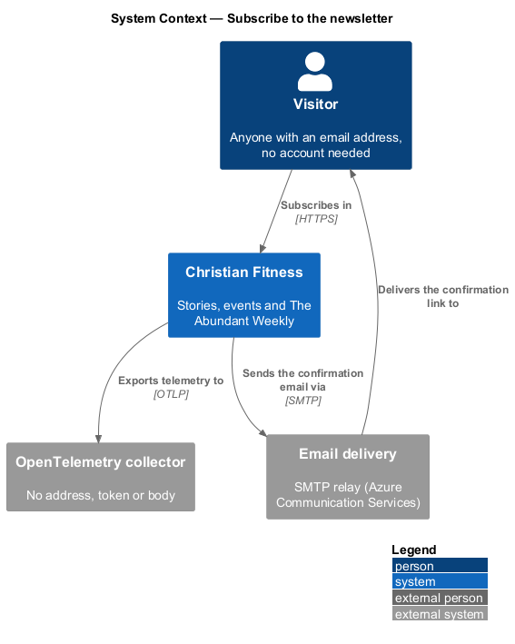
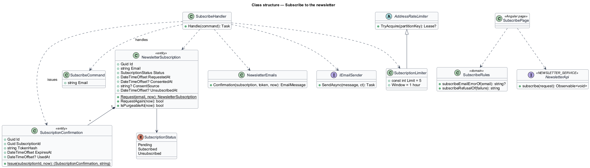
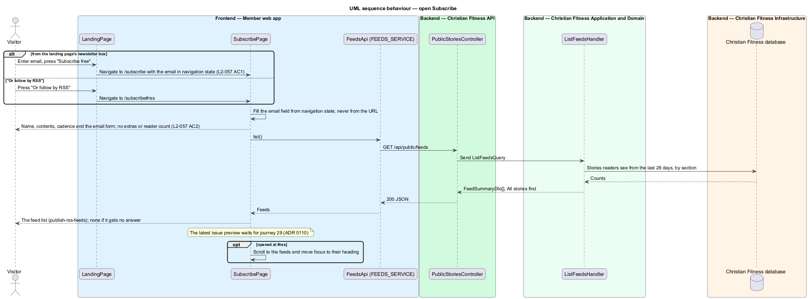
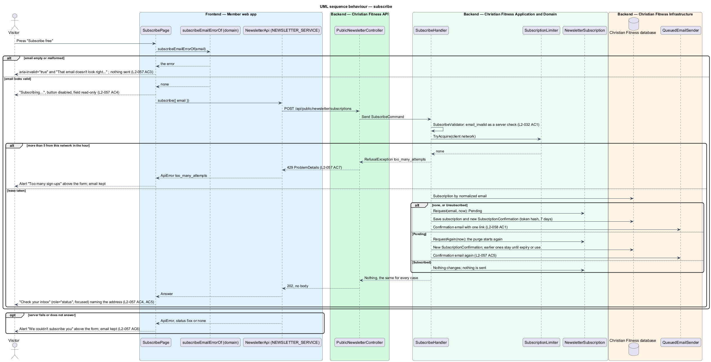

# Subscribe to the newsletter

## Overview

The Abundant Weekly is the community's email newsletter: the week's stories, the events worth
showing up for and one verse, every Saturday at 7 AM (`L1-018`). Anyone may subscribe with an
email address and no account. Nothing is sent to an address until its owner confirms it by the
link in a confirmation email (`confirm-and-unsubscribe`), which is the consent Canada's anti-spam
law asks for (`docs/mocks/README.md`, "Newsletter confirmation and unsubscribe").

- **subscription** — an email address's standing with the newsletter: Pending, Subscribed or Unsubscribed
- **pending** — address that asked to subscribe and has not followed its confirmation link
- **extras** — the three optional emails beside the Weekly (Event alerts, Training plan of the week and Morning devotion), deferred
- **network** — client address as rate limits count it: an IPv4 address, or the /64 of an IPv6 address (`IClientAddress`)

This feature covers the Subscribe screen of the Member web app at `/subscribe` (mock
`docs/mocks/pages/subscribe/`, states `default`, `invalid`, `submitting`, `success`, `error` and
`limited`) and the newsletter box on the landing page that leads to it. The feeds section of the
same screen is designed in `publish-rss-feeds`; the states after the emailed links (`confirmed`,
`link-expired`, `unsubscribed`) in `confirm-and-unsubscribe`.

The screen never reveals whether an address is already subscribed: every valid submission gets
the same answer and the same "Check your inbox" screen (`L2-057` AC5). An address is stored only
to send the newsletter, never shared, and never written to a span, metric or log (`L2-057` AC8,
`L2-033` AC2).

## Description

Read with ADR 0110, which settles what this design left open and what waits for later journeys.

### Member web app

- **Newsletter box on `LandingPage`** — the library's `cf-newsletter-box`, in the rail between
  Upcoming events and Most read (`L2-001` AC5, `member-access/view-landing-page`). "Subscribe free"
  navigates to `/subscribe` with the typed email in the router's navigation state, not in the URL,
  so no address reaches an access log or a `Referer`; "Or follow by RSS" navigates to
  `/subscribe#rss` (`L2-057` AC1). The box checks nothing: Subscribe does.
- **`SubscribePage`** — routed page at `subscribe` in `projects/web`, loaded with `loadComponent`,
  outside the member shell, so members and visitors see the same page. Its `providers` bind
  `NEWSLETTER_SERVICE` to `HttpNewsletterService`, `FEEDS_SERVICE` to `HttpFeedsService` and
  `CLIPBOARD_SERVICE` (`publish-rss-feeds`). On open it fills the email field from navigation
  state and, at `#rss`, moves focus to the feeds heading. It holds the screen's state in signals
  (the view, the email, the field's error, the alert and whether it is sending) and composes the
  plain `cf-masthead` (Back to news), `cf-subscribe`, `cf-feed-list` and `cf-footer`. Neither a
  reader count nor add-on controls are shown; add-on emails are deferred until someone owns writing
  and scheduling them. At XS the email field and button stack (`L2-057` AC9); the layout lives in
  the blocks' stylesheets.
- **Rules in `domain`** — `subscribeEmailErrorOf(email)` answers "That email doesn't look right.
  Check for a typo and try again." for an empty value or one Join's email rule refuses (not blank,
  at most 254 characters trimmed, one `@`, a dot in the domain, no white space), the rule the API's
  validator applies too, with the same case table in both suites. Typing clears the error
  (`L2-057` AC3). `subscribeRefusalOf(failure)` reads a refusal: 400 `validation_failed` marks the
  field, 429 shows "Too many sign-ups", anything else, a 5xx or no answer included, shows "We
  couldn't subscribe you"; both alerts keep the email (`L2-057` AC6, AC7). Unit tests cover each
  row.
- **Presentation** — `cf-subscribe` (block `subscribe`) draws the title, lead and state area: the
  form with `cf-form-field`, an `input--pill input--lg` field and `cf-button` ("Subscribing…",
  disabled and `aria-busy` while sending, the field read-only), and `cf-alert` for `error`,
  `limited` and `link-expired`. The outcome "Check your inbox" is a `role="status"` panel that takes
  focus, names the address as text and offers "Use a different email", which returns the form
  empty and focused (`L2-057` AC4). "Read last week's issue" and the latest issue preview wait for
  journey 29, when issues exist (ADR 0110).
- **`NewsletterApi` / `NEWSLETTER_SERVICE`** — contract and token in the `api` library:
  `subscribe(request)`, and `confirm(token)` and `unsubscribe(token)` from
  `confirm-and-unsubscribe`. **`HttpNewsletterService`** implements it and errors with an
  `ApiError`.

### Christian Fitness API

- **`PublicNewsletterController`** — `[AllowAnonymous]` under `api/public/newsletter`.
  `POST subscriptions` sends `SubscribeCommand` and answers 202 with no body. Antiforgery applies
  to the POST as to every unsafe request (`L2-030` AC3); the app fetches a token from
  `GET /api/antiforgery` first.
- **`SubscribeCommand`** (`Email`) with **`SubscribeValidator`** — refuses an empty or malformed
  address, or one over 254 characters, with 400 `validation_failed` and `fieldCodes.email` =
  `email_invalid`.
- **`SubscribeHandler`** — first takes a lease from **`SubscriptionLimiter`**, a subclass of
  `AddressRateLimiter` (5 an hour per network); with none left it refuses with 429
  `too_many_attempts` (`L2-057` AC7). Every submission counts and none is given back, so the limit
  says nothing about which addresses are subscribed. It then normalizes the address (trimmed,
  lower case) and finds its `NewsletterSubscription`:
  - none, Pending or Unsubscribed — `Request` or `RequestAgain` makes it Pending from now, so its
    purge starts again; a new `SubscriptionConfirmation` is issued and the confirmation email sent
    (`L2-057` AC5);
  - Subscribed — nothing changes and nothing is sent.

  Each case answers 202 with no body; the answer does not say which case ran.
- **`NewsletterSubscription`** — entity in `ChristianFitness.Domain/Newsletter`: `Email` (unique,
  normalized), `Status`, `RequestedAt`, `ConsentedAt`, `ConsentSource`, `UnsubscribedAt`. A class
  with no generated `ToString`, so the address is never printed by accident. Each Pending request
  updates `RequestedAt`; the publishing clock purges a still-Pending subscription and its
  confirmations 30 days after the most recent request (ADR 0078, ADR 0110).
- **`SubscriptionConfirmation`** — entity: the SHA-256 hash of a 32-byte base64url token,
  `ExpiresAt` 7 days after issue and `UsedAt`, as `PasswordReset` keeps its token (ADR 0010). The
  token exists only in the email.
- **`NewsletterEmails`** — Application service that composes the confirmation email: why the
  reader received it, the one link `<MemberApp:BaseUrl>/subscribe#confirm=<token>`
  (`MemberAppAddress`, never the request's `Host`), that it works once and lasts 7 days, and that
  ignoring it subscribes nobody (`L2-058` AC1). Every newsletter email ends with the footer of
  `confirm-and-unsubscribe`: Christian Fitness, `Organisation:PostalAddress` and an Unsubscribe
  link, with the `List-Unsubscribe` headers. It is sent through the existing **`IEmailSender`**:
  `QueuedEmailSender` queues it and returns, so the answer takes as long whether or not an email
  was sent (ADR 0010).
- **Telemetry** — spans carry the route template only (`TelemetryRedactionProcessor`); no log line
  names the address or the token; the delivery failure log names the exception type only, as
  `EmailDispatcher` does.

### Open questions

- **Extras.** `L2-057` AC5 updates a subscribed address's extras on a new submission. The extras
  are deferred, so the form, the API and the subscription carry none, and the "Your newsletter
  settings changed" email with its undo link is designed with them (ADR 0110).
- **Design-system gaps.** The mocks' `issue-preview` block has no page in
  `docs/design-system/components/`; it is built with journey 29.

## Requirements

The feature realizes the following level-2 (L2) requirements. Each L2 requirement refines a
level-1 (L1) requirement, cited by identifier. The specification states its requirements as
acceptance criteria; the text below condenses those criteria faithfully.

| L2 ID    | Refines (L1)       | Requirement |
| -------- | ------------------ | ----------- |
| `L2-057` | `L1-018`, `L1-013` | Anyone shall be able to subscribe with an email address and no account. Subscribe shall show the newsletter details, email field, latest issue preview and feeds, but not a reader count or add-on controls. Invalid addresses shall show an error; valid submissions shall show the same "Check your inbox" result regardless of subscription status. A pending address shall receive confirmation again; explicitly submitted extras for a subscribed address shall update without confirmation and any change shall send a settings-changed email with an undo link. Omitted extras stay unchanged. Failures shall preserve the email; rate limiting, privacy and XS layout follow AC7–AC9. |
| `L2-033` | `L1-013`           | No log, metric or span shall contain an email, name, home church, message text, token, query string or body (AC2). |

## Diagrams

### System context

A visitor subscribes in Christian Fitness, which sends the confirmation email through the email
delivery service.

### Containers

The Member web app posts a subscription to the API, which stores it and queues the confirmation
email.

### Components

`SubscribePage` checks the email with the domain's rules and calls `NEWSLETTER_SERVICE`; `SubscribeHandler`
takes a lease from `SubscriptionLimiter`, updates `NewsletterSubscription` and sends through
`IEmailSender`.

### Class structure

A `NewsletterSubscription` owns its `SubscriptionConfirmation` tokens;
`SubscriptionLimiter` is one more `AddressRateLimiter`.

### Behaviour — open Subscribe

The landing page passes the typed email in navigation state or opens the feeds; Subscribe shows
its form at once and loads the feeds (`L2-057` AC1–AC2).

### Behaviour — subscribe

A malformed email is refused in the page; a valid one is limited per network, then answered the
same way whatever the address's standing (`L2-057` AC3–AC7).

