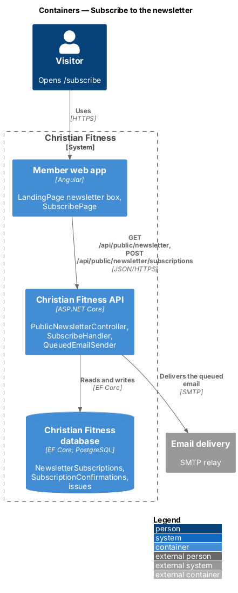
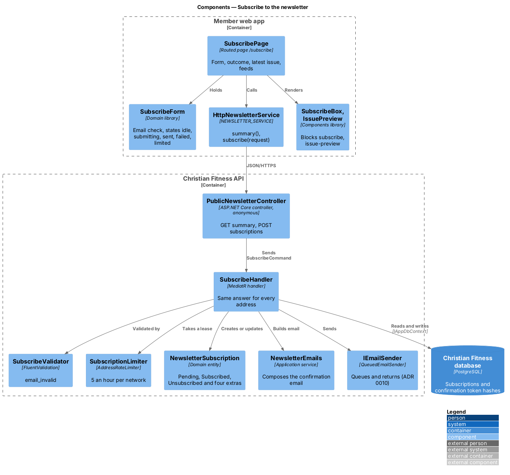

# Subscribe to the newsletter

## Overview

The Abundant Weekly is the community's email newsletter: the week's stories, the events worth
showing up for and one verse, every Saturday at 7 AM (`L1-018`). Anyone may subscribe with an
email address and no account. Nothing is sent to an address until its owner confirms it by the
link in a confirmation email (`confirm-and-unsubscribe`), which is the consent Canada's anti-spam
law asks for (`docs/mocks/README.md`, "Newsletter confirmation and unsubscribe").

- **subscription** — an email address's standing with the newsletter: Pending, Subscribed or Unsubscribed
- **pending** — address that asked to subscribe and has not followed its confirmation link
- **extras** — the three optional emails beside the Weekly: Event alerts, Training plan of the week and Morning devotion
- **readers** — number of Subscribed addresses with the Weekly on
- **network** — client address as rate limits count it: an IPv4 address, or the /64 of an IPv6 address (`IClientAddress`)

This feature covers the Subscribe screen of the Member web app at `/subscribe` (mock
`docs/mocks/pages/subscribe/`, states `default`, `invalid`, `submitting`, `success`, `error` and
`limited`) and the newsletter box on the landing page that leads to it. The feeds section of the
same screen is designed in `publish-rss-feeds`; the states after the emailed links (`confirmed`,
`link-expired`, `unsubscribed`) in `confirm-and-unsubscribe`.

The screen never reveals whether an address is already subscribed: every valid submission gets
the same answer and the same "Check your inbox" screen (`L2-057` AC5). An address is stored only
to send the newsletter, never shared, and never written to a span, metric or log (`L2-057` AC8,
`L2-033` AC2).

## Description

### Member web app

- **Newsletter box on `LandingPage`** — designed with the landing page (`L2-001` AC5,
  `member-access/view-landing-page`). "Subscribe free" navigates to `/subscribe` with the typed
  email in the router's navigation state, not in the URL, so no address reaches an access log or a
  `Referer`; "Or follow by RSS" navigates to `/subscribe#rss` (`L2-057` AC1).
- **`SubscribePage`** — routed page at `subscribe` in `projects/web`, loaded with `loadComponent`,
  outside the member shell. Its `providers` bind `NEWSLETTER_SERVICE` to `HttpNewsletterService`,
  `FEEDS_SERVICE` and `CLIPBOARD_SERVICE` (`publish-rss-feeds`). On open it fills the email field
  from navigation state, asks `summary()` and, at `#rss`, moves focus to the feeds heading. It
  composes the mock's blocks: `masthead masthead--plain` with Back to news, `subscribe` (lead,
  form, extras, note), `issue-preview` and `rss`. At XS the email field and button stack and the
  latest issue follows the form (`L2-057` AC9); the layout lives in the blocks' stylesheets.
- **`SubscribeForm`** — signal store in the `domain` library, on the page's `providers`. It holds
  the email, the extras (Event alerts ticked by default, `L2-057` AC2) and a state: `idle`,
  `invalid`, `submitting`, `sent`, `failed`, `limited`. `emailError(email)` answers "That email
  doesn't look right. Check for a typo and try again." for an empty value or one that is not
  `local@domain.tld` in form (the exact pattern is `<TO SUPPLY>`; the server is the authority).
  Typing clears `invalid` (`L2-057` AC3). A refusal with `too_many_attempts` sets `limited`; a 5xx
  or no answer sets `failed`; both keep the email and extras (`L2-057` AC6, AC7). Unit tests cover
  each transition.
- **Presentation** — the form is built from the library's `TextField` (`input--pill input--lg`),
  `Button` (`btn--primary btn--lg`, `aria-busy` while submitting), `Checkbox` (`check check--ui`)
  and `Alert` for `error`, `limited` and `link-expired`. The outcome "Check your inbox" is a
  `role="status"` region that takes focus, names the address as text and offers "Read last week's
  issue" (`/newsletter`) and "Use a different email", which returns the form empty (`L2-057` AC4).
  **`IssuePreview`** (block `issue-preview`) shows "Latest issue", the number, the lead story with
  its image and two more titles with their sections, and "Read the full issue" (`L2-059`). Whether
  `subscribe` and `issue-preview` become design-system components is listed under Open questions.
- **`NewsletterApi` / `NEWSLETTER_SERVICE`** — contract and token in the `api` library:
  `summary()`, `subscribe(request)`, and `confirm(token)` and `unsubscribe(token)` from
  `confirm-and-unsubscribe`, and `issue(number?)` from `read-newsletter-on-web`.
  **`HttpNewsletterService`** implements it and errors with an `ApiError`.

### Christian Fitness API

- **`PublicNewsletterController`** — `[AllowAnonymous]` under `api/public/newsletter`. `GET`
  sends `GetNewsletterSummaryQuery`; `POST subscriptions` sends `SubscribeCommand` and answers 202.
  Antiforgery applies to the POST as to every unsafe request (`L2-030` AC3); the page fetches a
  token from `GET /api/antiforgery` first.
- **`GetNewsletterSummaryQuery`** / handler — answers `NewsletterSummaryDto`: `name`, `about`,
  `cadence` ("Every Saturday, 7 AM"), `readers` and `latest` (`IssuePreviewDto`: number, lead
  story and two more from the most recent Sent issue, or none). The name, description and cadence
  come from configuration (`Newsletter:Name`, `Newsletter:About`, `Newsletter:Cadence`), documented
  in `docs/operations/settings.md` with the change.
- **`SubscribeCommand`** (`Email`, `Extras`) with **`SubscribeValidator`** — refuses an empty or
  malformed address, or one over 254 characters, with 400 `validation_failed` and
  `fieldCodes.email` = `email_invalid`.
- **`SubscribeHandler`** — first takes a lease from **`SubscriptionLimiter`**, a new subclass of
  `AddressRateLimiter` (5 an hour per network); with none left it refuses with 429
  `too_many_attempts` (`L2-057` AC7). Every submission counts and none is given back, so the limit
  says nothing about which addresses are subscribed. It then normalizes the address (trimmed,
  lower case) and finds its `NewsletterSubscription`:
  - none or Unsubscribed — `NewsletterSubscription.Request` makes it Pending; a new
    `SubscriptionConfirmation` is issued and the confirmation email sent;
  - Pending — a new confirmation is issued with the extras now chosen and the email sent again;
  - Subscribed — `UpdateExtras` sets the extras now chosen and no email is sent (`L2-057` AC5).

  Each case answers `SubscribeAnswerDto(email)` with 202; the answer does not say which case ran.
- **`NewsletterSubscription`** — entity in `ChristianFitness.Domain/Newsletter`: `Email` (unique,
  normalized), `Status`, `Weekly`, `Extras` (`NewsletterExtras`: `EventAlerts`, `TrainingPlan`,
  `MorningDevotion`), `RequestedAt`, `ConsentedAt`, `UnsubscribedAt`. A class with no generated
  `ToString`, so the address is never printed by accident (the pattern of `EmailMessage`).
  Each Pending request updates `RequestedAt`; scheduled work purges a still-Pending subscription
  and its confirmations 30 days after the most recent request (ADR 0078).
- **`SubscriptionConfirmation`** — entity: the SHA-256 hash of a 32-byte base64url token, the
  extras chosen, `ExpiresAt` 7 days after issue and `UsedAt`, as `PasswordReset` keeps its token
  (ADR 0010). The token exists only in the email.
- **`NewsletterEmails`** — Application service that composes the confirmation email: who sent it
  (Christian Fitness and its postal address), why the reader received it, the one link
  `<MemberApp:BaseUrl>/subscribe#confirm=<token>` (`MemberAppAddress`, never the request's `Host`),
  and that ignoring it subscribes nobody (`L2-058` AC1). It is sent through the existing
  **`IEmailSender`**: `QueuedEmailSender` queues it and returns, so the answer takes as long
  whether or not an email was sent (ADR 0010).
- **Telemetry** — spans carry the route template only (`TelemetryRedactionProcessor`); no log line
  names the address or the token; the delivery failure log names the exception type only, as
  `EmailDispatcher` does today.

### Open questions

- **Extras of a subscribed address.** `L2-057` AC5 updates a subscribed address's extras on a new
  submission, with no confirmation. Anyone who knows the address can then turn its extras on or
  off. The specification settles it; the risk is recorded for review.
- **Email pattern.** The client check and `email_invalid` need one pattern; the case table is
  `<TO SUPPLY>` and is shared by both suites (`AGENTS.md`, "Contracts").
- **Design-system gaps.** The mocks' blocks `subscribe`, `issue-preview`, `rss` and `feed` have no
  page in `docs/design-system/components/`. They are built as composites from library components
  unless the design system adds them first.
- **Readers in the copy.** "Joined by 6,800 readers" is the live count; whether a small count is
  shown or hidden is not specified.

## Requirements

The feature realizes the following level-2 (L2) requirements. Each L2 requirement refines a
level-1 (L1) requirement, cited by identifier. The specification states its requirements as
acceptance criteria; the text below condenses those criteria faithfully.

| L2 ID    | Refines (L1)       | Requirement |
| -------- | ------------------ | ----------- |
| `L2-057` | `L1-018`, `L1-013` | Anyone shall be able to subscribe to The Abundant Weekly with an email address and no account, and nothing shall be sent until the owner confirms. The landing page's newsletter box shall open `/subscribe` with the email filled in, and "Or follow by RSS" shall open it at its feeds. Subscribe shall show the newsletter's name, contents and schedule, an Email address field, "Subscribe free", "Also send me" with three optional labelled tick boxes (Event alerts ticked by default; Training plan of the week; Morning devotion), the number of readers, the latest issue's lead story and two more with "Read the full issue", and the feeds. A malformed or empty email shall send nothing and mark the field `aria-invalid="true"` with "That email doesn't look right. Check for a typo and try again.", cleared by typing. A valid email shall show "Subscribing…" on a disabled button and then "Check your inbox" (`role="status"`, focused) naming the address, with "Read last week's issue" and "Use a different email". An address already subscribed or awaiting confirmation shall get the same answer and screen; an awaiting address shall be sent the confirmation again and a subscribed one shall have its extras updated. A server failure or no answer shall show a message above the form and keep the email and extras. More than 5 subscriptions from one network in an hour shall be refused with `too_many_attempts` and HTTP 429 and a message to try later. An address shall be stored for sending only, never shared, and carried by no span, metric or log. At XS the field and button shall stack, the latest issue shall follow the form and each feed's actions shall sit under its address. |
| `L2-033` | `L1-013`           | No log, metric or span shall contain an email, name, home church, message text, token, query string or body (AC2). |

## Diagrams

### System context

A visitor subscribes in Christian Fitness, which sends the confirmation email through the email
delivery service.

### Containers

The Member web app reads the newsletter's summary and posts a subscription to the API, which
stores it and queues the confirmation email.

### Components

`SubscribePage` holds a `SubscribeForm` and calls `NEWSLETTER_SERVICE`; `SubscribeHandler`
takes a lease from `SubscriptionLimiter`, updates `NewsletterSubscription` and sends through
`IEmailSender`.

### Class structure

A `NewsletterSubscription` owns its `NewsletterExtras` and its `SubscriptionConfirmation` tokens;
`SubscriptionLimiter` is one more `AddressRateLimiter`.

### Behaviour — open Subscribe

The landing page passes the typed email in navigation state or opens the feeds; Subscribe loads
the newsletter's summary and latest issue (`L2-057` AC1–AC2).

### Behaviour — subscribe

A malformed email is refused in the page; a valid one is limited per network, then answered the
same way whatever the address's standing (`L2-057` AC3–AC7).

