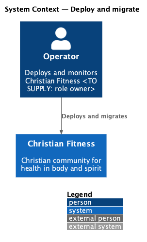
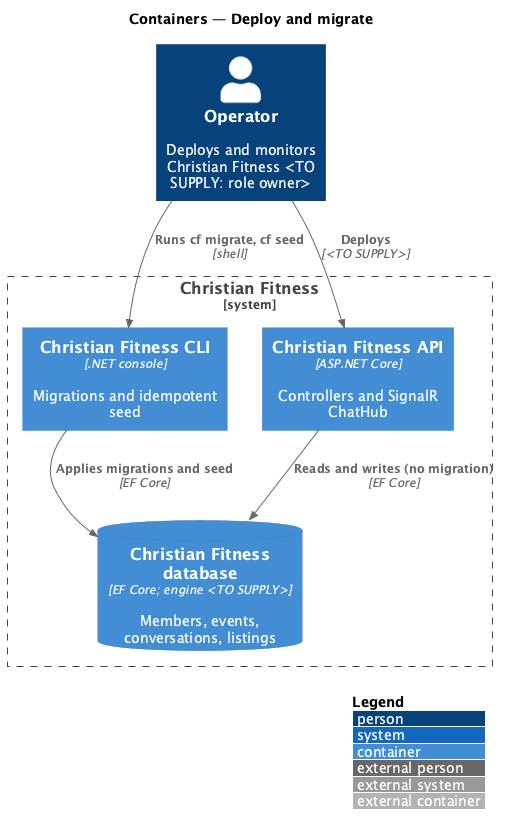
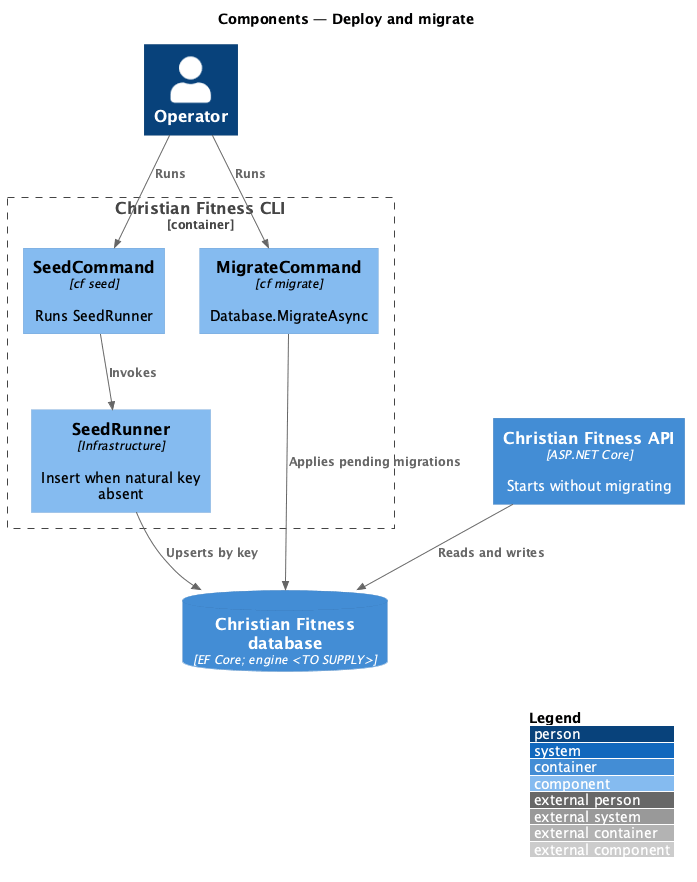
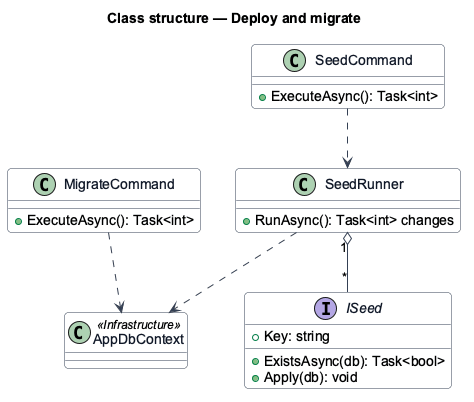
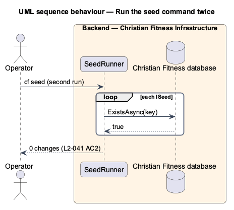

# Deploy and migrate

## Overview

A Christian Fitness release changes code and, sometimes, the database schema.
This feature defines how a release is deployed: the API starts without touching
the schema, a documented CLI command applies migrations and seed data, seeding is
idempotent, and every setting a deployed system needs is documented with the
change that adds it.

- **migration** — versioned EF Core schema change in `ChristianFitness.Infrastructure`
- **seed data** — reference rows a fresh system needs, such as event categories and the first staff account
- **idempotent** — producing no further change when run again

## Description

- **`ChristianFitness.Cli`** — .NET console with two commands: `cf migrate` calls `Database.MigrateAsync()` on `AppDbContext`; `cf seed` runs `SeedRunner`. Both read the connection string from `ConnectionStrings__Default`.
- **`SeedRunner`** — inserts each seed row only when its natural key is absent (upsert by key), so a second run changes nothing. Seed contents are `<TO SUPPLY>`; initial staff credentials come from configuration, never from source.
- **API startup** — `Program.cs` in `ChristianFitness.Api` does not call `Migrate` or `EnsureCreated`.
- **Settings documentation** — `docs/operations/settings.md` `<TO SUPPLY: confirm path>` lists each setting (name, purpose, example, required or optional). A change that adds a setting edits it in the same change.
- **Release order** — the pipeline runs `cf migrate`, then `cf seed`, then deploys the API and the two web apps. The hosting platform and pipeline are `<TO SUPPLY>`.

## Requirements

The feature realizes the following level-2 (L2) requirements. Each L2
requirement refines a level-1 (L1) requirement, cited by identifier. The
specification states these as acceptance criteria rather than one `shall`
sentence, so the criteria are quoted.

| L2 ID | Refines (L1) | Requirement |
|-------|--------------|-------------|
| `L2-041` | `L1-016` | 1. Given a new release, when the API starts, then it does not apply migrations; a documented CLI command applies them. 2. Given seed data, when the seed command runs twice, then the second run changes nothing. 3. Given a setting a deployed system needs, when it is added, then it is documented in the same change. |

## Diagrams

### System context

An operator deploys Christian Fitness and applies schema changes with documented commands.

### Containers

The CLI owns schema changes and seed data; the API only reads and writes data.

### Components

The CLI's migrate command uses the EF Core migrator; its seed command runs `SeedRunner`, which checks each row's natural key before inserting.

### Class structure

Both CLI commands depend on `AppDbContext`; `SeedRunner` holds a list of `ISeed` items keyed by natural key.

### Behaviour — release with migrations

The pipeline migrates and seeds through the CLI before the API starts; the API never migrates.

### Behaviour — run the seed command twice

The second run finds every natural key present and reports zero changes.

