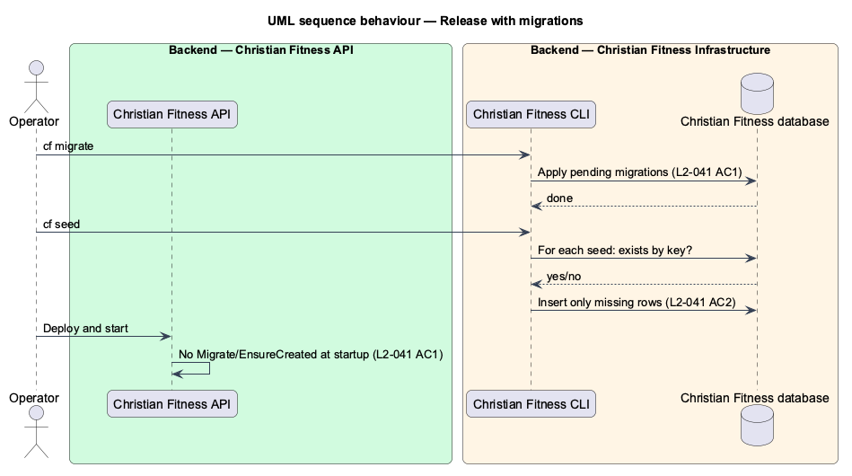
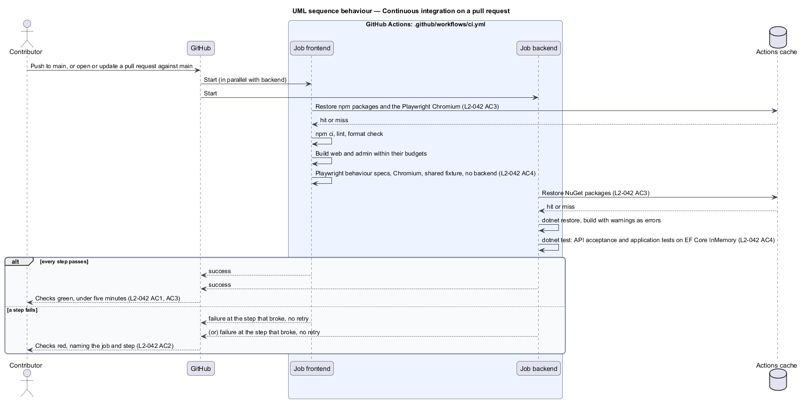

# Deploy and migrate

## Overview

A Christian Fitness release changes code and, sometimes, the database schema.
This feature defines how a release is deployed: the API starts without touching
the schema, a documented CLI command applies migrations and seed data, seeding is
idempotent, and every setting a deployed system needs is documented with the
change that adds it. Before any of that, continuous integration checks every
change on its way to `main`.

- **migration** — versioned EF Core schema change in `ChristianFitness.Infrastructure`
- **seed data** — reference rows a fresh system needs, such as event categories and the first staff account
- **idempotent** — producing no further change when run again
- **CI** — continuous integration: the GitHub Actions workflow that checks every push to `main` and every pull request against it

## Description

- **`ChristianFitness.Cli`** — .NET console, built as `cf`, with two commands: `cf migrate` calls `Database.MigrateAsync()` on `AppDbContext`; `cf seed` runs `SeedRunner`. Both read the connection string from `ConnectionStrings__Default`. An unknown or missing command prints the usage and exits with code 1.
- **Database** — PostgreSQL through Npgsql (ADR 0004). Migrations live in `ChristianFitness.Infrastructure/Persistence/Migrations`; the first, `InitialCreate`, creates `Members` and `StaffRoles`. Entity keys are `Guid.CreateVersion7()`.
- **`SeedRunner`** — in `ChristianFitness.Application`. It runs each `ISeed` and inserts its rows only when its natural key is absent, so a second run changes nothing; it returns the number of seeds applied.
- **`StaffAccountSeed`** — the only seed so far: the first staff account, a `Member` with a `StaffRole` of `Admin`, keyed by its normalised email. The email, password and name come from `Seed__StaffEmail`, `Seed__StaffPassword` and `Seed__StaffName`, never from source; the password is stored only as an ASP.NET Core Identity PBKDF2 hash through `IPasswordHasherService` (`L2-030` AC1). A missing setting stops `cf seed` with exit code 2, naming the setting, before anything is written. An existing account is left as it is, password included.
- **API startup** — `Program.cs` in `ChristianFitness.Api` does not call `Migrate` or `EnsureCreated`.
- **Settings documentation** — [`docs/operations/settings.md`](../../../operations/settings.md) lists each setting (name, purpose, example, required or optional). A change that adds a setting edits it in the same change.
- **Release order** — run `cf migrate`, then `cf seed`, then start the API and serve the two web apps. Any host that runs .NET 10 and reaches PostgreSQL will do; these three steps are the whole contract, and the pipeline that runs them is added with the first deployment, in its own ADR.
- **Continuous integration** — `.github/workflows/ci.yml`, workflow `CI`, runs on every push to `main` and every pull request against it (and by hand, `workflow_dispatch`). A newer run for the same branch cancels the older one. It has read-only repository permissions and uses no secret. Two jobs run side by side on `ubuntu-latest`, each with a five-minute timeout, so a run that would break the five-minute rule fails instead. Each checks out only its own folder (sparse checkout), so nothing outside it can be read:
  - **`frontend`** (working directory `frontend/`) — Node 24 with the npm cache keyed by `package-lock.json`; `npm ci`; `npm run lint`; `npm run format:check`; `npm run build` (both apps, within the `angular.json` budgets); then the Playwright Chromium, restored from the Actions cache keyed by the installed `@playwright/test` version and installed only on a miss; then `npm run e2e`, the behaviour specs only (`@sweep` specs stay off), on Chromium with four workers, against the build the previous step made (served by `e2e/static-server.mjs`; a person's run uses `ng serve`), with the shared fixture answering every request. On a failure the Playwright report and traces are uploaded as the `playwright-report` artifact for seven days.
  - **`backend`** (working directory `backend/`) — the .NET SDK named by `global.json`; NuGet packages restored from the Actions cache keyed by `Directory.Packages.props` and every `*.csproj`; `dotnet restore`; `dotnet build -c Release --no-restore` (warnings are errors through `Directory.Build.props`); `dotnet test tests/ChristianFitness.Api.Tests -c Release --no-build`, the acceptance tests through the API, on EF Core InMemory with no database. The direct handler and domain tests in `ChristianFitness.Application.Tests` are compiled by the build and run locally.
  - Each check is its own named step, so a failure names it (`Lint`, `Format check`, `Build`, `Behaviour specs`, `Build (warnings as errors)`, `Acceptance tests`). Nothing is retried: `retries: 0` in `playwright.config.ts`, and no step re-runs. Unit tests run locally, not in CI (AGENTS.md).

## Requirements

The feature realizes the following level-2 (L2) requirements. Each L2
requirement refines a level-1 (L1) requirement, cited by identifier. The
specification states these as acceptance criteria rather than one `shall`
sentence, so the criteria are quoted.

| L2 ID | Refines (L1) | Requirement |
|-------|--------------|-------------|
| `L2-041` | `L1-016` | 1. Given a new release, when the API starts, then it does not apply migrations; a documented CLI command applies them. 2. Given seed data, when the seed command runs twice, then the second run changes nothing. 3. Given a setting a deployed system needs, when it is added, then it is documented in the same change. |
| `L2-042` | `L1-016` | 1. Given a push to `main` or a pull request against it, when CI runs, then it runs the frontend's lint, format check, build of both apps and Playwright behaviour specs on Chromium, and the backend's build with warnings as errors and its acceptance tests through the API (`dotnet test`). 2. Given a change that breaks any of those checks, when CI runs, then the run fails at that check and names it; nothing is retried. 3. Given a change that passes every check, when CI runs, then the run is green in under five minutes, using cached npm packages, NuGet packages and the Playwright browser. 4. Given CI, when it runs, then it needs no secret and no real backend or database. |

## Diagrams

### System context

An operator deploys Christian Fitness and applies schema changes with documented commands.

### Containers

The CLI owns schema changes and seed data; the API only reads and writes data.

### Components

The CLI's migrate command uses the EF Core migrator; its seed command runs `SeedRunner`, which checks each row's natural key before inserting.

### Class structure

Both CLI commands depend on `AppDbContext`; `SeedRunner` holds a list of `ISeed` items keyed by natural key.

### Behaviour — release with migrations

The pipeline migrates and seeds through the CLI before the API starts; the API never migrates.

### Behaviour — run the seed command twice

The second run finds every natural key present and reports zero changes.

### Behaviour — continuous integration on a pull request

The two jobs start together; each restores its cache, runs its checks in order and stops at the first that fails, which the pull request names.

