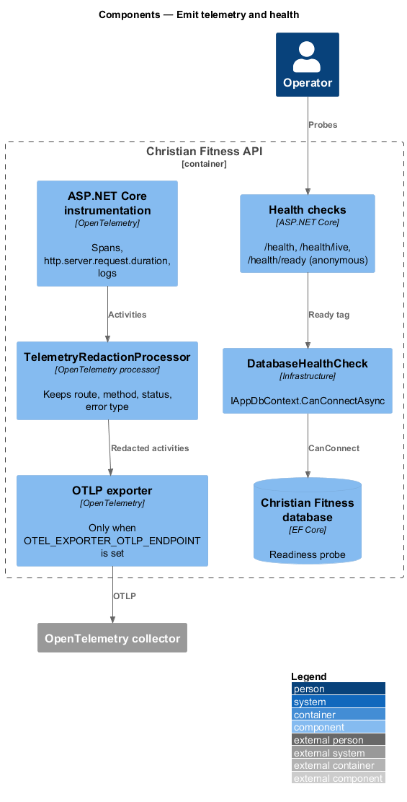
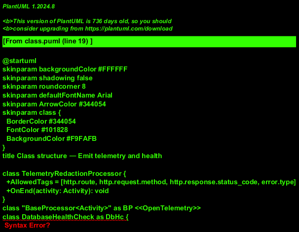
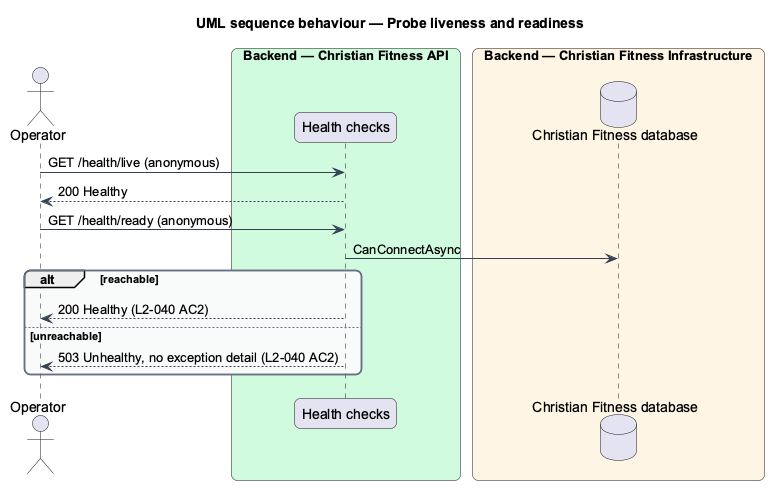

# Emit telemetry and health

## Overview

Operators need to see whether Christian Fitness is healthy without the system
recording anyone's personal data. This feature defines the OpenTelemetry traces
and metrics the Christian Fitness API emits and the anonymous health endpoints
that report liveness and readiness.

- **trace** — tree of timed spans for one request
- **route template** — endpoint path pattern such as `/api/events/{id}`, recorded instead of the concrete URL
- **liveness** — report that the API process is running
- **readiness** — report that the API can serve requests, including that the database is reachable

## Description

- **OpenTelemetry setup** — `ChristianFitness.Api` registers `AddOpenTelemetry().WithTracing(...).WithMetrics(...).WithLogging(...)` with ASP.NET Core instrumentation, service name `christian-fitness-api` (`OTEL_SERVICE_NAME` overrides it). The OTLP exporter is added only when `OTEL_EXPORTER_OTLP_ENDPOINT` is set to the operator's collector; without it nothing leaves the process. Both settings are in [`docs/operations/settings.md`](../../../operations/settings.md). EF Core instrumentation is added by the first slice that queries the database from a request, once a stable package exists.
- **Recorded attributes** — spans and the `http.server.request.duration` histogram carry `http.route` (template), `http.request.method`, `http.response.status_code`, `error.type` and duration only. A metric view keeps those tag keys on the histogram.
- **`TelemetryRedactionProcessor`** — keeps only the allowed tags on every span and drops the rest, among them `url.full`, `url.path`, `url.query`, `db.statement`, client and user-agent attributes and any user or claim attribute, and clears the status description (`L2-033` AC2). A request no route matched keeps only its method and status. SignalR hub invocations record the method name only, never message text.
- **Logging** — structured logs use templates without personal fields, to the console and, with an endpoint set, OTLP. The default level is `Information`; `Microsoft.AspNetCore` is held at `Warning` in code, because its request logs print the full URL with its query string.
- **Audited staff changes** — the audit behaviour of [staff roles](../../admin-access/staff-roles/README.md) logs `Staff change {AuditAction} audited` with the action name as its only attribute; who made the change and which record it changed are kept in the database's audit entries, never in a log, metric or span (`L2-019` AC3, ADR 0023).
- **Health checks** — `MapHealthChecks("/health/live")` runs no check and reports the process; `MapHealthChecks("/health/ready")` and `MapHealthChecks("/health")` run `DatabaseHealthCheck`, which asks `IAppDbContext.CanConnectAsync`, so a test injects an unreachable database through `IAppDbContext`. All three allow anonymous callers and write only `Healthy` or `Unhealthy` (HTTP 200 or 503) with no exception detail.

## Requirements

The feature realizes the following level-2 (L2) requirements. Each L2
requirement refines a level-1 (L1) requirement, cited by identifier. The
specification states these as acceptance criteria rather than one `shall`
sentence, so the criteria are quoted.

| L2 ID | Refines (L1) | Requirement |
|-------|--------------|-------------|
| `L2-040` | `L1-016` | 1. Given the API, when it handles requests, then it emits OpenTelemetry traces and metrics with the route template, status and duration only. 2. Given a health endpoint, when called anonymously, then it reports liveness and readiness (database reachable) without internal detail. |
| `L2-019` | `L1-008` | 3. Given any staff action that changes data, when it succeeds, then an audit entry records who, what, which record and when, without personal data in telemetry. |
| `L2-033` | `L1-013` | 2. Given any log, metric or span, when emitted, then it contains no email, name, home church, message text, token, query string or body. |

## Diagrams

### System context

Operators observe Christian Fitness through the OpenTelemetry collector and the health endpoints; members' data never reaches either.

### Containers

The Christian Fitness API exports telemetry to the collector and checks the database for readiness.

### Components

Instrumentation produces spans and metrics; the redaction processor strips everything except route template, method, status and duration before the exporter sends them.

### Class structure

The redaction processor is an OpenTelemetry `BaseProcessor<Activity>`; readiness uses the EF Core database health check.

### Behaviour — trace a request without personal data

Instrumentation records the request; the redaction processor keeps the route template, status and duration and drops everything else.

### Behaviour — probe liveness and readiness

Both endpoints are anonymous; readiness reports unhealthy when the database is unreachable, with no internal detail.

