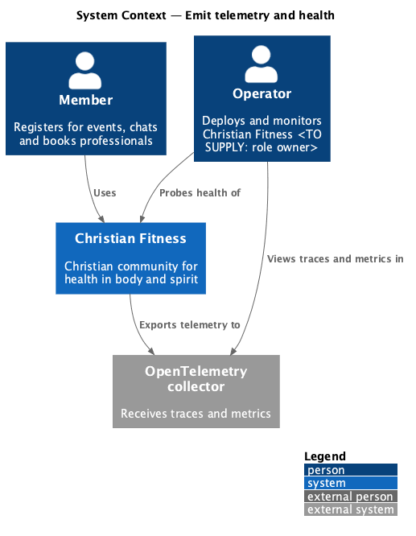
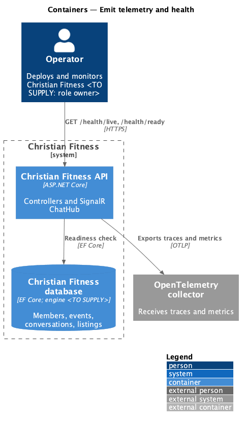
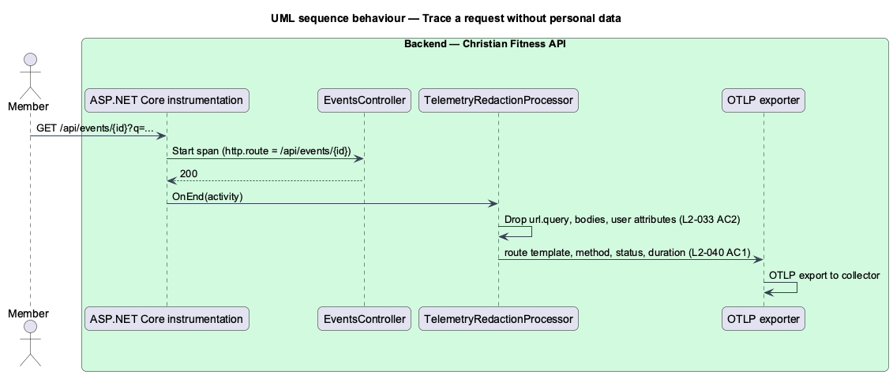

# Emit telemetry and health

## Overview

Operators need to see whether Christian Fitness is healthy without the system
recording anyone's personal data. This feature defines the OpenTelemetry traces
and metrics the Christian Fitness API emits and the anonymous health endpoints
that report liveness and readiness.

- **trace** — tree of timed spans for one request
- **route template** — endpoint path pattern such as `/api/events/{id}`, recorded instead of the concrete URL
- **liveness** — report that the API process is running
- **readiness** — report that the API can serve requests, including that the database is reachable

## Description

- **OpenTelemetry setup** — `ChristianFitness.Api` registers `AddOpenTelemetry().WithTracing(...).WithMetrics(...)` with ASP.NET Core and EF Core instrumentation and an OTLP exporter. The collector endpoint is configuration `OTEL_EXPORTER_OTLP_ENDPOINT` (`<TO SUPPLY: deployed value>`), documented with the deployment settings.
- **Recorded attributes** — spans and the `http.server.request.duration` histogram carry `http.route` (template), `http.request.method`, `http.response.status_code` and duration only.
- **`TelemetryRedactionProcessor`** — removes `url.full`, `url.query`, `db.statement` parameters, request and response bodies and any user or claim attribute before export (`L2-033` AC2). SignalR hub invocations record the method name only, never message text.
- **Logging** — structured logs use templates without personal fields; the log level and sink are `<TO SUPPLY>`.
- **`HealthController` / health checks** — `MapHealthChecks("/health/live")` returns the process status; `MapHealthChecks("/health/ready")` includes `DbContextHealthCheck<AppDbContext>`. Both are `[AllowAnonymous]` and write only `Healthy`/`Unhealthy` with no exception detail.

## Requirements

The feature realizes the following level-2 (L2) requirements. Each L2
requirement refines a level-1 (L1) requirement, cited by identifier. The
specification states these as acceptance criteria rather than one `shall`
sentence, so the criteria are quoted.

| L2 ID | Refines (L1) | Requirement |
|-------|--------------|-------------|
| `L2-040` | `L1-016` | 1. Given the API, when it handles requests, then it emits OpenTelemetry traces and metrics with the route template, status and duration only. 2. Given a health endpoint, when called anonymously, then it reports liveness and readiness (database reachable) without internal detail. |
| `L2-033` | `L1-013` | 2. Given any log, metric or span, when emitted, then it contains no email, name, home church, message text, token, query string or body. |

## Diagrams

### System context

Operators observe Christian Fitness through the OpenTelemetry collector and the health endpoints; members' data never reaches either.

### Containers

The Christian Fitness API exports telemetry to the collector and checks the database for readiness.

### Components

Instrumentation produces spans and metrics; the redaction processor strips everything except route template, method, status and duration before the exporter sends them.

### Class structure

The redaction processor is an OpenTelemetry `BaseProcessor<Activity>`; readiness uses the EF Core database health check.

### Behaviour — trace a request without personal data

Instrumentation records the request; the redaction processor keeps the route template, status and duration and drops everything else.

### Behaviour — probe liveness and readiness

Both endpoints are anonymous; readiness reports unhealthy when the database is unreachable, with no internal detail.

