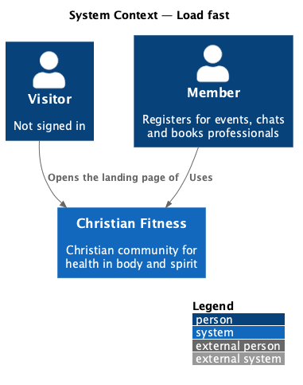
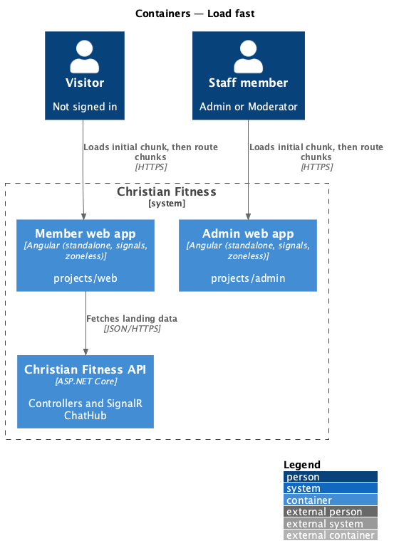
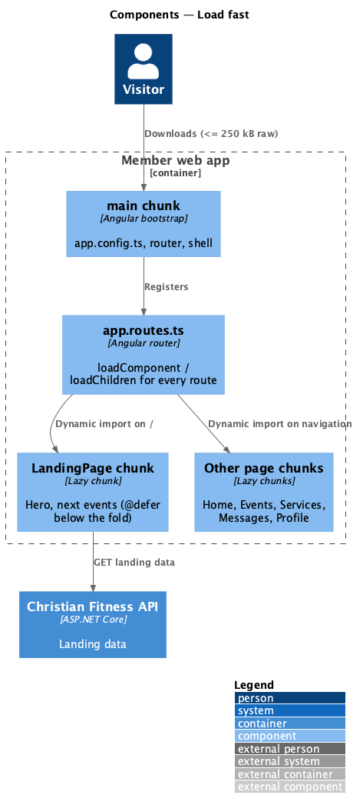
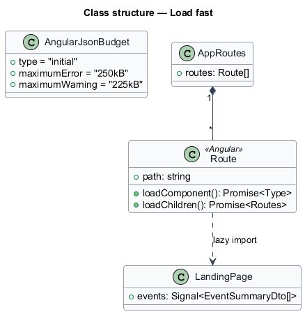
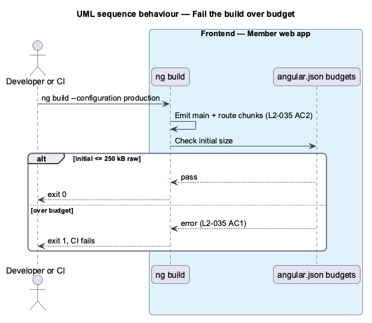
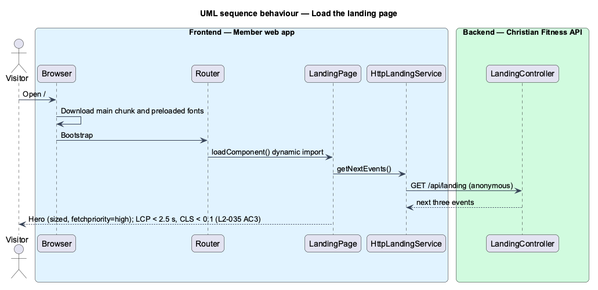

# Load fast

## Overview

Many members open Christian Fitness on mid-range phones over mobile networks.
This feature defines how both Angular apps keep the first load small and fast:
a size budget on initial JavaScript, a lazily loaded chunk per route, and page
experience targets on the landing page.

- **initial JavaScript** — scripts the browser downloads before the first route renders (the `main` and `polyfills` chunks)
- **budget** — `angular.json` size limit that fails the production build when exceeded
- **Largest Contentful Paint (LCP)** — time until the largest visible element renders
- **Cumulative Layout Shift (CLS)** — score of unexpected layout movement during load

## Description

- **`angular.json` budgets** — for `web` and `admin`, an `initial` budget with `maximumError: 250kB` (raw) and `maximumWarning: 225kB`. The workspace measured 212.29 kB (192.26 kB of JavaScript and 20.02 kB of foundation CSS) and a 220 kB warning; slice 30.1 raised the warning to 225 kB when the third lazy route turned on Angular's chunk optimizer, which folds the shared initial chunk into `main` (about 2 kB more raw, 1 kB less to transfer, one request fewer), measuring 220.40 kB ([ADR 0006](../../../adr/0006-error-screens.md)). Each component stylesheet has an `anyComponentStyle` budget of `2kB` (warning) and `4kB` (error). A breach of an error budget fails `ng build` and CI; raising a budget needs a stated reason.
- **Workspace** — one Angular workspace in `frontend/` holds the `web` and `admin` applications and the `components`, `domain` and `api` libraries, which are compiled from source into each app through the `@cf/components`, `@cf/domain` and `@cf/api` path aliases, so only what an app imports reaches its bundle (ADR 0001). ESLint enforces the dependency direction (ADR 0002).
- **Lazy routes** — every entry in `projects/web/src/app/app.routes.ts` and `projects/admin/src/app/app.routes.ts` uses `loadComponent` or `loadChildren`; no page component is imported eagerly. Heavy below-the-fold UI uses `@defer`.
- **Composition root** — `app.config.ts` binds tokens with lightweight providers; feature services are provided on routed components, not in `root`.
- **Landing page** — the hero image has explicit `width`/`height` and `fetchpriority="high"`; fonts are self-hosted with `font-display: swap` and preloaded; event cards reserve space while loading (`skeleton` block in the mocks) to keep CLS under 0.1.
- **Measurement** — a Lighthouse run against the landing page with a mid-range mobile and 4G profile, on request, records LCP and CLS. The exact device profile is `<TO SUPPLY>`.

## Requirements

The feature realizes the following level-2 (L2) requirements. Each L2
requirement refines a level-1 (L1) requirement, cited by identifier. The
specification states these as acceptance criteria rather than one `shall`
sentence, so the criteria are quoted.

| L2 ID | Refines (L1) | Requirement |
|-------|--------------|-------------|
| `L2-035` | `L1-014` | 1. Given each app's production build, when built, then its initial JavaScript is at most 250 kB raw and the build fails beyond the `angular.json` error budget. 2. Given every route, when built, then it is lazy-loaded and not part of the initial chunk. 3. Given a mid-range phone on a 4G profile, when the landing page loads, then Largest Contentful Paint is under 2.5 s and Cumulative Layout Shift under 0.1. |

## Diagrams

### System context

Visitors and members open Christian Fitness on phones; first load speed decides whether they stay.

### Containers

Each Angular app ships a small initial chunk and fetches one chunk per route on demand.

### Components

Inside the Member web app, the router resolves each route through a dynamic import, so only the bootstrap code and composition root sit in the initial chunk.

### Class structure

The build configuration holds the budget; each route definition holds a loader function instead of a component reference.

### Behaviour — fail the build over budget

The production build measures the initial chunk against the error budget and exits non-zero when it is exceeded.

### Behaviour — load the landing page

The browser fetches the initial chunk, the router imports the landing chunk, and the hero renders with reserved dimensions.

