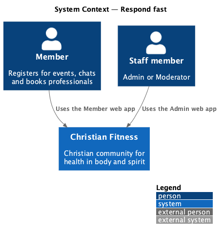
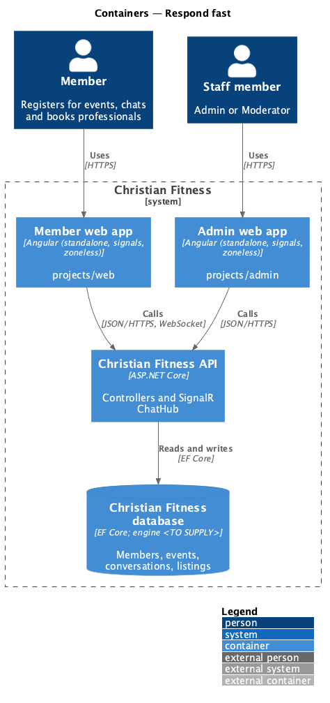
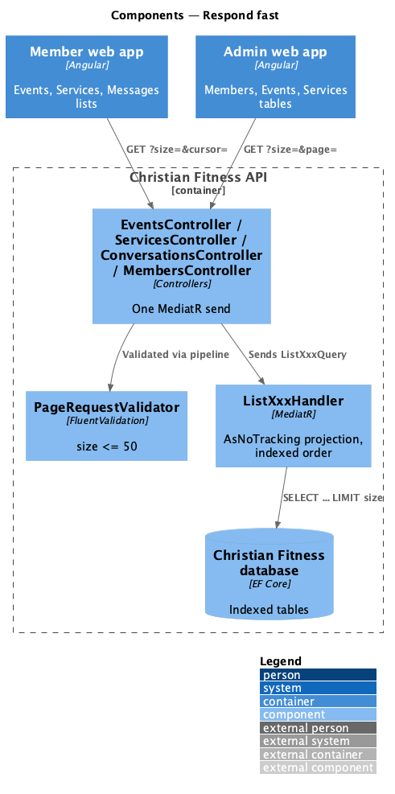
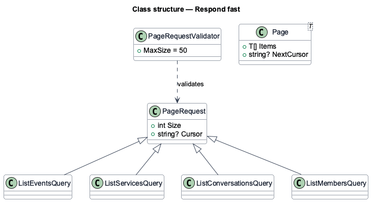
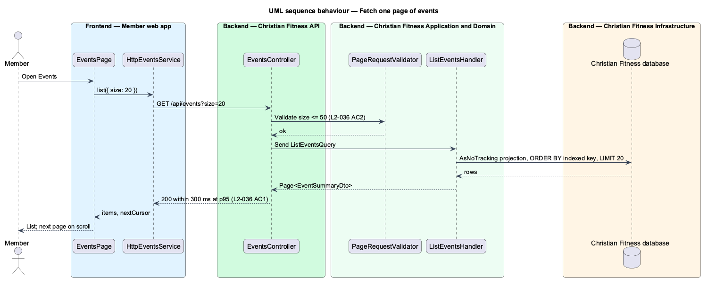

# Respond fast

## Overview

List screens in both apps call the Christian Fitness API for events, services,
conversations and members. This feature defines how those list endpoints stay
within a response-time target under normal load by returning bounded pages.

- **list endpoint** — endpoint returning a collection: events, services, conversations, members
- **page** — bounded slice of a collection with at most 50 items and a cursor or number to fetch the next
- **normal load** — 200 concurrent members

## Description

- **`PageRequest`** — Application DTO `{ page | cursor, size }`; `PageRequestValidator` caps `size` at 50 and defaults it to `<TO SUPPLY>`.
- **`Page<T>`** — response DTO `{ items, nextCursor | total }`, used by `ListEventsQuery`, `ListServicesQuery`, `ListConversationsQuery` and `ListMembersQuery` handlers. Cursor or offset paging per endpoint is `<TO SUPPLY>`.
- **Query shape** — handlers project to DTOs with `Select`, use `AsNoTracking`, and order by an indexed key; EF Core configurations in Infrastructure declare the supporting indexes.
- **Frontend** — list screens request the next page on scroll or a "Load more" control and keep a bounded window (`L2-037`).
- **Load test** — a load test at 200 concurrent members, run on request, checks the 95th percentile at 300 ms. Tooling and environment are `<TO SUPPLY>`. The `http.server.request.duration` metric (`L2-040`) observes the same target in production.

## Requirements

The feature realizes the following level-2 (L2) requirements. Each L2
requirement refines a level-1 (L1) requirement, cited by identifier. The
specification states these as acceptance criteria rather than one `shall`
sentence, so the criteria are quoted.

| L2 ID | Refines (L1) | Requirement |
|-------|--------------|-------------|
| `L2-036` | `L1-014` | 1. Given normal load of 200 concurrent members, when list endpoints (events, services, conversations, members) are called, then 95% respond within 300 ms. 2. Given list endpoints, when called, then they are paged and never return more than 50 items per page. |

## Diagrams

### System context

Members and staff browse lists through Christian Fitness.

### Containers

List screens in both apps call paged API endpoints that read projected rows from the database.

### Components

Each list controller sends a query; the validation behaviour caps the page size and the handler runs one projected, indexed query.

### Class structure

Every list query inherits `PageRequest`; every list handler returns `Page<T>`.

### Behaviour — fetch one page of events

The page size is capped at 50 before the handler runs; the handler returns one projected page and the cursor for the next.

