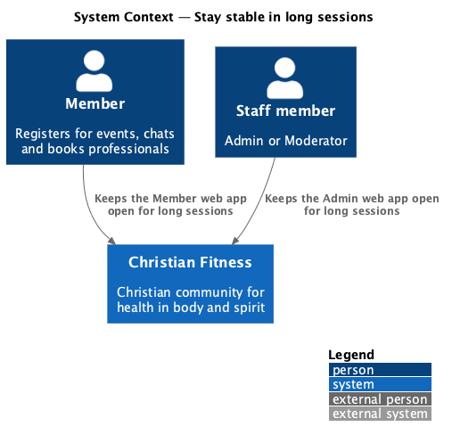
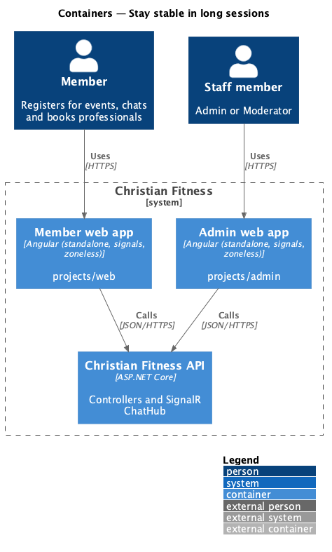
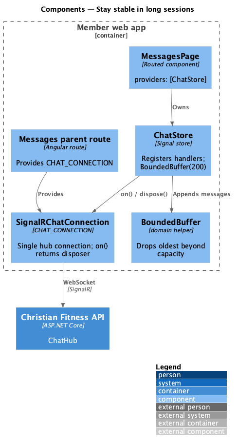
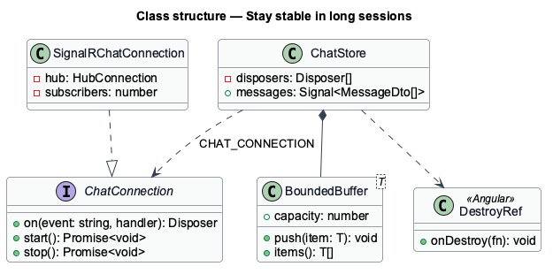
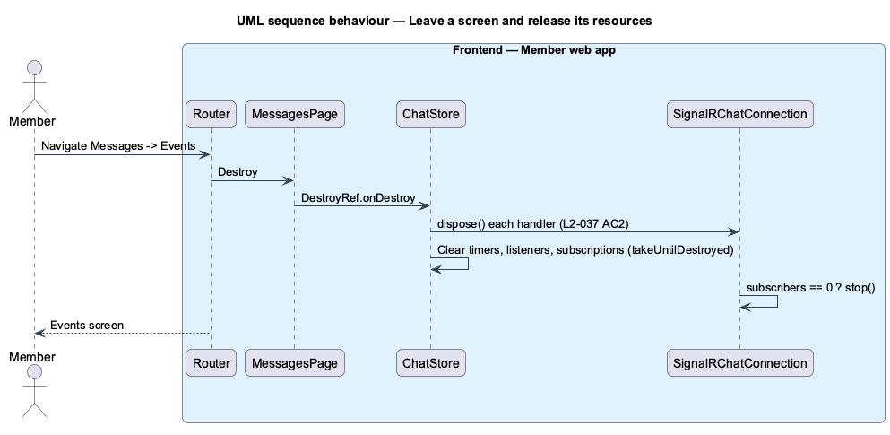
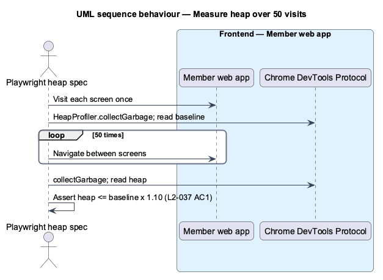

# Stay stable in long sessions

## Overview

A member may keep Christian Fitness open for an hour, moving between Events,
Messages and Profile many times. This feature defines how both apps release what
each screen acquires and bound what grows, so memory returns to its baseline.

- **heap baseline** — JavaScript heap size after garbage collection following the first visit to a screen
- **release** — disposal of a subscription, timer, listener, observer, object URL or real-time handler when its owning component is destroyed
- **bounded buffer** — collection with a fixed maximum size that drops the oldest entries

## Description

- **`DestroyRef` and `takeUntilDestroyed`** — every component and screen-scoped service ends its observable subscriptions with `takeUntilDestroyed()`; timers, `requestAnimationFrame` loops, DOM listeners, observers and `AbortController`s register a `DestroyRef.onDestroy` cleanup.
- **Screen-scoped providers** — a screen's store (for example `ChatStore`, `EventsStore`) is in its routed component's `providers`, so Angular destroys it with the component.
- **`CHAT_CONNECTION` / `SignalRChatConnection`** — the single real-time client, shared through the Messages parent route. Each `on(...)` registration returns a disposer that the subscribing store calls on destroy; the connection stops when the last subscriber leaves.
- **`BoundedBuffer<T>`** — pure helper in the `domain` library with unit tests; chat keeps at most 200 messages (`L2-016` AC6), and long lists keep a window sized `<TO SUPPLY>`.
- **Heap sweep** — a Playwright spec, run on request, navigates between screens 50 times, forces garbage collection through the Chrome DevTools Protocol and asserts the heap is within 10% of the first-visit baseline.

## Requirements

The feature realizes the following level-2 (L2) requirements. Each L2
requirement refines a level-1 (L1) requirement, cited by identifier. The
specification states these as acceptance criteria rather than one `shall`
sentence, so the criteria are quoted.

| L2 ID | Refines (L1) | Requirement |
|-------|--------------|-------------|
| `L2-037` | `L1-014` | 1. Given a member moves between screens 50 times, when the heap is measured after garbage collection, then it returns to within 10% of its level after the first visit. 2. Given a screen is left, when it is destroyed, then its subscriptions, timers, listeners and real-time handlers are released. |

## Diagrams

### System context

Members and staff keep the apps open for long sessions on low-power devices.

### Containers

The behaviour lives in the two Angular apps; the API is unaffected beyond the real-time connection it serves.

### Components

The Messages route owns the chat connection; its screen store registers hub handlers and disposes them when the route is left.

### Class structure

`ChatStore` depends on the `ChatConnection` contract and `DestroyRef`; it holds messages in a `BoundedBuffer`.

### Behaviour — leave a screen and release its resources

Destroying the routed component destroys its store, which disposes hub handlers and timers; the connection stops when it has no subscribers.

### Behaviour — measure heap over 50 visits

The on-request sweep compares the heap after garbage collection with the baseline after the first visit.

