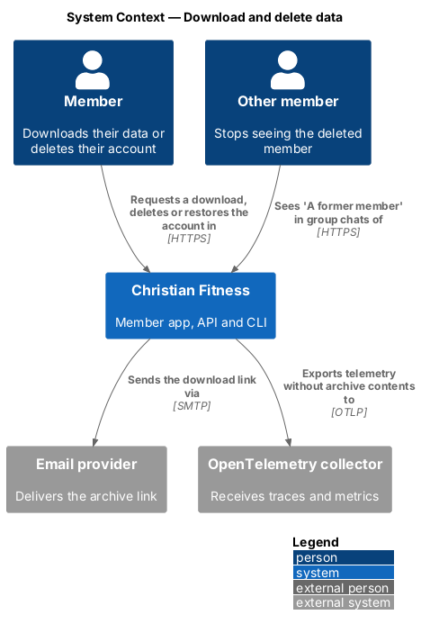
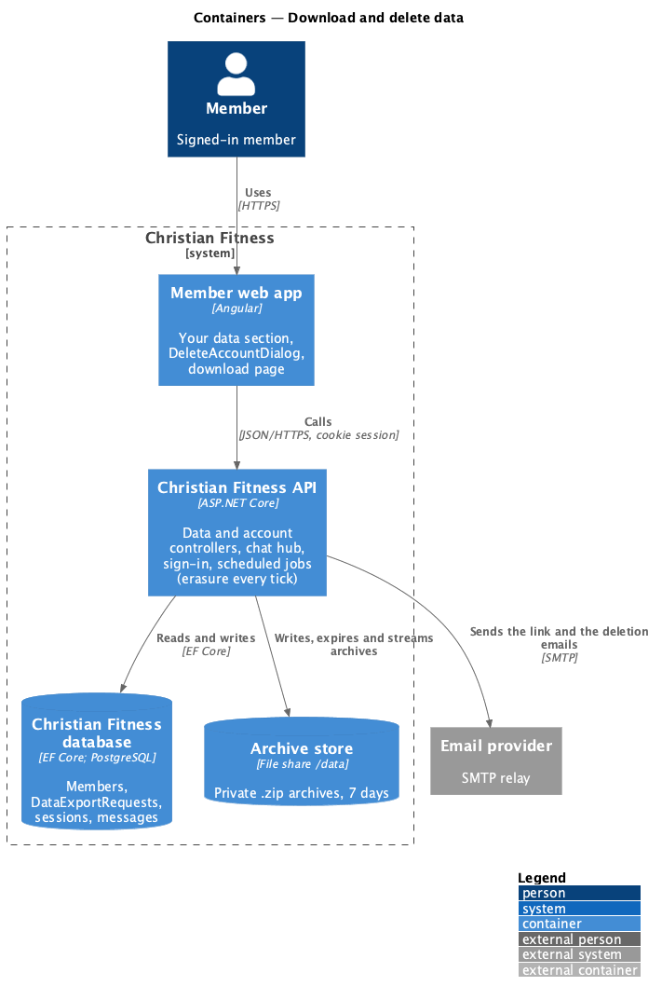
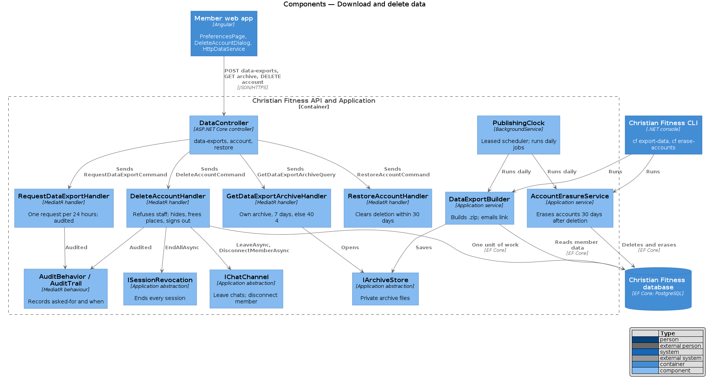
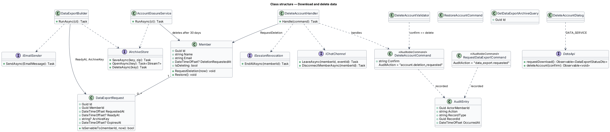
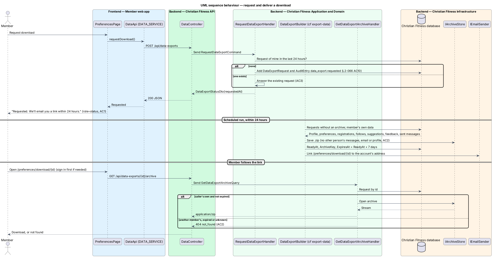
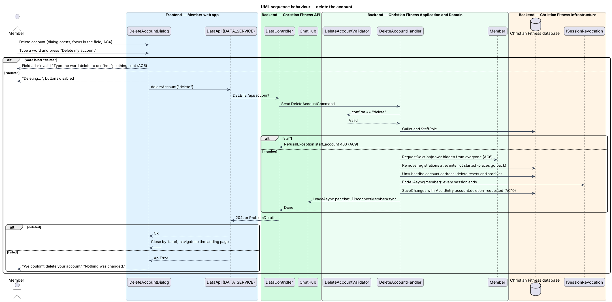
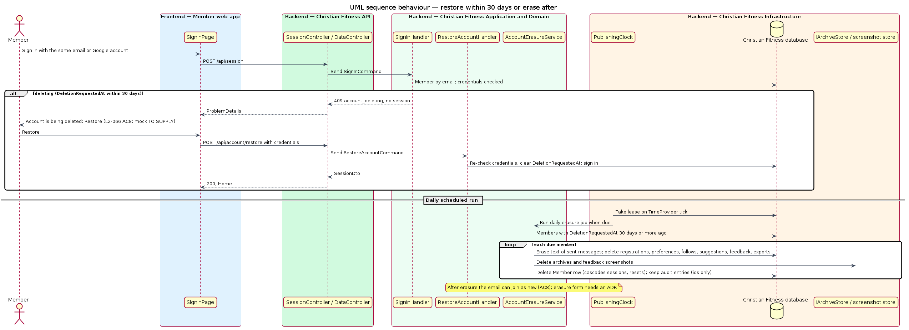

# Download and delete data

## Overview

Christian Fitness is a Christian community for health in body and spirit in the Greater Toronto Area. The preferences subsystem lets a member download their data and delete their account (`L1-019`), as part of protecting accounts and personal data (`L1-013`).

This feature covers the "Your data" section of the Preferences screen (mocks `docs/mocks/pages/preferences/default.html` and `download-requested.html`) and the Delete your account dialog (mock `docs/mocks/dialogs/delete-account/`, states `default`, `invalid`, `busy`, `failed`). A download is prepared within 24 hours and sent as an emailed link to a .zip archive. A deletion takes effect at once for everyone who could see or reach the member, and erases what the member holds after 30 days, during which the member can restore the account.

- **data export request** — record that a member asked for their data, with the time asked, the time the archive was ready and when its link expires
- **archive** — .zip file of one member's own data, kept for 7 days and served only to that member's session
- **deletion** — the member's confirmed request to delete their account; the account becomes deleting at once
- **deleting account** — account inside the 30 days after deletion: hidden from everyone, signed out, restorable by its holder
- **erasure** — removal, 30 days after deletion, of the data the member holds, by a scheduled job
- **former member** — the name shown in place of a deleting member's name on messages they sent; after erasure it is "Deleted member"

This feature supersedes the export and deletion parts of [protect personal data](../../security/protect-personal-data/README.md), which predate `L2-066`: that design answered a JSON download at once and placed the controls on the profile, while `L2-066` asks for an emailed .zip link within 24 hours and places them in Preferences.

## Description

### Member web app

- **Your data section** — part of `PreferencesPage` ([set email and notification preferences](../set-email-and-notification-preferences/README.md)). "Download your data" shows a secondary `button` "Request download"; once requested, or when `PreferencesDto.downloadRequestedAt` is within the last 24 hours, it shows the `role="status"` text "Requested. We'll email you a link within 24 hours." in its place (AC1, AC3). "Delete account" opens the dialog. A link to the Privacy Policy closes the section (`L2-067` AC4).
- **`DeleteAccountDialog`** — CDK Dialog in `projects/web/src/app/dialogs/delete-account/`, imported with `import()` on first press so neither it nor the CDK enters the initial bundle, and opened with the page's injector. It composes the library's `dialog` shell (title "Delete your account?", the account's name and email as subtitle), the `prose` text of what is removed and when, `text-field` "Type "delete" to confirm", `alert` and two `button`s, "Keep my account" and "Delete my account" (danger). Focus starts in the field; Escape, Close and "Keep my account" close it with nothing changed (AC4). `deleteConfirmation` in `@cf/domain` checks the word: anything else marks the field `aria-invalid` with "Type the word delete to confirm." and sends nothing (AC5, mock `invalid`). While waiting the button reads "Deleting…" and both buttons are disabled (mock `busy`). A failure shows "We couldn't delete your account" with "Nothing was changed." (mock `failed`). Success closes the dialog by its ref and navigates to the landing page (AC6). A refusal with `staff_account` shows that staff ask an Admin (AC9); no mock draws it.
- **`DataApi` / `DATA_SERVICE`** — contract and token in the `api` library (`api/src/account/data.ts`): `requestDownload()`, `deleteAccount(confirm)`. `HttpDataService` is bound on `PreferencesPage`.
- **Download link route** — `/preferences/download/:id` under the member shell and `memberAuthGuard`, so a member who follows the emailed link signs in first and returns to it (`L2-004` AC6). The page starts the browser download from `GET /api/data-exports/{id}/archive` and shows an expired or not-found state otherwise. No mock draws this page.

### Christian Fitness API

- **`DataController`** — `POST /api/data-exports` sends `RequestDataExportCommand`; `GET /api/data-exports/{id}/archive` sends `GetDataExportArchiveQuery`; `DELETE /api/account` sends `DeleteAccountCommand`; `POST /api/account/restore` sends `RestoreAccountCommand`. Each requires a member session except restore (see the restore behaviour).
- **`RequestDataExportCommand` / handler** — an `IAuditableCommand` (`data_export.requested`). When a request of the caller's is younger than 24 hours it answers that one and adds nothing; otherwise it adds a `DataExportRequest`. It records the audit entry with the member as actor (AC10).
- **`DataExportBuilder`** — application service run by the CLI command `cf export-data`. For each request without an archive it assembles the member's own data (below) into a .zip, stores it through a private `IArchiveStore`, sets `ReadyAt` and `ExpiresAt = ReadyAt + 7 days`, and sends one `EmailMessage` to the account's address with the link `{MemberAppAddress}/preferences/download/{id}` (AC1). The same run deletes archives past their expiry. Neither the email nor any span carries what the archive holds (AC10).
- **`GetDataExportArchiveQuery` / handler** — streams the archive only when the request's `MemberId` is the caller's and `ExpiresAt` is in the future; any other id, an expired one or another member's is the same 404 `not_found` (AC2, `L2-031` AC3).
- **`DeleteAccountCommand` / `DeleteAccountValidator` / handler** — an `IAuditableCommand` (`account.deletion_requested`). The validator refuses a `confirm` other than "delete" with 400 `validation_failed`. The handler refuses a member who holds a `StaffRole` with 403 `staff_account` (AC9), then, in one unit of work: marks the member deleting (`Member.RequestDeletion(now)`, which sets `DeletionRequestedAt`); removes their registrations at events (and later series sessions) that have not started, so the places go back (AC6); unsubscribes the account subscription; deletes unused password resets and every archive; ends every session through `ISessionRevocation.EndAllAsync` (AC6, "signed out everywhere at once"). After the save it calls `IChatChannel.LeaveAsync` for each event chat the member was in and a new `IChatChannel.DisconnectMemberAsync`, so open hub connections close too.
- **Deleting accounts in other handlers** — from the moment of deletion: `GetPublicProfileHandler` answers `not_found`; group and direct chat history and the conversation list name the author "A former member" (AC7); `ChatMembership.SeatAsync` and `GroupMembership.ShareAGroupAsync` ignore the member, so they leave every group chat (AC6); `DirectChat.OtherNameAsync` treats them as unavailable; going counts exclude them.
- **`AccountErasureService`** — application service run by the CLI command `cf erase-accounts`. With `TimeProvider`, it finds members whose `DeletionRequestedAt` is 30 days or more in the past and erases them as the table below states (AC7). After erasure the email is free, so it can join as new (AC8).
- **`RestoreAccountCommand`** — sign-in by password (`SignInHandler`) or by Google (`L2-049` design) for a deleting account answers 409 `account_deleting` with no session; the screen then offers Restore, which re-proves the credentials, clears `DeletionRequestedAt` and signs the member in (AC8). Places that went back are not restored.
- **`DataExportRequest`** — new entity (`Id`, `MemberId`, `RequestedAt`, `ReadyAt?`, `ArchiveKey?`, `ExpiresAt?`) with a cascade from `Member`; migration `AddDataExportsAndDeletion` adds it and `Member.DeletionRequestedAt`.
- **Settings** — the archive store's directory (`Exports__Directory`, on the `/data` share of [ADR 0047](../../../adr/0047-continuous-deployment-to-azure-container-apps.md)) and the schedules of `cf export-data` and `cf erase-accounts` shall be documented in `docs/operations/settings.md` in the same change.
- **Archive and rate limit** — [ADR 0062](../../../adr/0062-personal-data-erasure-and-retention.md) fixes the seven JSON sections and README, display-name-only participants, and five deletion attempts per member per rolling hour, counting invalid and refused attempts. The sixth receives 429 `too_many_attempts`.

### Personal data and what happens to it

The table lists every store of member data in the code today, then the stores the new requirements add (designed elsewhere). "Archive" is what the download holds (AC1); "At deletion" is AC6; "At erasure" is AC7, 30 days later.

| Data (entity) | Archive | At deletion | At erasure |
|---|---|---|---|
| Profile: `Member` name, email, city, bio, goals, interests, home church, `ShowHomeChurch`, `JoinedAt` | Yes | Hidden from everyone; kept for restore | Row deleted (cascades below); email free to join again |
| `Member.PasswordHash` | No | Kept for restore | Deleted with the row |
| `Member.Status`, `ModerationNote` (staff's words) | No | Kept | Deleted with the row |
| Sessions (`SessionRecord`, Infrastructure) | No | All ended at once; hub connections closed | Cascade |
| `PasswordReset` | No | Deleted | Cascade |
| `SignInFailure` (hash of the email, no member id) | No | Untouched; lasts 15 minutes | Untouched |
| `Registration` at events not started | Yes | Removed; places go back; chat left | — |
| `Registration` at past events | Yes | Kept, member hidden from chats and counts | Deleted |
| `ChatMessage` sent in group chats | Yes (own text, event title and participant display names only) | Author shown as "A former member" | Text and identity erased; row shows "Deleted member" and "Message removed" |
| `DirectMessage` sent | Yes (own text and other participant's display name only) | Author shown as "A former member"; unavailable for new messages | Text and identity erased; row shows "Deleted member" and "Message removed" |
| `DirectMessage` received | No (another person's message) | Unchanged for the sender | Remains intact for the sender; detach deleted member identity |
| `ChatReadMarker` | No | Kept | Deleted |
| `MessageReport` filed by the member (reason) | No | Kept for staff | Detach member identity; purge 12 months after decision |
| `MessageReport` about the member's messages | No | Kept for staff | Detach member identity and erased text; purge 12 months after decision |
| `AuditEntry` (ids only) | No | `account.deletion_requested` added | Remove identifying actor and record references; purge two years after occurrence |
| `ProfessionalApplication`, `ServiceListing` of a professional | `<TO SUPPLY>` | `<TO SUPPLY>` | Delete exclusively owned data; declined applications and associated declined listings otherwise purged 12 months after decline |
| `MemberPreferences` (`L2-064`, `L2-065`) | Yes | Kept | Deleted |
| Account subscription (`L2-057`) | Yes (as preferences) | Unsubscribed | Address deleted (`L2-058` AC6) |
| Google sign-in link (`L2-049`) | No | Kept for restore | Deleted |
| Series places and drop-ins (`L2-052`, `L2-053`) | Yes | Sessions not started go back; series chat left | Deleted |
| Listing follows (`L2-056`) | Yes | Kept for restore | Deleted |
| Listing suggestions (`L2-062`), including the suggested person's email | Yes | Kept for staff review | Erased |
| Feedback notes and screenshots (`L2-063`) | Yes | Kept | Erased, screenshot files too |
| Legal acceptance versions (`L2-067` AC5) | Yes | Kept | Deleted |
| `DataExportRequest` and archives | — | Archives deleted; links stop working | Rows deleted |

### Open questions

- **Schedules and hosting.** Issue #77 decides the scheduler for exports, erasure and retention purges; exports run at least once in 24 hours and erasure and purges at least daily.
- **Unmocked states.** Sign-in for a deleting account with Restore, the download page (ready, expired), the `staff_account` refusal in the dialog, and the email's wording have no mock.

## Requirements

The feature realizes the following level-2 (L2) requirements. Each L2 requirement refines a level-1 (L1) requirement, cited by identifier. The L2 specification states its requirements as acceptance criteria; the text below condenses those criteria faithfully.

| L2 ID | Refines (L1) | Requirement |
|-------|--------------|-------------|
| `L2-066` | `L1-019`, `L1-013` | [Download and delete your data](../../../specs/L2.md#l2-066-download-and-delete-your-data): archive, grace period, message erasure, audit and rate limit. |
| `L2-033` | `L1-013` | 3. A deletion shall sign the member out and erase or anonymise the profile, registrations and authored messages after the 30-day restoration period. 4. A member who asks shall receive an export of their profile, registrations and messages. |
| `L2-031` | `L1-013` | 3. An id that does not belong to the caller shall reveal nothing (opaque ids, uniform 404). |

## Diagrams

### System context

A member asks Christian Fitness for their data or deletes their account. The archive link arrives by email; telemetry carries neither the archive nor the member.

### Containers

The API records requests and deletions; the CLI builds archives and erases accounts on a schedule; archives sit on private storage that only the API serves.

### Components

`DataController` sends one request per action. `DataExportBuilder` and `AccountErasureService` run from the CLI; `ISessionRevocation` and `IChatChannel` end the member's sessions and chat connections at deletion.

### Class structure

`Member` gains `DeletionRequestedAt`; `DataExportRequest` belongs to one member. The handlers and services depend on `IAppDbContext`, `IArchiveStore`, `IEmailSender` and `TimeProvider`.

### Behaviour — request and deliver a download

The request is recorded and audited at once; the scheduled builder prepares the .zip, emails the link, and serves it only to its own member for 7 days.

### Behaviour — delete the account

The dialog checks the word; the handler refuses staff, then in one unit of work hides the member, gives back future places, ends every session and records the audit entry; the chat hub drops the member's connections.

### Behaviour — restore or erase

Within 30 days a sign-in offers Restore; after 30 days the erasure job removes the member's data and frees the email.

