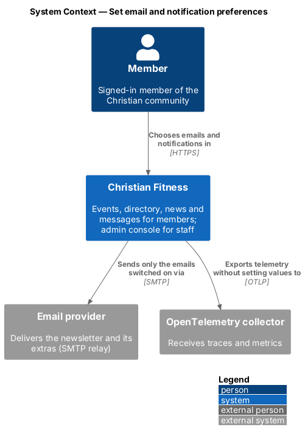
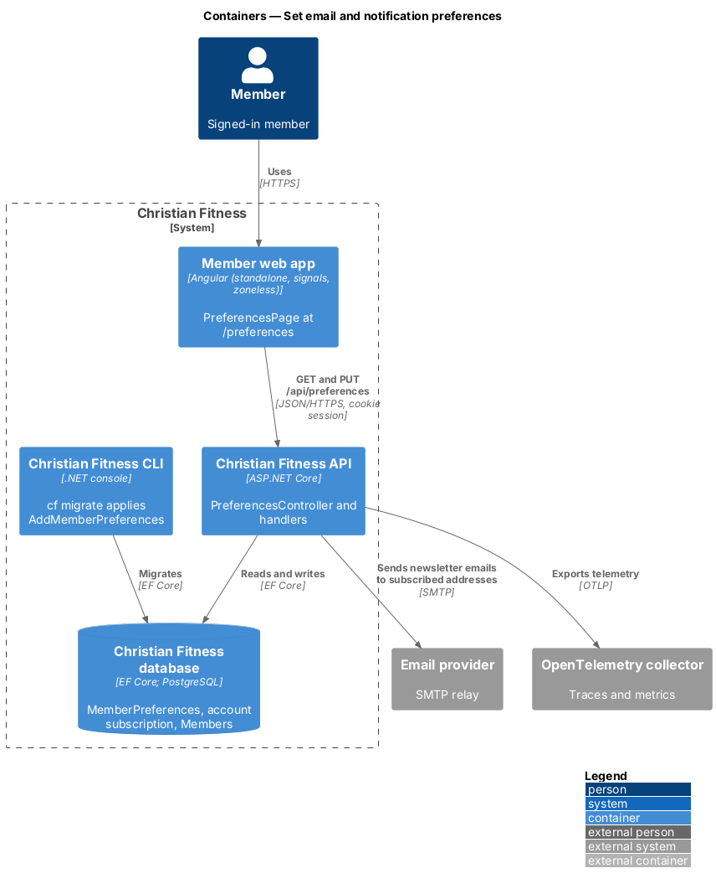
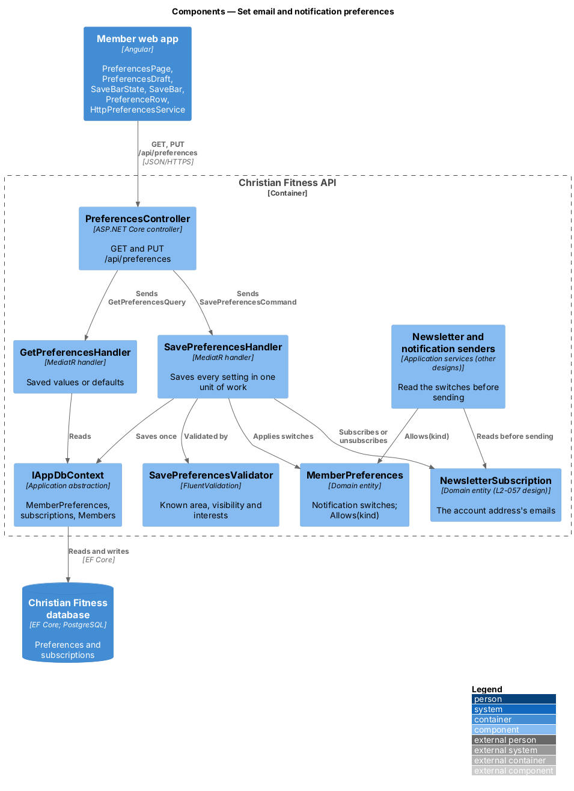
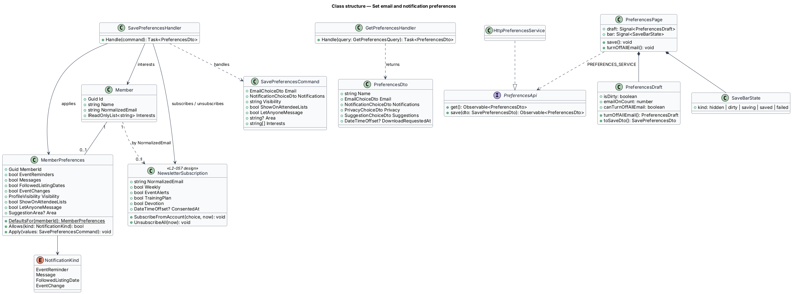
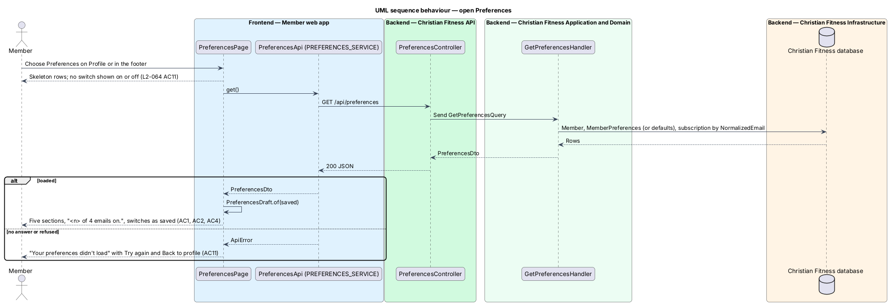
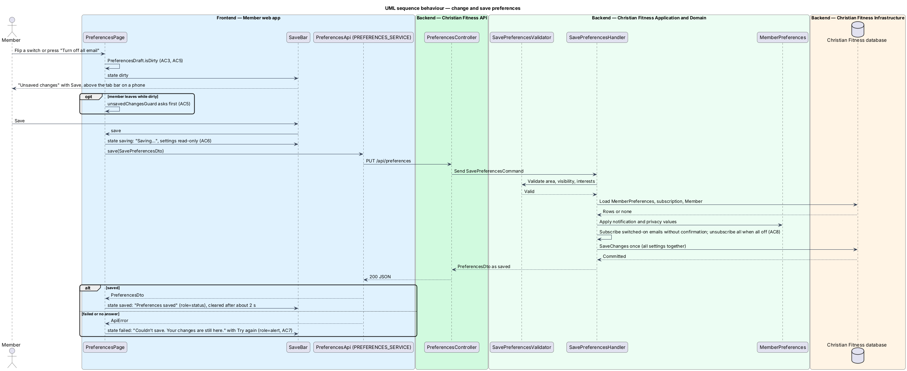
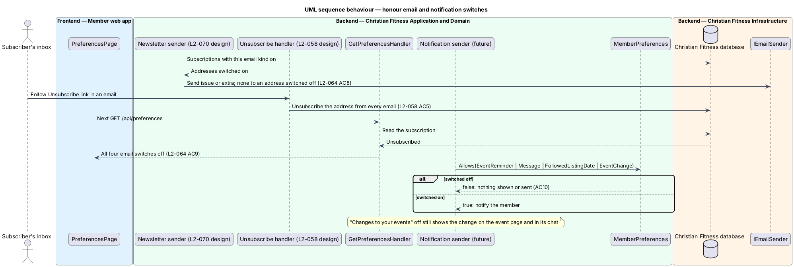

# Set email and notification preferences

## Overview

Christian Fitness is a Christian community for health in body and spirit in the Greater Toronto Area. The preferences subsystem lets a member choose which emails and notifications they receive, who can see and message them, what is used to suggest events and stories, and lets them download their data or delete their account (`L1-019`).

This feature covers the Preferences screen itself and its first two sections, Email and Notifications (mock `docs/mocks/pages/preferences/`). The screen opens at `/preferences` from the profile's "Preferences" action and from the member footer. It shows five sections (Email, Notifications, Privacy, Suggestions, Your data), keeps a list of those sections in view at LG and wider, and saves every change on the page together when the member presses Save.

- **email switch** — on/off setting for one email the newsletter sends: The Abundant Weekly or one of its three extras (Event alerts, Training plan of the week, Morning devotion)
- **account subscription** — newsletter subscription of the member's own account address, introduced by the newsletter design for `L2-057` and `L2-058`; the email switches show and change it
- **notification switch** — on/off setting for one kind of notification: Event reminders, Messages, New dates from listings you follow, Changes to your events
- **save bar** — bar fixed at the bottom of the screen that holds unsaved changes, their Save action and the result of saving
- **draft** — settings as the member has set them on screen, compared with the settings as saved

The Privacy and Suggestions sections are designed in [set privacy and suggestion preferences](../set-privacy-and-suggestion-preferences/README.md); Your data is designed in [download and delete data](../download-and-delete-data/README.md). All five sections share the screen, the draft and the save path described here.

## Description

The feature is a vertical slice from the Preferences screen to the database. No part of it exists in the code yet; the names below follow the codebase's conventions.

### Member web app

- **Route `/preferences`** — a child of the member shell in `projects/web/src/app/app.routes.ts`, behind `memberAuthGuard`, with `loadComponent` and the title "Preferences · Christian Fitness". It carries `canDeactivate: [unsavedChangesGuard]` (AC5). The profile's "Preferences" button ([view profile](../../member-profile/view-profile/README.md)) and the footer link of `L2-008` AC5 ([navigate the member app](../../member-home/navigate-member-app/README.md)) lead to it.
- **`PreferencesPage`** — routed page component in `projects/web/src/app/pages/preferences/`. It binds `PREFERENCES_SERVICE` to `HttpPreferencesService` on its own `providers`, holds the loaded preferences and the draft as signals, and composes only library components: the `back-link`, the page title and subtitle with the member's name (AC1), `side-navigation` for the section list (shown at LG and wider, hidden at XS; AC1, AC12), one section per preference group, `preference-row` with `switch` for each email and notification setting, and `save-bar`. While loading it shows `skeleton` rows and no switch (AC11, mock `loading`); a failed load shows the `empty-state` error variant "Your preferences didn't load" with Try again and Back to profile (mock `error`).
- **`PreferencesDraft`** — pure helper in the `domain` library (`domain/src/preferences/preferences-draft.ts`) with unit tests. It keeps the saved `PreferencesDto` and the edited values, answers `isDirty` and `emailOnCount` ("<n> of 4 emails on."), applies `turnOffAllEmail()` (all four email switches off; AC3), answers whether Turn off all email is offered (only with at least one email on), and builds the `SavePreferencesDto`. The page keeps no rule of its own.
- **`SaveBarState`** — pure helper in the `domain` library. It moves through `hidden`, `dirty` ("Unsaved changes" with Save), `saving` ("Saving…", every setting read-only), `saved` ("Preferences saved", `role="status"`), and `failed` ("Couldn't save. Your changes are still here." with Try again, `role="alert"`) (AC5 to AC7; mocks `unsaved`, `saving`, `saved`, `failed`). The page starts one 2-second timer for `saved` and clears it when the state changes or the page is destroyed.
- **`unsavedChangesGuard`** — `CanDeactivateFn` in the `domain` library that asks before leaving while the draft is dirty (AC5). The page also adds a `beforeunload` listener while dirty and removes it when clean or destroyed. The form of the question is `<TO SUPPLY>`: no mock draws it (see Open questions).
- **`SaveBar`** — presentation component in the `components` library under its design-system name (`components/src/save-bar/`, block `save-bar`). It takes the state, the text and the busy flag as inputs and emits `save`. On a phone it sits above the `tab-bar` and never covers it (AC12).
- **`PreferenceRow`, `SideNavigation`** — presentation components built once under their design-system names (`preference-row`, `side-navigation`), with the existing `Switch` (`components/src/switch/`, `role="switch"`) inside each row. Each switch keeps a 44 × 44 px target beside its text (AC12).
- **`PreferencesApi` / `PREFERENCES_SERVICE`** — contract and injection token in the `api` library (`api/src/preferences/preferences.ts`): `get()` answers `PreferencesDto`; `save(dto)` answers the saved `PreferencesDto`. A refusal or no answer errors with an `ApiError`.
- **`HttpPreferencesService`** — HTTP implementation in `projects/web/src/app/services/`, calling `GET /api/preferences` and `PUT /api/preferences`.

### Christian Fitness API

- **`PreferencesController`** — ASP.NET Core controller at `api/preferences`; it requires a member session (fallback policy). `GET` sends one `GetPreferencesQuery`; `PUT` sends one `SavePreferencesCommand`. It checks nothing itself.
- **`GetPreferencesQuery` / `GetPreferencesHandler`** — reads the caller's `MemberPreferences` (or the defaults when the member has no row), the account subscription for the member's `NormalizedEmail`, the member's name, interests (`Member.Interests`) and the latest data-export request. It answers `PreferencesDto`: `name`, `email { weekly, eventAlerts, trainingPlan, devotion }`, `notifications { eventReminders, messages, followedListingDates, eventChanges }`, the privacy and suggestion values of the sibling feature, and `downloadRequestedAt`.
- **`SavePreferencesCommand` / `SavePreferencesValidator` / `SavePreferencesHandler`** — the command carries every setting on the page. The validator refuses an unknown area, visibility or interest with 400 `validation_failed` and a field code. The handler loads the caller's `MemberPreferences` (creating it from the defaults), applies every value, writes the account subscription (below) and the member's interests, and saves once, so every changed setting is saved together or none is (AC6). It answers the saved `PreferencesDto`.
- **`MemberPreferences`** — new domain entity in `ChristianFitness.Domain/Members/`, one row per member, keyed by `MemberId` with a cascade from `Member`. It holds the four notification switches and the privacy and suggestion settings. `MemberPreferences.DefaultsFor(memberId)` gives every notification switch on (AC4), so existing members need no backfill: a member without a row has the defaults. `Allows(NotificationKind)` answers whether a notification of a kind may be shown or sent.
- **Account subscription** — the email switches are not stored on `MemberPreferences`. They are the subscription record that the newsletter design introduces for `L2-057` (named `NewsletterSubscription` here until that design settles), found by the member's normalized email (AC2). Saving an email switch on subscribes the account's address to that email with the consent time recorded and no confirmation email, since the address is the account's own (AC8). Saving all four off unsubscribes the address as the Unsubscribe link of `L2-058` AC5 does (AC8). An unsubscribe from an email link therefore shows as switches off the next time Preferences opens (AC9, mock `unsubscribed` shows the same text after "Turn off all email").
- **`NotificationKind`** — enum `EventReminder`, `Message`, `FollowedListingDate`, `EventChange`. Each sender of a notification shall read `MemberPreferences.Allows(kind)` for the recipient before showing or sending it (AC10). "Changes to your events" off still shows the change on the event itself, as `CancelEventHandler` does today through `IChatChannel.NotifyCancelledAsync` and the event page.
- **`IAppDbContext.MemberPreferences`** — new `DbSet`; migration `AddMemberPreferences` adds the table. The CLI applies it (`cf migrate`); the API does not migrate on startup.
- **Telemetry** — spans record the route templates `api/preferences` only. No span, metric or log carries a setting's value, the member's name or the address (`L2-033` AC2, `L2-065` AC9).

### Open questions

- **Notification channel.** ADR 0061 chooses an in-app inbox now and web push later. The Notifications section reads "In the app, on the bell. Chat messages show as unread dots on Messages." and has one switch for each kind that notifies: event reminders (24 hours before), cancelled events, cancelled series dates and new dates from followed hosts (`L2-064` AC4). Chat messages do not notify. No notification is sent until those slices are built; until then the switches are stored only, and `Allows` is the single rule each sender shall read.
- **Leaving with unsaved changes.** AC5 asks first, but no mock draws the question. A CDK Dialog in the design system's `dialog` component is the house pattern; the browser's own prompt is the only option on closing the tab. A mock state is `<TO SUPPLY>`.
- **Subscription without confirmation.** AC8 subscribes the account's address without a confirmation email. The newsletter design for `L2-058` AC2 records the time of consent; the consent source ("Preferences, signed in") should be recorded there too. Confirming this with the newsletter design is `<TO SUPPLY>`.
- **Email extras senders.** Event alerts, the training plan and the devotion have no sender or schedule (mocks README open question 14), so AC8 can only be enforced for The Abundant Weekly until those senders exist.
- **Receipts and security notices.** AC3's text says receipts and security notices still arrive. Whether the legal-change notice of `L2-067` AC6 counts as such a notice is `<TO SUPPLY>`.
- **Two tabs.** Two open Preferences pages save the whole page each; the later save wins. No requirement asks for more.

## Requirements

The feature realizes the following level-2 (L2) requirements. Each L2 requirement refines a level-1 (L1) requirement, cited by identifier. The L2 specification states its requirements as acceptance criteria; the text below condenses those criteria faithfully.

| L2 ID | Refines (L1) | Requirement |
|-------|--------------|-------------|
| `L2-064` | `L1-019` | 1. Preferences on the profile or the footer shall open `/preferences` with the sections Email, Notifications, Privacy, Suggestions and Your data, a section list in view at LG and wider, and the member's name. 2. Email shall show The Abundant Weekly and its three extras as switches (`role="switch"`) with name and description, set as the account address's subscription stands, and "<n> of 4 emails on." 3. "Turn off all email" shall turn all four off and read "You won't get any email from us except receipts and security notices."; with none on it shall not be offered. 4. Notifications shall show Event reminders, Messages, New dates from listings you follow and Changes to your events as switches, all on for a new member. 5. A change that differs from what is saved shall show a fixed bottom bar "Unsaved changes" with Save, above the tab bar on a phone; nothing shall be saved until Save, and leaving with unsaved changes shall ask first. 6. A successful Save shall save every changed setting together and show "Preferences saved" (`role="status"`) for about 2 seconds; while waiting the button shall read "Saving…" and the settings shall be read-only. 7. A failed save shall say so (`role="alert"`) with Try again and keep the changes. 8. An email switch saved off shall stop that kind of email as an unsubscribe does; saved on, it shall take effect without a confirmation email. 9. After an unsubscribe from an email link, the email switches shall show off. 10. A notification switch saved off shall stop that kind of notification; "Changes to your events" off shall still show the change on the event. 11. While loading, skeleton rows shall show and no switch shall show on or off; a failed load shall offer Try again and a way back to the profile. 12. At XS the section list shall be hidden, each switch shall keep a 44 × 44 px target, and the save bar shall not cover the tab bar. |
| `L2-033` | `L1-013` | 2. No log, metric or span shall contain an email, name, token, query string or body. |

## Diagrams

### System context

A member sets their preferences in Christian Fitness. The newsletter's emails leave through the email provider and honour the account subscription; telemetry leaves without personal data.

### Containers

The Member web app calls the Christian Fitness API, which reads and writes the preferences and the account subscription in the Christian Fitness database. The CLI applies the `AddMemberPreferences` migration.

### Components

`PreferencesController` sends `GetPreferencesQuery` or `SavePreferencesCommand`. The save handler writes `MemberPreferences`, the account subscription and the member's interests in one unit of work; the newsletter sender and future notification senders read them.

### Class structure

`PreferencesPage` depends on the `PreferencesApi` contract and owns a `PreferencesDraft` and a `SaveBarState`. `SavePreferencesHandler` changes `MemberPreferences`, the account subscription and `Member`.

### Behaviour — open Preferences

The page shows skeleton rows until the preferences arrive, then sets every switch from the saved values; a failed load shows the error state.

### Behaviour — change and save

A change shows the save bar; Save sends the whole page once, the handler saves every setting together, and the bar reports saved or failed. Leaving with unsaved changes asks first.

### Behaviour — honour the switches

The newsletter sender reads the account subscription, so an email switch saved off or an Unsubscribe link both stop that email; a notification sender reads `MemberPreferences.Allows` before notifying.

