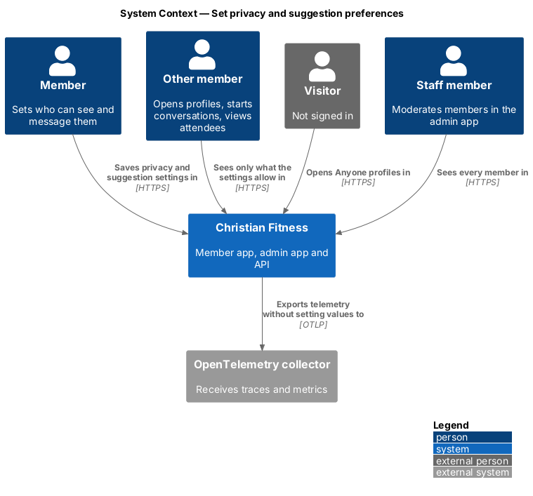
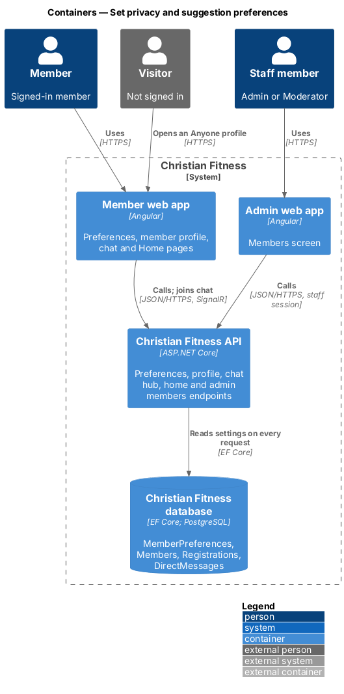
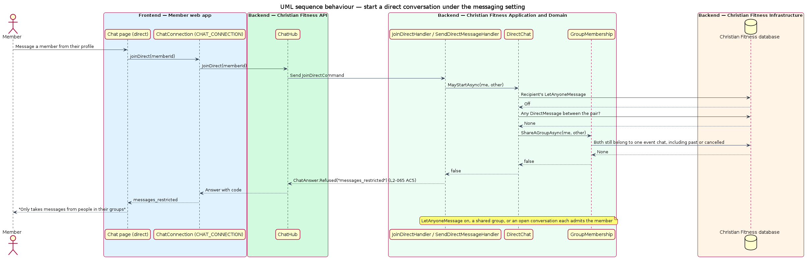

# Set privacy and suggestion preferences

## Overview

Christian Fitness is a Christian community for health in body and spirit in the Greater Toronto Area. The preferences subsystem lets a member choose who can see and message them and what is used to suggest events and stories for them (`L1-019`), and so protects their personal data (`L1-013`).

This feature covers the Privacy and Suggestions sections of the Preferences screen (mock `docs/mocks/pages/preferences/`) and, more importantly, how each setting is enforced by the features it governs. The screen, its draft and its save bar are designed in [set email and notification preferences](../set-email-and-notification-preferences/README.md); a privacy or suggestion change uses that save bar (`L2-065` AC8).

- **profile visibility** — who can open a member's profile: Anyone (including visitors who are not signed in), Members (anyone signed in) or Just my groups; Members for a new member
- **shared group** — event chat both members still belong to, including a past or cancelled event; leaving ends that shared group ([ADR 0075](../../../adr/0075-public-profiles-and-privacy.md)). A series chat joins this once series exist (`L2-052`).
- **attendee list** — names or pictures of the members going to an event or series, as the event page's `avatar-stack` draws them ("Michael, Danielle and 140 others")
- **open conversation** — direct conversation in which at least one message has already been sent between the two members
- **suggestion area** — one of Toronto East, Toronto West, Downtown Toronto, Scarborough, North York, Mississauga, Brampton and Durham
- **not-found view** — the screen and the 404 `not_found` answer that an unknown id gives, so a refused profile reveals nothing (`L2-031` AC3)

## Description

### Settings and storage

- **`MemberPreferences`** — the entity of the sibling feature holds `Visibility` (`ProfileVisibility`: `Anyone`, `Members`, `JustMyGroups`), `ShowOnAttendeeLists`, `LetAnyoneMessage` and `Area` (`SuggestionArea`, none until chosen). `DefaultsFor` gives `Members` (AC1) and `LetAnyoneMessage = false` (AC5). The default of `ShowOnAttendeeLists` is not stated by `L2-065`; the mock shows it on, which is `<TO SUPPLY>` until confirmed.
- **Interests** — the Interests toggles are `Member.Interests`, the profile's own list (AC7, `L2-006`). `SavePreferencesHandler` writes them through a new `Member.ChangeInterests`, with the keys of `Interests.All` checked by `SavePreferencesValidator`, as `UpdateProfileValidator` checks them.
- **Home church** — the existing `Member.ShowHomeChurch` remains the single stored choice; Preferences reads and saves it with the other settings. "Show my home church" defaults off, is independent of visibility, and permits disclosure only to signed-in viewers admitted to the profile. Edit profile no longer changes it; existing choices are preserved (AC10, `L2-033` AC5).
- **Screen parts** — the Privacy section composes `radio-group` ("Who can see your profile", three choices with descriptions) and three `preference-row` switches ("Show my home church", "Show me on attendee lists", "Let anyone message me"). The Suggestions section composes `select` ("Your area") and the `chip` library's `interest` toggles with `aria-pressed` and a check mark as well as colour (AC6); `interestLabel` in `@cf/domain` names each key.
- **Telemetry** — no span, metric or log carries a visibility, an area, an interest or a switch's value (AC9, `L2-033` AC2). Handlers that enforce a setting record no reason for a refusal beyond its code.

### Enforcement: who can see a profile (AC2, AC3)

- **`GetPublicProfileHandler`** (existing, `Application/Profiles/GetPublicProfileQuery.cs`) shall read the target's `MemberPreferences` and the viewer. It answers the profile when the viewer is the member, or when the visibility is `Anyone`; `Members` when a viewer is signed in; `JustMyGroups` when the viewer shares a group with the member. Otherwise it throws the same `RefusalException(not_found)` an unknown id does. A member whose account is being deleted is not found ([download and delete data](../download-and-delete-data/README.md)).
- **What is answered** — the authenticated `PublicProfileDto` has name, bio, interests and home church only where `ShowHomeChurch` is set; it never includes email. The anonymous projection has only name, bio and interests, with no church key regardless of the switch (AC3, AC10, `L2-033` AC5).
- **Anonymous access** — `GET /api/public/members/{id}` is `[AllowAnonymous]`, under `public-reads` (issue #80), and answers only an Anyone profile; all other or unknown ids get the same 404. `/members/:id` removes the member guard and chooses public masthead and "Join to message" without a session, or the current member page with one ([ADR 0075](../../../adr/0075-public-profiles-and-privacy.md)).
- **`GroupMembership.ShareAGroupAsync(db, a, b)`** — new helper in `Application/Chat/` beside `ChatMembership`. It checks current membership of both in one event chat, irrespective of past or cancelled event status; leaving ends membership. The profile and messaging rules both call it (AC11).
- **Staff** — the admin console's member screens (`SearchMembersQuery` and the moderation commands) do not read the visibility, so staff see a member either way (AC2).

### Enforcement: who can message a member (AC5)

- **`DirectChat.MayStartAsync`** — new rule in `Application/Chat/DirectChat.cs`. A conversation may start when the recipient's `LetAnyoneMessage` is on, when the two share a group, when the conversation is already open (a `DirectMessage` exists between the pair in either direction), or when started through Message on the recipient's published, claimed listing. The server verifies the listing and current owner on the initial history, join and first send requests; a member id alone is not listing context (ADR 0066). Otherwise the answer is `messages_restricted`, a new code in `RefusalCodes`.
- **Handlers that shall read it** — `JoinDirectHandler` and `SendDirectMessageHandler` answer `ChatAnswer.Refused("messages_restricted")` over the hub, as a hub refusal is an answer and never an exception; `GetDirectHistoryHandler` answers 403 ProblemDetails with that code over REST. An open conversation stays open, so its history and new messages are unaffected.
- **Contacting a professional** — Message on a published, claimed listing is exempt from the owner's messaging preference (ADR 0066). `RequestBookingHandler` sends through `SendDirectMessageCommand`; the Message exception does not by itself extend to booking requests.
- **Screen** — `PublicProfileDto` gains `messagesRestricted` for a signed-in viewer, so the profile's Message action says that the member only takes messages from people in their groups; the chat page shows the same text when a join answers `messages_restricted`. No mock draws this text yet.

### Enforcement: attendee lists (AC4)

- No attendee list exists in the code: `EventDetailDto` carries only `Going`. The event page mock (`docs/mocks/pages/event-detail/`) draws an `avatar-stack`, and the series designs (`L2-050`, `L2-051`) will draw more. Each query that names or pictures attendees shall exclude members whose `ShowOnAttendeeLists` is off and still count them in going, through `IRegistrationReader`, which shall gain one attendee method so every list applies the rule in one place.
- `GetEventRegistrationsQuery` (staff, `L2-024`) is unaffected: staff still see every member. A host's view of its attendees is not built and no requirement places it yet.

### Enforcement: suggestions (AC6, AC7)

- **`GetHomeHandler`** (existing) suggests the three soonest published events of the categories the member's interests name (`InterestCategories.For`). It orders events by the rule of ADR 0076: (1) the member's area or GTA-wide, then within those (2) events of a followed listing, (3) events matching an interest, (4) the rest, ties by date. Events gain a suggestion area (the eight areas or GTA-wide) chosen in the event editor; the free-text `Event.Area` stays for display, and existing events are mapped by staff review, unmapped ones becoming GTA-wide.
- **Landing page** — the landing page is for visitors and orders by date only; `L2-001` AC8 sends a signed-in member to Home, where the ordering applies (ADR 0076).

### Open questions

- ~~Area matching, landing order and interest list~~ — resolved by ADR 0076: events gain a suggestion area; the order is area, followed host, interest, then the rest; the landing page orders by date only; the interest list is the union, with `INTERESTS` in `@cf/api` as the single source.
- **Privacy Policy wording.** The policy mock says hosts see the name and email of people registered; no host access exists in the code, and `L2-065` AC4 says only that hosts still see attendees (see [read the Privacy Policy and Terms](../../legal/read-privacy-policy-and-terms/README.md)).

## Requirements

The feature realizes the following level-2 (L2) requirements. Each L2 requirement refines a level-1 (L1) requirement, cited by identifier. The L2 specification states its requirements as acceptance criteria; the text below condenses those criteria faithfully.

| L2 ID | Refines (L1) | Requirement |
|-------|--------------|-------------|
| `L2-065` | `L1-019`, `L1-013` | 1. "Who can see your profile" shall be one radio group of Anyone, Members and Just my groups, with Members for a new member. 2. A Members profile shall show the not-found view to a visitor who is not signed in; a Just my groups profile shall show it to a member who shares no group chat; staff shall see it in the admin app either way. 3. An Anyone profile shall show a visitor only name, bio and interests, never the email or home church. 4. With "Show me on attendee lists" off, the member shall be counted in going but not named or pictured to other members; the host and staff still see them. 5. With "Let anyone message me" off, the default, a member who shares no group chat shall be refused a new direct conversation with `messages_restricted` and Message shall say why, except when started through Message on the owner's published, claimed listing; open conversations stay open and replies and blocking follow the usual rules. 6. "Your area" shall be one of eight areas and Interests shall be `aria-pressed` toggles set from the profile, with a check mark as well as colour. 7. Home's suggested events shall be ordered, ties by date, by (1) the member's area or GTA-wide, then within those (2) followed listings' events, (3) interest matches, (4) the rest; the landing page, for visitors, orders by date only; interests saved here are the profile's interests. 8. A change shall use the save bar of `L2-064` AC5 to AC7. 9. No span, metric or log shall carry a setting's value. 10. "Show my home church" shall be off for a new member, independent of visibility, and shown only to signed-in viewers admitted to the profile. 11. A shared event chat shall count while both still belong, including after the event or its cancellation. 12–13. The anonymous endpoint and unguarded page follow [ADR 0075](../../../adr/0075-public-profiles-and-privacy.md). |
| `L2-031` | `L1-013` | 2, 3. Another member's private data shall be refused with 403 or 404 and no data, and guessing ids shall reveal nothing. |
| `L2-033` | `L1-013` | 2, 5. No log, metric or span shall contain personal data; home church shall never be shown or returned anonymously. |

## Diagrams

### System context

Members and visitors reach member profiles and messages in Christian Fitness; each member's privacy settings decide what the others see and who may start a conversation.

### Containers

The Member web app saves the settings through the API; the API's profile, chat and home handlers read them from the database on every request.

### Components

`SavePreferencesHandler` writes `MemberPreferences` and the member's interests. `GetPublicProfileHandler`, the direct-chat handlers, the attendee reader and `GetHomeHandler` read them, with `GroupMembership` deciding whether two members share a group.

### Class structure

`MemberPreferences` holds the visibility, the two switches and the area; the enforcing handlers depend on it and on `GroupMembership`.

### Behaviour — open a member's profile

The handler answers the public fields only when the visibility admits the viewer; any other case is the not-found answer an unknown id gives.

### Behaviour — start a direct conversation

Joining or sending to a member who accepts messages only from their groups is refused with `messages_restricted` unless the two share a group or already have a conversation.

### Behaviour — attendee list and suggestions

An attendee list names only the members who show themselves, while going counts everyone; Home suggests the member's area first, then followed hosts, then interests (ADR 0076).

