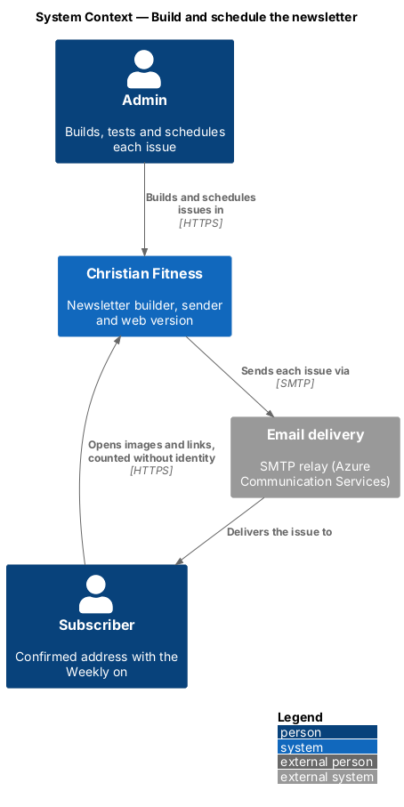
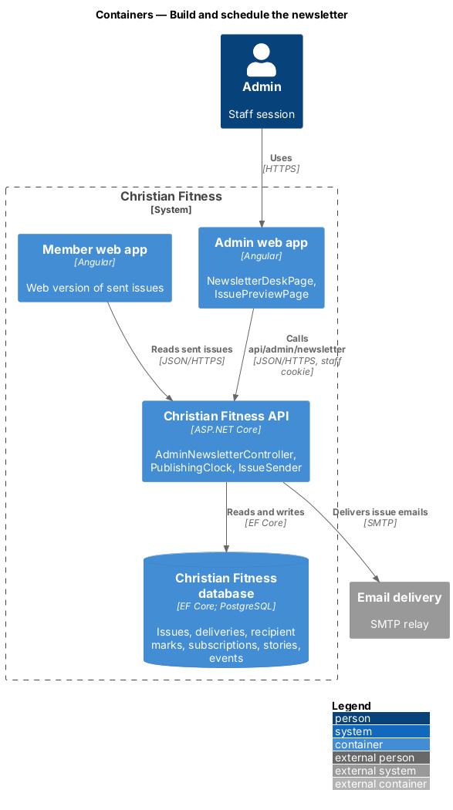
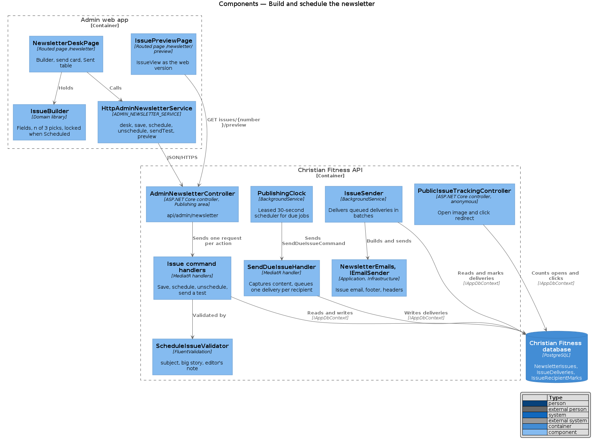
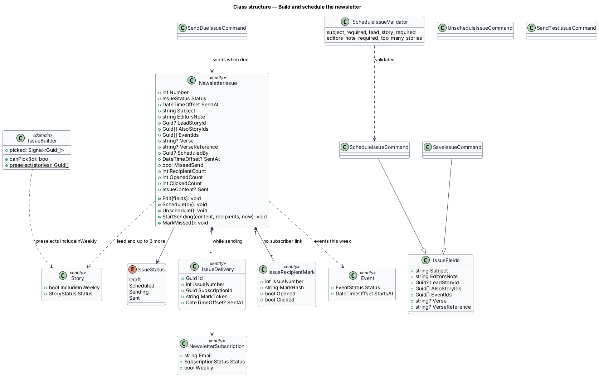
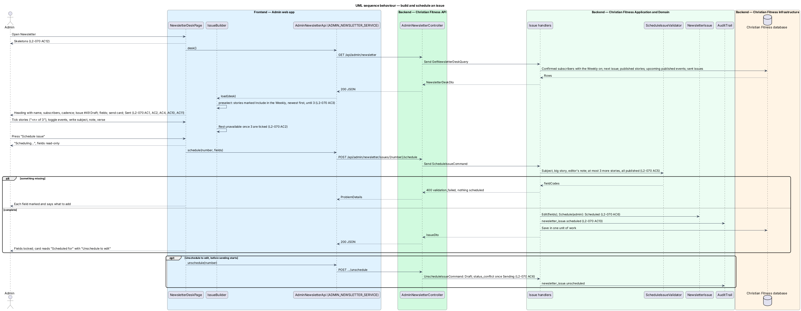
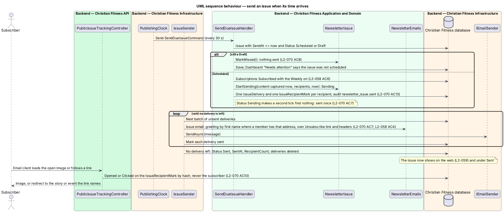
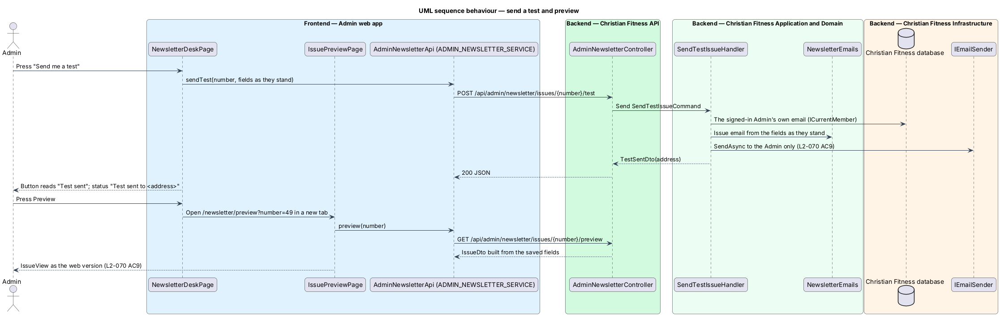

# Build and schedule the newsletter

## Overview

Each Saturday at 7 AM The Abundant Weekly goes to every confirmed subscriber (`L1-018`). An Admin
builds each issue in the Admin web app from published stories and events, tests it, and schedules
it; at its time the system sends it once and keeps it on the web (`L1-022`). This feature is the
console's Newsletter screen (mock `docs/mocks/pages/admin-newsletter/`, states `default`,
`invalid`, `submitting`, `scheduled`, `test-sent`, `loading` and `error`) and the sending behind
it.

- **issue** — one numbered edition of the newsletter, Draft, Scheduled, Sending or Sent
- **next issue** — the one issue not yet sent, which the screen builds
- **send time** — date and time an issue goes out, shown in Eastern time (`America/Toronto`)
- **big story** — the issue's lead, chosen from the published stories
- **also this week** — up to three more published stories ("<n> of 3")
- **confirmed subscriber** — Subscribed address with the Weekly on (`news/subscribe-to-newsletter`)
- **missed issue** — issue still a Draft when its send time passed, so nothing was sent
- **recipient mark** — per-recipient random mark, stored only as a hash with no link to the subscriber, that counts an open or a click once
- **add-on emails** — event alerts, the training plan and devotions, which send on their own schedules and are not built here

The screen shows the newsletter's name, confirmed subscribers and cadence; the next issue's
number and status; its Subject line, Editor's note, The big story, Also this week, Events this
week and a Verse to carry with its Reference; a send card with the time, time zone and number of
recipients, "Schedule issue", Preview and "Send me a test"; and Sent, with each sent issue's
share of opens and clicks.

## Description

### Admin web app

- **`NewsletterDeskPage`** — routed page at `newsletter` in `projects/admin`, loaded with
  `loadComponent` under the staff shell, in the Publish group of the navigation. Its `providers`
  bind `ADMIN_NEWSLETTER_SERVICE` to `HttpAdminNewsletterService` and an `IssueBuilder`. It renders
  the mock's `split split--builder` layout with library components: `TextField` (subject, verse,
  reference), `Textarea` (editor's note), `Select` (the big story), `Checkbox` rows (block
  `pick-row`) for Also this week with "<n> of 3", toggle `Button`s with `aria-pressed` for Events
  this week (block `interest`), the `send-card` composite ("Goes out" or "Scheduled for", date,
  "7:00 AM Eastern · <n> people", Schedule issue or "Unschedule to edit", Preview, Send me a test,
  `p role="status"`), the note on add-on emails (`L2-070` AC11), and a `Table` of sent issues.
  Loading shows skeletons, a failure "The newsletter didn't load" with Try again (`L2-070` AC12).
  A Moderator opens Newsletter as an Admin does (`StaffArea.Newsletter`, open to both roles; Stories alone is `StaffArea.Publishing`, Admins only; `L2-019` AC1, ADR 0064).
- **`IssueBuilder`** — signal store in the `domain` library: the fields, the picks, the status and
  a state (`idle`, `scheduling`, `invalid`, `scheduled`, `failed`). `preselect(stories)` ticks the
  stories marked "Include in the Weekly", newest first, until three are ticked (`L2-070` AC3).
  `canPick(id)` is false for every unticked story once three are ticked, so the rest show as
  unavailable (`L2-070` AC2). In `scheduled` every field is read-only (`L2-070` AC6). `fieldCodes`
  mark each field `aria-invalid` with what to add ("Add a subject line before scheduling.";
  `L2-070` AC5). Unit tests cover each rule.
- **`IssuePreviewPage`** — routed page at `newsletter/preview` in `projects/admin`, opened by
  Preview in a new tab; it renders the components library's `IssueView`
  (`news/read-newsletter-on-web`) from `GET …/issues/{number}/preview` (`L2-070` AC9). The mock's
  Preview links to the member app's `/newsletter`, which shows only sent issues.
- **`AdminNewsletterApi` / `ADMIN_NEWSLETTER_SERVICE`** — contract and token in the `api` library:
  `desk()`, `save(number, fields)`, `schedule(number, fields)`, `unschedule(number)`,
  `sendTest(number, fields)` and `preview(number)`.

### Christian Fitness API

- **`AdminNewsletterController`** — under `api/admin/newsletter` (area `StaffArea.Newsletter`,
  Admins and Moderators); each action sends one MediatR request: `GET` (`GetNewsletterDeskQuery`),
  `PUT issues/{number}` (`SaveIssueCommand`), `POST issues/{number}/schedule`,
  `POST issues/{number}/unschedule`, `POST issues/{number}/test` and `GET issues/{number}/preview`.
- **`GetNewsletterDeskQuery`** / handler — answers the name and cadence (settings of
  `news/subscribe-to-newsletter`), the number of confirmed subscribers (`L2-070` AC1), the next
  issue (number, status, send time, fields, `missedSend`), the published stories newest first
  with section, age and `includeInWeekly`, the published upcoming events of the issue's week, and
  the sent issues newest first with number, date, subject and opened and clicked shares
  (`L2-070` AC10). When no next issue exists it creates Draft number n + 1 with the next cadence
  time (Saturday 7:00 AM Toronto, through `EventSchedule`).
- **`NewsletterIssue`** — entity in `ChristianFitness.Domain/Newsletter` (fields in the class
  diagram). `Schedule(by)` and `Unschedule()` move between Draft and Scheduled; `Unschedule` from
  Sending or Sent throws and the handler refuses with 409 `status_conflict`, so an issue can be
  unscheduled until the moment sending starts (`L2-070` AC6).
- **`ScheduleIssueCommand`** with **`ScheduleIssueValidator`** — refuses an empty subject, no big
  story or an empty editor's note with 400 `validation_failed` and `fieldCodes`
  `subject_required`, `lead_story_required` and `editors_note_required`; more than three more
  stories (`too_many_stories`) or a story or event no longer published (`story_unavailable`,
  `event_unavailable`) are refused the same way (`L2-070` AC2, AC5). A complete issue is saved and
  Scheduled. Audited as `newsletter_issue.scheduled`; `UnscheduleIssueCommand` as
  `newsletter_issue.unscheduled` (`L2-070` AC13; ADR 0023).
- **`SendTestIssueCommand`** / handler — builds the issue email from the fields as they stand and
  sends it through `IEmailSender` to the signed-in Admin's own address only (`ICurrentMember`),
  answering that address for the status message "Test sent to <address>" (`L2-070` AC9). No
  unsubscribe token or recipient mark is issued for a test.
- **`SendDueIssueCommand`** / handler — sent by `PublishingClock` every 30 seconds
  (`write-review-publish-story`). For the issue whose send time has passed:
  - still a Draft: `MarkMissed()` and nothing is sent; the Dashboard's "Needs attention" says the
    issue was not scheduled (`L2-070` AC8; `admin-dashboard/view-dashboard`), and the Admin may
    schedule it for a later time the same day;
  - Scheduled: `StartSending` captures the `IssueContent` (`news/read-newsletter-on-web`), sets
    Sending, and writes one `IssueDelivery` (subscription, a fresh random mark token) and one
    `IssueRecipientMark` (the mark's hash only) per confirmed subscriber, in one unit of work, so
    a second tick finds nothing to send (`L2-070` AC7). Audited as `newsletter_issue.sent` against
    the Admin who scheduled it.
- **`IssueSender`** — `BackgroundService` in Infrastructure that takes unsent `IssueDelivery` rows
  in batches, composes each email through `NewsletterEmails` (greeting by first name where a member
  account has that address, else none; the subscriber's own Unsubscribe link and `List-Unsubscribe`
  headers, `L2-058` AC4; an open image and links carrying the mark), hands it to `IEmailSender` and
  marks the delivery sent. With none left it sets the issue Sent with `SentAt` and
  `RecipientCount` and deletes the deliveries, which ends every link between a mark and a
  subscriber. The issue then shows on the web (`L2-059`) and under Sent.
- **`PublicIssueTrackingController`** — `[AllowAnonymous]`, no cookie:
  `GET api/public/newsletter/o/{mark}` answers a 1 × 1 image and sets `Opened` on the matching
  `IssueRecipientMark`; `GET api/public/newsletter/c/{mark}/{target}` sets `Clicked` (and `Opened`)
  and redirects to the story or event the target id names, never to a URL from the request. The
  issue's `OpenedCount` and `ClickedCount` count marks, so each recipient counts once and the
  shares are counts over `RecipientCount`, with no record of which subscriber did either
  (`L2-070` AC10). Routes are recorded as templates; no mark is logged.

### Open questions

- **Bulk sending and the email queue.** `QueuedEmailSender` holds at most 500 messages and drops
  the newest when full (ADR 0010). An issue to 6,800 addresses through it would lose mail; the
  `IssueDelivery` table is this design's durable queue, and `IssueSender` needs back-pressure from
  the transport (or a transport-level batch API) before it hands over more. The required
  `Email:MaxPerMinute` and `Email:MaxPerDay` settings size and rate-limit the sender to the
  relay's limits; neither has a hard-coded value. The transport integration needs an ADR.
- **Saving a draft issue.** The mock has no Save button and no saved indicator, and `L2-070` says
  nothing of keeping a draft between visits. The design saves fields with `SaveIssueCommand` after
  a pause, as the story editor does; that behaviour, and its interval, need confirming and a mock
  state.
- **Rescheduling a missed issue.** `L2-070` AC8 lets a missed issue be scheduled for a later time
  the same day, but the send card has no time field. A mock state and the rule for the time (any
  later time that day, Toronto) are `<TO SUPPLY>`.
- **Events this week and On the calendar.** The builder toggles events; the web version shows "the
  next four published events at the time of sending" (`L2-059` AC1). See
  `news/read-newsletter-on-web`.
- **Opens and clicks.** An open image is blocked or prefetched by many mail clients, so open shares
  are estimates. Whether tracking images and redirected links are acceptable under the Privacy
  Policy (`L2-067`) is `<TO SUPPLY>`.
- **Who scheduled a sent issue.** The audit entry for `newsletter_issue.sent` names the Admin who
  scheduled it, since the clock has no member; whether that is the intended "who" is `<TO SUPPLY>`.
- **Add-on emails.** They "send on their own schedules" (`L2-070` AC11), but nothing builds or
  schedules them (`docs/mocks/README.md`, open question 14).
- **First name of a subscriber.** A subscriber is greeted by first name "where one is known"; the
  only source is a member account with the same address, which `L2-033` treats as personal data
  read only at sending.

## Requirements

The feature realizes the following level-2 (L2) requirement. Each L2 requirement refines a level-1
(L1) requirement, cited by identifier. The specification states its requirements as acceptance
criteria; the text below condenses those criteria faithfully.

| L2 ID    | Refines (L1)       | Requirement |
| -------- | ------------------ | ----------- |
| `L2-070` | `L1-022`, `L1-018` | Newsletter shall show the newsletter's name, how many subscribers are confirmed and when it is sent, and the next issue with its number and status (Draft or Scheduled). The issue shall have a Subject line, an Editor's note, "The big story" chosen from published stories, "Also this week" with up to three more published stories ticked ("<n> of 3", the rest unavailable once three are ticked), "Events this week" as toggles over published upcoming events, and a Verse to carry with its Reference. Stories marked "Include in the Weekly" shall be ticked under "Also this week" until three are, newest first. The send card shall show the date and time, the time zone, how many people it goes to, and "Schedule issue". An empty subject, no big story or an empty editor's note shall schedule nothing and mark the field with what to add. A complete issue shall become Scheduled with its fields locked, the card reading "Scheduled for" with "Unschedule to edit", which makes it a Draft again until sending starts. At its time a Scheduled issue shall be sent once to every confirmed subscriber with the newsletter on, greeting each by first name where known and carrying their own Unsubscribe link, and shall appear on the web and under "Sent". An issue still a Draft at its time shall send nothing, be named in the Dashboard's "Needs attention", and be schedulable for a later time the same day. "Send me a test" shall send the issue as it stands only to the Admin's own address, read "Test sent" and name the address in a `status` message; Preview shall open the web version in a new tab. "Sent" shall show each issue's number, date, subject and the shares who opened and clicked, counted without storing which subscriber did either. The screen shall say the add-on emails send on their own schedules. Loading shall show skeletons; a failure shall offer Try again; a Moderator shall use it as an Admin does (ADR 0064). Scheduling, unscheduling and sending shall each record an audit entry of who and which issue. |

## Diagrams

### System context

An Admin builds and schedules issues in Christian Fitness, which sends them through the email
delivery service and counts opens and clicks without identifying subscribers.

### Containers

The Admin web app calls `api/admin/newsletter`; the API keeps issues and deliveries in the
database, sends through SMTP, and serves sent issues to the Member web app.

### Components

`NewsletterDeskPage` drives `IssueBuilder` and calls `ADMIN_NEWSLETTER_SERVICE`;
`PublishingClock` sends `SendDueIssueCommand`, `IssueSender` delivers each email, and
`PublicIssueTrackingController` counts opens and clicks.

### Class structure

A `NewsletterIssue` references its stories and events, owns its deliveries while sending and its
recipient marks, which hold no subscriber link.

### Behaviour — build and schedule an issue

The screen preselects stories marked for the Weekly; scheduling refuses a missing subject, big
story or note, and otherwise locks the issue until it is unscheduled (`L2-070` AC1–AC6, AC13).

### Behaviour — send an issue

At its time a Scheduled issue is captured and queued once per confirmed subscriber and sent in
batches; a Draft is marked missed (`L2-070` AC7, AC8, AC10, AC13).

### Behaviour — send a test and preview

A test goes only to the Admin's own address; Preview opens the web version in the admin app
(`L2-070` AC9).

