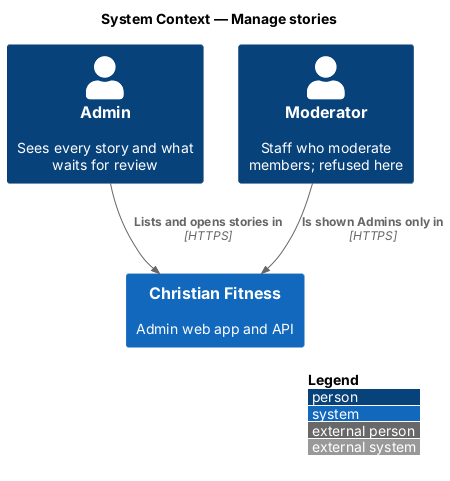
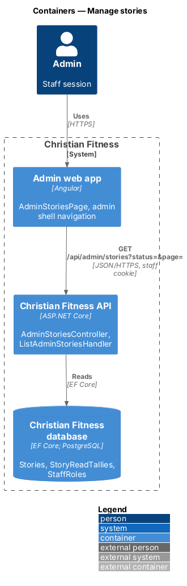
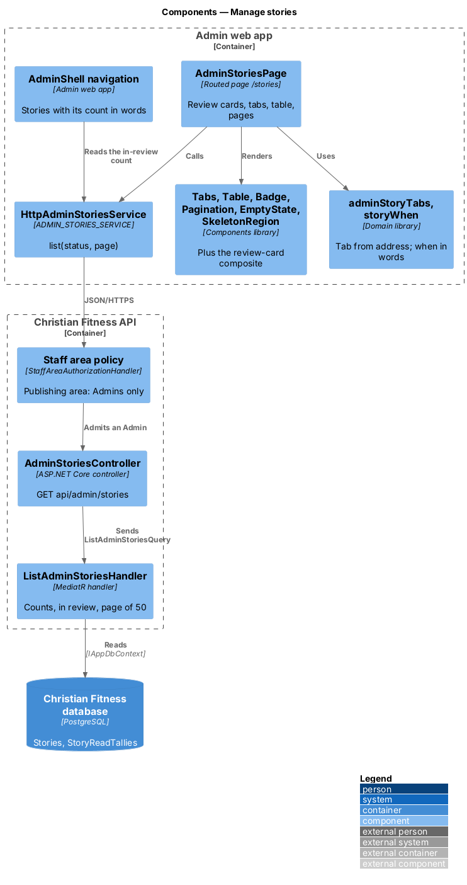
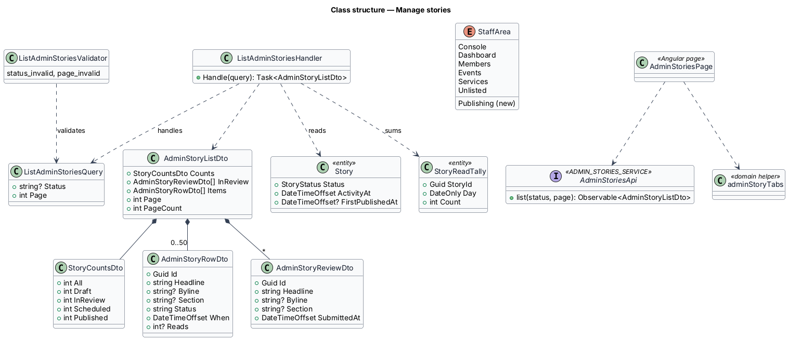
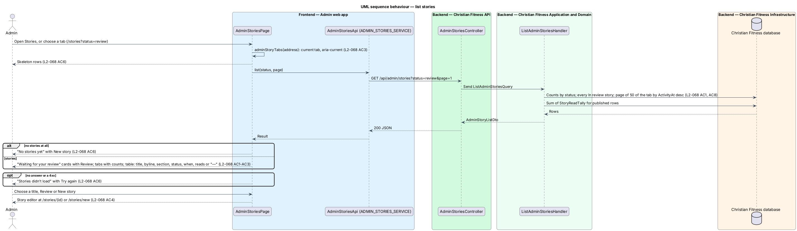
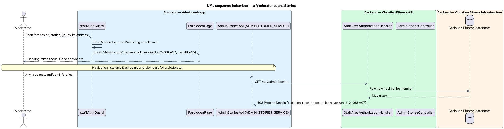

# Manage stories

## Overview

Stories is the Admin web app's list of every story, whatever its status, and the way into the
story editor (`L1-022`). It shows what is waiting for review above the list, filters by status,
and tells an Admin how often each published story was read. It sits in the console's Publish
group beside Newsletter (`L2-021`).

- **story status** — one of Draft, In review, Scheduled and Published (`L2-068`)
- **review card** — call-out above the list for one story In review, with Review
- **newest activity** — the latest of a story's edit, submission, schedule and publication, which orders the list
- **when** — the instant a row shows for its status: edited (Draft), submitted (In review), scheduled for (Scheduled) or published (Published)
- **reads** — sum of a published story's daily read tallies (`news/read-story`)

The screen is `docs/mocks/pages/admin-stories/` (states `default`, `filtered`, `loading`, `empty`
and `error`). The editor it opens is designed in `write-review-publish-story`. Only Admins open
it; a Moderator sees "Admins only" (`L2-019` AC5).

## Description

### Admin web app

- **`AdminStoriesPage`** — routed page at `stories` in `projects/admin`, loaded with
  `loadComponent` under the staff shell; its `providers` bind `ADMIN_STORIES_SERVICE` to
  `HttpAdminStoriesService`. It renders the `page-head` with "Stories", the subtitle and New story
  (to `/stories/new`), then:
  - one review card per story In review (mock block `review-card`: "Waiting for your review ·
    Submitted <when>", the headline, byline and section, and Review to `/stories/{id}`; `L2-068`
    AC2), built from the library's `Card` and `Button`;
  - the library's `Tabs` as links All, Draft, In review, Scheduled and Published with each count
    (`tabs__count`), the current one with `aria-current="page"`, and the choice in the address as
    `?status=draft|review|scheduled|published` (`L2-068` AC3);
  - the library's `Table` (`table--wide`): the headline as a link to the editor with the byline
    under it, section, a `Badge` with the status in words (`status--draft`, `status--review`,
    `status--scheduled`, `status--published`), when, and Reads, which shows the count for a
    published story and "—" with "Not published" for assistive technology otherwise (`L2-068`
    AC1, AC4);
  - the library's `Pagination` below 50 rows (`?page=`; `L2-068` AC8).

  Loading shows `SkeletonRegion` rows; no stories at all shows `EmptyState` "No stories yet" with
  New story; a request with no answer or a 4xx shows "Stories didn't load" with Try again, and a
  5xx the server-error screen (`L2-068` AC6; `L2-043` AC4). A tab with no stories is not drawn
  (`<TO SUPPLY>`; the events screen's `tab-empty` is the likely pattern).
- **`adminStoryTabs`** — pure helper in the `domain` library, as `admin-event-tabs` is for events:
  the address's `status` to a tab (an unknown value is All) and each tab's link.
- **`storyWhen`** — pure helper in the `domain` library: a row's status and instant to "Edited
  yesterday", "Submitted 1 hour ago", "Sat Apr 18, 6:00 AM" or "Today, 7:12 AM" in
  `America/Toronto`. The full wording table is `<TO SUPPLY>` beyond the mock's rows.
- **Navigation** — `ADMIN_AREAS` (`domain/src/admin/admin-areas.ts`) gains `stories` and
  `newsletter` in the Publish group; Stories is outside a Moderator's areas, Newsletter is inside them (ADR 0062). Stories carries the number of
  stories in review as `admin-nav__count` with `aria-label` "1 story to review" / "<n> stories to
  review" (`L2-068` AC5). Where the shell reads that count is set with the grouped navigation
  (`admin-access/navigate-admin-app`); the list's `counts.inReview` is the same number.
- **`AdminStoriesApi` / `ADMIN_STORIES_SERVICE`** — the contract of `write-review-publish-story`;
  this screen uses `list(status, page)`.

### Christian Fitness API

- **`AdminStoriesController`** — `GET api/admin/stories?status=&page=` sends one
  **`ListAdminStoriesQuery`**. The `stories` segment maps to `StaffArea.Publishing`, which only
  Admins pass; a Moderator is refused by `StaffAreaAuthorizationHandler` with 403 `forbidden_role`
  before any controller runs, on this and every other stories endpoint (`L2-068` AC7; ADR 0020, ADR 0062).
- **`ListAdminStoriesValidator`** — refuses an unknown status or a page below 1 with 400
  `validation_failed` (`fieldCodes` `status_invalid`, `page_invalid`).
- **`ListAdminStoriesHandler`** — answers `AdminStoryListDto`: `counts` by status (All, Draft, In
  review, Scheduled, Published), `inReview` (every In review story, oldest submission first,
  as `AdminStoryReviewDto`), and `items`, one page of at most 50 `AdminStoryRowDto` of the tab,
  ordered by `Story.ActivityAt` newest first then `Id` (`L2-068` AC1, AC8; `L2-036` AC2), with
  `page` and `pageCount`. `when` is chosen by status as defined above; `reads` is the sum of the
  story's `StoryReadTally` rows for a story that has been published, and null for one never
  published (`L2-068` AC1).
- **Telemetry and audit** — a list changes nothing and is not audited; spans carry the route
  template only.

### Open questions

- **Reads of an unpublished story.** Decided (issue 91): an unpublished story keeps its count
  (`L2-068` AC1).
- **Review cards.** Decided (issue 91): at most 3 above the list, then "All {n} in review"
  (`L2-068` AC2).
- **Moderators and the new areas.** Settled by ADR 0062 and `L2-019` AC1: Stories stays Admins only
  (`L2-068` AC7); Newsletter, Event series, Community Pick, Listings and Feedback are open to a
  Moderator too.

## Requirements

The feature realizes the following level-2 (L2) requirements. Each L2 requirement refines a
level-1 (L1) requirement, cited by identifier. The specification states its requirements as
acceptance criteria; the text below condenses those criteria faithfully.

| L2 ID    | Refines (L1) | Requirement |
| -------- | ------------ | ----------- |
| `L2-068` | `L1-022`     | A story shall be a Draft, In review, Scheduled or Published. Stories shall list every story, newest activity first, with title, author, section, status, when (edited, submitted, scheduled for or published) and, once published, how many times it was read; a story never published shall show no count. Each story in review shall be called out above the list with "Waiting for your review", when submitted, title, author and section, and Review, which opens it in the editor. The tabs All, Draft, In review, Scheduled and Published shall show only stories of that status, mark the current tab, show each count and carry the choice in the address. A row's title shall open the story in the editor; "New story" shall open an empty draft. The navigation's Stories shall carry the number of stories in review, in words for assistive technology ("1 story to review"). Loading shall show skeleton rows; no stories shall show an empty state with New story; a failure shall offer Try again. A Moderator opening Stories or any story by its address shall see "Admins only", and every stories endpoint shall refuse them with `forbidden_role`. More than 50 stories shall be paged 50 at a time. |
| `L2-019` | `L1-008`     | A Moderator opening an area by its address shall see the "Admins only" screen in place while the address is kept, and a read the API refuses with `forbidden_role` shall show the same screen (AC5). |

## Diagrams

### System context

An Admin lists and opens stories in Christian Fitness; a Moderator is refused.

### Containers

The Admin web app asks the API for one page of stories with the staff session; the API reads
stories and their read tallies.

### Components

`AdminStoriesPage` calls `ADMIN_STORIES_SERVICE`; the staff area policy admits Admins to
`AdminStoriesController`, which sends `ListAdminStoriesQuery`.

### Class structure

`ListAdminStoriesHandler` reads `Story` and sums `StoryReadTally` into an `AdminStoryListDto` of
counts, review cards and at most 50 rows; `StaffArea` gains `Publishing`.

### Behaviour — list stories

Each tab asks for its page of stories with the counts and the review queue; empty and failed
loads show their states (`L2-068` AC1–AC4, AC6, AC8).

### Behaviour — a Moderator opens Stories

The guard shows "Admins only" in place, and the API refuses every stories request with
`forbidden_role` (`L2-068` AC7).

