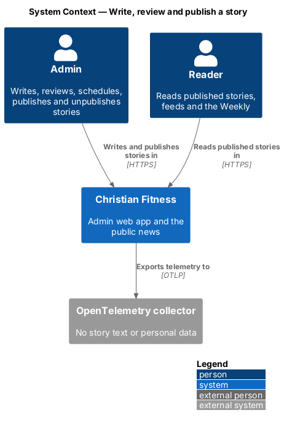
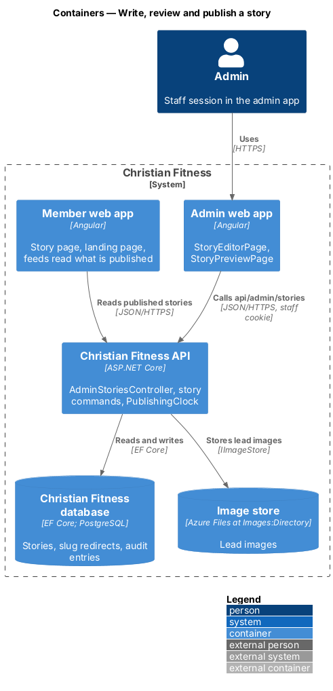
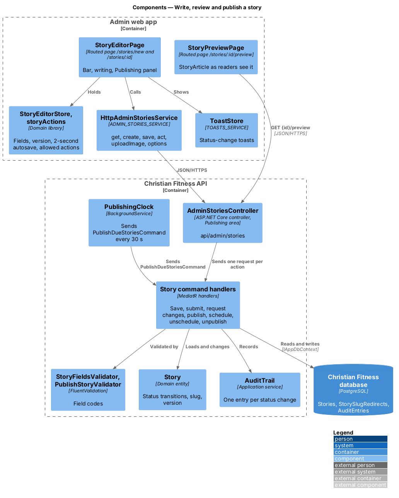
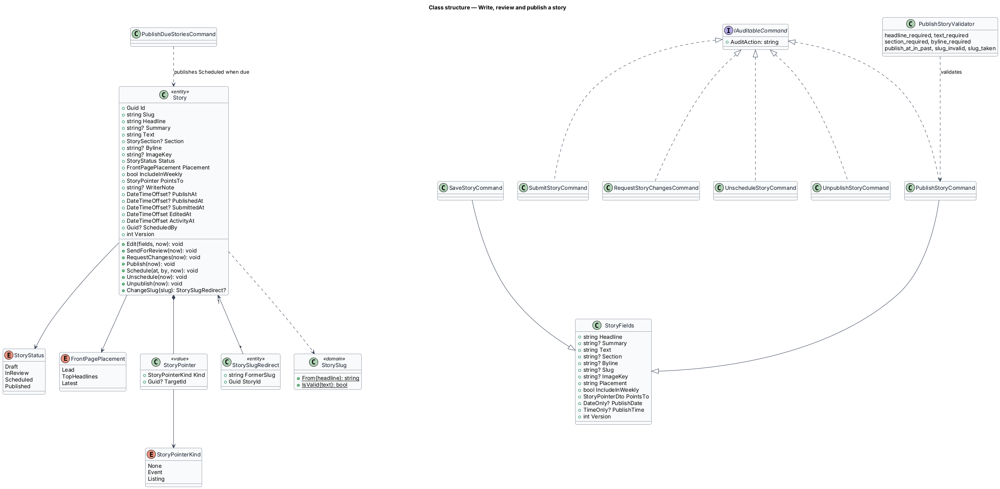
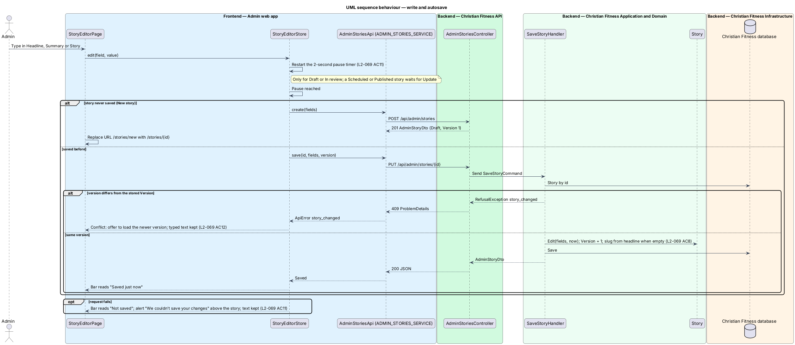
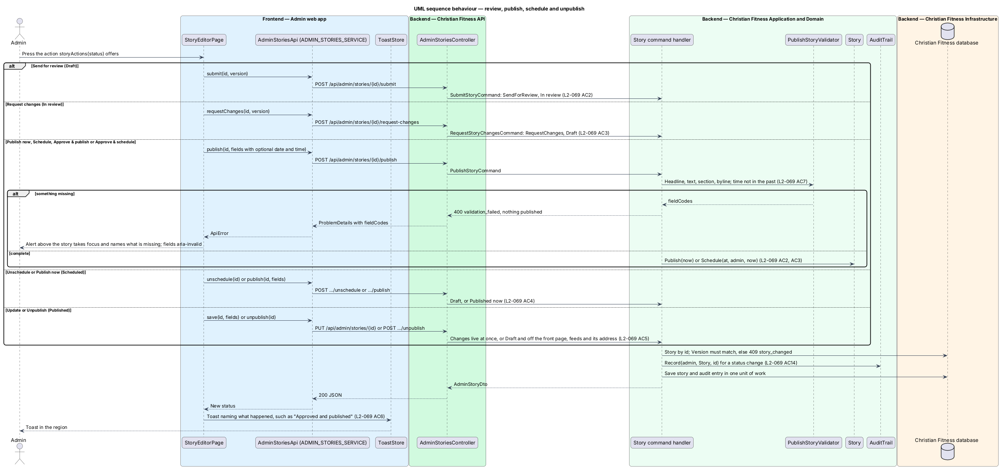
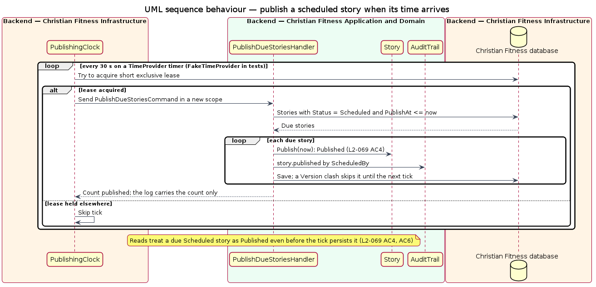
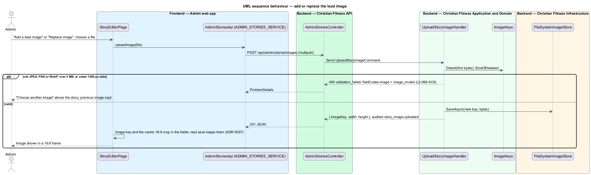

# Write, review and publish a story

## Overview

Staff write the community's stories in the Admin web app, send them for review, and publish them
at once or at a chosen time; a published story can be updated or unpublished (`L1-022`). What an
Admin publishes here is what the public reads on the landing page (`L2-001`), on the story page
(`news/read-story`), in the RSS feeds (`news/publish-rss-feeds`) and in the next issue of the
Weekly (`build-and-schedule-newsletter`).

- **story status** — one of Draft, In review, Scheduled and Published (`L2-068`)
- **writer's note** — note from the story's writer to the reviewer, shown above an In review story
- **Publishing panel** — side panel of the editor: when, front-page placement, the Weekly, section, byline, what the story points to, and its link
- **front-page placement** — where a published story sits on the landing page: Lead story, Top headlines or The latest
- **autosave** — save of a Draft or In review story 2 seconds after the Admin stops typing
- **version** — number the server increases on each save, used to refuse a save over a version the Admin has not seen
- **scheduled time** — date and time in `America/Toronto` at which a Scheduled story publishes itself

The editor is a screen of its own, not a drawer (`docs/mocks/README.md`, "Story editor"; mock
`docs/mocks/pages/admin-story-editor/`, states `new`, `draft`, `default` (in review), `saving`,
`failed`, `invalid`, `scheduled`, `published`, `approved`, `loading` and `error`). Its bar shows a
way back to Stories, the status, when the story was last saved, Preview and the actions its status
allows.

| Status    | Actions in the bar                                         |
| --------- | ---------------------------------------------------------- |
| Draft     | Send for review; Publish now, or Schedule with a time      |
| In review | Request changes; Approve & publish, or Approve & schedule  |
| Scheduled | Unschedule; Publish now                                    |
| Published | Unpublish; Update                                          |

## Description

### Admin web app

- **`StoryEditorPage`** — routed page at `stories/new` and `stories/:id` in `projects/admin`,
  loaded with `loadComponent` under the staff shell. Its `providers` bind
  `ADMIN_STORIES_SERVICE` to `HttpAdminStoriesService`, `TOASTS_SERVICE` to `ToastStore` and a
  `StoryEditorStore`. It renders the mock's `editor` block (`editor__bar`, `editor__grid`,
  `editor__image`, `editor__writing`, `editor__side`) and the `editor-note` block with the
  writer's note for an In review story (`L2-069` AC3). Every part is the components library's:
  `Button` (bar actions, `aria-busy` while one runs), `Badge` for the status, `Textarea` for
  Headline, Summary and Story, each with a visible label (`L2-069` AC1), `RadioGroup` for When with
  `TextField` date and time, `Select` for front page, section, byline and "Points readers to",
  `Checkbox` "Include in the Weekly" with the next issue's number and date, `TextField` with the
  `/stories/` prefix for the link, `Alert` above the story, and `ToastRegion`. The panel's note
  names the feeds the story goes to ("Goes to the All stories and Nutrition RSS feeds when
  published"). A 404 `not_found` shows the admin not-found page; loading shows skeletons; another
  failure shows "This story didn't load" with Try again and Stories (`L2-069` AC15).
- **`StoryEditorStore`** — signal store in the `domain` library, on the page's `providers`: the
  fields, status, version, `savedAt` and a state (`idle`, `saving`, `acting`, `failed`,
  `invalid`, `conflict`). For Draft and In review it saves 2,000 ms after the last edit and
  restarts the pause on each keystroke; for Scheduled and Published nothing saves until an action
  is pressed (`L2-069` AC11). A failed save keeps the fields and sets `failed`; a 409
  `story_changed` sets `conflict`, which offers to load the newer version and keeps what was typed
  until the Admin chooses (`L2-069` AC12). `fieldCodes` from a refusal mark each field
  `aria-invalid` and fill the alert, which takes focus (`L2-069` AC7). Its timer ends with the page.
  Unit tests advance a fake clock.
- **`storyActions(status, hasScheduledTime)`** — pure helper in the `domain` library answering the
  table above; the primary action reads "Schedule" or "Approve & schedule" when a date and time are
  chosen (`L2-069` AC2, AC3).
- **`StoryPreviewPage`** — routed page at `stories/:id/preview` in `projects/admin`, opened by
  Preview in a new tab. It reads `GET /api/admin/stories/{id}/preview` and renders the components
  library's `StoryArticle` (`news/read-story`), so an Admin sees the story as readers will,
  whatever its status (`L2-069` AC13). The member app cannot show a draft: it serves published
  stories only and holds no staff session (ADR 0047 keeps the two apps on separate origins).
- **`AdminStoriesApi` / `ADMIN_STORIES_SERVICE`** — contract and token in the `api` library:
  `list` (`manage-stories`), `get`, `create`, `save`, `submit`, `requestChanges`, `publish`,
  `unschedule`, `unpublish`, `uploadImage`, `preview` and `options` (bylines, the published events
  and listings a story may point to, and the next issue's number and date).

### Christian Fitness API

- **`AdminStoriesController`** — under `api/admin/stories`; each action sends one MediatR request:
  `POST` (create a Draft), `GET {id}`, `PUT {id}` (save or Update), `POST {id}/submit`,
  `POST {id}/request-changes`, `POST {id}/publish`, `POST {id}/unschedule`, `POST {id}/unpublish`,
  `POST images`, `GET {id}/preview` and `GET options`. The `stories` segment maps to a new
  `StaffArea.Publishing` (with `newsletter`), which `StaffAccess` allows to Admins only; until it
  exists the segment falls to `StaffArea.Unlisted`, which refuses Moderators the same way
  (`L2-068` AC7; ADR 0020).
- **`Story`** — entity in `ChristianFitness.Domain/News` (fields in the class diagram). Its methods
  are the only way a status changes: `SendForReview`, `RequestChanges`, `Publish`, `Schedule`,
  `Unschedule`, `Unpublish`. A transition its status does not allow throws, and the handler refuses
  it with 409 `status_conflict` (existing code). `Version` is an EF Core concurrency token. `Edit`
  sets `EditedAt` and `ActivityAt`; every status change sets `ActivityAt`, which orders Stories.
- **`StoryFields`** / **`StoryFieldsValidator`** — the editor's fields, shared by
  `CreateStoryCommand`, `SaveStoryCommand` and `PublishStoryCommand` as `EventFields` is for events
  (ADR 0025). Lengths are `<TO SUPPLY>`. The slug, when given, holds only lowercase letters, digits
  and hyphens (`slug_invalid`) and is unique among stories and former slugs (`slug_taken`); when
  empty, `StorySlug.From(headline)` makes it, adding a number on a clash (`L2-069` AC8).
- **`SaveStoryCommand`** / handler — refuses a `Version` other than the stored one with 409
  `story_changed` (`L2-069` AC12), else applies `Edit`. A slug changed on a story that has been
  published adds a `StorySlugRedirect` from the earlier slug (`L2-069` AC8; `L2-061` AC8). On a
  Published story this is Update, live at once (`L2-069` AC5).
- **`PublishStoryCommand`** with **`PublishStoryValidator`** — saves the fields, then requires a
  headline, text, section and byline, and a scheduled time after now (`TimeProvider`), else 400
  `validation_failed` with `fieldCodes` `headline_required`, `text_required`, `section_required`,
  `byline_required` or `publish_at_in_past`, publishing nothing (`L2-069` AC7). With no time it
  calls `Publish(now)`; with one it turns the Toronto date and time into UTC with the existing
  `EventSchedule` and calls `Schedule(at, admin, now)` (`L2-069` AC2–AC4). Publishing as Lead
  story makes it the front page's lead (`L2-069` AC6).
- **`SubmitStoryCommand`**, **`RequestStoryChangesCommand`**, **`UnscheduleStoryCommand`**,
  **`UnpublishStoryCommand`** — one status change each. Unpublish makes the story a Draft, so the
  landing page, the feeds and `/stories/<slug>` stop showing it at once (`L2-069` AC5).
- **Audit** — each status command is an `IAuditableCommand`: `story.submitted`,
  `story.changes_requested`, `story.published`, `story.scheduled`, `story.unscheduled` and
  `story.unpublished`, recorded by `AuditTrail` with the Admin and the story's id in the same unit
  of work (`L2-069` AC14; ADR 0023).
- **`UploadStoryImageCommand`** / handler — the event image rules reused: `ImageKeys.Detect` reads
  the type from the first bytes, at most 5 MB, stored through `IImageStore`; a new
  `ImageKeys.WidthOf` reads the width from the JPEG, PNG or WebP header, and under 1,600 px is
  refused with `fieldCodes.image` = `image_invalid` (`L2-069` AC9). Audited as
  `story_image.uploaded`. A story may be published without an image.
- **`PublishingClock`** — `BackgroundService` in Infrastructure with a 30-second timer from
  `TimeProvider`. Each tick sends **`PublishDueStoriesCommand`** in a new scope; its handler
  publishes every Scheduled story whose `PublishAt` has passed and audits `story.published` against
  the Admin who scheduled it, so a story is published within a minute of its time (`L2-069` AC4).
  The same clock sends `SendDueIssueCommand` (`build-and-schedule-newsletter`).
- **`GetStoryPreviewQuery`** — answers the reader's `PublishedStoryDto` shape for any status, to
  Admins only.

### Open questions

- **Scheduler.** The specification sets "within a minute" but not the mechanism. An in-process
  `BackgroundService` fits ADR 0047's single replica; a second replica would publish twice without
  a lease or a database lock. An alternative treats a Scheduled story whose time has passed as
  Published in every read, with no timer. Either choice needs an ADR, and whether
  `NewsletterUpkeep` (`news/confirm-and-unsubscribe`) is the same service.
- **Who writes stories.** The editor shows a writer's note and "Request changes … tells the
  writer", but bylines are not staff and staff roles are Admin and Moderator
  (`docs/mocks/README.md`, open question 7). Where the note comes from and how the writer is told
  are `<TO SUPPLY>`; the bylines list (a fixed list in the mock) needs a source.
- **Autosave and the `saving` mock.** The `saving` state makes every field read-only, which suits
  an action but not a save every 2 seconds while typing. The design keeps fields editable during
  autosave and uses the read-only state for actions.
- **Audit of saves.** `L2-019` AC3 audits every staff change; `L2-069` AC14 names status changes.
  Auditing each autosave would add an entry every few seconds; the design audits status changes and
  image uploads only. This needs confirming.
- **The previous lead.** Publishing a new Lead story "replaces the Lead story"; where the old lead
  goes (Top headlines or The latest) is not specified.
- **Cropping to 16:9.** `L2-069` AC9 crops the image to 16:9. The design stores the original and
  crops in the browser with `aspect-ratio: 16 / 9` and `object-fit: cover`; server-side cropping
  would need an image library and an ADR.
- **Card wording and listings.** The next step card's words have no field in the editor, and
  directory listings do not exist in the code yet (see `news/read-story`).
- **Preview target.** The mock's Preview has nothing behind it (`docs/mocks/README.md`, open
  question 10); `StoryPreviewPage` in the admin app is this design's answer and the mock state `admin-story-editor/preview` draws it.

## Requirements

The feature realizes the following level-2 (L2) requirement. Each L2 requirement refines a level-1
(L1) requirement, cited by identifier. The specification states its requirements as acceptance
criteria; the text below condenses those criteria faithfully.

| L2 ID    | Refines (L1) | Requirement |
| -------- | ------------ | ----------- |
| `L2-069` | `L1-022`     | The story editor shall have a bar with a way back to Stories, the status, when last saved, Preview and the actions the status allows; the lead image; a labelled Headline, Summary and Story text; and Publishing: when (on publishing, or a date and time), front-page placement (Lead story, Top headlines, The latest), inclusion in the next Weekly named with its issue and date, section, byline, what it points to (nothing, a published event or a published listing) and its link under `/stories/`. A Draft's "Send for review" shall make it In review, and its primary action shall publish now or, with a date and time, read "Schedule" and make it Scheduled. A story In review shall show the writer's note; "Request changes" shall make it a Draft and tell the writer; "Approve & publish" (or "Approve & schedule") shall publish or schedule it. A Scheduled story shall be published within a minute of its time; before then "Unschedule" shall make it a Draft and "Publish now" publish it. A Published story's Update shall make changes live at once; "Unpublish" shall make it a Draft and remove it from the front page, the feeds and its address. A published story shall appear on the front page where placed, replacing the Lead story if it is the lead, in the All stories feed and its section's feed, and in the next issue if included, with a toast naming what happened. Publishing or scheduling with an empty headline or text, a missing section or byline, or a past time shall publish nothing, focus a message naming what is missing and mark the field. An empty link shall be made from the headline; a link shall hold only lowercase letters, digits and hyphens, be unique, and keep its earlier address working when changed after publishing. A lead image shall be a JPEG, PNG or WebP at least 1600 px wide and at most 5 MB, cropped to 16:9, with "Replace image"; a story may be published without one. A paragraph beginning with `>` shall be published as a pull quote, and the text shall be stored and rendered as text, never HTML. A Draft or In review story shall be saved 2 seconds after typing stops with the bar saying when; a Published or Scheduled story shall change only on Update or an action; a failed save shall say so above the story and keep the text. A save over an unseen version shall be refused with `story_changed`, offering to load the newer version without losing what was typed. Preview shall open the story as readers see it in a new tab, whatever its status, for Admins only. Each status change shall record an audit entry of who, which story and the change. An unknown story id shall show the admin not-found page; loading shall show skeletons; a failure shall offer Try again and a way back to Stories. |

## Diagrams

### System context

Admins write and publish stories in Christian Fitness; readers see only what is published.

### Containers

The Admin web app calls `api/admin/stories` with the staff session; the API stores stories and
images, and the Member web app reads what is published.

### Components

`StoryEditorPage` drives a `StoryEditorStore` and calls `ADMIN_STORIES_SERVICE`;
`AdminStoriesController` sends one command per action, and `PublishingClock` publishes Scheduled
stories when due.

### Class structure

`Story` owns its status transitions, pointer and version; the commands share `StoryFields`, and
each status command is auditable.

### Behaviour — write and autosave

A Draft or In review story saves 2 seconds after typing stops; a stale version is refused with
`story_changed` and a failure keeps the text (`L2-069` AC8, AC11, AC12).

### Behaviour — review, publish, schedule and unpublish

Each action sends one command; publishing validates the required fields, every status change is
audited, and a toast names the result (`L2-069` AC2–AC7, AC14).

### Behaviour — publish a scheduled story

`PublishingClock` publishes each Scheduled story whose time has passed within a minute (`L2-069`
AC4, AC6).

### Behaviour — add or replace the lead image

An image of the wrong type, over 5 MB or under 1,600 px wide is refused with `image_invalid`
(`L2-069` AC9).

