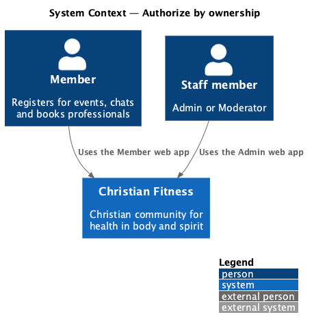
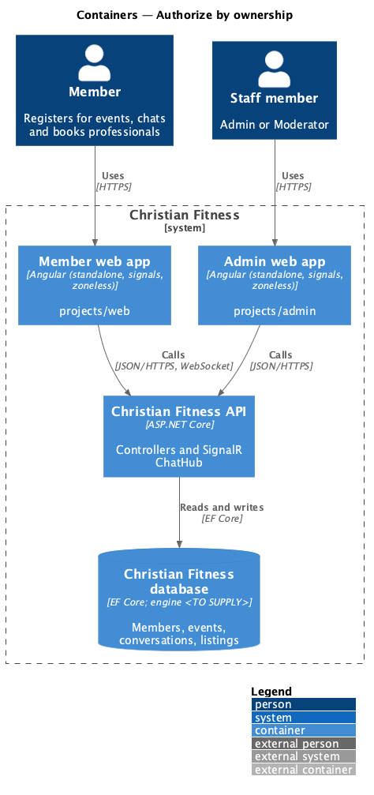
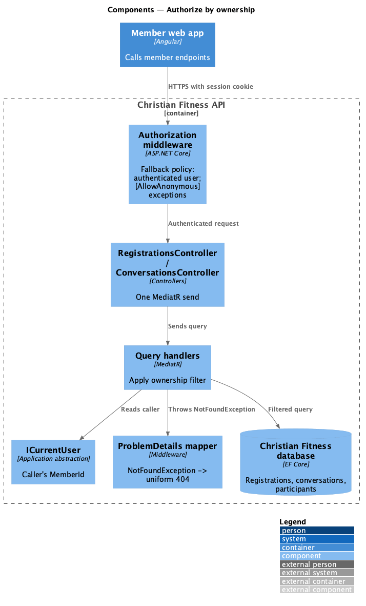
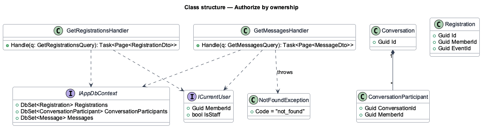
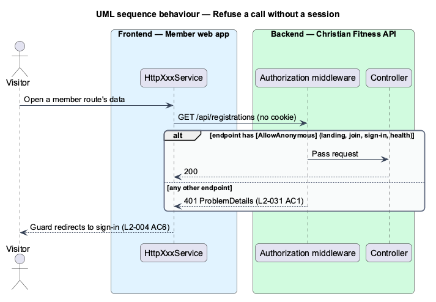
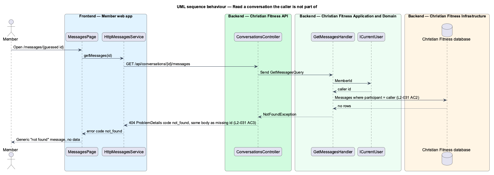

# Authorize by ownership

## Overview

Each Christian Fitness member sees and changes only their own data and the
conversations they belong to. This feature defines how the Christian Fitness API
enforces that rule for every endpoint: unauthenticated callers are refused by a
fallback policy, and each query filters by the caller's identity so another
member's record is indistinguishable from one that does not exist.

- **fallback policy** — ASP.NET Core authorization policy applied to every endpoint that declares no other policy; it requires an authenticated user
- **explicitly anonymous endpoint** — endpoint marked `[AllowAnonymous]`: landing data, join and sign-in
- **opaque id** — identifier with no guessable order, such as a random `Guid`
- **ownership filter** — query predicate that restricts rows to those the caller owns or participates in

The rule spans the members, events, messages and services subsystems; each
handler there applies it, and this design names the shared parts.

## Description

- **Fallback policy** — `AuthorizationOptions.FallbackPolicy = RequireAuthenticatedUser()`, set in `ChristianFitness.Api`. A request without a session returns 401.
- **`[AllowAnonymous]` endpoints** — `LandingController` (landing data, `L2-001`), `AuthController.Join` and `AuthController.SignIn`, the health endpoints (`L2-040`). No other endpoint carries the attribute.
- **`StaffOnly` policy** — admin console endpoints require a staff role; role rules belong to `L2-019`.
- **`ICurrentUser`** — Application-layer abstraction exposing `MemberId` from the session principal; implemented by `HttpCurrentUser` in Infrastructure. Handlers take the caller from it, never from a request body.
- **Ownership filters in handlers** — each query handler filters by `ICurrentUser.MemberId`: `GetRegistrationsQuery` by `Registration.MemberId`, `GetConversationQuery` and `GetMessagesQuery` by `ConversationParticipant`, `GetMyProfileQuery` by `Member.Id`. A row outside the filter is reported as not found.
- **`NotFoundException` → 404** — the ProblemDetails mapper returns one uniform 404 body (code `not_found`) for both missing and not-owned rows, so a guessed id reveals nothing. Chat hub refusals return `not_a_participant` as an answer (`L2-016`).
- **Opaque ids** — entities use `Guid` keys generated with `Guid.CreateVersion7()` or random v4 (`<TO SUPPLY>`); URLs carry no sequential numbers.
- **Public profile projection** — viewing another member returns `PublicMemberDto` only; private fields (email, home church) are never projected.

## Requirements

The feature realizes the following level-2 (L2) requirements. Each L2
requirement refines a level-1 (L1) requirement, cited by identifier. The
specification states these as acceptance criteria rather than one `shall`
sentence, so the criteria are quoted.

| L2 ID | Refines (L1) | Requirement |
|-------|--------------|-------------|
| `L2-031` | `L1-013` | 1. Given any endpoint, when called without a session, then it returns 401 unless it is explicitly anonymous (landing data, join, sign-in). 2. Given a member, when they request another member's private data, registrations or conversations they are not part of, then the API returns 403 or 404 and no data. 3. Given an id in a URL, when it does not belong to the caller, then guessing ids reveals nothing (opaque ids, uniform 404). |

## Diagrams

### System context

Members and staff use Christian Fitness; the system decides what each one may see from their identity.

### Containers

The Christian Fitness API authenticates each request and filters database reads by the caller before returning data to either app.

### Components

The fallback policy refuses anonymous calls before any controller runs; handlers read the caller from `ICurrentUser` and apply ownership filters in their EF Core queries.

### Class structure

Query handlers depend on `ICurrentUser` and `IAppDbContext`; `ConversationParticipant` links a `Member` to a `Conversation` and is the basis of the participant filter.

### Behaviour — refuse a call without a session

The fallback policy returns 401 for any endpoint not marked `[AllowAnonymous]`; landing, join, sign-in and health remain reachable.

### Behaviour — read a conversation the caller is not part of

The handler filters by participant; a conversation the caller is not part of yields the same 404 as a missing one.

