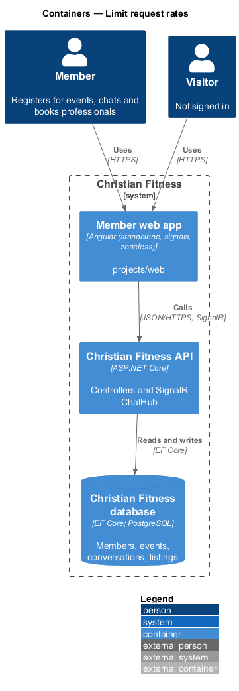
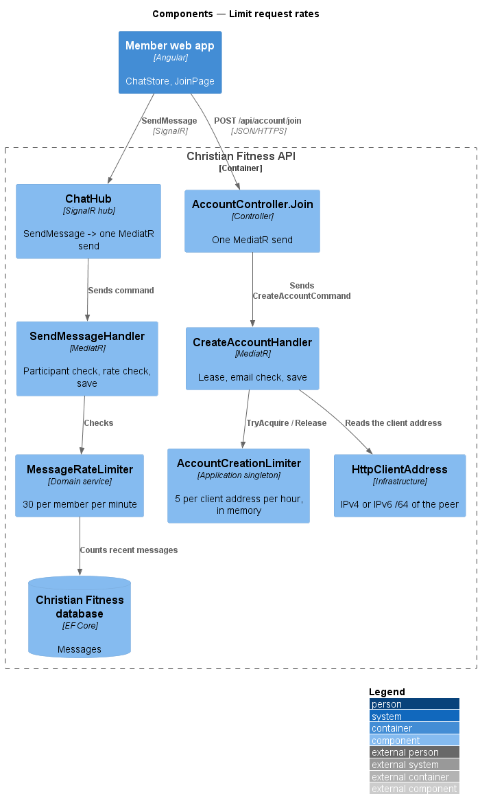
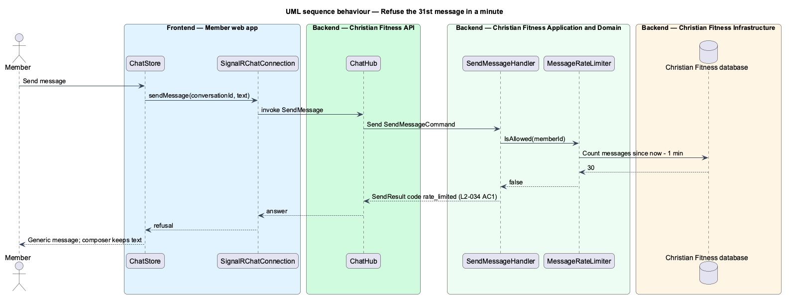
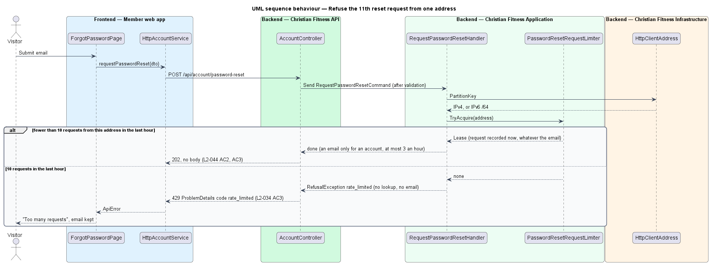

# Limit request rates

## Overview

Rate limits stop one member flooding a conversation, one address mass-creating
accounts and one address sending reset emails to many inboxes. This feature defines the
three limits the specification sets and where each is enforced.

- **message rate window** — rolling one-minute window in which one member may send at most 30 messages
- **account creation window** — one-hour window in which one IP address may create at most 5 accounts
- **reset request window** — one-hour window in which one IP address may ask for at most 10 password reset links, whatever emails it names
- **rate-limited refusal** — refusal of a request that exceeds its window: a hub answer with code `rate_limited` for messages, HTTP 429 with code `rate_limited` for account creation and reset requests
- **client address** — the address an account creation or a reset request is counted against: an IPv4 address, or the /64 network of an IPv6 address, since one IPv6 host is usually given a whole /64

The sign-in lockout (`L2-004` AC3) is a related limit designed with sign-in.

## Description

- **`MessageRateLimiter`** — Application-layer domain service used by `SendMessageHandler`. It counts the member's messages in the last minute from `Message.SentAt` (or an in-memory sliding window, `<TO SUPPLY>` for multi-instance hosting) using `TimeProvider`, and refuses the 31st with code `rate_limited`.
- **`ChatHub.SendMessage`** — sends one `SendMessageCommand`; the refusal reaches the client as a `SendResult { ok: false, code: 'rate_limited' }` answer, never a thrown hub exception.
- **`AccountCreationLimiter`** (slice 3.2, [ADR 0012](../../../adr/0012-sign-in-protections.md)) — Application-layer singleton used by `CreateAccountHandler`. Before the email is checked it calls `TryAcquire(clientAddress)`: under a lock it drops the address's creations older than an hour (read from `TimeProvider`), and with fewer than 5 left it records one now and answers a lease; with 5 it answers none and the handler refuses with code `rate_limited`, HTTP 429 (L2-034 AC2). A join that then fails (a taken email, a lost race, a fault) releases its lease, so only accounts created count; a body that fails validation never reaches the handler. The window slides: the sixth is accepted once the oldest of the five is an hour old. Each call also forgets addresses whose newest creation is older than the hour, so the map holds at most the last hour's creations. It is kept in memory: no address is stored, and an instance restart forgets the counts.
- **`AddressRateLimiter`** (slice 20.2, [ADR 0014](../../../adr/0014-choosing-a-new-password.md)) — the sliding window above, with its limit and window given by each subclass: `AccountCreationLimiter` (5 an hour) and `PasswordResetRequestLimiter` (10 an hour) share it, each a singleton with counts of its own.
- **`PasswordResetRequestLimiter`** (slice 20.2) — used by `RequestPasswordResetHandler`. Before the email is looked up it calls `TryAcquire(clientAddress)`; with 10 requests from the address in the last hour the handler refuses with code `rate_limited`, HTTP 429, sends no email and reads no account (L2-034 AC3). Every request counts, for an account or not, and none is given back, so the answer says nothing about which emails have accounts: only the address's own count decides it. The per-account window of `L2-044` AC6 (3 emails an hour) still applies under it. Link checks are not limited: a 256-bit token cannot be guessed.
- **`IClientAddress`** — Application abstraction; `HttpClientAddress` (Infrastructure) answers `HttpContext.Connection.RemoteIpAddress` as the partition key: an IPv4 address (an IPv4-mapped IPv6 address is read as its IPv4 address), the first 64 bits of an IPv6 address, or `unknown` when there is none. The address is never logged.
- **Behind the reverse proxy** — the API trusts `X-Forwarded-For` only when `ASPNETCORE_FORWARDEDHEADERS_ENABLED` is `true` ([settings](../../../operations/settings.md)); ASP.NET Core then takes the last address the proxy appended, so a client cannot choose its own. Unset, the address is the direct peer's.
- **Member web app** — `ChatStore` keeps the composer text on `rate_limited` and shows the generic message; `JoinPage` shows the `form-alert` "Too many new profiles" for a 429 (mock `join/limited`), keeping what was typed; `ForgotPasswordPage` shows "Too many requests" for a 429 (mock `forgot-password/limited`), keeping the email.

## Requirements

The feature realizes the following level-2 (L2) requirements. Each L2
requirement refines a level-1 (L1) requirement, cited by identifier. The
specification states these as acceptance criteria rather than one `shall`
sentence, so the criteria are quoted.

| L2 ID | Refines (L1) | Requirement |
|-------|--------------|-------------|
| `L2-034` | `L1-013` | 1. Given more than 30 messages from one member in one minute, when the next is sent, then it is refused with code `rate_limited`. 2. Given more than 5 account creations from one IP address in one hour, when the next is attempted, then it is refused with HTTP 429. 3. Given 10 password reset requests from one IP address in one hour, whatever emails they named, when the next is made, then it is refused with HTTP 429 and code `rate_limited`, no email is sent, and the Forgot password screen shows "Too many requests" and keeps the email typed. |

## Diagrams

### System context

Members send messages and visitors create accounts; both actions are rate limited.

### Containers

The Member web app reaches the API over HTTPS and SignalR; the API counts messages from the database and account creations per address.

### Components

`ChatHub` sends a command whose handler consults `MessageRateLimiter`; `CreateAccountHandler` consults `AccountCreationLimiter` and `RequestPasswordResetHandler` consults `PasswordResetRequestLimiter`, each with the client address.

### Class structure

`MessageRateLimiter` reads `TimeProvider` and the message store; `SendResult` carries the refusal code back through the hub. `AddressRateLimiter` reads `TimeProvider` and keeps each address's leases of the last hour; `AccountCreationLimiter` and `PasswordResetRequestLimiter` set its limit.

### Behaviour — refuse the 31st message in a minute

The handler counts the sender's messages in the last minute and answers `rate_limited` once 30 have been sent; the composer keeps its text.

### Behaviour — refuse the 6th account creation from one address

The handler asks the limiter for a lease on the client address before it checks the email; a sixth creation inside the hour is refused 429 `rate_limited`, and a join that fails gives its lease back.

### Behaviour — refuse the 11th reset request from one address

The handler asks the limiter for a lease on the client address before it looks up the email; an eleventh request inside the hour is refused 429 `rate_limited`, with no lookup and no email.

