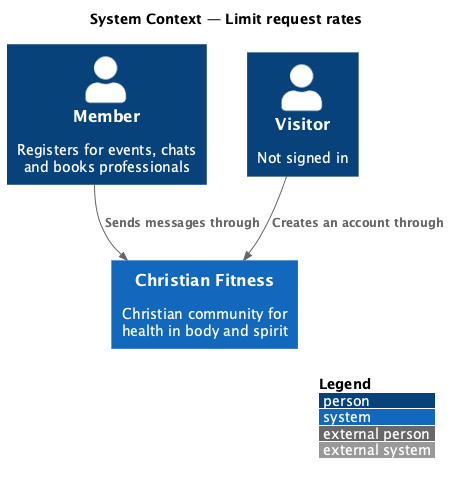
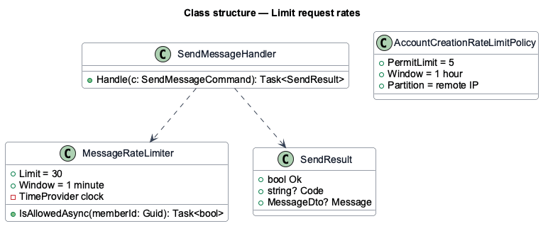
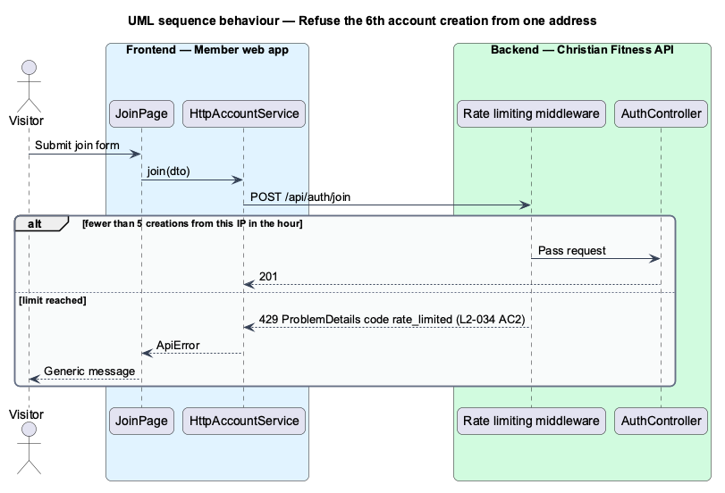

# Limit request rates

## Overview

Rate limits stop one member flooding a conversation and one address mass-creating
accounts. This feature defines the two limits the specification sets and where
each is enforced.

- **message rate window** — rolling one-minute window in which one member may send at most 30 messages
- **account creation window** — one-hour window in which one IP address may create at most 5 accounts
- **rate-limited refusal** — refusal of a request that exceeds its window: a hub answer with code `rate_limited` for messages, HTTP 429 for account creation

The sign-in lockout (`L2-004` AC3) is a related limit designed with sign-in.

## Description

- **`MessageRateLimiter`** — Application-layer domain service used by `SendMessageHandler`. It counts the member's messages in the last minute from `Message.SentAt` (or an in-memory sliding window, `<TO SUPPLY>` for multi-instance hosting) using `TimeProvider`, and refuses the 31st with code `rate_limited`.
- **`ChatHub.SendMessage`** — sends one `SendMessageCommand`; the refusal reaches the client as a `SendResult { ok: false, code: 'rate_limited' }` answer, never a thrown hub exception.
- **Account creation limiter** — ASP.NET Core rate limiting middleware with a fixed-window policy `account-creation` (5 permits per hour, partitioned by remote IP address) on `AuthController.Join`. A refusal returns 429 ProblemDetails with code `rate_limited`. Forwarded-header trust for the client IP depends on hosting: `<TO SUPPLY>`.
- **Member web app** — `ChatStore` keeps the composer text on `rate_limited` and shows the generic message; `JoinPage` shows a generic message on 429.

## Requirements

The feature realizes the following level-2 (L2) requirements. Each L2
requirement refines a level-1 (L1) requirement, cited by identifier. The
specification states these as acceptance criteria rather than one `shall`
sentence, so the criteria are quoted.

| L2 ID | Refines (L1) | Requirement |
|-------|--------------|-------------|
| `L2-034` | `L1-013` | 1. Given more than 30 messages from one member in one minute, when the next is sent, then it is refused with code `rate_limited`. 2. Given more than 5 account creations from one IP address in one hour, when the next is attempted, then it is refused with HTTP 429. |

## Diagrams

### System context

Members send messages and visitors create accounts; both actions are rate limited.

### Containers

The Member web app reaches the API over HTTPS and SignalR; the API counts messages from the database and account creations per address.

### Components

`ChatHub` sends a command whose handler consults `MessageRateLimiter`; the rate limiting middleware guards the join endpoint.

### Class structure

`MessageRateLimiter` reads `TimeProvider` and the message store; `SendResult` carries the refusal code back through the hub.

### Behaviour — refuse the 31st message in a minute

The handler counts the sender's messages in the last minute and answers `rate_limited` once 30 have been sent; the composer keeps its text.

### Behaviour — refuse the 6th account creation from one address

The fixed-window policy partitions by IP address and returns 429 before the controller runs.

