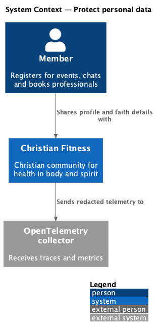
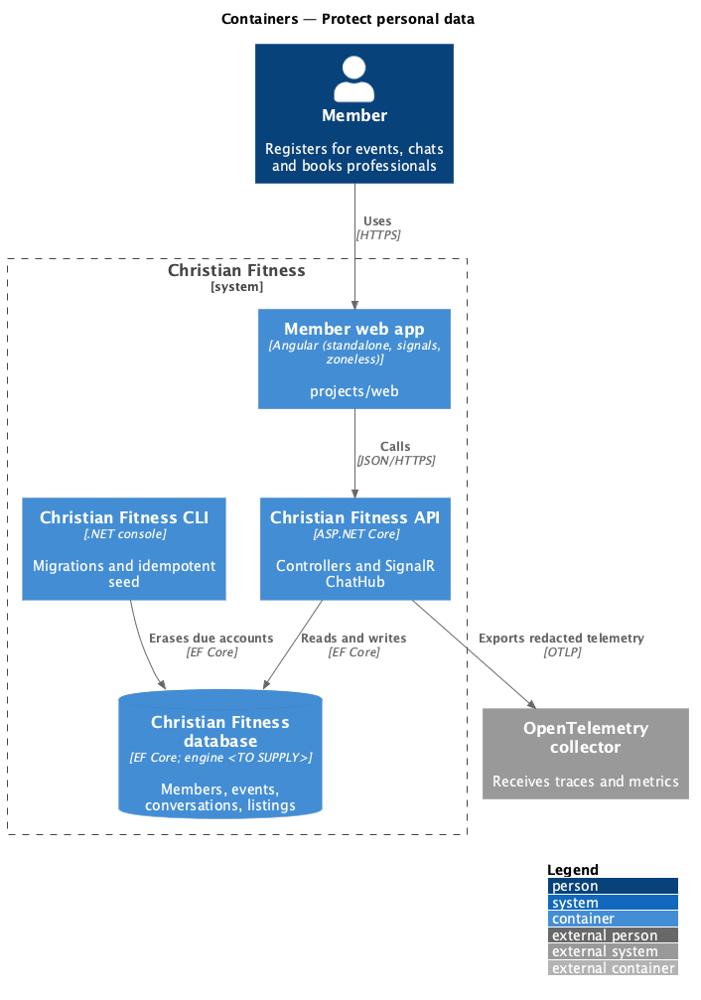
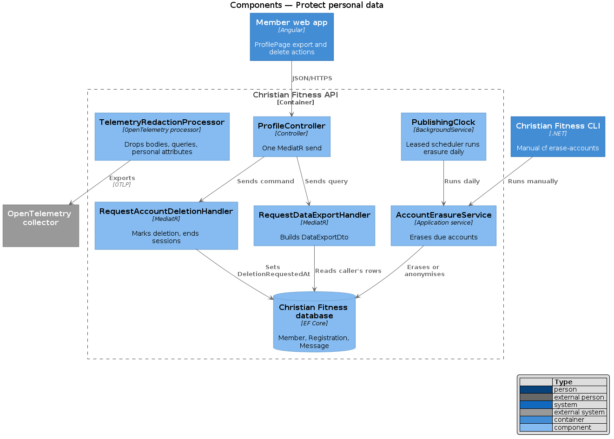
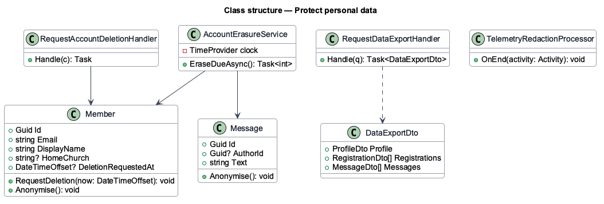
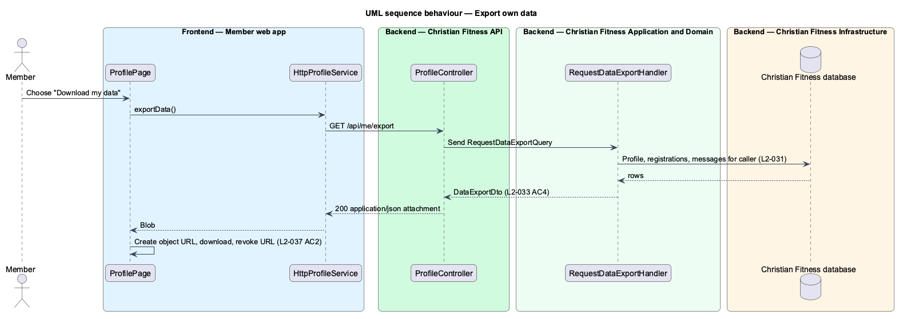
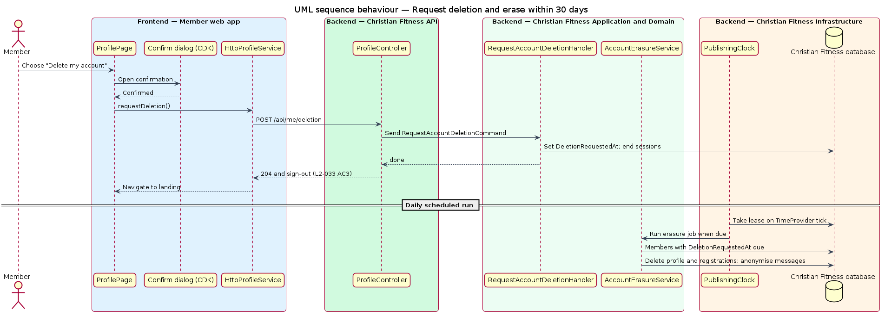

# Protect personal data

## Overview

Christian Fitness stores personal data and, optionally, faith details such as a
home church. This feature defines how that data stays optional, stays out of
telemetry, and can be exported or erased at the member's request. It applies
across the accounts, profile, messages and telemetry parts of the system.

- **faith details** — optional, sensitive personal data a member may share: home church and similar fields
- **data export** — machine-readable copy of a member's profile, registrations and messages
- **erasure request** — member's request to delete their account; the system erases or anonymises their data within 30 days
- **anonymise** — replace identifying fields with a fixed placeholder while keeping the row so conversations stay intact

## Description

- **Optional faith fields** — `Member.HomeChurch` and other faith fields are nullable; `CreateAccountValidator` and `UpdateProfileValidator` impose length limits only, never presence: `HomeChurch` holds at most 120 characters (`L2-003` AC6) and a blank one is stored as null (slice 2.1); the limits of the profile's other faith fields are set by `member-profile/edit-profile`. The `pages/join/` and `dialogs/edit-profile/` mocks mark them optional.
- **Telemetry redaction** — logging uses structured templates with no personal fields; `TelemetryRedactionProcessor` drops request/response bodies, query strings and headers; the HTTP instrumentation records `http.route` (template) rather than the URL. See `operations/emit-telemetry-and-health`.
- **`RequestDataExportCommand` / `RequestDataExportHandler`** — assembles `DataExportDto` (profile, registrations, authored messages) for the caller only and returns it as a JSON download. Delivery format beyond JSON is `<TO SUPPLY>`.
- **`RequestAccountDeletionCommand` / `RequestAccountDeletionHandler`** — records `Member.DeletionRequestedAt`, ends every session of the member and signs them out.
- **`AccountErasureService`** — runs from a CLI command `cf erase-accounts` on a schedule (`<TO SUPPLY: scheduler>`). It deletes profile and registrations and anonymises authored messages (`Message.Text` replaced, author set to a placeholder) for every request older than 0 days and at most 30 days, using `TimeProvider`.
- **Member web app** — `ProfilePage` exposes "Download my data" and "Delete my account"; deletion confirms in a CDK Dialog. No mock shows these controls yet: `<TO SUPPLY: mock state in pages/profile and a confirm dialog>`.

## Requirements

The feature realizes the following level-2 (L2) requirements. Each L2
requirement refines a level-1 (L1) requirement, cited by identifier. The
specification states these as acceptance criteria rather than one `shall`
sentence, so the criteria are quoted.

| L2 ID | Refines (L1) | Requirement |
|-------|--------------|-------------|
| `L2-033` | `L1-013` | 1. Given home church and faith details, when a member joins, then they are optional. 2. Given any log, metric or span, when emitted, then it contains no email, name, home church, message text, token, query string or body. 3. Given a member, when they request deletion of their account, then their profile, registrations and authored messages are erased or anonymised within 30 days and they are signed out. 4. Given a member, when they request their data, then they receive an export of their profile, registrations and messages. |

## Diagrams

### System context

Members share personal and faith details with Christian Fitness; only redacted telemetry leaves the system.

### Containers

The API serves export and deletion requests; the CLI erases accounts whose deletion request is due; telemetry goes to the collector without personal data.

### Components

Profile handlers read only the caller's rows; the erasure service anonymises messages and deletes profile and registrations; the redaction processor filters every span before export.

### Class structure

`Member` carries nullable faith fields and `DeletionRequestedAt`; `AccountErasureService` uses `TimeProvider` to find requests that are due.

### Behaviour — export own data

The handler reads only the caller's profile, registrations and authored messages and returns them as a download.

### Behaviour — request deletion and erase within 30 days

The request ends the member's sessions immediately; the CLI erasure run deletes or anonymises the data before 30 days pass.

